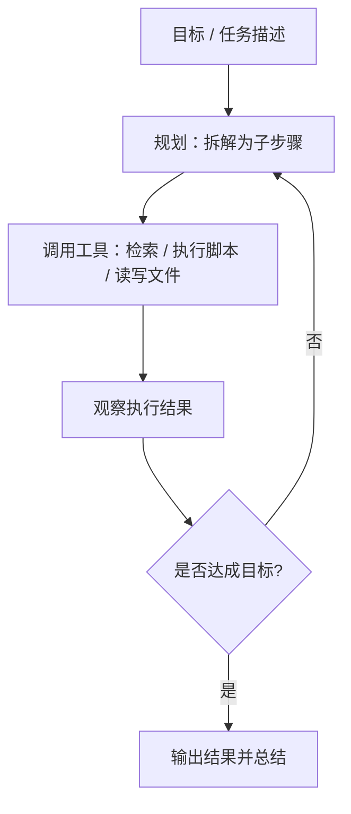

## 三类最常用的工具

1. **编码助手**：在编辑器里根据上下文补全或重写代码，支持解释报错、生成单元测试。适合样板代码、脚本框架、格式转换。
2. **文档问答（RAG）**：把本地笔记、数据手册、论文切块存入向量库，提问时先检索相关片段再作答，能显著减少凭空编造。
3. **Agent**：给定目标后自行规划步骤、调用工具（搜索、执行命令、读写文件），并根据观察结果调整。适合多步骤的工程任务，例如"按这个指标设计滤波器并验证"。

## LLM 的工作方式

大语言模型本质上是在给定上下文的前提下预测下一个 token。这解释了两件事：它对"常见写法"非常熟练（模板代码、标准公式），但对"具体数值"没有可靠记忆（引脚编号、寄存器偏移、器件参数）。理解这一点，就能判断哪些任务可以放心交给它。

## RAG：让模型读你自己的笔记

RAG 的核心是相似度检索。把每段文本编码为向量后，用余弦相似度排序：

$$
\cos(\mathbf{a},\mathbf{b})=\frac{\mathbf{a}\cdot\mathbf{b}}{\lVert\mathbf{a}\rVert\,\lVert\mathbf{b}\rVert}
$$

检索到最相关的若干片段后，把它们拼进提示词再让模型回答。工程要点有三个：切块大小（太碎丢上下文，太大稀释关键信息）、是否需要重排序（rerank）、以及回答中必须给出原文出处。

## Agent 的循环

这个循环的可靠性取决于两件事：工具返回的信息是否准确，以及每一步是否可验证。因此给 Agent 设计工具时，宁可返回结构化、可校验的数据，也不要返回大段自然语言描述。

## 在电子工程中的具体用法

- 把公式转成 MATLAB 或 Python 验证脚本，再自己核对量纲与单位。
- 阅读数据手册时，让它整理寄存器表并生成位域定义，但地址与位宽必须逐项核对。
- 解释综合或仿真工具的报错信息，缩小排查范围。
- 生成测试激励：随机激励、边界值、时序违例场景。

> [!tip] 提问技巧
> 提供约束条件比堆砌需求更有效：目标平台（如 STM32F103 / xc7z020）、工具版本、已有代码片段、期望的接口形式。上下文越具体，生成的代码越少返工。

> [!warning] 三个明确不能省略的验证
> 1. 公式的适用条件（连续/离散、实/复、归一化方式）；
> 2. 硬件相关的地址、引脚、时钟频率；
> 3. 涉及安全与器件的参数，必须查原始手册。

## 相关阅读

- [[ai-agents/index|AI 工具分类总览]]
- [[programming/python-numpy-dsp|Python NumPy 与 DSP]]
- [[maps/learning-path|推荐学习路径]]
