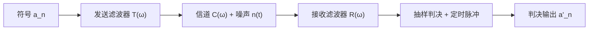

## 为什么基带传输是数字通信的地基

任何数字通信系统都要先把比特映射成波形。当这些波形不经过载波调制、直接在电缆或背板上传输时，就是**数字基带传输**。它要同时对付两个敌人：**码间串扰**（intersymbol interference，ISI）——波形展宽拖尾，使前后码元在本码元的抽样时刻叠加上来；以及**噪声**——抽样值上叠加随机扰动，使判决出错。

理解基带传输的关键是把它拆成一条线性链路：发送滤波器 $T(\omega)$ → 信道 $C(\omega)$ + 加性噪声 → 接收滤波器 $R(\omega)$ → 抽样判决。三者串联的总传输特性

$$
H(\omega)=T(\omega)\,C(\omega)\,R(\omega)
$$

决定了波形形状与 ISI，而噪声决定判决裕量。数字基带的全部设计问题，就是在"带宽、无 ISI、抗噪声"三者之间做权衡。带通调制（[[communication/digital-modulation-qpsk|数字调制]]）只是把这条基带链路乘上载波搬到高频，基带的分析结论可以整体复用。



## 基带信号的波形与频谱

数字基带信号是一串码元波形之和：

$$
s(t)=\sum_{n=-\infty}^{\infty}a_ng(t-nT_B)
$$

其中 $a_n$ 为第 $n$ 个符号，$g(t)$ 为码元波形，$T_B$ 为码元周期，$R_B=1/T_B$ 为码元速率（Baud）。常见波形：

| 波形 | 特点 | 用途/注意 |
| --- | --- | --- |
| 单极性 NRZ | 1 为高电平、0 为零电平 | 有直流，需隔直耦合时易失真 |
| 双极性 NRZ | 1 为 $+E$、0 为 $-E$ | 等概时无直流，抗噪好，最常用 |
| 单极性 RZ | 归零，占空比小于 100% | 含位定时分量，便于提取时钟 |
| 双极性 RZ | 双极性且归零 | 兼顾直流小与定时信息 |
| 差分波形 | 用相邻码元电平是否跳变表示信息 | 可解决接收端相位模糊（DPSK 基础） |
| 多电平波形 | 一个码元携带多个比特 | 提高频带利用率，代价是噪声容限下降 |

二进制的基带信号功率谱由**连续谱**与**离散谱（线谱）**两部分组成：

$$
P_s(f)=f_Bp(1-p)\left|G_1(f)-G_2(f)\right|^2
+f_B^2\sum_{m=-\infty}^{\infty}\left|pG_1(mf_B)+(1-p)G_2(mf_B)\right|^2\delta(f-mf_B)
$$

其中 $f_B=1/T_B$，$G_1$、$G_2$ 为两种码元波形的频谱，$p$ 为出现 $g_1$ 的概率。两条结论决定了码型设计：

- **连续谱**由 $G_1(f)-G_2(f)$ 决定，给出信号占用的带宽；
- **离散谱**是否存在，决定能否从信号中直接提取位定时（时钟）分量。等概双极性 NRZ 因 $G_2=-G_1$、$p=1/2$ 而没有离散谱，因此不能直接提时钟；RZ 波形含 $f_B$ 处的线谱，可以直接提取。

这也解释了为什么"同样传信息，波形形状不同"：带宽由连续谱主瓣决定（矩形 NRZ 的第一零点带宽为 $f_B$），时钟信息由离散谱决定，二者共同构成码型选择的物理依据。

## 传输码型：AMI 与 HDB3

选择传输码型要兼顾六条原则：无直流（或直流很小）、含足够定时信息、对信源统计特性透明（长 0/长 1 不丢时钟）、编码效率高、有内在检错能力、编译码简单。最常考的是 AMI 与 HDB3。

**AMI 码**（传号交替反转码）：0 仍为 0，1 交替编码为 $+1$ 与 $-1$。优点是无直流、可利用极性交替规则检错、编译码简单；致命缺点是**长 0 串会丢失时钟**。

**HDB3 码**（三阶高密度双极性码）在 AMI 基础上限制连 0 个数：每出现 4 个连 0，就用取代节 $000V$ 或 $B00V$ 替换，保证最多 3 个连 0。编码规则：

1. 连 0 个数不超过 3 时按 AMI 编码；
2. 每 4 个连 0 用取代节替换：**V 脉冲的极性与前一非零脉冲相同**（故意破坏交替规则，便于接收端识别），且**相邻两个 V 极性交替**；
3. 若两个 V 之间的非零脉冲（含 B）个数为偶数，用 $B00V$，为奇数则用 $000V$（目的是让两 V 间脉冲数为奇数，接收端才能正确区分 V 与正常脉冲）；
4. 其余 1 码仍按 AMI 交替。

> [!example] HDB3 编码示例
> 信息序列 $1\,0\,0\,0\,0\,1\,0\,0\,0\,0\,1$：
> 第一位 1 按 AMI 编为 $+1$；随后 4 连 0 用 $000V$ 取代，前一非零为 $+1$，故 $V=+1$（与前一脉冲同极性），得到 $0,0,0\,+1$；接着的 1 按 AMI 交替为 $-1$；再一个 4 连 0，前一非零为 $-1$，若用 $000V$ 则 $V=-1$，但检查两 V 间非零脉冲：上一个 V 是 $+1$，中间有 $-1$ 一个（奇数），因此第二个取代节应换成 $B00V$，B 取 $+1$、V 取 $+1$（相邻 V 极性交替，B 与 V 同极性）；最后 1 编为 $-1$。
> 结果：$+1\;0\;0\;0\;+1\;\;-1\;+1\;0\;0\;+1\;\;-1$。逐段核对极性交替与"两 V 间非零脉冲数为奇数"这两条规则，是这类题的唯一检查办法。

## 码间串扰从哪来

接收端在第 $k$ 个码元的抽样时刻得到

$$
r(kT_B)=a_kh(0)+\sum_{n\ne k}a_nh\left[(k-n)T_B\right]+n_R(kT_B)
$$

第二项就是 ISI：其他码元的波形拖尾在本码元抽样时刻的叠加。注意 ISI 是**确定性失真**，不是噪声——只要知道 $h(t)$ 就能算出来，因此可以用设计波形的方法消除，而噪声只能靠提高信噪比或编码对抗。

## 奈奎斯特第一准则：无 ISI 的条件

**时域条件**：总冲激响应在抽样时刻满足

$$
h(kT_B)=\begin{cases}1,&k=0\\0,&k\ne0\end{cases}
$$

即本码元抽样时刻取最大值，其他码元的抽样时刻恰好为零。

由时域条件做傅里叶变换并利用频域周期延拓，得到**奈奎斯特第一准则**：

$$
\sum_iH\left(\omega+\frac{2\pi i}{T_B}\right)=\text{常数},\qquad\left|\omega\right|\le\frac{\pi}{T_B}
$$

**判断口诀**：把 $H(\omega)$ 按间隔 $2\pi/T_B$ 切段、平移到 $(-\pi/T_B,\ \pi/T_B)$ 内叠加，若叠加结果为常数，则无码间串扰。等价说法是：$H(\omega)$ 关于**奈奎斯特频率** $\omega=\pi/T_B$ 呈奇对称滚降。

### 理想低通与 2 Baud/Hz 极限

理想低通的频域条件是矩形：

$$
H(\omega)=\begin{cases}T_B,&\left|\omega\right|\le\pi/T_B\\0,&\text{其他}\end{cases}
$$

此时码元速率 $R_B=1/T_B$ 恰为带宽 $B=1/(2T_B)$ 的两倍，频带利用率为

$$
\eta_{\max}=\frac{R_B}{B}=2\ \text{Baud/Hz}
$$

这是基带系统的**理论极限**。但理想低通的冲激响应是 $\mathrm{Sa}$ 函数，拖尾按 $1/t$ 缓慢衰减，对定时抖动极其敏感，且矩形幅频特性物理不可实现——所以工程上只能逼近。

### 升余弦滚降：可实现的折中

在奈奎斯特频率附近做平滑滚降，得到升余弦频谱，滚降系数 $\alpha\in[0,1]$：

$$
B=(1+\alpha)\frac{1}{2T_B}=(1+\alpha)\frac{R_B}{2},
\qquad
\eta=\frac{R_B}{B}=\frac{2}{1+\alpha}\ \text{Baud/Hz}
$$

- $\alpha=0$：退化为理想低通，$\eta=2$（极限，不可实现）；
- $\alpha=1$：全升余弦，$\eta=1$，带宽 $B=R_B$，拖尾按 $1/t^3$ 衰减，对定时误差不敏感。

滚降的代价是带宽增大、频带利用率下降；收益是拖尾快速收敛、物理可实现、对定时抖动不敏感。这是"理论极限"与"工程可实现"之间最典型的交换。

> [!example] 带宽与利用率计算
> 码元速率 $R_B=2048\ \text{kBaud}$、滚降系数 $\alpha=0.5$，则
> $$
> B=(1+0.5)\times\frac{2048}{2}=1536\ \text{kHz}=1.536\ \text{MHz},\qquad
> \eta=\frac{2}{1.5}\approx1.33\ \text{Baud/Hz}
> $$
> 反过来，给定带宽 $B$ 与滚降系数，最大无 ISI 码元速率为 $R_B=2B/(1+\alpha)$。

## 抗噪声性能：双极性与单极性差多少

设噪声为高斯白噪声经接收滤波器后的窄带噪声，方差 $\sigma_n^2=n_0B$。等概发送、最佳门限判决时：

**双极性**（电平 $\pm d$，门限为 0）：

$$
P_e=\frac{1}{2}\mathrm{erfc}\left(\frac{d}{\sqrt{2}\sigma_n}\right)
$$

**单极性**（电平 $0$ 与 $d$，门限为 $d/2$）：

$$
P_e=\frac{1}{2}\mathrm{erfc}\left(\frac{d}{2\sqrt{2}\sigma_n}\right)
$$

比较两式：在**同一个电平参数 $d$** 下，单极性的判决距离只有双极性的一半，误码率明显更差（约 6 dB）。但要注意比较条件：单极性在电平 $0$ 与 $d$ 时的平均功率只有双极性 $\pm d$ 的一半，若改为**相同平均功率**比较，单极性的电平要放大 $\sqrt{2}$ 倍，差距缩小为约 3 dB。教材中"双极性比单极性好 6 dB"的结论对应同一电平参数（同一峰值）的比较条件，引用时必须写明这一点，否则容易与"等功率"版本混淆。

> [!warning] 条件比结论重要
> 误码率公式永远要连着三个条件读：噪声模型（AWGN、方差 $n_0B$）、判决门限（最佳门限随电平和先验概率变化）、比较基准（同峰值还是同平均功率）。只记结论数值，换一个比较基准就会错。

## 眼图：一眼看穿 ISI 与噪声

**眼图**是示波器以 $T_B$ 为周期重叠扫描接收基带波形形成的图形，把大量码元的波形叠在一起，直观显示 ISI 与噪声容限：

| 眼图特征 | 反映的传输质量 |
| --- | --- |
| 眼睛张开度（垂直张开） | 噪声容限，判决门限上下的裕量 |
| 眼睛张开最大处 | 最佳抽样判决时刻 |
| 边沿斜率 | 对定时误差的敏感程度，越陡越敏感 |
| 上、下两叉的聚拢程度 | ISI 大小，越聚拢 ISI 越小 |
| 中心横线位置 | 最佳判决门限 |

工程上用眼图做快速诊断：张开度小说明噪声大或 ISI 严重；交叉点发散说明定时抖动大；上下不对称说明有直流偏移或判决门限偏置。

## 部分响应：主动"借" ISI 换极限利用率

既然 ISI 是确定性的，就可以**有控制地引入已知的、有规律的 ISI**，换取缓变的滚降特性和 2 Baud/Hz 的频带利用率——这就是部分响应技术。

以第 I 类部分响应为例，用两个相距 $T_B$ 的 $\sin x/x$ 波形相加：

$$
g(t)=\frac{\sin\left(\pi t/T_B\right)}{\pi t/T_B}+\frac{\sin\left[\pi(t-T_B)/T_B\right]}{\pi(t-T_B)/T_B}
$$

拖尾按 $1/t^2$ 衰减（比理想低通的 $1/t$ 快），带宽仍为 $1/(2T_B)$，频带利用率保持 2 Baud/Hz；但抽样值变成

$$
C_k=a_k+a_{k-1}
$$

即相邻码元的和，取值 $\{-2,0,+2\}$，成为**伪三进制**。接收端若直接按 $a_k=C_k-a_{k-1}$ 相关判决，一旦某个 $a_{k-1}$ 判错，会沿着序列一直传播下去——**差错传播**。

解决方法是发送端**预编码**（模 2 相关编码）：

$$
b_k=a_k\oplus b_{k-1}\pmod 2,\qquad C_k=b_k+b_{k-1}
$$

接收端只需对**本码元的抽样值**取模 2 判决，$a_k=C_k\bmod 2$，不需要前一个码元的判决结果，差错传播被彻底切断。这就是"部分响应 = 主动借 ISI + 预编码堵住差错传播"的完整逻辑。

## 时域均衡：补偿实际信道

实际信道的 $C(\omega)$ 不理想，总特性 $H(\omega)$ 偏离奈奎斯特条件，抽样时刻出现剩余 ISI。**时域均衡**在判决前插入横向滤波器（抽头延迟线）：

$$
y(t)=\sum_{n=-N}^{N}C_n\,x(t-nT_B)
$$

通过调整抽头系数 $C_n$ 强迫抽样时刻的 ISI 归零（**迫零均衡**，按峰值失真准则解线性方程组）或使总均方误差最小（**MMSE 准则**）。有限个抽头只能消除有限个 ISI 采样点，剩余部分靠 MMSE 折中。

频域均衡直接校正幅频/相频特性，适合固定信道；时域均衡抽头可随信道自适应更新，适合随参信道与未知信道，是现代接收机的主流做法。FIR 横向滤波器的设计方法见 [[vault-notes/dsp/07-fir-filter-design|FIR 滤波器设计]]。

> [!tip] 一个可验证的小实验
> 用 Python 生成升余弦滚降频谱对应的冲激响应，观察滚降系数从 0 增大到 1 时拖尾衰减变快、而带宽变宽：
>
> ```python
> import numpy as np
>
> def rc_pulse(t, Tb, alpha):
>     if alpha == 0:
>         return np.sinc(t / Tb)
>     sinc = np.sinc(t / Tb)
>     denom = 1 - (2 * alpha * t / Tb) ** 2
>     return sinc * np.cos(np.pi * alpha * t / Tb) / denom
>
> Tb = 1.0
> t = np.linspace(-8, 8, 4001)
> for a in (0.0, 0.5, 1.0):
>     h = rc_pulse(t, Tb, a)
>     print(a, "B/fs =", (1 + a) / 2, "tail@8T =", abs(h[0]))
> ```
>
> 这段代码只做波形计算，不涉及随机噪声；实际眼图还需要加入码元序列与噪声后再叠加观察。

## 易错点与工程注意

- **ISI 不是噪声**：它由 $h(t)$ 决定、可用波形设计消除；噪声只能用功率或编码手段对抗。
- 奈奎斯特第一准则判断的是**总特性** $H(\omega)=TCR$，不是单独某个滤波器。
- 理想低通的 2 Baud/Hz 是极限值，任何 $\alpha>0$ 的滚降都会降低利用率；不要把它当成"总能达到"。
- 离散谱决定能否直接提取位定时，等概双极性 NRZ 没有离散谱，必须用 RZ 或扰码/编码保证定时信息。
- 眼图看到的是"ISI + 噪声"的叠加效果，眼睛张开度好不等于误码率一定低，还要看判决门限位置。
- 部分响应的 2 Baud/Hz 以牺牲 SNR 为代价（三电平判决距离变小），且必须配合预编码。

## 来源与延伸阅读

- [[vault-notes/communication/06-digital-baseband|数字基带传输系统（详细笔记）]]：功率谱公式、AMI/HDB3 编码步骤、奈奎斯特准则推导、部分响应与均衡。
- [[vault-notes/communication/02-deterministic-signals|确知信号]]：门函数与 $\mathrm{Sa}$ 的变换对，是理解基带主瓣带宽的数学基础。
- [[vault-notes/dsp/07-fir-filter-design|FIR 滤波器设计]]：时域均衡与成形滤波器的实现方法。

## 相关阅读

- [[communication/communication-signals-and-channel|通信信号与信道]]：噪声功率 $n_0B$ 与信道模型。
- [[communication/digital-modulation-qpsk|数字调制 QPSK]]：把基带波形搬上载波后的带通传输。
- [[communication/synchronization|同步原理]]：位同步与定时误差对 ISI 的影响。
- [[signal-processing/random-processes|随机信号、估计与检测]]：匹配滤波与噪声统计。
