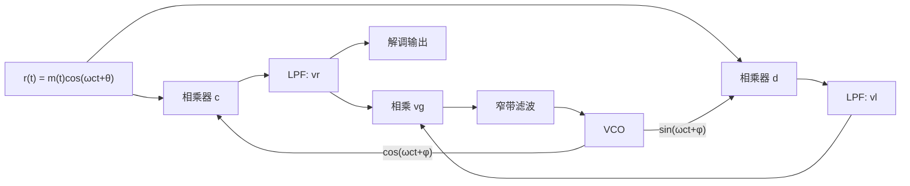

## 为什么同步是"最后一公里"

前面的调制、最佳接收、误码率公式都有一个隐含前提：接收端知道载波的相位、知道每个码元的抽样时刻、知道帧从哪里开始。这些信息并不随数据一起"天然到达"，必须由接收机**自己重新构造**——这就是同步。

同步出错的后果是系统性的，而不是简单多几个误码：

| 同步类型 | 作用 | 失锁后果 |
| --- | --- | --- |
| 载波同步 | 产生同频同相的相干载波 | 相干解调失效，2PSK 整帧倒 π |
| 码元同步（位同步） | 确定每个码元的抽样判决时刻 | 误码率急剧上升 |
| 群同步（帧同步） | 找到帧/群的开头 | 分路错位、整帧解析失败 |
| 网同步 | 全网节点时钟一致 | 缓冲器滑码、数据丢失 |

这四级同步是**逐级依赖**的：群同步以码元同步为前提，码元同步的定时又依赖载波恢复后的信号质量。任何一级失锁，上层逻辑都无法工作。

## 载波同步：从接收信号中恢复相干载波

**载波同步**（carrier synchronization）要在接收端得到与发送载波同频同相（或相差已知且恒定）的本地载波。两条基本路线：

- **插入导频法（外同步）**：发端在频谱的适当位置插入小功率导频，收端用窄带滤波器提取，再倍频/分频得到载波。适合 SSB/VSB 与模拟电视，代价是占用发送功率与频谱资源。
- **直接法（自同步）**：从已调信号自身通过非线性变换提取载波，不需要额外功率。适合 DSB、2PSK 等抑制载波的信号。

### 平方环

2PSK/DSB 信号本身没有载波离散谱，直接滤波取不出 $f_c$。平方运算会产生二倍频分量：

$$
\left[m(t)\cos\omega_ct\right]^2=\frac{m^2(t)}{2}\left[1+\cos2\omega_ct\right]
$$

用窄带滤波器或锁相环取出 $2f_c$，再二分频即得 $f_c$。二分频的初相位不确定，输出可能是 $0$ 或 $\pi$——这就是**相位模糊**的根源，也正是第 7 章 2PSK"倒 π"的出处。工程上用差分编码（2DPSK）规避：信息由相邻码元的相位差承载，本地载波整体翻转不影响相位差。

### 科斯塔斯环（同相正交环）

**科斯塔斯环**（Costas loop）不用平方器，直接在 $f_c$ 上工作：压控振荡器（VCO）输出同相与正交（$90^\circ$ 移相）两路本地载波，分别与接收信号相乘并低通：

$$
v_r=\frac{1}{2}m(t)\cos(\varphi-\theta),\qquad
v_l=\frac{1}{2}m(t)\sin(\varphi-\theta)
$$

其中 $\theta$ 为发送载波初相，$\varphi$ 为本地 VCO 相位。两路再相乘得到误差电压：

$$
v_g=v_rv_l=\frac{1}{8}m^2(t)\sin2(\varphi-\theta)\approx\frac{1}{4}m^2(t)(\varphi-\theta)\quad(\text{小相差})
$$

误差电压驱动 VCO，使 $\varphi\to\theta$（或差 $\pi$），环路锁定；锁定后 $v_r\to\frac{1}{2}m(t)$ 就是解调输出。也就是说**载波提取与解调同步完成**。

平方环与科斯塔斯环的理论性能相同：科斯塔斯环省去平方器、避免高频电路，但需要更多支路，实现更复杂；两者都存在 $0/\pi$ 相位模糊，2PSK 仍要配合差分编码。

载波同步的四个性能指标互相制约：**效率**（插入导频会损失功率，直接法效率高）、**精度**（锁定后的稳态相差）、**建立时间**（开机到锁定）、**保持时间**（信号中断后本地载波仍可用的时长）。环路带宽越大建立越快，但稳态相差与噪声抖动越大。

## 位同步：让抽样落在眼睛最张开处

**码元同步**（位同步）要产生与接收码元同步的定时脉冲，使抽样判决发生在码元的最佳时刻。方法分两类：

- **外同步法**：发端插入位定时导频（频域零点处插小载波，或时域穿插定时码），收端窄带滤波提取后移相 $1/4$ 周期，把判决点移到码元中心。
- **自同步法**：从信号自身提取。若基带信号含定时离散谱（如 RZ 波形），可直接窄带滤波或锁相提取；等概双极性 NRZ 没有离散谱（见 [[communication/digital-baseband-transmission|数字基带传输]]），必须先做微分整流、平方等非线性变换，把 $f_B$ 分量"造"出来，再用锁相环（PLL）跟踪。

数字锁相环位同步的做法是：本地晶振分频产生定时脉冲，与接收码元的前沿比较，超前则扣除一个脉冲、滞后则附加一个脉冲，调整精度为一个分频周期 $T_B/m$，相位逐步对齐。

### 定时误差怎样折损误码率

抽样时刻偏离最佳点 $\Delta t$ 时，信号样值按约 $\left(1-2\Delta t/T_B\right)$ 的比例减小，等效于损失了一部分信号能量：

$$
P_e(\Delta t)\approx\frac{1}{2}\mathrm{erfc}\left(\sqrt{\frac{E}{n_0}\left(1-\frac{2\Delta t}{T_B}\right)}\right)
$$

所以**定时抖动直接吃掉有效 $E_b/N_0$**，这与眼图边沿斜率反映的定时敏感度是同一件事。接收机里定时恢复的重要性不亚于自动增益控制（AGC）。

## 帧同步：在连续码元流中找到"帧头"

**群同步**（帧同步）是在码元流中识别帧的起始位置，之后才能正确分路、分字节、解分组头。两种插入方式：

- **集中插入法**：在帧头集中插入一个特殊同步码组，接收端用识别器逐位比对。PCM 30/32 路系统把帧同步码 $0011011$ 放在 TS0。
- **分散插入法**：把同步码分散到每帧的固定位置（如每帧 1 位、按 1/0 交替），T1 系统每 193 bit 插 1 位帧码。

集中插入法依赖具有尖锐自相关的同步码组，最典型的是**巴克码**（Barker code）：长度 $n$ 的巴克码局部自相关满足

$$
R(j)=\begin{cases}n,&j=0\\0\ \text{或}\ \pm1,&j\ne0\end{cases}
$$

即完全对齐时出现尖锐峰值，错开一位就几乎归零。已知长度为 $n=2,3,4,5,7,11,13$（已证明 $n>13$ 不存在）。7 位巴克码的一种形式为 $1110010$，识别器由移存器、相加器和判决器组成：码字全部对齐时相加输出峰值 7，超过门限即判定"帧头找到"。

### 漏同步与假同步：容错门限的两难

设同步码长 $n$，识别器允许 $m$ 位错误（即门限适当降低），码元误码率为 $p$，则：

$$
P_1=1-\sum_{i=0}^{m}C_n^ip^i(1-p)^{n-i}
$$

$$
P_2=\frac{\sum_{i=0}^{m}C_n^i}{2^n}
$$

$P_1$ 是**漏同步概率**（真同步码因误码未被识别），$P_2$ 是**假同步概率**（随机数据碰巧长得像同步码）。$m$ 增大可以降低漏同步，但假同步会上升——这是容错与误判之间的折中。平均建立时间近似为 $N_T(1+P_1+P_2)$ 帧（误码小时约一两帧）。

> [!example] 7 位巴克码的漏/假同步估算
> 取 $n=7$、$p=10^{-3}$、$m=0$：
> $$
> P_1=1-(1-p)^7\approx7\times10^{-3},\qquad P_2=\frac{1}{2^7}\approx7.8\times10^{-3}
> $$
> 两者同一量级。若把门限放宽到 $m=1$，$P_1$ 大约降到 $2\times10^{-5}$ 量级，但 $P_2$ 升到 $8/128\approx6\%$——必须用"连续多帧确认"等策略压制假同步。

其他帧同步方式包括：起止式同步（每个字符加起始/停止位，即异步串口 UART 的原理，效率低）、自群同步（码组本身具有自识别结构，如某些自同步卷积码），以及扩频系统的 PN 码捕获与跟踪（滑动相关/匹配滤波捕获、延迟锁相环跟踪），后者是卫星导航与 CDMA 的核心。

## 网同步：让全网时钟一致

单条链路同步后，多节点组网还要解决各节点时钟不一致的问题：时钟偏差会让交换/中继节点的缓冲器**滑码**（重读或漏读一个比特/字节）。三种方案：

- **主从同步（开环）**：全网锁定一个主时钟，按等级分配（等级主从），PDH/SDH 传输网采用；
- **互同步（闭环）**：各节点时钟相互比较、调节到加权平均值，无主站，适合特殊网状网；
- **准同步（异步）**：各节点使用高稳定度时钟（如铯原子钟），靠缓冲器吸收缓慢漂移，用于国际互连与跨网。

5G 时代的网同步要求更高：前传（eCPRI）对时钟同步有严格指标，基站还需 GPS/北斗等外部授时辅助，这正是本章"网同步"在现代系统中的延伸。

## 易错点与工程注意

- 平方环和科斯塔斯环都存在相位模糊，不能仅靠环路本身消除；必须用差分编码或导频符号解决。
- 载波同步的"建立时间"与"精度"是矛盾的指标，环路带宽不能一味增大。
- 等概双极性 NRZ 没有定时离散谱，直接滤波提取位同步会失败，必须先做非线性变换。
- 巴克码的自相关峰值是 $n$（不是 1），识别门限要按峰值设定；不同教材的 7 位巴克码极性约定可能不同。
- 漏同步与假同步共用同一个容错门限 $m$，调参必须同时评估两个概率。
- 帧同步码插入位置要与帧结构（如 E1 的 TS0）匹配，改动帧结构必须重新设计同步码。

## 来源与延伸阅读

- [[vault-notes/communication/13-synchronization|同步原理（详细笔记）]]：平方环/科斯塔斯环推导、位同步环路、巴克码识别器、漏/假同步公式与网同步。
- [[vault-notes/communication/10-source-coding|信源编码]]：E1 帧结构与 TS0 同步码 $0011011$。
- [[vault-notes/communication/12-orthogonal-codes-pn-sequences|正交编码与伪随机序列]]：PN 序列双值自相关是扩频同步的基础。

## 相关阅读

- [[communication/digital-modulation-qpsk|数字调制]]：倒 π 现象与 2DPSK 差分编码。
- [[communication/digital-baseband-transmission|数字基带传输]]：眼图、定时灵敏度与码元同步。
- [[communication/source-and-channel-coding|信源与信道编码]]：帧结构、同步码与 PN 序列。
- [[communication/mobile-networks|5G 与 6G]]：小区搜索、定时提前与 5G 网络同步。
- [[mathematics/probability-overview|概率论概览]]：二项分布是漏同步/假同步公式的来源。
