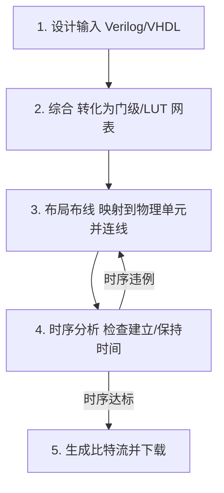

## 为什么先建立"器件与流程"的直觉

写 RTL 时如果不知道代码最终落到哪种资源上，就很难解释三件事：为什么一段 `always` 会变成多个触发器；为什么同样的逻辑换一块 FPGA 后频率不同；为什么"综合通过"不等于"时序达标"。这一篇先回答"设计最终运行在什么结构上、经过哪些步骤"，为后续的 [[digital-systems/timing-analysis-and-constraints|时序分析]] 与 [[digital-systems/vivado-design-flow|Vivado 流程]] 打地基。

本文的数值与公式来自课程笔记，时序图是 WaveDrom 重绘的**理论示意图**，不是 RTL 仿真波形；器件参数（如 VCO 范围、Bank 数量）以具体器件手册为准。

## 从 PLD 到 FPGA：两种实现机理

可编程逻辑器件（Programmable Logic Device，PLD）指制造完成后仍可由用户编程改变逻辑功能的芯片。按集成度分三档：

| 类别 | 全称 | 集成度（逻辑门数） | 典型结构 |
| --- | --- | --- | --- |
| SPLD | 简单可编程逻辑器件 | 数百门 | 与-或阵列（乘积项结构） |
| CPLD | 复杂可编程逻辑器件 | 数千 ~ 数万门 | 多个 SPLD 模块 + 全局互连 |
| FPGA | 现场可编程门阵列 | 数十万 ~ 数十亿门 | 查找表 + 触发器 + 分布式布线 |

SPLD 内部又分 PROM、PLA、PAL、GAL：区别在于"与阵列/或阵列哪个可编程、输出结构是否可编程、用什么工艺编程"。它们共同的思想是**用乘积项之和（sum of products）实现组合逻辑**，CPLD 沿用这一路线，因此适合逻辑级数少、时序可预测的小规模粘合逻辑；FPGA 则用查找表（Look-Up Table，LUT）实现组合逻辑：

- 一个 $k$ 输入 LUT 就是一张 $2^k \times 1$ 的 SRAM 真值表：输入是地址，输出是表项。写入不同的表项，同一个 LUT 就能实现任意 $k$ 变量组合函数；
- LUT 后面接触发器（FF），就构成 FPGA 的基本单元 Slice/CLB；
- 除了 LUT 与 FF，现代 FPGA 还有块 RAM（BRAM）、硬件乘加单元（DSP48）、进位链（CARRY4）和时钟管理单元。

这解释了综合报告里常见的四类资源：**LUT** 反映组合逻辑规模，**FF** 反映寄存器数量，**BRAM** 反映片上存储，**DSP** 反映乘法/乘加强度。同一段算法，用 LUT 堆乘法会占用大量资源且频率低，映射到 DSP48 则又快又省——这就是 [[signal-processing/dft-and-fft|FFT]]、FIR 等运算密集型模块要关注 DSP 使用率的原因。

## I/O Bank 与时钟资源分布

7 系列 FPGA 的 I/O 按 Bank 分组，不同 Bank 类型支持的电压与速率不同：

| Bank 类型 | 定位 | 典型用途 |
| --- | --- | --- |
| HP（High Performance） | 高性能 | 高速接口、DDR、低压差分信号 |
| HR（High Range） | 宽电压范围 | 通用 I/O，兼容 3.3 V / 2.5 V / 1.8 V |
| HD（High Density） | 高密度 | 大量普通 I/O，多见于 UltraScale 系列 |

两个容易记错的点：**7 系列只有 HP 与 HR Bank**，HD 属于 UltraScale 系列；一个具体型号不会同时具备 HP/HR/HD 三种 Bank，要以器件手册的 Bank 表为准。

以 FGG484 封装（如 XC7A15T、XC7A35T）为例：I/O 按列排在芯片左右两侧（左侧 Bank 14/15/16，右侧 Bank 34/35，均为 HR）；**CMT 成列放在 I/O 列内侧**（左侧 PLL00/01/02 与 MMCM00/01/02，右侧 PLL10/11 与 MMCM10/11）；全局时钟缓冲 BUFG 集中在芯片水平中轴附近；高速收发器 GTP Quad 位于顶部。这种"CMT 靠边、BUFG 居中、I/O 在外"的布局不是随意的：全局时钟从中心向四周辐射能把**时钟偏斜（skew）**压到最小，I/O 在外层则是为了缩短引脚到焊盘的走线。

由此得到两条工程结论：

1. 时钟源必须走专用时钟引脚与时钟网络（IBUFG → BUFG/MMCM），**不要从普通 I/O 或逻辑布线取时钟**，否则偏斜大、边沿差、约束难写；
2. 引脚分配要结合 Bank 电压与时钟能力，不能只看原理图上的编号。

## CMT：一个 MMCM 加一个 PLL

**CMT（Clock Management Tile，时钟管理单元）由一个 MMCM 加一个 PLL 组成。** 内部骨架相同：

- **D 分频器**：先把输入频率降下来，使鉴频鉴相器（PFD）工作在合适频率；
- **PFD**：比较参考时钟与反馈时钟的相位差；
- **CP（电荷泵）+ LF（环路滤波器）**：把相位误差转换成控制电压并滤除高频抖动；
- **VCO（压控振荡器）**：产生高频振荡，是整个 CMT 的"心跳"；
- **O0…On 输出分频器**：把 VCO 频率分频成各路输出时钟；
- **M 反馈分频器**：决定反馈路径分频比，从而决定 VCO 频率；
- **Lock Detect**：环路锁定后拉高 `locked`。

MMCM 与 PLL 的差别：

| 特性 | MMCM | PLL |
| --- | --- | --- |
| VCO 相位抽头 | 8 个相位抽头 + 1 个可变相位抽头 | 8 个相位抽头 |
| 分数分频 | 支持（O0…O6、M） | 不支持，仅整数分频 |
| 输出 | CLKOUT0–6，其中 CLKOUT0B–3B 为反相输出，另有 CLKFBOUT/B | CLKOUT0–5，另有 CLKFBOUT |
| 相位精度 | 粗调 $45^\circ$，可变抽头可更细 | 粗调 $45^\circ$ |
| 资源 | 更大 | 更小 |

选型口诀：需要**分数分频**（如 50 MHz 想得到非整数比的时钟）或**精细相位移动**（如 DDR 采样点微调）用 MMCM；只要整数倍频/分频且资源紧张用 PLL。Clocking Wizard 会自动判断，但设计者要知道它在用哪一种。

### 频率与相位关系

$$
f_{VCO}=f_{CLKIN}\times\frac{M}{D},\qquad f_{CLKOUTk}=\frac{f_{VCO}}{O_k},\qquad f_{CLKFBOUT}=\frac{f_{VCO}}{M}
$$

**例**：$f_{CLKIN}=100$ MHz，$D=1$，$M=10$，则 $f_{VCO}=1$ GHz；取 $O_0=20$，得到 $f_{CLKOUT0}=50$ MHz。注意不能把 $f_{CLKIN}\times M$ 直接当输出频率，**必须先除 $O_k$**；同时 $M/D$ 的取值要让 $f_{VCO}$ 落在器件允许范围（7 系列典型为几百 MHz 到 1 GHz 量级，随速度等级变化，以 UG472 为准），否则工具报错或环路失锁。

VCO 的 8 个相位抽头把 VCO 周期均分，因此相邻抽头相差：

$$
\Delta\varphi=\frac{360^\circ}{8}=45^\circ,\qquad \Delta t=\frac{T_{OUT}}{8}
$$

50 MHz 输出（$T=20$ ns）时一个抽头为 2.5 ns，$90^\circ$ 等于 2 个抽头即 5 ns；$180^\circ$ 更简单，直接用反相输出 CLKOUT0B。需要非 $45^\circ$ 整数倍的相位（如 22.5°，或 DDR 采样点微调）只能靠 MMCM 的可变相位抽头。


### locked 与复位释放

`locked` 是"时钟已稳定"的硬件握手信号。MMCM/PLL 配置后需要微秒量级时间锁定，这期间输出时钟不稳定；若系统复位在锁定前就释放，触发器可能在时钟抖动期被采样，出现上电偶发跑飞——这类问题在仿真里往往看不出来，因为仿真时钟是理想的。

典型做法是把 `locked` 与外部复位相与，再用"异步复位、同步释放"同步到输出时钟域（详见 [[digital-systems/verilog-sequential-logic|Verilog 时序逻辑]] 的复位一节）：

```verilog
// 等待 locked 后再释放内部复位（示意；MMCM 由 Clocking Wizard 生成）
clk_wiz_0 u_clk_wiz (
    .clk_out1 (clk_out),
    .locked   (locked),
    .clk_in1  (clk_in)
);

reg [1:0] rst_sync;
always @(posedge clk_out or negedge locked)
    if (!locked) rst_sync <= 2'b00;
    else         rst_sync <= {rst_sync[0], 1'b1};

wire rst_n_sys = rst_sync[1];
```

## EDA 流程总览

EDA（Electronic Design Automation）是把"设计输入 → 综合 → 布局布线 → 下载验证"串起来的工具链。它的发展大致分三个阶段：CAD（替代手工绘图，做版图编辑与设计规则检查）、CAE（引入仿真验证，回答"设计对不对"）、EDA（HDL 与自动综合，回答"怎么自动设计"）。现代设计的主流思路是**以自顶向下（top-down）为主、自底向上（bottom-up）为辅**：先定义顶层架构与行为，再逐层分解；关键 IP（如 PLL、SRAM）可以先用底层优化好的模块再集成。



各阶段解决的问题不同：**综合**把行为级代码变成结构级网表，只做到"逻辑上等价"；**布局布线**才把网表映射到真实 LUT/FF 并连上金属线，延迟从此变成可评估对象；**时序分析**用静态穷举检查所有路径（不需要测试向量），回答"在目标频率下能否稳定工作"；最后**下载配置**才让硬件真正运行。IP 核复用是 EDA 的重要组成，按交付形态分为软核（HDL 源码，灵活但需完整后端）、固核（门级网表，折中）、硬核（物理版图，性能最优但绑定工艺）。

### 三种"验证"不要混

| 类型 | 输入 | 回答的问题 | 局限 |
| --- | --- | --- | --- |
| 功能仿真（前仿真） | RTL 代码 | 逻辑功能对不对 | 不含门延迟与线延迟 |
| 时序仿真（后仿真） | 布局布线后网表 + SDF 延迟 | 真实延迟下会不会采错 | 极慢，覆盖率取决于测试向量 |
| 静态时序分析（STA） | 网表 + 时序约束 | 所有路径在最坏/最好情况下是否满足建立/保持 | 需要正确约束；对异步行为覆盖有限 |

三者的关系是互补而不是替代：功能仿真快、便于调试；后仿真最接近真实但慢；STA 覆盖全部路径且不需要向量，是签核（sign-off）的主要手段。**"仿真通过"不能证明时序达标，"综合成功"也不能。**

## 三层抽象与 ASIC/FPGA 的差异

课程笔记把数字设计分成三层：行为级（Behavioral，HDL 描述功能）、结构级（Structural，门与连线）、物理级（Physical，晶体管与版图）。同一个反相器在三种层次上的"落地形态"分别是 `assign B = ~A;`、门级网表（或 SPICE 子电路）和版图。层越往下，时序信息越真实、仿真越慢。

以 SPICE 反相器为例，传播延迟定义为输出与输入各自 50% 电平点之间的时间差：

$$
t_{pHL}=\frac{t_{PHL1}+t_{PHL2}}{2}\ (\text{按 50\% 点}),\qquad t_p=\frac{t_{pHL}+t_{pLH}}{2}
$$

一阶估算（把 MOS 当恒流源给负载电容 $C_L$ 充放电）：

$$
t_{pHL}\approx\frac{C_L V_{DD}}{2I_{DSN}},\qquad t_{pLH}\approx\frac{C_L V_{DD}}{2I_{DSP}}
$$

要让两者接近，需 $I_{DSP}\approx I_{DSN}$，这正是典型工艺里 PMOS 宽度取 NMOS 两倍左右的原因（空穴迁移率约为电子的 $1/2$）。由此还能得到两条工程直觉：**负载电容越大延迟越大**（扇出影响时序）；**电源电压越高延迟越小**。组合逻辑延迟是后续时序分析中 $T_{logic}$ 的来源。


ASIC 与 FPGA 的关键差异：

| 阶段 | ASIC | FPGA |
| --- | --- | --- |
| 电路落地 | 生成掩膜版图，定制晶体管 | 生成 bitstream，配置 LUT/FF 与布线开关 |
| 综合 | DesignCompiler 等 → 门级网表 | Vivado Synthesis → LUT/FF 网表 |
| 布局布线 | Floorplan → Placement → Routing | Implementation（布局布线） |
| 时序检查 | PrimeTime 等 STA | Vivado Timing Report |
| 单次迭代 | 数周至数月，费用高 | 数分钟至数小时，费用低 |
| 时序由什么决定 | 版图与寄生参数，流片后不可改 | LUT 级数 + 布线延迟 + 时钟偏斜，可重新实现 |

因此 ASIC 更强调单元尺寸、负载与版图；FPGA 更强调 RTL 结构（流水线、寄存器配平、资源映射）与约束。这也解释了为什么 FPGA 设计里"改代码切流水线"往往比"调综合选项"有效。

## 易错点

| 易错点 | 说明 | 正确做法 |
| --- | --- | --- |
| 把 LUT 当成"门电路" | LUT 是 SRAM 真值表，资源看 LUT/FF 数量 | 资源报告看 LUT、FF、BRAM、DSP 四类 |
| 从普通 I/O 取时钟 | 偏斜大、边缘差、约束难 | 专用时钟引脚 → BUFG/MMCM |
| 忘记 VCO 频率范围 | 工具报错或失锁 | 用 $M/D$ 与 $O_k$ 反推并核对手册 |
| 用输出频率直接当 VCO 频率 | 频率算错 20 倍 | 先算 $f_{VCO}$ 再除 $O_k$ |
| 复位不等 `locked` | 上电偶发跑飞 | `locked` 参与复位释放 |
| 把"综合成功"当"设计完成" | 布局布线与时序可能不达标 | 看实现后 WNS/TNS 与 DRC |
| 混淆仿真类型 | 用 RTL 仿真证明时序 | 功能仿真、STA、后仿真分工明确 |

## 前置与相关

- 前置：[[digital-systems/verilog-basics|数字设计与 Verilog 基础]] 中的组合/时序逻辑与 LUT 映射直觉。
- 下一步：[[digital-systems/vivado-design-flow|Vivado 设计流程]] 把本篇的流程落到具体菜单与报告；[[digital-systems/timing-analysis-and-constraints|静态时序分析与约束]] 解释 $T_{logic}$、时钟偏斜与建立/保持方程。
- 时序逻辑与复位：[[digital-systems/verilog-sequential-logic|Verilog 时序逻辑]]。
- 系统实例：[[digital-systems/fpga-interfaces-and-ad9361|外设与射频接口]] 中的 PLL/FIFO/AD9361 时钟链。
- 跨学科：[[signal-processing/dft-and-fft|DFT 与 FFT]]（DSP48 与流水线）、[[communication/digital-modulation-qpsk|数字调制 QPSK]]（基带带宽与采样率约束）。

## 来源与延伸阅读

- [[vault-notes/fpga/basics/01-eda-technology-overview|EDA 技术概述]]：EDA 三阶段、设计思路、IP 核、功能仿真与时序仿真。
- [[vault-notes/fpga/basics/02-fpga-cpld-overview|FPGA 与 CPLD 元件概述]]：PLD 分类、SPLD 子类、乘积项与查找表。
- [[vault-notes/fpga/sta/01-design-implementation-flow|数字系统设计与实现流程]]：三层抽象、两个仿真检查点、SPICE 反相器与时序定义。
- [[vault-notes/fpga/sta/02-device-structure-clock-resources|FPGA 器件结构与时钟资源]]：I/O Bank、FGG484 分布、CMT、MMCM/PLL 与 locked。
- [[vault-notes/fpga/00-guide|FPGA 知识库导读]]：本学科的学习路线与跨库接口。
