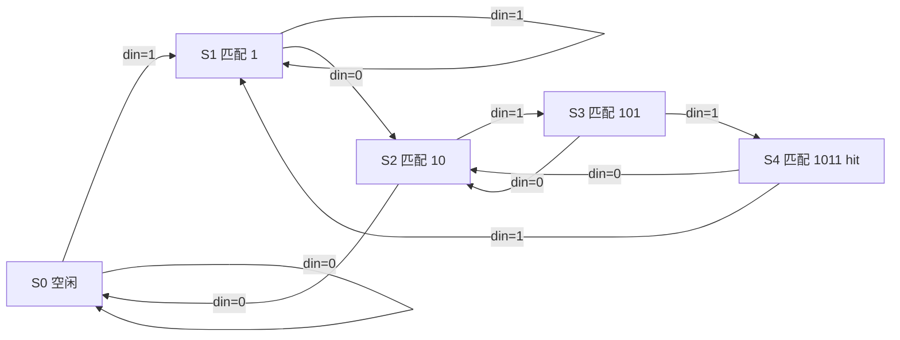

## 为什么需要状态机

接口电路几乎都带有"记住走到了第几步"的需求：UART 接收要先等起始位、再逐位采样、最后检查停止位；按键消抖要区分"松开、按下抖动、稳定按下、松开抖动"；序列检测器要记住已经匹配了多长的前缀。把这些步骤写成**状态 + 转移条件**，是数字设计中最稳定、最易验证的组织方式。

有限状态机（Finite State Machine，FSM）由三部分组成：有限个状态、状态之间的转移条件、以及由状态（和输入）决定的输出。写 FSM 的关键不是语法，而是先把**状态转移图**画对，再把它机械地翻译成 RTL。

## Moore 与 Mealy：输出时序差一个"沿"或"输入"

| 类型 | 输出取决于 | 响应速度 | 波形特点 |
| --- | --- | --- | --- |
| Moore | 当前状态 | 状态更新后一个时钟周期才反映到输出 | 输出干净，与时钟对齐 |
| Mealy | 当前状态 + 当前输入 | 输入一变，输出可能立刻变（不等时钟） | 响应快一个周期，但输入毛刺会直接传到输出 |

工程上多数场景选 Moore，或选"寄存器输出型 Mealy"：逻辑上按 Mealy 计算，但把输出再用触发器打一拍，牺牲一个周期换取干净波形。原因是**组合输出会把输入上的毛刺放大成输出尖峰**，如果这个输出直接驱动外部引脚或作为其他模块的时钟/使能，很容易出问题。

一个直观对比：序列检测器命中时，Moore 在"进入命中状态的那个时钟沿之后"才拉高输出；Mealy 则在最后一个比特到达的同一拍就拉高。两者都正确，区别只在时序预算和毛刺风险。

## 状态图与状态编码

状态图用圆圈表示状态、箭头表示转移、箭头旁标注条件；RTL 里的 `case` 就是这张图的逐条翻译。编码方式影响资源与时序：

- **二进制编码（binary）**：$n$ 个状态只需 $\lceil\log_2 n\rceil$ 位，省触发器，但次态译码逻辑复杂；
- **格雷编码（Gray）**：相邻状态只有一位变化，降低翻转功耗与毛刺，适合线性流程（如 FIFO 指针）；
- **独热编码（one-hot）**：每个状态一个触发器，次态逻辑最简单，FPGA 触发器资源充足时往往是综合工具的首选。

编码不改变状态机的逻辑，但会改变**关键路径长度**与**毛刺概率**，在高速设计里值得显式指定。无论选哪种，都要给 `default` 分支，把非法编码导向安全状态，避免状态跑飞后死锁。

## 三段式写法：把一件事拆成三件事

推荐把 FSM 拆成三段：

1. **状态寄存器**（时序）：`state <= next_state`，只在时钟沿更新，用非阻塞赋值；
2. **次态逻辑**（组合）：根据 `state` 与输入计算 `next_state`，用阻塞赋值并给默认值；
3. **输出逻辑**（组合或时序）：由 `state`（Moore）或 `state` + 输入（Mealy）决定输出。

下面检测串行序列 `1011`（允许重叠匹配）。状态含义是"已匹配的前缀长度"：

```verilog
module seq_detector_1011
(
    input  wire clk,
    input  wire rst_n,
    input  wire din,

    output reg  hit
);

// 状态含义：已匹配的前缀
localparam S0 = 3'd0;   // 无匹配
localparam S1 = 3'd1;   // 已匹配 "1"
localparam S2 = 3'd2;   // 已匹配 "10"
localparam S3 = 3'd3;   // 已匹配 "101"
localparam S4 = 3'd4;   // 已匹配 "1011"

reg [2:0] state, next_state;

// 1) 状态寄存器：只在时钟沿更新
always @(posedge clk or negedge rst_n)
    if (!rst_n) state <= S0;
    else        state <= next_state;

// 2) 次态逻辑：组合逻辑，默认值 + 完整分支
always @(*)
    begin
        next_state = S0;
        case (state)
            S0: next_state = din ? S1 : S0;
            S1: next_state = din ? S1 : S2;
            S2: next_state = din ? S3 : S0;
            S3: next_state = din ? S4 : S2;
            S4: next_state = din ? S1 : S2;   // 匹配完成后处理重叠
            default: next_state = S0;
        endcase
    end

// 3) 输出逻辑：Moore，只依赖状态
always @(*)
    hit = (state == S4);

endmodule
```



时序关系（假设 50 MHz，$T_{clk}=20$ ns，上升沿触发，低有效异步复位）：`state` 在上升沿更新，`next_state` 由组合逻辑在沿后经 $T_{pd}$ 稳定；若 `hit` 用组合输出，它在 `state` 变为 S4 后立刻有效（不等下一个沿），这与寄存器输出差一个"沿到 $T_{pd}$"的时间。实际要把 `hit` 送外部引脚时，建议改成寄存器输出：

```verilog
// 寄存器输出：hit_r 在进入 S4 的那个沿之后才拉高，天然无组合毛刺
always @(posedge clk or negedge rst_n)
    if (!rst_n) hit_r <= 1'b0;
    else        hit_r <= (next_state == S4);
```

注意这里用 `next_state` 而不是 `state`：进入捕获沿后 `state` 已经是 S4，若再用 `state` 判断，输出会晚一个周期。两种写法都能用，但**必须全篇统一**，否则同一设计里不同输出会错拍。

## 例题二：用状态机做按键消抖

机械按键抖动 5–20 ms，需要"连续稳定 20 ms 才认可"。与计数器版（只输出稳定电平）相比，状态机版把四个阶段显式写出来：松开（IDLE）、按下抖动计时（PRESS）、稳定按下（HOLD）、松开抖动计时（RELEASE）。

```verilog
module key_debounce_fsm
#(
    parameter CNT_MAX = 20'd1_000_000    // 50 MHz 下 20 ms
)
(
    input  wire clk,
    input  wire rst_n,
    input  wire key_in,      // 按下为低电平

    output reg  key_flag     // 确认按下时输出一个周期的高脉冲
);

localparam IDLE    = 2'b00;   // 按键松开
localparam PRESS   = 2'b01;   // 按下抖动计时
localparam HOLD    = 2'b10;   // 已稳定按下
localparam RELEASE = 2'b11;   // 松开抖动计时

reg [1:0]  state;
reg [19:0] cnt;

always @(posedge clk or negedge rst_n)
    if (!rst_n) begin
        state    <= IDLE;
        cnt      <= 20'd0;
        key_flag <= 1'b0;
    end else begin
        key_flag <= 1'b0;                 // 默认清零，保证只持续一拍
        case (state)
            IDLE: begin
                cnt <= 20'd0;
                if (key_in == 1'b0) state <= PRESS;
            end
            PRESS:
                if (key_in == 1'b1) begin     // 抖动，回到松开
                    state <= IDLE;
                    cnt   <= 20'd0;
                end else if (cnt == CNT_MAX - 1) begin  // 稳定 20 ms
                    state    <= HOLD;
                    cnt      <= 20'd0;
                    key_flag <= 1'b1;
                end else
                    cnt <= cnt + 1'b1;
            HOLD: begin
                cnt <= 20'd0;
                if (key_in == 1'b1) state <= RELEASE;
            end
            RELEASE:
                if (key_in == 1'b0) begin     // 抖动，回到稳定按下
                    state <= HOLD;
                    cnt   <= 20'd0;
                end else if (cnt == CNT_MAX - 1) begin  // 稳定 20 ms
                    state <= IDLE;
                    cnt   <= 20'd0;
                end else
                    cnt <= cnt + 1'b1;
            default: state <= IDLE;
        endcase
    end

endmodule
```

与计数器版（见 [[digital-systems/verilog-sequential-logic|Verilog 时序逻辑]]）的取舍：

| 维度 | 计数器版 | 状态机版 |
| --- | --- | --- |
| 代码行数 | 少 | 多 |
| 能区分按下/松开路径 | 弱，只给稳定电平与按下脉冲 | 强，四条路径显式 |
| 扩展长按、双击、组合键 | 困难 | 容易，加状态与计时分支即可 |
| 出错排查 | 只能看 `key_reg` | 可以直接观察 `state` |


## 状态机与其他时序逻辑的组合

一个典型的三段式状态机 + 定时器结构（用定时器脉冲当状态转移使能）如下例：LED 每 500 ms 切换一次状态，输出 one-hot 图案。

```verilog
module fsm_led
#(
    parameter TIME_500MS = 25'd24_999_999
)
(
    input  wire clk,
    input  wire rst_n,

    output reg  [2:0] led
);

localparam S0 = 2'b00, S1 = 2'b01, S2 = 2'b10;

reg [1:0]  state, next_state;
reg [24:0] cnt;

wire en = (cnt == TIME_500MS);    // 单周期使能

always @(posedge clk or negedge rst_n)
    if (!rst_n)                 cnt <= 25'd0;
    else if (cnt == TIME_500MS) cnt <= 25'd0;
    else                        cnt <= cnt + 1'b1;

always @(posedge clk or negedge rst_n)
    if (!rst_n) state <= S0;
    else        state <= next_state;

always @(*)
    case (state)
        S0:      next_state = en ? S1 : S0;
        S1:      next_state = en ? S2 : S1;
        S2:      next_state = en ? S0 : S2;
        default: next_state = S0;
    endcase

always @(posedge clk or negedge rst_n)
    if (!rst_n) begin
        led <= 3'b001;
    end else begin
        case (next_state)
            S0:      led <= 3'b001;
            S1:      led <= 3'b010;
            S2:      led <= 3'b100;
            default: led <= 3'b001;
        endcase
    end

endmodule
```

要点：第二段是组合逻辑，用阻塞赋值并写 `default`；第一、三段是时序逻辑，用非阻塞赋值；第三段按 `next_state` 输出，使 `led` 与状态在同一个沿后一起变化，避免"状态先变、输出晚一拍"的视觉错位。


## 常见错误与验证方法

| 错误 | 后果 | 正确做法 |
| --- | --- | --- |
| 次态 `case` 缺 `default` | 推断出锁存器、状态跑飞后死锁 | 补 `default` 指向安全状态 |
| 组合输出直接驱外部引脚 | 状态切换瞬间出现毛刺 | 输出寄存一拍 |
| 三段式里混用阻塞/非阻塞 | 仿真与综合不一致 | 时序段 `<=`，组合段 `=` |
| 输出判断用错 `state` 或 `next_state` | 输出整体错一拍 | 全篇统一并写进注释 |
| 状态编码位宽不足 | 状态被截断 | `localparam` 用足够位宽 |
| 把状态机当时钟分频器用 | 时钟域混乱 | 状态转移用使能，不生成新时钟 |
| Mealy 输出直接进异步接口 | 输入毛刺被放大 | 改 Moore 或输出寄存 |

验证思路：上板之前至少验证三件事——复位后进入初始状态且输出为默认值；输入能按状态图走到每个状态；非法编码能被 `default` 拉回。序列检测器用连续输入 `1011` 检查 `hit` 恰好有效一个周期，用 `1011011` 检查重叠匹配能被识别两次；消抖状态机用"抖动不足 20 ms 应被滤除、稳定 20 ms 才切换"两条用例检查。仿真时把 `CNT_MAX` 改小（如 5）只能验证结构与状态流转，**不能替代生产参数下的验证**。

## 前置与相关

- 前置：[[digital-systems/verilog-basics|数字设计与 Verilog 基础]]（组合/时序、阻塞/非阻塞、Latch）；[[digital-systems/verilog-sequential-logic|Verilog 时序逻辑]]（寄存器、计数器、计数器版消抖）。
- 时序与约束：[[digital-systems/timing-analysis-and-constraints|静态时序分析与约束]] 解释状态寄存器的建立/保持检查，以及组合输出为什么容易成为关键路径。
- 工具流程：[[digital-systems/vivado-design-flow|Vivado 设计流程]] 中的 RTL 分析与仿真步骤。
- 系统实例：[[digital-systems/fpga-interfaces-and-ad9361|外设与射频接口]] 中的 UART 收发状态机与 TDD 切换时序。
- 跨学科：[[communication/digital-modulation-qpsk|数字调制 QPSK]] 中的符号映射与同步；[[signal-processing/dft-and-fft|DFT 与 FFT]] 的硬件实现同样依赖"按时钟节拍复用运算单元"的状态控制。

## 来源与延伸阅读

- [[vault-notes/fpga/verilog/sequential/10-finite-state-machines|状态机]]：三段式 LED 状态机、定时器使能与仿真代码。
- [[vault-notes/fpga/verilog/sequential/07-key-debounce-fsm|按键消抖（状态机版）]]：四状态消抖结构、`key_flag` 单周期输出与波形。
- [[vault-notes/fpga/verilog/sequential/06-key-debounce|按键消抖（计数器版）]]：两种实现的第一种，方便对照取舍。
- [[vault-notes/fpga/architecture/uart-rs232|串口 UART（RS232）]]：收发状态机是 FSM 的典型工程应用。
