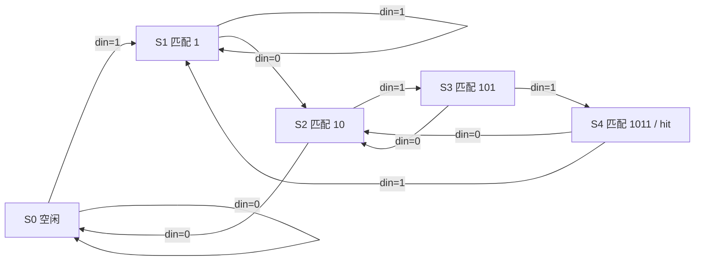

## 为什么需要状态机

接口电路几乎都带有"记住走到了第几步"的需求：UART 接收等起始位、再按位采样、最后校验；序列检测器要记住已匹配的前缀。把这些步骤写成状态转移，是数字设计中最稳定、最易验证的组织方式。

## Moore 与 Mealy

- **Moore**：输出只由当前状态决定。输出与输入异步，波形干净，但响应晚一个时钟。
- **Mealy**：输出由当前状态与当前输入共同决定。响应快一个周期、状态数可能更少，但输入上的毛刺可能直接传到输出。

工程上多数场景选 Moore 或"寄存器输出型 Mealy"：把输出也用触发器打一拍，牺牲一个周期换来干净的波形。

## 三段式写法

推荐把 FSM 拆成三段：状态寄存器（时序）、次态逻辑（组合）、输出逻辑（组合或时序）。这样每一段职责单一，便于代码审查与综合优化。

下面以检测串行序列 `1011` 为例（允许重叠匹配）：

```verilog
module seq_detector_1011 (
    input  wire clk,
    input  wire rst_n,
    input  wire din,
    output reg  hit
);
    // 状态含义：已匹配的前缀长度
    localparam S0 = 3'd0, S1 = 3'd1, S2 = 3'd2, S3 = 3'd3, S4 = 3'd4;
    reg [2:0] state, next_state;

    // 1) 状态寄存器
    always @(posedge clk or negedge rst_n) begin
        if (!rst_n) state <= S0;
        else        state <= next_state;
    end

    // 2) 次态组合逻辑
    always @(*) begin
        next_state = S0;                 // 默认值，避免锁存器
        case (state)
            S0: next_state = din ? S1 : S0;
            S1: next_state = din ? S1 : S2;   // 已匹配 "1"
            S2: next_state = din ? S3 : S0;   // 已匹配 "10"
            S3: next_state = din ? S4 : S2;   // 已匹配 "101"
            S4: next_state = din ? S1 : S2;   // 匹配完成后处理重叠
            default: next_state = S0;
        endcase
    end

    // 3) 输出逻辑（Moore：只依赖状态）
    always @(*) hit = (state == S4);
endmodule
```

## 状态转移图



## 状态编码

- **二进制编码（binary）**：状态数 $n$ 只需 $\lceil\log_2 n\rceil$ 位，省触发器，但次态译码逻辑复杂。
- **格雷编码（Gray）**：相邻状态只有一位变化，降低翻转功耗与毛刺，适合线性流程。
- **独热编码（one-hot）**：每个状态一个触发器，次态逻辑最简单，FPGA 的触发器资源充足时往往是综合工具的首选。

> [!warning] 输出毛刺与安全状态
> 组合输出可能在状态切换瞬间产生毛刺。如果输出直接驱动外部引脚，应把输出寄存一拍。另外 `default` 分支把所有非法编码导向安全状态，可以避免状态机跑飞后死锁。

## 验证思路

上板之前至少验证三件事：复位后进入 S0 且输出为 0；连续输入 `1011` 时 `hit` 恰好有效一个周期；重叠序列 `1011011` 能被识别两次。这些用例在 [[Projects/UART-Loopback-Project|UART 回环项目]] 的接收状态机里同样适用。

## 相关阅读

- [[Digital-Systems/Verilog-Sequential-Logic|Verilog 时序逻辑]]
- [[Projects/UART-Loopback-Project|UART 回环项目]]
- [[Signal-Processing/Signals-and-Systems-Intro|信号与系统导论]]
