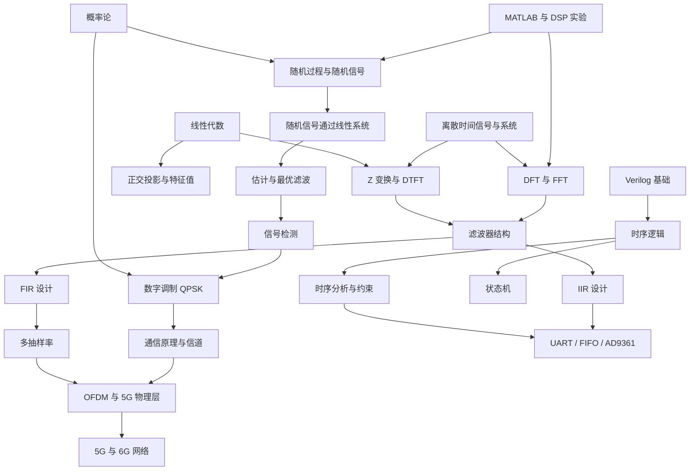

## 知识网络图

箭头表示"前置支撑"：$A\rightarrow B$ 表示理解 $B$ 需要先理解 $A$。这张图只保留主干，细节关联在各主题页的学习路径里。

## 五条主要知识链

### 1. 数学 → 变换 → 滤波器 → 实现

[[mathematics/linear-algebra-basics|线性代数]] 提供正交基、特征分解与投影；[[signal-processing/z-transform-and-dtft|Z 变换与 DTFT]] 把差分方程变成代数方程；[[signal-processing/digital-filter-structures|滤波器结构]]、[[signal-processing/iir-filter-design|IIR 设计]]、[[signal-processing/fir-filter-design|FIR 设计]] 把传递函数落到可实现的运算上；最后在 FPGA 里用 [[digital-systems/timing-analysis-and-constraints|时序约束]] 保证它在时钟下正确工作。

### 2. 概率 → 随机信号 → 通信

[[mathematics/probability-overview|概率论]] 给出高斯分布、Q 函数与假设检验；[[signal-processing/random-processes|随机过程]] 与 [[signal-processing/correlation-and-power-spectrum|相关函数与功率谱]] 描述噪声；[[signal-processing/signal-detection-theory|信号检测理论]] 推出匹配滤波；[[communication/digital-modulation-qpsk|数字调制]] 的误码率 $P_b=Q(\sqrt{2E_b/N_0})$ 正是这条链的出口。

### 3. 信号与系统 → 频域分析 → 工程应用

[[signal-processing/signals-and-systems-intro|离散时间信号与系统]] 建立卷积与采样；[[signal-processing/dft-and-fft|DFT 与 FFT]] 让频谱可计算；[[signal-processing/multirate-dsp|多抽样率]] 解释 OFDM、软件无线电与音频重采样的共同结构；[[communication/mobile-networks|5G/6G]] 把这些结构用在真实系统里。

### 4. 逻辑 → 时序 → 接口 → 系统

[[digital-systems/verilog-basics|Verilog 基础]] 解决"如何描述电路"，[[digital-systems/verilog-sequential-logic|时序逻辑]] 解决"如何用时钟保存状态"，[[digital-systems/fsm-design|状态机]] 组织多步流程，[[digital-systems/timing-analysis-and-constraints|时序分析]] 回答"能不能跑到目标频率"，[[digital-systems/fpga-interfaces-and-ad9361|接口与 AD9361]] 把数字世界接到射频前端。

### 5. 工具 → 效率

[[programming/matlab-for-dsp|MATLAB]] 与 [[programming/python-numpy-dsp|Python NumPy]] 负责原型验证；[[ai-agents/ai-tools-overview|AI 工具概览]] 加速查文档与调试，但不替代对前置知识的理解。

## 五张学科知识地图

源笔记里有五张按知识点组织的地图，适合当复习索引：

- [[vault-notes/maps/sampling-quantization-map|采样、量化与数字化知识地图]]：从抽样到量化噪声，对应 [[signal-processing/signals-and-systems-intro|信号与系统]]。
- [[vault-notes/maps/fourier-analysis-map|傅里叶分析知识地图]]：连续/离散、周期/非周期四种傅里叶工具的对应关系，对应 [[signal-processing/dft-and-fft|DFT 与 FFT]]。
- [[vault-notes/maps/digital-communication-map|数字通信系统知识地图]]：从信源到接收机的信号流，对应 [[communication/index|通信原理]]。
- [[vault-notes/maps/random-signal-processing-map|随机信号处理知识地图]]：概率、随机过程、功率谱、估计与检测，对应 [[signal-processing/random-processes|随机过程]]。
- [[vault-notes/maps/linear-systems-filtering-map|线性系统与滤波知识地图]]：系统函数、零极点与滤波器设计，对应 [[signal-processing/digital-filter-structures|滤波器结构]]。

## 如何用网络复习

1. 任选一个节点，向上追问"它依赖什么"，向下追问"它支撑什么"。
2. 若某个节点答不出来，说明前置缺失，回到对应文章补。
3. 优先检查高扇出的枢纽节点：$SS\rightarrow ZT$、$RANDOM\rightarrow DETECT$、$TIMING\rightarrow IF$ 往往是理解断层的所在。

> [!note] 关于图的局限
> 网络图只保留主要依赖，省略了大量细节关联（如窗函数与频谱泄漏、OQPSK 与功放线性度）。看到图外的关系，说明已经到了可以自己建立连接的阶段。

## 相关阅读

- [[maps/learning-path|推荐学习路径]]
- [[maps/index|导航总览]]
- [[signal-processing/index|信号处理学习路径]]
<!-- topic-index:start -->
## 跨学科知识地图

### 知识关联

- [[vault-notes/maps/sampling-quantization-map|采样、量化与数字化知识地图]]
- [[vault-notes/maps/fourier-analysis-map|傅里叶分析知识地图]]
- [[vault-notes/maps/digital-communication-map|数字通信系统知识地图]]
- [[vault-notes/maps/random-signal-processing-map|随机信号处理知识地图]]
- [[vault-notes/maps/linear-systems-filtering-map|线性系统与滤波知识地图]]

<!-- topic-index:end -->