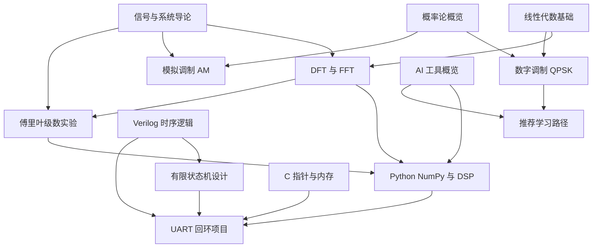

## 知识网络图

图中的箭头表示"前置支撑"关系：$A\rightarrow B$ 表示理解 $B$ 需要先理解 $A$。

## 四条主要知识链

### 1. 数学 → 频谱 → 代码

[[Mathematics/Linear-Algebra-Basics|线性代数基础]] 提供正交基与酉矩阵的语言，[[Signal-Processing/DFT-and-FFT|DFT 与 FFT]] 是它最重要的工程出口，而 [[Programming/Python-NumPy-DSP|Python NumPy 与 DSP]] 负责把公式变成可以观察的结果。这条链的每一环都可以独立验证：写一个 DFT 矩阵，和 `np.fft` 的输出比对即可。

### 2. 概率 → 噪声 → 误码率

[[Mathematics/Probability-Overview|概率论概览]] 给出高斯分布与 Q 函数；[[Communication/Digital-Modulation-QPSK|数字调制 QPSK]] 的误码率公式 $P_b=Q(\sqrt{2E_b/N_0})$ 正是二者的直积。[[Communication/Analog-Modulation-AM|模拟调制 AM]] 则从另一侧说明：为什么把信息放在幅度上的调制方式抗噪能力更差。

### 3. 时序 → 状态机 → 接口

[[Digital-Systems/Verilog-Sequential-Logic|Verilog 时序逻辑]] 解决"如何用时钟保存状态"，[[Digital-Systems/FSM-Design|有限状态机设计]] 解决"如何组织多步流程"，[[Projects/UART-Loopback-Project|UART 回环项目]] 把两者组合成能上板验证的接口。这条链是唯一必须"动手才算学会"的路径。

### 4. 工具 → 效率

[[AI-Agents/AI-Tools-Overview|AI 工具概览]] 横跨上面三条链：生成仿真脚本、解释报错、整理数据手册。它不改变知识结构，只加速实现环节。放在 [[Maps/Learning-Path|推荐学习路径]] 的末端，是因为没有基础时很难判断生成的代码是否正确。

## 如何用网络复习

1. 任选一个节点，向上追问"它依赖什么"，向下追问"它支撑什么"。
2. 若某个节点答不出来，说明前置缺失，回到对应文章补。
3. 复习时优先检查图中的"枢纽节点"：$SS\rightarrow DFT$、$VLOG\rightarrow FSM$ 这类高扇出关系，往往是理解断层的所在。

> [!note] 关于图的局限
> 网络图只保留主要依赖，省略了大量细节关联（如窗函数与频谱泄漏、OQPSK 与功放线性度）。看到图外的关系，说明已经到了可以自己建立连接的阶段。

## 相关阅读

- [[Maps/Learning-Path|推荐学习路径]]
- [[Maps/index|导航总览]]
- [[Signal-Processing/DFT-and-FFT|DFT 与 FFT]]
