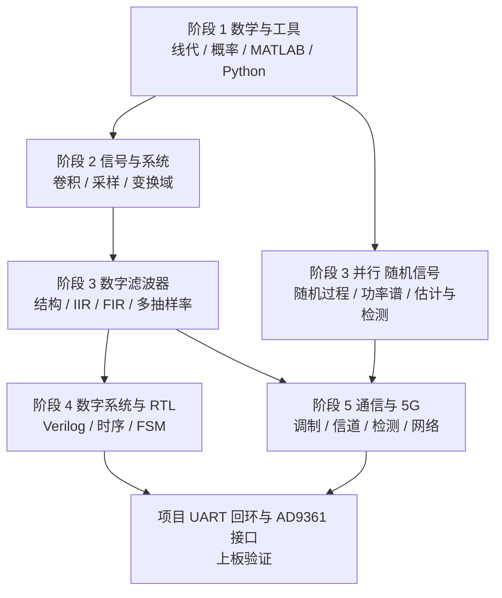

## 总体思路

电子信息工程的知识结构有一个特点：上层内容大量复用下层工具，但下层的"必要性"往往要在上层遇到问题时才显现。因此路线设计成"够用即学、遇到就补"：每个阶段只学当前任务需要的那部分数学，把剩下的留给后面。

## 五个阶段

### 阶段 1：数学与工具

- 核心内容：矩阵运算与消元、向量空间与正交投影、特征值与 SVD、概率公理与常见分布、数字特征与抽样分布。
- 对应文章：[[mathematics/linear-algebra-basics|线性代数基础]]、[[mathematics/orthogonality-least-squares|正交性与最小二乘]]、[[mathematics/probability-overview|概率论概览]]。
- 工具：[[programming/matlab-for-dsp|MATLAB 与 DSP 实验]]、[[programming/python-numpy-dsp|Python NumPy 与 DSP]]。
- 交付成果：能用 NumPy 完成矩阵运算与蒙特卡洛仿真，并解释一次最小二乘拟合的正规方程。

### 阶段 2：信号与系统（连续到离散）

- 核心内容：序列与数字频率、卷积、差分方程、抽样定理与混叠、DTFT 频率响应、DFT 的定义与圆周卷积条件。
- 对应文章：[[signal-processing/signals-and-systems-intro|离散时间信号、系统与采样]]、[[signal-processing/z-transform-and-dtft|Z 变换与 DTFT]]、[[signal-processing/dft-and-fft|DFT 与 FFT]]。
- 并行：[[interactive-labs/fourier-series-lab|傅里叶级数实验]] 观察截断与吉布斯现象。
- 交付成果：给定一段信号，能画出正确的单边幅度谱，并解释频率分辨率与补零的关系。

### 阶段 3：数字滤波器与多抽样率

- 核心内容：直接型/级联/并联结构、模拟原型与双线性变换、线性相位 FIR 与窗函数、抽取与插值、多相分解。
- 对应文章：[[signal-processing/digital-filter-structures|数字滤波器结构]]、[[signal-processing/iir-filter-design|IIR 滤波器设计]]、[[signal-processing/fir-filter-design|FIR 滤波器设计]]、[[signal-processing/multirate-dsp|多抽样率数字信号处理]]。
- 交付成果：给定指标（通带/阻带/纹波），能选择 IIR 或 FIR 并说明理由，估计阶数与运算量。

### 阶段 3 并行：随机信号与统计

- 核心内容：平稳性、相关函数与功率谱、白噪声与通过线性系统、维纳/卡尔曼滤波、匹配滤波与检测。
- 对应文章：[[signal-processing/random-processes|随机过程与随机信号]]、[[signal-processing/random-signals-through-systems|随机信号通过线性系统]]、[[signal-processing/statistical-estimation-filtering|统计估计与最优滤波]]、[[signal-processing/signal-detection-theory|信号检测理论]]。
- 交付成果：能推导白噪声通过 RC 低通后的输出功率，并说明匹配滤波为什么在采样时刻信噪比最大。

### 阶段 4：数字系统与 RTL

- 核心内容：组合/时序逻辑建模、阻塞与非阻塞、复位策略、计数器与分频、FSM 三段式、同步设计、静态时序分析。
- 对应文章：[[digital-systems/verilog-basics|Verilog 基础]]、[[digital-systems/verilog-sequential-logic|Verilog 时序逻辑]]、[[digital-systems/fsm-design|有限状态机设计]]、[[digital-systems/timing-analysis-and-constraints|时序分析与约束]]、[[digital-systems/vivado-design-flow|Vivado 设计流程]]。
- 交付成果：独立写出带异步复位同步释放与状态机的模块，给出时钟约束并解释时序报告中的 WNS。

### 阶段 5：通信系统与 5G

- 核心内容：确知信号与信道、模拟调制、数字基带传输与无 ISI 条件、数字带通调制与误码率、最佳接收、信源/信道编码、同步、5G 物理层与网络架构。
- 对应文章：[[communication/communication-signals-and-channel|通信信号与信道]]、[[communication/analog-modulation-am|模拟调制 AM]]、[[communication/digital-baseband-transmission|数字基带传输]]、[[communication/digital-modulation-qpsk|数字带通调制]]、[[communication/source-and-channel-coding|信源与信道编码]]、[[communication/synchronization|同步]]、[[communication/mobile-networks|5G 与 6G]]。
- 交付成果：能解释"为什么 QPSK 在同样带宽下传输两倍比特"，并能从星座图与噪声功率估算误码率。

### 阶段 6（项目）：从 RTL 到射频

- 组合练习：[[digital-systems/fpga-interfaces-and-ad9361|UART / FIFO / AD9361 接口]]、[[projects/uart-loopback-project|UART 回环项目]]。
- 交付成果：完成一个可上板验证的接口项目，并说明采样率、时钟与数据吞吐率之间的关系。

## 阶段检查点

| 检查点 | 判断标准 |
| --- | --- |
| 数学够用 | 能写出 DFT 矩阵并说明其正交性，能推导最小二乘正规方程 |
| 信号入门 | 能解释混叠为何不可逆，并算出 $\Delta f=1/T_0$ |
| 滤波器 | 能说明线性相位 FIR 的四类约束，并估算窗函数法阶数 |
| 随机信号 | 能写出维纳–辛钦关系并解释白噪声通过滤波器的功率谱 |
| RTL 入门 | 能指出一段代码中阻塞/非阻塞赋值误用之处 |
| 通信系统 | 能比较 2PSK 与 QPSK 的误码率与带宽效率 |
| 项目完成 | 回环测试误码为 0，时序报告无违例 |

> [!warning] 常见的时间浪费
> 一是在纯数学证明上停留过久（先会用再补证明）；二是过早追求高阶内容（如 16-QAM、OFDM、MIMO）而跳过卷积与采样定理；三是只看不写代码，频谱分析与滤波器设计必须亲手跑过。

## 相关阅读

- [[maps/knowledge-network|跨学科知识网络]]
- [[maps/index|导航总览]]
- [[signal-processing/index|信号处理完整路径]]
