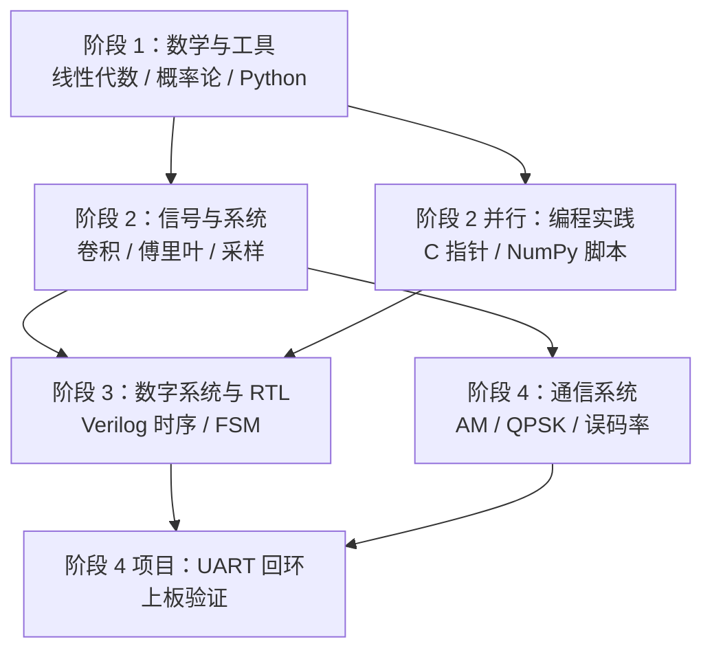

## 总体思路

电子信息工程的知识结构有一个特点：上层内容大量复用下层工具，但下层的"必要性"往往要在上层遇到问题时才显现。因此路线设计成"够用即学、遇到就补"：每个阶段只学当前任务需要的那部分数学，把剩下的留给后面的课程。

## 四个阶段

### 阶段 1：数学与工具

- 核心内容：矩阵乘法与特征分解、随机变量与高斯分布、Python 基础语法。
- 对应文章：[[Mathematics/Linear-Algebra-Basics|线性代数基础]]、[[Mathematics/Probability-Overview|概率论概览]]。
- 交付成果：能用 NumPy 完成矩阵运算与简单蒙特卡洛仿真。

### 阶段 2：信号与系统

- 核心内容：LTI 系统与卷积、傅里叶变换、采样定理、DFT 与 FFT。
- 对应文章：[[Signal-Processing/Signals-and-Systems-Intro|信号与系统导论]]、[[Signal-Processing/DFT-and-FFT|DFT 与 FFT]]、[[Interactive-Labs/Fourier-Series-Lab|傅里叶级数实验]]。
- 并行建议：同时推进 [[Programming/Python-NumPy-DSP|Python NumPy 与 DSP]]，做到"公式能写、代码能跑"。
- 交付成果：给定一段信号，能画出正确的单边幅度谱并解释频率分辨率。

### 阶段 3：数字系统与 RTL

- 核心内容：组合与时序逻辑、非阻塞赋值、复位策略、FSM 三段式写法。
- 对应文章：[[Digital-Systems/Verilog-Sequential-Logic|Verilog 时序逻辑]]、[[Digital-Systems/FSM-Design|有限状态机设计]]。
- 交付成果：独立写出带异步复位同步释放与状态机的模块，通过仿真并上板验证。

### 阶段 4：通信系统与项目

- 核心内容：调制的频谱搬移、AM 的调制度与解调、QPSK 的 I/Q 表示与误码率。
- 对应文章：[[Communication/Analog-Modulation-AM|模拟调制 AM]]、[[Communication/Digital-Modulation-QPSK|数字调制 QPSK]]、[[Projects/UART-Loopback-Project|UART 回环项目]]。
- 交付成果：能解释"为什么 QPSK 在同样带宽下传输两倍比特"，并完成一个可上板验证的接口项目。

## 阶段检查点

| 检查点 | 判断标准 |
| --- | --- |
| 数学够用 | 能写出 DFT 矩阵并说明其正交性 |
| 信号入门 | 能解释混叠为何不可逆，并算出 $\Delta f$ |
| RTL 入门 | 能指出一段代码中阻塞/非阻塞赋值误用之处 |
| 项目完成 | 回环测试 10 万字节误码为 0 |

> [!warning] 常见的时间浪费
> 一是在纯数学证明上停留过久，二是过早追求高阶内容（如 16-QAM、OFDM）而跳过卷积与采样定理。先把阶段 2、3 的动手部分做扎实，后面学调制会轻松很多。

## 相关阅读

- [[Maps/Knowledge-Network|跨学科知识网络]]
- [[Maps/index|导航总览]]
- [[Digital-Systems/FSM-Design|有限状态机设计]]
