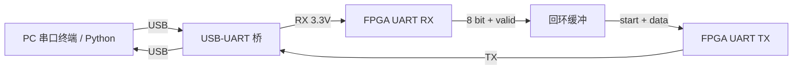

## 项目目标

在 FPGA 上实现一个 UART 回环（loopback）：PC 通过 USB-UART 桥发送若干字节，FPGA 收到后原样发回，PC 侧脚本校验收发一致并统计误码。验收标准有三条：115200 bps 下连续收发 10 万个字节无错误；上电后无需手动复位即可工作；任意波特率误差引起的采样偏移不导致误码。

## UART 帧格式与波特率

UART 是异步串行接口，没有独立时钟线，收发双方靠约定好的波特率对齐。常见配置 8N1 的一帧为：

| 部分 | 位宽 | 电平 |
| --- | --- | --- |
| 起始位 | 1 | 0 |
| 数据位 | 8 | LSB 先发 |
| 校验位 | 0（无） | — |
| 停止位 | 1 | 1 |

一帧共 10 个比特，一位时间 $T_b=1/115200\approx8.68\,\mu s$，整帧约 $86.8\,\mu s$，理论上限约 $11520$ 字节/秒。

FPGA 时钟 50 MHz，分频系数为

$$ \text{DIV}=\left\lfloor\frac{f_{clk}}{f_{baud}}\right\rfloor=\left\lfloor\frac{50\,000\,000}{115200}\right\rfloor=434 $$

实际波特率为 $50\,000\,000/434\approx115207$ bps，相对误差约 0.006%，远小于接收端能容忍的范围（10 位累计偏移需小于 5% 位宽）。

## 系统结构



## 发送模块实现

```verilog
module uart_tx (
    input  wire       clk,        // 50 MHz
    input  wire       rst_n,
    input  wire       start,
    input  wire [7:0] data,
    output reg        tx,         // 空闲为高
    output reg        busy
);
    localparam integer DIV = 434;         // 50e6 / 115200

    reg [15:0] cnt;
    reg [3:0]  bit_idx;
    reg [9:0]  frame;                     // {stop, data[7:0], start}

    always @(posedge clk or negedge rst_n) begin
        if (!rst_n) begin
            tx <= 1'b1; busy <= 1'b0; cnt <= 16'd0;
            bit_idx <= 4'd0; frame <= 10'h3FF;
        end else if (!busy && start) begin
            frame   <= {1'b1, data, 1'b0}; // 停止位 + 数据 + 起始位
            tx      <= 1'b0;               // 输出起始位
            busy    <= 1'b1;
            cnt     <= 16'd0;
            bit_idx <= 4'd0;
        end else if (busy) begin
            if (cnt == DIV - 1) begin
                cnt <= 16'd0;
                if (bit_idx == 4'd9) begin // 最后一位（停止位）结束
                    busy    <= 1'b0;
                    tx      <= 1'b1;
                    bit_idx <= 4'd0;
                end else begin
                    bit_idx <= bit_idx + 4'd1;
                    tx      <= frame[bit_idx + 1];  // 取下一比特
                end
            end else begin
                cnt <= cnt + 16'd1;
            end
        end
    end
endmodule
```

要点：`frame` 的最低位就是起始位，所以进入发送状态时先输出 `frame[0]`；此后每过一个位时间就输出 `frame[bit_idx+1]`，索引递增正好对应 LSB 先发。

## PC 侧验证脚本

```python
import serial

CASES = (b"\x55\xaa", bytes(range(8)), b"\x00\xff\xa5")

with serial.Serial("COM3", 115200, timeout=1.0) as port:
    for payload in CASES:
        port.write(payload)
        echo = port.read(len(payload))
        ok = echo == payload
        print(f"{payload.hex(' '):<20} -> {echo.hex(' '):<20} {'OK' if ok else 'MISMATCH'}")

    # 连续压力测试：统计误码
    import os
    total = errors = 0
    for _ in range(1000):
        chunk = os.urandom(100)
        port.write(chunk)
        got = port.read(len(chunk))
        total += len(chunk)
        errors += sum(a != b for a, b in zip(chunk, got)) + max(0, len(chunk) - len(got))
    print(f"共 {total} 字节，误码 {errors}")
```

## 验证步骤

1. **先发 `0x55`（01010101）**：波形上是规则的方波，用示波器或逻辑分析仪最容易看出位宽是否正确（应为 8.68 µs）。
2. **再接回环**：单个字节通过后，再做多字节连续测试，检查是否存在溢出（`busy` 期间新数据被丢弃）。
3. **压力测试**：用随机数据跑 10 万字节统计误码，观察是否存在系统性错误（多为波特率偏差或采样点偏移）。
4. **复位上电测试**：确认上电即工作，不依赖手动按键复位。

## 常见问题

> [!warning] 串口不通的排查顺序
> 1. **共地**：USB-UART 与 FPGA 必须共地，这是最常见的原因；
> 2. **电平**：3.3 V 与 5 V 不可混接，确认桥接器是 3.3 V 输出；
> 3. **TX/RX 交叉**：PC 的 TX 接 FPGA 的 RX；
> 4. **波特率误差**：核对分频系数与时钟实际频率（晶振偏差）；
> 5. **首位丢失**：接收端启动采样过早，检查起始位检测与 16 倍过采样中点采样。

> [!tip] 用回环验证时钟
> 发送 `0x55` 后测出的位宽可以反推实际时钟频率，这也是检查开发板时钟是否与设计一致的小技巧。

## 相关阅读

- [[Digital-Systems/FSM-Design|有限状态机设计]]
- [[Digital-Systems/Verilog-Sequential-Logic|Verilog 时序逻辑]]
- [[Programming/C-Pointer-and-Memory|C 指针与内存]]
