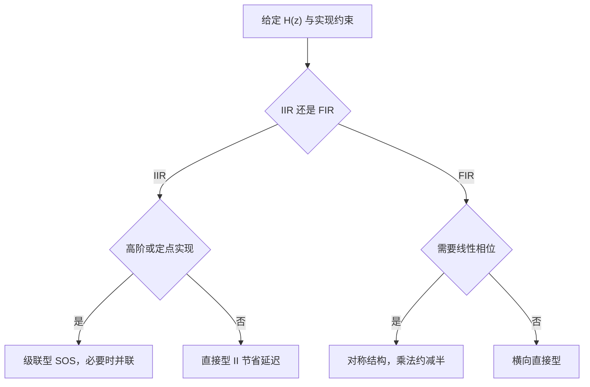

## 为什么"结构"是一个独立问题

滤波器设计的第一步是得到系统函数 $H(z)$，但 $H(z)$ 只是一条代数表达式，计算机不能直接"算"它。把 $H(z)$ 翻译成"延迟 + 乘法 + 加法"的运算图，就是**结构**（structure）问题。

同一个 $H(z)$ 有无穷多种实现。它们对输入输出关系的描述完全相同，却在三件事上差别很大：

- **运算量**：每输出一个点需要多少次乘法、多少次加法；
- **存储量**：需要多少个延迟单元（寄存器）保存历史数据；
- **数值行为**：系数被量化成有限位后，极点位置会偏移多少，中间变量会不会溢出，会不会出现极限环。

在浮点 MATLAB 里这三种结构几乎没有区别，但在 16 位定点 DSP 或 FPGA 上，结构选错可能让一个理论稳定的滤波器实际发散。因此"给定 $H(z)$ 怎么实现"是独立于设计的工程问题。

## 三种基本积木与信号流图的两条规则

任何数字滤波器都由三种元件搭成：

| 元件 | 时域关系 | z 域关系 | 典型硬件 |
| --- | --- | --- | --- |
| 延迟 $z^{-1}$ | $y(n)=x(n-1)$ | $Y(z)=z^{-1}X(z)$ | 触发器/寄存器 |
| 乘法器 $a$ | $y(n)=a\,x(n)$ | $Y(z)=aX(z)$ | 乘法器、DSP Slice |
| 加法器 | $y(n)=x_1(n)+x_2(n)$ | $Y(z)=X_1(z)+X_2(z)$ | 加法器 |

把它们连成有向图，就得到**信号流图**（signal flow graph）。读图只需记住两条规则：

1. **节点**代表一个变量，多条支路汇入同一个节点时，节点的值等于各支路贡献之和；
2. **支路**代表乘法或延迟，支路增益写在箭头旁；单位增益支路可以省略标注。

本节讨论的 IIR 系统函数取如下形式，其中 $b_r$ 是零点系数，$a_k$ 是极点系数：

$$
H(z)=\frac{\sum_{r=0}^{M}b_r z^{-r}}{1+\sum_{k=1}^{N}a_k z^{-k}}
$$

对应的差分方程为

$$
y(n)=\sum_{r=0}^{M}b_r x(n-r)-\sum_{k=1}^{N}a_k y(n-k)
$$

> [!info] 结构不唯一
> 结构只规定运算顺序，不改变 $H(z)$。判断两个结构是否等价，唯一标准是它们的系统函数是否相同；延迟数、乘法数、中间变量都允许不同。

还有一条贯穿全节的定理：**转置定理**。把信号流图中所有支路反向、输入与输出互换、加法器与分支点互换，得到**转置结构**，其系统函数不变。转置会改变运算顺序与中间变量的动态范围，常用于缩短关键路径、方便流水线实现。

## IIR 滤波器的结构

### 直接型 I

最直白的实现是把分子、分母分别搭出来：先让输入经过一条 $M$ 级延迟链完成零点部分，得到中间变量 $w(n)$，再让输出经过一条 $N$ 级延迟链完成极点部分：

$$
w(n)=\sum_{r=0}^{M}b_r x(n-r),\qquad y(n)=w(n)-\sum_{k=1}^{N}a_k y(n-k)
$$

这就是**直接型 I**（direct form I）。它需要 $M+N$ 个延迟，零点和极点的作用分处两条链，物理意义清楚。

以二阶节为例：

$$
H(z)=\frac{b_0+b_1z^{-1}+b_2z^{-2}}{1+a_1z^{-1}+a_2z^{-2}}
$$

差分方程为

$$
y(n)=b_0x(n)+b_1x(n-1)+b_2x(n-2)-a_1y(n-1)-a_2y(n-2)
$$

直接型 I 需要 4 个延迟（输入链 2 个、输出链 2 个）。它的缺点是延迟多、系数对极点位置敏感，高阶时不适合直接使用。

### 直接型 II（典范型）

把 $H(z)$ 看成两个系统的级联，先实现极点部分，再实现零点部分，并让两部分共用同一条延迟链：

$$
H(z)=\frac{1}{1+\sum_{k=1}^{N}a_kz^{-k}}\cdot\sum_{r=0}^{M}b_rz^{-r}
$$

中间变量记为 $w(n)$，则有

$$
w(n)=x(n)-\sum_{k=1}^{N}a_k w(n-k),\qquad y(n)=\sum_{r=0}^{M}b_r w(n-r)
$$

这就是**直接型 II**（direct form II），也称**典范型**（canonical form）。它只需要 $\max(M,N)$ 个延迟，是延迟数最少的 IIR 实现；代价是中间变量 $w(n)$ 同时携带极点与零点的信息，动态范围可能远大于输入输出，定点实现时容易溢出。

> [!warning] 直接型 I 与直接型 II 不是彼此的转置
> 两者系统函数相同，但**延迟数不同**（$M+N$ 对 $\max(M,N)$），而转置运算保持延迟数不变，所以它们不可能互为转置。直接型 I 的转置是"转置直接型 I"，直接型 II 的转置是"转置直接型 II"。把这一点记清楚，可以避免在推导和答题时套错关系。

### 级联型

把分子、分母分别因式分解，再把共轭的零点、极点两两配对成二阶节（second-order section，SOS）：

$$
H(z)=\prod_{i=1}^{K}H_i(z),\qquad
H_i(z)=\frac{b_{0i}+b_{1i}z^{-1}+b_{2i}z^{-2}}{1+a_{1i}z^{-1}+a_{2i}z^{-2}}
$$

每个二阶节用直接型 II 实现，就得到**级联型**（cascade form）。它的关键优势是**系数敏感度低**：一个二阶节的系数只影响一对共轭极点，量化误差被局部化，不会像高阶直接型那样让所有极点一起漂移。工程上高阶 IIR 几乎都转成 SOS 实现，MATLAB 的 `tf2sos` 就是做这件事。

级联也要付代价：各节增益需要分配（缩放），否则前级输出可能过大或过小；零点与极点的配对顺序、节的排列顺序都会影响输出噪声，通常要通过仿真或按规范选择。

一个分解示例：

$$
H(z)=\frac{1+2z^{-1}+z^{-2}}{1-1.5z^{-1}+0.56z^{-2}}\cdot\frac{1-0.5z^{-1}}{1+0.3z^{-1}}
$$

前一个二阶节的两个实极点为 $0.7$ 与 $0.8$（由 $z^2-1.5z+0.56=0$ 解出），后一个一阶节给出零点 $0.5$ 与极点 $-0.3$，两节串联。原笔记此处写"一对共轭极点"，按系数求解应为两个实极点，特此更正。

### 并联型

把 $H(z)$ 做部分分式展开：

$$
H(z)=\sum_{i=1}^{K}H_i(z)
$$

每个 $H_i(z)$ 是一阶或二阶节，各节**并联**（输出相加），称为**并联型**（parallel form）。并联的每个节独立运算，一个节的舍入误差不会通过反馈传到另一个节，因此适合并行硬件（多核 DSP、FPGA 多通道）和对误差传播敏感的应用。

注意：部分分式展开要求 $H(z)$ 是真分式（$M<N$）。若 $M\ge N$，需要先做多项式除法，把直接项 $c_0+c_1z^{-1}+\cdots$ 单独提出来。

> [!tip] 级联与并联怎么选
> 级联的零点、极点都按节成对控制，调参直观，是最通用的选择；并联各节独立、误差不串扰，适合并行实现，但零点由各节共同决定，想单独调整某个零点比较麻烦。

### 转置型

对任一结构做上一节的转置变换，就得到**转置型**（transposed form）。转置型的系统函数与原结构相同，延迟数也相同，但运算顺序改变，关键路径可能变短，因而常用于流水线实现。

以直接型 II 的转置为例，它把延迟链放在支路上、先做乘法再累加，中间变量的取值范围与直接型 II 不同。定点实现时，转置结构的中间变量动态范围与舍入噪声表现可能更好，也可能引入新的溢出风险，具体要结合结构与缩放逐项评估，不能只凭"转置"二字判断优劣。

### IIR 结构对比

| 结构 | 延迟数 | 乘法数（每输出点） | 系数敏感度 | 适用场合 |
| --- | --- | --- | --- | --- |
| 直接型 I | $M+N$ | $M+N+1$ | 高（高阶时） | 教学、低阶、需要分离零极点 |
| 直接型 II | $\max(M,N)$ | $M+N+1$ | 高（高阶时） | 低阶、延迟受限 |
| 级联型 | 每节 2 个，共约 $\max(M,N)$ | $M+N+1$（按节拆分） | 低 | 通用高阶 IIR，工程首选 |
| 并联型 | 每节 2 个，共约 $\max(M,N)$ | 与级联相当 | 低 | 并行实现、误差隔离 |
| 转置型 | 同原结构 | 同原结构 | 取决于原型 | 流水线、缩短关键路径 |

## FIR 滤波器的结构

FIR 滤波器没有输出反馈，系统函数只有零点：

$$
y(n)=\sum_{m=0}^{M}h(m)x(n-m),\qquad H(z)=\sum_{m=0}^{M}h(m)z^{-m}
$$

阶数为 $M$，长度为 $M+1$。

### 直接型（横向滤波器）

把上式直接画成一条**抽头延迟线**（tapped delay line）：输入依次经过 $M$ 个延迟，每个抽头乘 $h(m)$ 后求和，称为**横向滤波器**（transversal filter）。

- 延迟数 $M$，乘法数 $M+1$；
- 没有反馈，**永远稳定**；
- 只要 $h(n)$ 对称，就能实现严格线性相位，这是 FIR 最大的卖点。

横向结构是 FPGA 实现 FIR 的标准形式：抽头延迟线映射为移位寄存器，乘加映射为 DSP Slice。

### 级联型

把 $H(z)$ 因式分解为一阶、二阶节的乘积：

$$
H(z)=h(0)\prod_{i=1}^{K}\left(1-c_iz^{-1}\right)\prod_{j=1}^{L}\left(1-b_{1j}z^{-1}+b_{2j}z^{-2}\right)
$$

每节用直接型实现。级联型适合需要单独调整零点的场合，乘法数通常比直接型多，但数值特性更好。

### 频率采样型

由频率采样定理，FIR 的 $H(z)$ 可以用 $N$ 个等间隔频率采样值 $H(k)$ 表示：

$$
H(z)=\left(1-z^{-N}\right)\frac{1}{N}\sum_{k=0}^{N-1}\frac{H(k)}{1-W_N^{-k}z^{-1}},\qquad W_N=e^{-j2\pi/N}
$$

结构由**梳状滤波器** $1-z^{-N}$ 与 $N$ 个**并联谐振器**组成，梳状部分需要约 $N$ 个延迟、谐振器再各需 1 个，合计约 $2N$ 个延迟。由于 $H(k)$ 直接出现在表达式中，它特别适合窄带、多带或频率形状任意的滤波器；缺点是系数为复数、对有限字长敏感，谐振器的极点正好落在单位圆上，实际实现必须靠梳状零点精确抵消，量化后可能失稳，需要额外处理。

### 线性相位型

若 FIR 系数满足对称条件

$$
h(n)=h(M-n)\quad(\text{偶对称})\qquad\text{或}\qquad h(n)=-h(M-n)\quad(\text{奇对称})
$$

则滤波器具有严格线性相位，群延迟为常数 $M/2$ 个样点。实现时把对称的抽头**先相加再乘**，乘法次数约减半。以偶对称为例：

$$
y(n)=h(0)\left[x(n)+x(n-M)\right]+h(1)\left[x(n-1)+x(n-M+1)\right]+\cdots
$$

乘法从 $M+1$ 次降到约 $(M+1)/2$ 次，代价是加法数增加。在 FPGA 上乘法器比加法器昂贵，这笔交换通常划算；更关键的是，只要成对量化，对称性在系数量化后仍然保持，线性相位不会因定点化而破坏。

四种线性相位 FIR（I/II/III/IV 型）能实现哪些滤波器、零点如何分布，见 [[signal-processing/fir-filter-design|FIR 数字滤波器设计]]，这里不重复。

### FIR 结构对比

| 结构 | 延迟数 | 乘法数 | 特点 |
| --- | --- | --- | --- |
| 直接型（横向） | $M$ | $M+1$ | 最简单，FPGA 标准实现 |
| 级联型 | $M$ | 通常多于 $M+1$ | 零点可单独调整 |
| 频率采样型 | 约 $2N$ | $N$ 个复系数 | 直接指定 $H(k)$，适合窄带多带 |
| 线性相位型 | $M$ | 约 $(M+1)/2$ | 对称结构，省一半乘法 |

## 格型结构

**格型结构**（lattice structure）用一组**反射系数** $k_m$ 把滤波器表示成多级格型节，每级只有两个乘法和两个加法：

$$
\begin{aligned}
f_m(n)&=f_{m-1}(n)+k_m\,g_{m-1}(n-1)\\
g_m(n)&=k_m\,f_{m-1}(n)+g_{m-1}(n-1)
\end{aligned}
$$

其中 $f_m(n)$ 为前向误差，$g_m(n)$ 为后向误差，初始条件 $f_0(n)=g_0(n)=x(n)$。FIR 格型的输出就是最后一级的前向误差 $f_M(n)$。

- 反射系数与多项式系数一一对应，可由 Levinson–Durbin 递推互相转换；
- **数值稳健**：系数量化时，格型结构的稳定性判据简单，误差不会像高阶直接型那样集中放大；
- 语音编码（LPC）、自适应滤波（LMS/RLS）和部分多抽样率滤波器组常用格型。

一阶 FIR 格型为例：

$$
f_1(n)=x(n)+k_1x(n-1),\qquad g_1(n)=k_1x(n)+x(n-1)
$$

其传递函数为 $H(z)=1+k_1z^{-1}$，反射系数 $k_1$ 就是唯一的系数。

IIR 格型在 FIR 格型基础上加反馈，用来实现全极点系统：

$$
H(z)=\frac{1}{A(z)},\qquad A(z)=1+\sum_{k=1}^{N}a_kz^{-k}
$$

其稳定性条件可以写得很简洁：**所有 $|k_m|<1$ 当且仅当 $A(z)$ 的全部零点在单位圆内，全极点系统稳定**。注意这句话的适用范围：FIR 格型本身没有反馈，永远稳定；$|k_m|<1$ 描述的是它对应的全极点 IIR 系统稳定，以及 FIR 多项式是最小相位。把判据安到 FIR 的"稳定性"上会闹笑话。

## 结构选择与有限字长

理论等价的结构，在有限字长下并不等价。工程上要关注四类效应：

1. **系数量化**：系数被截断或舍入后，极点位置偏移。高阶直接型的极点密集在单位圆附近，很小的系数误差就能把极点推出单位圆；级联型把极点分散到各二阶节，敏感度显著降低。
2. **中间变量溢出**：直接型 II 的 $w(n)$ 动态范围最大，定点实现要预留裕量或改用直接型 I/级联型；级联型要做逐节缩放。
3. **舍入噪声**：每次乘加都会引入量化噪声，噪声经过反馈会被放大；转置结构和级联结构的噪声传播路径不同，需要按信噪比要求选择。
4. **极限环**：IIR 的反馈在零输入时可能因舍入而持续小幅振荡，低电平信号下尤其明显，必要时用误差反馈或提高位宽。

> [!tip] 工程选择口诀
> 延迟选直接型 II，稳健选级联，并行选并联；线性相位 FIR 用对称结构；语音与自适应滤波考虑格型。结构不改变 $H(z)$，但决定同样的 $H(z)$ 在真实硬件上还能不能正常工作。



## MATLAB 结构与实现示例

```matlab
% 二阶 IIR 的系数（与上文的级联示例对应）
b = [0.2 0.3 0.2];
a = [1 -1.5 0.56];

sos = tf2sos(b, a);            % 转成级联型二阶节（含增益 g）
[b2, a2] = sos2tf(sos);        % 从级联型还原直接型系数

[k, v] = tf2latc(b, a);        % 求格型反射系数：FIR 用 k，IIR 还有 v
[b3, a3] = latc2tf(k, v);      % 从格型还原

y  = filter(b, a, x);          % 直接滤波（MATLAB 内部为转置直接型 II）
Hd = dfilt.df2sos(sos);        % 结构对象：级联型（旧版 dfilt 接口）
```

- `filter` 是最常用的调用方式，内部按转置直接型 II 计算；如果关心数值行为，应显式转成 SOS 再用 `sosfilt`。
- `dfilt` 系列在新版本中已被 `dsp.FilterCascade` 等系统对象取代，旧代码仍可运行，新项目建议用系统对象。
- `freqz` 只看频响，不反映量化误差；定点评估要用定点仿真或 `fvtool` 的量化视图。

> [!note] 示例说明
> 以上代码用于说明函数接口与结构转换关系，本页未在 MATLAB 中实际运行，具体函数签名请以所用版本文档为准。

## 易错点

- **把阶数 $M$ 当成滤波器长度**：FIR 阶数为 $M$ 时长度是 $M+1$，直接型有 $M$ 个延迟、$M+1$ 个乘法。
- **认为直接型 I 与直接型 II 互为转置**：两者延迟数不同，不是转置关系。
- **忽略直接型 II 的中间变量范围**：$w(n)$ 可能比输入输出大很多，定点实现直接照搬会溢出。
- **级联型忘了缩放**：每节增益分配不当，前级饱和或后级信噪比恶化。
- **频率采样型当万能结构**：复数系数、单位圆上的极点使它对量化非常敏感。
- **线性相位只省乘法不检查对称性**：系数量化必须成对处理，否则对称条件被破坏，线性相位随之消失。

## 前置与相关阅读

- [[signal-processing/signals-and-systems-intro|信号与系统导论]]：LTI 系统、卷积与差分方程，是理解结构的起点。
- [[signal-processing/iir-filter-design|IIR 数字滤波器设计]]：给定指标求 $H(z)$，得到系数后回到本篇选择结构。
- [[signal-processing/fir-filter-design|FIR 数字滤波器设计]]：线性相位条件、四种类型与窗函数法。
- [[signal-processing/multirate-dsp|多抽样率数字信号处理]]：多相分解把滤波器拆成多个低速率支路，是多抽样率系统的结构基础。
- [[signal-processing/dft-and-fft|DFT 与 FFT]]：频域分析与频率采样型结构的理论来源。

## 来源与延伸阅读

- [[vault-notes/dsp/05-filter-structures|数字滤波器的基本结构（详细笔记）]]：三种积木与两条规则、IIR 五种结构、FIR 四种结构、格型结构、MATLAB 函数与有限字长讨论的完整原文。
- [[vault-notes/dsp/06-iir-filter-design|IIR 数字滤波器设计（详细笔记）]]：本篇得到的结构用于实现该章的 $H(z)$。
- [[vault-notes/dsp/07-fir-filter-design|FIR 数字滤波器设计（详细笔记）]]：线性相位四种类型与对称结构的详细推导。
- [[vault-notes/dsp/08-multirate-sampling|序列的抽取和插值（详细笔记）]]：多相结构与格型在多抽样率系统中的应用。
- 前置知识：[[vault-notes/dsp/01-discrete-time-systems|离散时间信号与系统]]、[[vault-notes/dsp/02-z-transform-and-dtft|Z 变换与 DTFT]]。
