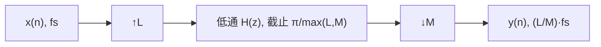

## 为什么需要改变采样率

实际系统里，不同模块常常工作在不同的采样率：

| 场景 | 采样率差异 |
| --- | --- |
| 音频 | 44.1 kHz（CD）、48 kHz（专业）、96 kHz |
| 软件无线电 | ADC 在中频采样（几十 MHz），基带只需几百 kHz |
| OFDM | 子载波符号率与 FFT 采样率相互转换 |
| 滤波器组 | 分析滤波器组降采样，综合滤波器组升采样 |
| 图像/视频 | 分辨率缩放、金字塔分解 |

若所有模块都按最高采样率工作，运算量、存储和功耗会成倍增加。多抽样率技术的目标是：**让每个模块只在自己需要的速率下运算，在速率变化处用滤波器保证信息不丢失**。

> [!info] 多抽样率系统
> **多抽样率系统**（multirate system）是包含采样率变换的数字系统。一次完整的采样率变换 = **抽取或插值** + **低通滤波**，两者缺一不可。

## 抽取：降低采样率

### 定义与时域关系

**$D$ 倍抽取**（decimation by $D$，下采样）定义为

$$
x_d(n)=x(nD),\qquad n=0,1,2,\dots
$$

即每隔 $D$ 个样点取一个，采样率从 $f_s$ 降到 $f_s/D$。

### 频域关系与混叠

抽取后的频谱是原频谱先压缩到 $[-\pi/D,\pi/D]$、再展宽 $D$ 倍并叠加的结果：

$$
X_d(e^{j\omega})=\frac{1}{D}\sum_{k=0}^{D-1}X\left(e^{j(\omega-2\pi k)/D}\right)
$$

若原信号带宽超过 $\pi/D$，展宽后的副本会互相重叠，高频分量折叠到低频，形成**混叠**。因此抽取之前必须先低通滤波，把 $|\omega|>\pi/D$ 的分量滤掉：

$$
x(n)\ \to\ \boxed{H(z)}\ \to\ \downarrow D\ \to\ x_d(n)
$$

这个滤波器称为**抗混叠滤波器**（anti-aliasing filter），截止频率为 $\pi/D$（按原采样率归一化）。

> [!example] $D=2$ 的抽取
> 原信号含 1 kHz 与 7 kHz 两个分量，$f_s=16$ kHz。
> - 抽取前：两个分量都在 $[0,8]$ kHz 内，可分辨；
> - 直接 2 倍抽取：新采样率 8 kHz，Nyquist 变成 4 kHz，7 kHz 折叠到 $8-7=1$ kHz，与原来的 1 kHz 重合，无法再分开；
> - 先低通到 4 kHz 再抽取：7 kHz 被滤除，只剩 1 kHz，结果干净。

> [!warning] 抽取不是"简单丢点"
> 直接丢点等价于先采样、再混叠，丢掉的信息无法恢复。正确顺序永远是**先滤波、后丢点**。

## 插值：提高采样率

### 定义与时域关系

**$I$ 倍插值**（interpolation by $I$，上采样）先每两个样点之间插入 $I-1$ 个零：

$$
x_i(n)=
\begin{cases}
x(n/I), & n=0,\pm I,\pm2I,\dots\\
0, & \text{其他}
\end{cases}
$$

采样率从 $f_s$ 升到 $If_s$。插零只改变了时间轴，并没有产生新的信息。

### 频域关系与镜像

插零后的频谱是原频谱压缩 $I$ 倍：

$$
X_i(e^{j\omega})=X(e^{j\omega I})
$$

原来在 $[-\pi,\pi]$ 内的一个周期被压缩到 $[-\pi/I,\pi/I]$，在 $[-\pi,\pi]$ 内出现 $I$ 个**镜像**。要得到真正的插值，必须用低通滤波器保留基带副本、滤掉镜像：

$$
x(n)\ \to\ \uparrow I\ \to\ \boxed{H(z)}\ \to\ x_i(n)
$$

滤波器截止频率为 $\pi/I$（按新采样率归一化），并需要增益 $I$：插零让平均功率下降 $I$ 倍，增益 $I$ 才能让插值结果在原始样点上还原 $x(n)$。

> [!example] $I=2$ 的插值
> 原序列 $x(n)=\{1,2,3\}$，2 倍插零后为 $\{1,0,2,0,3,0\}$。频谱压缩一半，在 $\pi$ 附近出现镜像；用截止 $\pi/2$、增益 2 的低通滤掉镜像，就得到平滑的插值序列。

> [!warning] 插零不是"插值"
> 插零后的序列听起来仍是原信号，但频谱里满是镜像，直接送 DAC 会产生高频成像。抗镜像滤波器（anti-imaging filter）是插值的一部分，不能省。

## 有理数倍采样率转换

任意有理数倍变换 $\frac{L}{M}$（从 $f_s$ 变到 $\frac{L}{M}f_s$）用"先插值、再滤波、后抽取"实现：



- 先插值 $L$ 倍，采样率升到 $Lf_s$；
- 低通截止取 $\pi/\max(L,M)$，同时承担抗镜像与抗混叠；
- 再抽取 $M$ 倍，得到 $\frac{L}{M}f_s$；
- 滤波器增益取 $L$，补偿插零造成的幅度下降。

> [!example] 44.1 kHz 与 48 kHz 互转
> $48000/44100=160/147$，所以 44.1 kHz → 48 kHz 取 $L=160$、$M=147$；反向取 $L=147$、$M=160$。MATLAB 的 `resample(x,160,147)` 内部就是多相实现的 $\uparrow160$ + FIR + $\downarrow147$。

> [!warning] 频率归一化的陷阱
> 同一个物理频率，在不同采样率下对应的数字频率不同。$f_s=48$ kHz 时 1 kHz 对应 $\omega=2\pi\cdot1000/48000$；抽取 2 倍后 $f_s=24$ kHz，同一个 1 kHz 对应 $\omega=2\pi\cdot1000/24000$。设计抗混叠/抗镜像滤波器时，**必须按当前采样率归一化**。

## 诺贝尔恒等式

**诺贝尔恒等式**（noble identity）是多抽样率系统的"代数法则"，允许把滤波器搬过抽取器或插值器：

$$
H(z)\downarrow D=\ \downarrow D\,H(z^{D})
\qquad
H(z)\uparrow I=\ \uparrow I\,H(z^{I})
$$

读法是：滤波器在抽取器之前，等价于抽取器之后接一个把 $z$ 换成 $z^D$ 的滤波器；插值同理。这两条恒等式是**多相分解**与高效实现的理论基础：它让我们能把运算从高速率侧搬到低速率侧。

## 多相分解与高效实现

### 多相分解

把滤波器 $H(z)=\sum_{n=0}^{N-1}h(n)z^{-n}$ 按 $n \bmod D$ 分组：

$$
H(z)=\sum_{k=0}^{D-1}z^{-k}E_k(z^{D}),
\qquad
E_k(z)=\sum_{m}h(mD+k)z^{-m}
$$

$E_k(z)$ 称为第 $k$ 个**多相分量**（polyphase component），每个分量只保留原滤波器每 $D$ 个系数中的一个。对插值因子 $I$ 有完全平行的分解，只需把 $D$ 换成 $I$。

### 多相抽取器

把 $H(z)$ 与 $\downarrow D$ 级联，用诺贝尔恒等式把 $E_k(z^D)$ 搬到抽取器之后，就得到每个子滤波器只工作在 $f_s/D$ 的结构：

```text
x(n) ──► z^0 ──► ↓D ──► E0(z) ──┐
     ──► z^-1 ─► ↓D ──► E1(z) ──┤
     ──► ...                     ├──► (Σ) ──► x_d(n)
     ──► z^-(D-1) ─► ↓D ──► E_{D-1}(z) ──┘
```

每个分支的输入是 $x(n)$ 的一个延迟相位，抽取后变成低速率序列，再送进长度为约 $N/D$ 的子滤波器，最后求和。D 个分支轮流贡献样本，等效于一个输入"换向开关"。

### 多相插值器

插值方向相反：先在低速率下用 $E_k(z)$ 滤波，再插值、延迟 $k$ 个高速率样点并相加：

```text
              ┌──► E0(z) ──► ↑I ──► z^0 ──┐
x(n) ──┬──────┼──► E1(z) ──► ↑I ──► z^-1 ──┤
       │      └──► ...                     ├──► (Σ) ──► x_i(n)
       └─────────► E_{I-1}(z) ─► ↑I ─► z^-(I-1) ──┘
```

所有子滤波器都工作在输入速率 $f_s$，插值后的延迟与求和工作在 $If_s$，但延迟只是移位操作，不消耗乘法。

### 计算量对比

以每秒乘法次数计：

| 实现 | 抽取（$\downarrow D$） | 插值（$\uparrow I$） |
| --- | --- | --- |
| 直接实现 | $Nf_s$（高速率下逐点算） | $NIf_s$（对含零序列也算） |
| 多相实现 | $Nf_s/D$ | $Nf_s$ |
| 节省因子 | $1/D$ | $1/I$ |

> [!example] 64 抽头（约 64 阶）滤波器、8 倍抽取
> - 直接实现：滤波器在 $f_s$ 下工作，每秒 $64f_s$ 次乘法；
> - 多相实现：8 个子滤波器各约 8 个抽头，工作在 $f_s/8$，每秒 $8\times8\times f_s/8=8f_s$ 次乘法；
> - 计算量降到 $1/8$，而且被丢弃的样点不再参与运算。

按"每个输出点"计，多相抽取器仍需约 $N$ 次乘法：每个输出由 $D$ 个子滤波器的当前输出相加，而每个子滤波器约有 $N/D$ 个抽头。节省发生在**每秒**的总运算量上——它避免了高速率下的无效计算。$\frac{L}{M}$ 转换的总计算量约为直连结构的 $1/\max(L,M)$ 量级。

## 多抽样率系统的应用

### 分数倍重采样

$\uparrow L$ + 低通 + $\downarrow M$ 可以实现任意有理数倍变换，广泛用于音频重采样、图像缩放、视频帧率转换。例如 44.1 kHz 与 48 kHz 互转、音乐变速变调（改变重采样比而不改变音高需要专门的相位声码器，属于另一类问题）。

### 滤波器组

- **分析滤波器组**：把信号分成多个子带，每个子带降采样后传输或处理；
- **综合滤波器组**：各子带升采样、滤波后合成原信号；
- 正交镜像滤波器组（QMF）、离散小波变换（DWT）都是多抽样率系统，设计目标是**完美重构**（perfect reconstruction）与混叠抵消。

### OFDM 与软件无线电

- OFDM 的 IFFT/FFT 本身就是一种多抽样率结构：$N$ 个子载波、子载波间隔与采样率满足 $\Delta f=f_s/N$，循环前缀是时域复制；
- 软件无线电的 DDC/DUC：ADC 在中频高速采样 → 数字混频 → CIC 或多相 FIR 抽取 → 基带；发射端反向；
- **CIC 滤波器**（cascaded integrator-comb）是抽取/插值的常用高效结构，只用加减法和寄存器、不需要乘法器，适合大倍数变频；代价是通带下垂（droop）和阻带衰减有限，通常后面再跟一级补偿 FIR。

### 音频与图像

音频重采样、采样率转换与抗混叠；图像金字塔、多分辨率分析与 JPEG 2000 的小波变换，都是"滤波 + 采样率变换"的组合。

## MATLAB 示例

```matlab
% 抽取（自动加抗混叠滤波器；默认滤波器类型与阶数随版本，待核验）
y1 = decimate(x, 4);

% 插值（自动加抗镜像滤波器）
y2 = interp(x, 4);

% 有理数倍转换：44.1 kHz -> 48 kHz 取 160/147
y3 = resample(x, 160, 147);

% 先插 L、再滤波、后抽 M（多相实现，可复用同一滤波器）
h  = designMultirateFIR(160, 147);
y4 = upfirdn(x, h, 160, 147);

% 流式处理：系统对象
dec = dsp.FIRDecimator(4, fir1(63, 0.25));
intp = dsp.FIRInterpolator(4, fir1(63, 0.25));
```

- `decimate`、`interp`、`resample` 都会自动设计抗混叠/抗镜像滤波器，不要手工在前后再串一个同截止频率的低通；
- `resample` 的两个整数参数是 $L$ 与 $M$，不是原采样率与目标采样率，需要自己约分（44.1k→48k 为 160/147）；
- 自己设计滤波器时，可用 `designMultirateFIR` 或 `fir1`，截止频率按中间速率归一化，增益取 $L$。

> [!note] 示例说明
> 以上代码用于说明函数接口，本页未在 MATLAB 中实际运行，具体默认参数请以所用版本文档为准。

## 易错点

- **直接丢点/插零就完事**：抽取前必须抗混叠，插值后必须抗镜像，滤波器是变换的一部分。
- **截止频率归一化错**：$\pi/D$、$\pi/I$ 是相对对应侧采样率的；抽取后用新采样率理解频率，插值滤波按新采样率设计。
- **忘记插值增益 $I$**：抗镜像滤波器增益取 $I$，否则插值后幅度整体下降 $I$ 倍；$\frac{L}{M}$ 转换的增益取 $L$。
- **把 $\uparrow I$ 与 $\downarrow M$ 的顺序写反**：标准结构是先插值、再滤波、后抽取；顺序反了会引入无法用滤波补救的混叠。
- **多相分解下标错位**：$E_k$ 对应 $h(mD+k)$，$k$ 是延迟相位数；$E_k$ 与 $z^{-k}$ 的配对弄反，滤波器整体会错位 $D$ 个样点。
- **以为多相结构改变了滤波器**：它只改变运算组织方式，系统函数不变，性能指标应以原 $H(z)$ 为准。

## 前置与相关阅读

- [[signal-processing/signals-and-systems-intro|信号与系统导论]]：采样定理与混叠，是理解抽取、插值的前提。
- [[signal-processing/dft-and-fft|DFT 与 FFT]]：频谱周期延拓、频率分辨率，OFDM 中的 IFFT/FFT 由此而来。
- [[signal-processing/fir-filter-design|FIR 数字滤波器设计]]：抗混叠、抗镜像滤波器几乎都设计成线性相位 FIR。
- [[signal-processing/digital-filter-structures|数字滤波器结构]]：多相结构是一种特殊的 FIR 实现形式。
- [[signal-processing/iir-filter-design|IIR 数字滤波器设计]]：CIC 之后的补偿滤波与窄带抽取常用 IIR。

## 来源与延伸阅读

- [[vault-notes/dsp/08-multirate-sampling|序列的抽取和插值——多抽样率数字信号处理基础（详细笔记）]]：抽取/插值的频域推导、诺贝尔恒等式、多相分解、滤波器组与应用、MATLAB 函数的完整原文。
- [[vault-notes/dsp/07-fir-filter-design|FIR 数字滤波器设计（详细笔记）]]：抗混叠/抗镜像滤波器的设计与线性相位要求。
- [[vault-notes/dsp/03-discrete-fourier-transform|离散傅里叶变换（详细笔记）]]：频谱周期延拓与频率采样，是抽取/插值频域关系的来源。
- 应用方向：[[vault-notes/5g/phy/04-physical-channels-signals|5G 物理信道与信号]]、[[vault-notes/communication/06-digital-baseband|数字基带]]、[[vault-notes/fpga/ad9361/iq-signals|AD9361 与 IQ 信号]]。
- 工具参考：[[vault-notes/matlab/matlab-notes|MATLAB 学习笔记]]。
