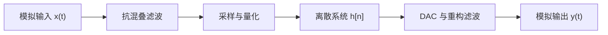

## 信号、系统与两个基本假设

信号是携带信息的函数，系统是把输入信号映射为输出信号的算子。整个本科阶段的信号处理课程，基本建立在两个假设之上：**线性**（叠加原理成立）与**时不变**（系统特性不随时间改变）。满足这两个条件的系统称为 LTI 系统，它可以用冲激响应完整描述。

## 线性时不变系统与卷积

LTI 系统的输出等于输入与冲激响应的卷积：

$$
y(t)=x(t)*h(t)=\int_{-\infty}^{\infty}x(\tau)\,h(t-\tau)\,d\tau
$$

离散形式是加权求和：

$$
y[n]=x[n]*h[n]=\sum_{k=-\infty}^{\infty}x[k]\,h[n-k]
$$

卷积的直观理解是「翻转、平移、相乘、求和」：每一个输入样本都对输出产生一个移位并缩放后的冲激响应副本，输出是所有副本的叠加。FIR 滤波器就是有限长度的 $h[n]$。

## 频域视角

对离散信号取离散时间傅里叶变换（DTFT），系统函数为

$$
H(e^{j\omega})=\sum_{n=-\infty}^{\infty}h[n]\,e^{-j\omega n}
$$

由卷积定理，时域卷积对应频域相乘：$Y(e^{j\omega})=X(e^{j\omega})H(e^{j\omega})$。因此滤波器设计的本质是设计 $|H(e^{j\omega})|$ 的形状。需要注意 $H(e^{j\omega})$ 以 $2\pi$ 为周期，这是离散时间信号频谱的固有性质。

## 采样定理与混叠

连续信号经理想采样后，频谱会以采样频率 $f_s$ 为间隔周期性复制。若信号的最高频率为 $f_{max}$，只有满足

$$
f_s > 2f_{max}
$$

才能保证相邻复制谱不重叠，这称为奈奎斯特（Nyquist）采样定理。工程上通常留出余量，例如音频采样取 44.1 kHz 而按 20 kHz 带宽设计。不满足条件时，高频成分会折叠到低频，形成混叠：

$$
f_{alias}=\left|f_0-k f_s\right|,\quad k\in\mathbb{Z}
$$

> [!warning] 混叠是不可逆的
> 一旦采样率不足，高频分量与低频分量在数字域完全重合，后级滤波器无法区分。抗混叠滤波器必须放在 ADC 之前，属于模拟域。

## 从连续到数字的完整链路

## 常见误区

- 把 DTFT 与 DFT 混为一谈：DTFT 的频谱是连续的、以 $2\pi$ 为周期；DFT 只是对 DTFT 在频域上的均匀采样。
- 认为「采样率越高越好」：采样率越高数据量越大，且需与量化位数、处理吞吐率一起权衡。
- 忽略量化误差：理想采样只讨论时间离散，实际 ADC 还会引入幅度量化，信噪比约为 $6.02b+1.76$ dB（$b$ 为位数）。

## 相关阅读

- [[Signal-Processing/DFT-and-FFT|DFT 与 FFT]]
- [[Mathematics/Probability-Overview|概率论概览]]
- [[Communication/Analog-Modulation-AM|模拟调制 AM]]
