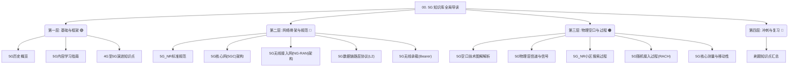

# 📡 5G 通信知识库全局物理导读与框架

> [!abstract] 📌 核心导读
> 欢迎来到 **5G 通信方向知识库**。
> 本文档是整个 5G 学习体系的“地图”与“指南针” (MOC: Map of Content)，旨在帮助你梳理各个分散知识点之间的内在逻辑与层级关系。无论你是初学者还是为了应对面试复习，都可以从这篇综述出发，顺藤摸瓜地掌握 5G 核心技术。

---

## 一、 5G 知识体系全景逻辑图

5G 并非单一技术，而是一个从物理子载波到核心网服务化架构的庞大系统工程。以下是整个知识库的模块拆解与逻辑树。

---

## 二、 核心知识模块映射与导航

通过下方链接，你可以直接跳转到对应的核心知识卡片。

> [!tip] 🧭 先看分层地图
> [[vault-notes/5g/architecture/01-layering-overview]] 用「物理层 → 数据链路层 → 网络层 → 传输层」一页串起整个 5G 架构，适合作为本页的配套导图。

### 🟢 1. 启蒙阶段：5G 基础与演进框架
*核心目标：了解 5G 的来源、目标场景以及与 4G 网络的演进关系。*
*   🔗 **[[vault-notes/5g/fundamentals/02-5g-history-applications|5G 历史概览]]**：从 ITU 的 IMT-2020 目标到 5G 建设体验速率。
*   🔗 **[[vault-notes/5g/fundamentals/03-5g-learning-guide|5G 内容学习指南]]**：教你如何宏观建立 5G 知识树模型。
*   🔗 **[[vault-notes/5g/fundamentals/01-4g-to-5g-evolution|4G 至 5G 演进知识点]]**：聚焦非独立组网（NSA Option 3X），理解网络控制面与数据面的双连接分流。

### 🔵 2. 骨架阶段：标准规范与网络架构
*核心目标：掌握 3GPP 协议赋予 5G 的宏观规则，以及核心网与接入网的拓扑形态。*
*   🔗 **[[vault-notes/5g/protocols/04-nr-standard-specifications|5G NR 标准规范]]**：学习频段划分（FR1/FR2）、灵活子载波间隔（SCS）与 RB/BWP 定义。
*   🔗 **[[vault-notes/5g/architecture/02-5gc-architecture|5G核心网 (5GC) 架构]]**：理解颠覆性的 SBA 服务化架构，以及 AMF、SMF、UPF 三大核心网元的职责分离。
*   🔗 **[[vault-notes/5g/architecture/03-ng-ran-architecture|5G 无线接入网 (NG-RAN) 架构]]**：掌握 gNB 内部 CU 和 DU 的分离架构，以及前传、中传 F1 接口的逻辑。
*   🔗 **[[vault-notes/5g/protocols/03-data-link-layer-l2|5G 数据链路层协议 (L2)]]**：俯视数据向下打包过程，理解 SDAP的QoS映射、PDCP的加密、RLC的分段以及 MAC 层的调度。
*   🔗 **[[vault-notes/5g/protocols/01-bearer-l1-l2|5G 无线承载 (Bearer)]]**：数据的运输通道，梳理 SRB（信令连接）和 DRB（数据连接）如何配合工作。

### 🟠 3. 血肉阶段：物理过程与空口核心技术
*核心目标：探究 5G 最硬核、最底层的无线空口交互。这部分是通信底层原理精华。*
*   🔗 **[[vault-notes/5g/phy/05-air-interface-illustrated|5G 空口技术图解解析]]**：物理层总纲，使用图表宏观展示空口交互模型。
*   🔗 **[[vault-notes/5g/phy/04-physical-channels-signals|5G 物理层信道与信号]]**：详尽解析各类上/下行物理信道（PBCH/PDCCH等）与参考信号（PSS/SSS/DMRS等）。
*   🔗 **[[vault-notes/5g/phy/01-cell-search|5G NR 小区搜索过程]]**：详解手机开机后，如何通过盲检 SSB 找到基站、计算 PCI 并建立下行同步。
*   🔗 **[[vault-notes/5g/phy/03-random-access-rach|5G 随机接入过程 (RACH)]]**：下行同步后，手机如何通过发射 PRACH 完成上行同步、获取 MSG2/3/4 的核心流程。
*   🔗 **[[vault-notes/5g/phy/02-measurements-mobility|5G 核心测量与移动性]]**：手机处于运动或弱网状态时，如何利用 A1~A6 测量事件在基站间进行安全切换（Handover）。

### 🔴 4. 冲刺复习：刷题与疑难解答
*   🔗 **刷题知识点汇总**：收录了常见考点、面试题与易错细节（例如 CA 载波聚合、LTE/NR 双连接参数、PCI数量对账）。

---

## 三、 🏁 推荐进阶阅读路线

如果您希望从零开始系统性梳理，建议参考以下“业务生命周期”建立直觉：

> **1. 宏观了解时代背景与 5G 规则**   ➔ 🔗 *5G 历史与 NR 标准*
> **2. 看清 5G 骨干网怎么连接**     ➔ 🔗 *5GC 架构与 NG-RAN 演进*
> **3. 基站空口怎么播发无线电波**   ➔ 🔗 *5G 空口图解与信道信号*
> **4. 手机开机拿什么连上网**       ➔ 🔗 *小区搜索与 RACH 过程*
> **5. 连上网后数据怎么交互**       ➔ 🔗 *L2 协议栈与无线承载*
> **6. 用户移动时如何保证不断网**   ➔ 🔗 *核心测量与移动性管理*
> **7. 查漏补缺**                   ➔ 🔗 *刷题知识点汇总*

---

## 四、 🔬 底层原理延伸：通信原理

5G 空口的每一项技术，都能在《通信原理（第七版）》中找到理论出处。需要补底层原理时，从这里切入：

| 5G 技术 | 理论出处 |
| --- | --- |
| 子载波间隔 SCS 15/30/60/120 kHz、循环前缀 CP | [[vault-notes/communication/08-advanced-digital-modulation]] —— OFDM 正交条件 $\Delta f=1/T_s$ 与 CP 抗多径 |
| PDSCH 的 256QAM/1024QAM、控制信道的 QPSK | [[vault-notes/communication/07-digital-bandpass]]、[[vault-notes/communication/08-advanced-digital-modulation]] —— QAM 星座与噪声容限 |
| LDPC 编码、Polar 码 | [[vault-notes/communication/11-error-control-coding]] —— 现代编码双雄与香农极限 |
| 扰码、PRACH 前导码（Zadoff-Chu 序列） | [[vault-notes/communication/12-orthogonal-codes-pn-sequences]] —— PN 序列与正交性 |
| 小区搜索 PSS/SSS、时频同步 | [[vault-notes/communication/13-synchronization]] —— 载波同步与群同步的工程实现 |
| 多径衰落对抗、相关带宽 | [[vault-notes/communication/04-channel]]、[[vault-notes/communication/03-random-processes]] —— 随参信道与瑞利/莱斯分布 |
| 物理层处理链（CRC→编码→速率匹配→调制） | [[vault-notes/communication/09-optimal-reception]]、[[vault-notes/communication/11-error-control-coding]] |
| 噪声、检测与估计的完整链路 | [[vault-notes/random-signals/00-knowledge-map]] —— 概率 → 随机过程 → PSD → 估计/检测 → [[vault-notes/random-signals/10-awgn-channel]] |

> 完整交叉索引见 [[vault-notes/communication/b-cross-library-links]]；知识地图见 [[vault-notes/communication/00-guide]]。

---

## 五、 🧪 专题、实验与真题

| 类型 | 笔记 | 用途 |
| --- | --- | --- |
| 分层总览 | [[vault-notes/5g/architecture/01-layering-overview]] | 按物理层 → L2 → 网络层 → 传输层串起架构 |
| 工程仿真 | [[vault-notes/5g/engineering-simulation/01-engineering-simulation]]、[[vault-notes/5g/engineering-simulation/02-signal-tower-practice]] | 信号塔/机房设备与线缆配置记录 |
| 端到端流程 | [[vault-notes/5g/phy/06-ue-access-core-network-flow]] | 从 RACH 到 PDU 会话建立的时序图 |
| 承载网 | [[vault-notes/5g/protocols/05-transport-network]] | 前传/中传/回传、EPS 承载与 PDU 会话 |
| 真题 | 第十二届大唐杯真题B组1套、第十二届大唐杯真题B组2套、第十二届大唐杯真题B组3套 | 大唐杯 B 组三套题 |
| 物理元件 | 物理元件配置题目总结 | 设备选型与工程参数题 |
| 6G 延伸 | [[vault-notes/5g/6g/01-6g-architecture]] | 6G 五面架构与产业链上游 |
| 可视化 | 全库知识网络 Canvas、5G 空口技术图解 Canvas | 图形化串联 |
| HTML 导图 | 5G知识总导图.html | 用浏览器打开（Obsidian 内不能预览 HTML） |

> [!tip] 学习顺序
> 先读 [[vault-notes/5g/fundamentals/03-5g-learning-guide]] 建立知识树，再按「标准 → 架构 → 空口 → 流程 → 真题」推进；每读完一篇就回到本页勾一次进度。
