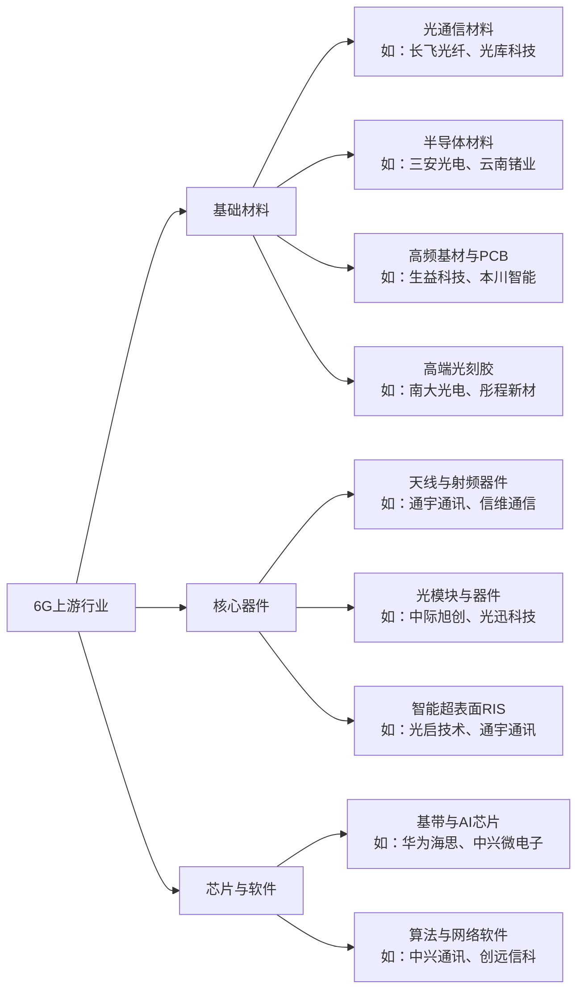

# 🌐 6G 网络架构与产业链

> [!abstract] 本页在讲什么
> 6G 的“五面”架构（控制 / 智能 / 数据 / 安全 / 用户）与产业链上游的材料、器件、芯片与软件。

6G网络架构的5面包括: **控制面,智能面,数据面,安全面,用户面**
6G网络不包括: 毫秒级的时延体验
6G产业链的上游是整个技术体系的地基，主要涵盖**基础材料、核心器件、芯片与软件**三大核心领域，为6G网络的性能突破提供关键支撑

---

**关联**：[[vault-notes/5g/00-guide]]｜[[vault-notes/5g/fundamentals/03-5g-learning-guide]]｜[[vault-notes/5g/fundamentals/02-5g-history-applications]]

