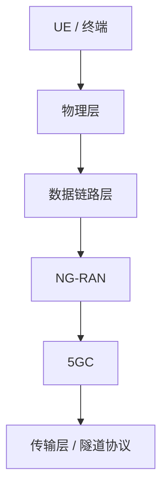

# 🧭 5G分层总览

> [!abstract] 📌 核心导读
> 本页是「5G核心架构与规范」的总导航：按 物理层 → 数据链路层 → 网络层 → 传输层 组织学习路径，便于复习与跳转。

> [!info] 💡 阅读方法
> 先抓每层“解决什么问题”，再看“和谁交互、走什么接口”。
> 记忆口诀：==空口看物理，承载看L2，系统看网络，落地看传输==。

## 📶 1. 物理层

负责空口上的真实发射与接收、频谱与时域资源、数值化栅格、同步、随机接入等基础能力。

- [[vault-notes/5g/protocols/04-nr-standard-specifications|5G NR 标准规范]]

## 🔗 2. 数据链路层

负责空口数据的成帧、调度、重传、加密、QoS 映射，以及无线承载的组织方式。

- [[vault-notes/5g/protocols/03-data-link-layer-l2|5G 数据链路层协议 (L2)]]
- [[vault-notes/5g/protocols/01-bearer-l1-l2|5G 无线承载 (Bearer)]]

## 🌐 3. 网络层

负责接入网与核心网的整体架构、控制面和用户面的分工、网络功能拆分，以及接口关系。

- [[vault-notes/5g/architecture/03-ng-ran-architecture|5G 无线接入网 (NG-RAN) 架构]]
- [[vault-notes/5g/architecture/02-5gc-architecture|5G 核心网 (5GC) 架构]]
- [[vault-notes/5g/protocols/05-transport-network|5G 承载网]]（前传 / 中传 / 回传）
- [[vault-notes/5g/architecture/03-ng-ran-architecture|网络层入口（NG-RAN / 5GC / 承载网）]]

## 🚛 4. 传输层

这里更偏向 5G 系统工程里的承载协议与隧道协议，而不是端到端应用层的普通 TCP/UDP 语义。

- [[vault-notes/5g/protocols/02-transport-layer-tunnels|5G 传输层与隧道协议]]

## 🧩 5. 一页速查

| 层级 | 典型关键词 | 记忆抓手 |
| --- | --- | --- |
| 物理层 | FR1、FR2、BWP、SSB、PRACH | 解决“怎么发、怎么收” |
| 数据链路层 | SDAP、PDCP、RLC、MAC、HARQ | 解决“怎么分层传、怎么调度” |
| 网络层 | NG-RAN、5GC、AMF、SMF、UPF | 解决“怎么接入、怎么会话、怎么转发” |
| 传输层 | SCTP、GTP-U、PFCP、UDP/IP | 解决“信令怎么走、数据怎么隧道化” |

## 🛤️ 阅读顺序

1. 先看 [[vault-notes/5g/protocols/04-nr-standard-specifications|物理层]]，建立 NR 空口的底座。
2. 再看 [[vault-notes/5g/protocols/03-data-link-layer-l2|数据链路层]]，理解 SRB / DRB、QoS Flow、HARQ、RLC / MAC。
3. 然后看 [[vault-notes/5g/architecture/03-ng-ran-architecture|NG-RAN]] 和 [[vault-notes/5g/architecture/02-5gc-architecture|5GC]]，把控制面与用户面接起来。
4. 最后看 [[vault-notes/5g/protocols/02-transport-layer-tunnels|传输层]]，把 N2 / N3 / N9 等接口上的承载协议补齐。

## 📚 规范依据

- 3GPP TS 38.300: NR / NG-RAN 总体描述，适合先建立网络全景。
- 3GPP TS 23.501: 5GS 系统架构，适合理解 5GC、切片和会话控制。
- 3GPP TS 38.321: MAC 协议规范，适合回看调度与 HARQ 关系。
- 3GPP TS 29.281: GTPv1-U 用户面隧道，适合理解 N3 / N9 传输。
- 3GPP TS 38.331: RRC 协议规范，适合把无线接入过程和控制面串起来。

## 🔖 关联入口

- [[vault-notes/5g/protocols/04-nr-standard-specifications|物理层入口]]
- [[vault-notes/5g/protocols/03-data-link-layer-l2|L2 入口]]
- [[vault-notes/5g/architecture/03-ng-ran-architecture|NG-RAN 入口]]
- [[vault-notes/5g/architecture/02-5gc-architecture|5GC 入口]]
- [[vault-notes/5g/protocols/02-transport-layer-tunnels|传输层入口]]

> [!success] ✅ 复习完成标志
> 能不看笔记说清 N2 / N3 / N4 / N9 分别承载什么协议，以及 SRB / DRB 与 QoS Flow 的关系，就算掌握这套分层框架。

---

## 📎 附：电信管理网（TMN）分层

> [!note] 另一套“分层”概念
> 电信管理网分层模型从下到上依次为：**网元管理层 → 网络管理层 → 业务管理层 → 商务管理层**。它与 5G 协议栈的物理层 / L2 / 网络层 / 传输层不是同一套划分，注意区分。

---

**关联**：[[vault-notes/5g/00-guide]]｜[[vault-notes/5g/protocols/05-transport-network]]｜00_全库理论知识点综合与联系
