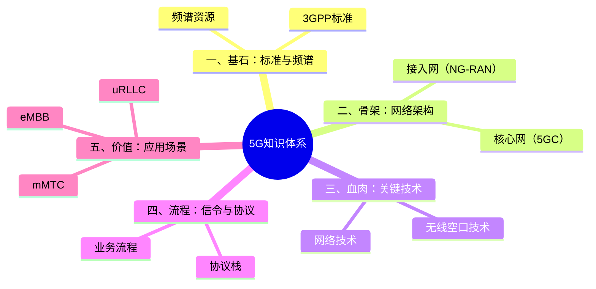
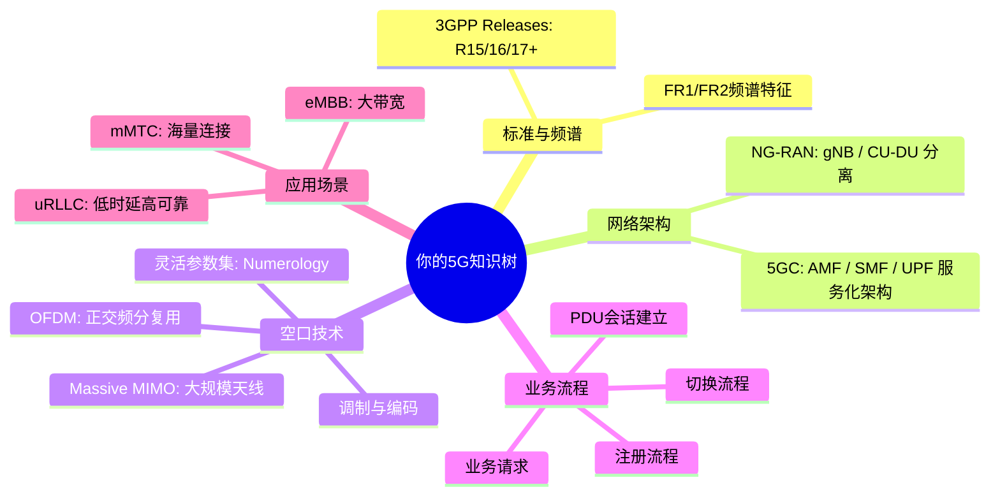

# 5G 知识体系与学习框架

> [!abstract] 📌 核心导读
> **构建系统化、结构化的 5G 知识树。**
> 5G 的知识点庞大且繁杂，建议按照从底层协议到上层架构，再到应用场景的逻辑来梳理。以下为您提供了宏观知识体系和个人的学习路线图建议。

---

## 宏观视角：5G 通用知识体系

将 5G 网络解构为五大模块：基石、骨架、血肉、流程、价值。

---

## 微观路线：个人 5G 知识树进阶

聚焦于深入理解和解决实际通信工程问题，您的个人知识架构可以按照以下维度展开：

> [!tip] 学习建议
> 学习时建议以**空口技术**和**业务流程**（涵盖信令与协议）为核心突破点，这是理解5G核心设计（如时延、速率）最关键的拼图。

---

## 🔗 关联

- 总入口：[[vault-notes/5g/00-guide]]
- 分层地图：[[vault-notes/5g/architecture/01-layering-overview]]
- 下一步：[[vault-notes/5g/protocols/04-nr-standard-specifications]]｜[[vault-notes/5g/architecture/02-5gc-architecture|5G核心网(5GC)架构]]｜[[vault-notes/5g/architecture/03-ng-ran-architecture|5G无线接入网(NG-RAN)架构]]
- 理论底座：[[vault-notes/communication/07-digital-bandpass]]｜[[vault-notes/communication/08-advanced-digital-modulation]]