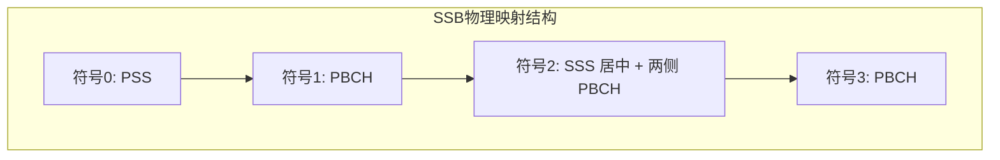

# 🔍 5G NR 小区搜索与同步过程

> [!abstract] 📌 核心导读
> **小区搜索 (Cell Search)** 是UE在开机、脱网重连或切换时，**寻找并同步到5G小区**的首要动作。其终极目的是与基站达到“节拍一致”（时频同步）并获取小区的身份证（PCI）和广而告之的系统快报（MIB）。

---

## 🧱 1. 小区搜索的核心基石：SSB块

小区搜索的本质是找寻并解码基站持续广播的灯塔信号——**SSB (同步信号块, SS/PBCH Block)**。

### 1.1 SSB 的三大组成部分
| 组成要素 | 全称 | 承担任务 |
| :--- | :--- | :--- |
| **==PSS==** | 主同步信号 (Primary Sync Signal) | 实现【符号级定时同步】，获取小区组内ID (即 `N_ID^(2)`: 取值 0~2 ) |
| **==SSS==** | 辅同步信号 (Secondary Sync Signal) | 实现【无线帧级同步】，获取小区组ID (即 `N_ID^(1)`: 取值 0~335 ) |
| **==PBCH==** | 物理广播信道 (Physical Broadcast Channel) | 传输 **MIB (主信息块)**，包含后续驻留的最核心解码参数 |

### 1.2 SSB 的时频结构与发送周期
- **时域**：霸占连续的 **4个 OFDM 符号**。顺序为：`PSS` ➔ `PBCH` ➔ `SSS + PBCH` ➔ `PBCH`。
- **频域**：铺满 **240个子载波** (精算为 20个 PRB)。
- **发送周期**：默认每 **20ms** 扫描播发一次。
- **波束扫描**：在狭窄的 5ms 突发窗口内，基站像探照灯一样旋转播发多个指向不同空间的 SSB，以覆盖所有扇区。最大波束数视频段而定 (Sub-6GHz 为 4/8 个，毫米波高达 64 个)。

---

## 🏃 2. 小区搜索标准“三步走”

只要按部就班走好这三步，手机就能成功“看”到一座5G基站。

### 🟢 第一步：PSS 盲检（符号级同步）
- **UE动作**：在同步栅格（GSCN，规定好的可能频点）上盲搜 PSS 序列 (Zadoff-Chu短序列)。
- **获取成就**：
  1. 找到了电磁波的 OFDM 符号对齐起跑线（**符号定时**）。
  2. 解出了 PCI 公式的后半部分：**`N_ID^(2)` (取值 0, 1 或 2)**。

### 🟡 第二步：SSS 检测（帧级同步）
- **UE动作**：顺藤摸瓜，在 PSS 之后的确定位置解出 SSS，它是一段 m序列。
- **获取成就**：
  1. 找到了完整的 10ms 无线大帧的头部对齐端（**帧级定时**）。
  2. 解出了 PCI 公式的前半部分：**`N_ID^(1)` (取值 0 ~ 335)**。
  3. **合成完整身份(PCI)** ➔ `PCI = 3 × N_ID^(1) + N_ID^(2)`。

### 🔵 第三步：PBCH 解调（获取 MIB，打开大门）
- **UE动作**：利用前面算出的对齐位置和身份密码，一举破译紧贴着的 PBCH 数据。
- **获取成就**：提取出 **MIB (Master Information Block)**。里面包含了：
  - 系统帧号 (SFN 高6位)
  - 关键系统参数 (极简子载波间隔、SSB偏移、半帧指示)
  - 最重要的：**SIB1 控制资源集配置 (`PDCCH-ConfigSIB1`)**——相当于告诉手机“接下来去哪片地找详细入网指南RMSI”。

考点 : **MIB消息的传输周期为80ms**

---

## 🧮 3. 物理小区标识 (PCI) 深度解析

**PCI (Physical Cell Identity)** 就像是小区的工号。全网最多有 1008 个不同的工号。
*备注: 5G核心网的cell id有1008个;4G网的cell id有504个*

> [!important] 🔑 PCI 计算核心公式
> **`PCI = 3 × N_ID^(1) + N_ID^(2)`**
> - 前项提供大组号 (0~335)，产生 336 种变化。
> - 后项提供同组内编号 (0~2)，产生 3 种微调。
> - *合计：336 × 3 = 1008 枚唯一标识。*

### ⚠️ PCI 模值在无线规划中的致命影响
在基站做工勘规划时，PCI相邻不可乱填，其除余（Mod）属性直接决定底层信道的干扰排布：

| 模值运算 | 影响底层的什么资源？ | 网络规优铁律 |
| :--- | :--- | :--- |
| **PCI Mod 3** | CRS 参考信号的位置 *(LTE复用干扰)* | 邻区之间 **必须错开** |
| **PCI Mod 4** | PBCH 的 DMRS 解调参考信号序列 | 邻区之间 **必须错开** |
| **PCI Mod 8/30** | 标准 PDSCH/PUSCH DMRS 加扰序列 | 尽量做随机化降低打底干扰 |

*(注：计算完PCI并成功解码SIB1后，UE就可以立刻开启下一步——发送 Msg1 进行 RACH 随机接入啦！)*

---

## 🧪 4. 刷题补充

> [!info] 高频易错点
> 这部分把和 PCI / SSB raster / 波束扫描 相关的刷题点补齐。

- **5G PCI** 全网共有 **1008 个**（0~1007），而 **4G PCI** 共有 **504 个**（0~503），这个对比经常直接拿来做判断题。
- **用于 NR SCell 接入的 SSB** 必须严格映射在 **SS raster** 上；而用于测量、PCell / PSCell 接入的 SSB，不一定强制要求映射在 SS raster 上。
- **波束扫描** 在 C-Band / 2.6G 等 Sub-6 场景常记作 **最多 8 个**，毫米波场景可扩展到 **64 个**。
- **SS burst set** 的所有 **SSBLOCK** 需要在 **5 ms** 内发完，适合和 SSB 周期、波束扫描一起记。

---

**关联**：[[vault-notes/5g/00-guide]]｜[[vault-notes/5g/protocols/04-nr-standard-specifications]]｜[[vault-notes/5g/phy/03-random-access-rach]]｜[[vault-notes/communication/13-synchronization]]
