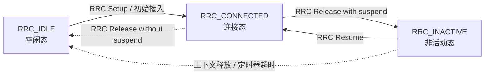

# 📏 5G核心测量与移动性 (Measurement & Mobility)

> [!abstract] 📌 核心导读
> 移动性管理是蜂窝网络最重要的特性之一。其核心基石在于**终端(UE)的实时无线信道测量与报告上报**。基站(gNB)通过给手机下发一套细致的“测量规则”，手机就成了一个移动的探针，为基站判决是否应当“切换(Handover)”提供最前线的参考。

---

## 🔁 RRC 三态与状态转换

> [!tip] 一句话记忆
> 5G NR 的 RRC 常用三态来理解：`RRC_IDLE`、`RRC_INACTIVE`、`RRC_CONNECTED`。其中 `INACTIVE` 是 5G 相比 4G 最有辨识度的新增态，用来平衡待机功耗和恢复速度。

| 状态 | 白话理解 | 常见用途 |
| --- | --- | --- |
| `RRC_IDLE` | 空闲态，UE 没有保持完整 RRC 连接上下文 | 小区选择/重选、待机省电 |
| `RRC_INACTIVE` | 非活动态，保留部分上下文但不占用完整连接 | 快速恢复、低功耗待机 |
| `RRC_CONNECTED` | 连接态，UE 与 gNB 建立完整 RRC 连接 | 业务收发、测量配置、切换控制 |

### 常见三种状态转换

- `RRC_IDLE → RRC_CONNECTED`：初始接入，通常先经过随机接入和 RRC 建链。
- `RRC_CONNECTED → RRC_INACTIVE`：网络释放连接但保留上下文，方便后续快速恢复。
- `RRC_INACTIVE → RRC_CONNECTED`：UE 通过 Resume 机制恢复到连接态。

> [!note] 也要记住的补充路径
> `RRC_CONNECTED → RRC_IDLE` 和 `RRC_INACTIVE → RRC_IDLE` 也存在，通常对应完整释放或上下文失效。

> [!info] 关联阅读
> 想把这三态和接入过程串起来，可以顺手看 [[vault-notes/5g/phy/03-random-access-rach|5G NR随机接入过程 (RACH)]].

## 🏗️ 1. UE 测量配置的四大基本盘（RRC 下发）

为了让处于连接态的手机科学、有序地进行信号监控，基站会告诉它以下四大硬性规定：

| 参数 | 白话解析 | 核心作用 |
| :--- | :--- | :--- |
| **隙 (Measurement Gap)** | “停下发数据，专心听听隔壁的声音” | 告诉UE什么时候可以暂停当前主链路收发，去测异频或异系统的邻区。 |
| **报 (Report Config)** | “该怎么跟我说？定期说还是有事再说？” | 定义上报条件。比如：是按固定周期每隔多久发一次报告？还是满足了某个**测量事件（A1~A6等）**被触发时才猛然告警？ |
| **标 (Meas ID)** | “当前这是哪号任务？” | 将特定测量对象和特定报告规则绑定的**全局唯一标识任务号**。 |
| **看 (Meas Object)** | “你具体给我盯紧哪个台子？” | 指定测量对象！去测哪个中心频点？是以 `SSB` 还是精细的 `CSI-RS` 信号作为考核打分的试卷？ |

---

## 🚨 2. 5G 核心网络同系统测量事件 (A系列事件)

当选择“事件触发上报”时，最核心的逻辑就是配置各类 **A 系列门限事件**。

> [!important] A3最重要
> A3 事件是日常移动通信中最频繁接触的“换手”信号，是触发同架构基站核心切换（Handover）的冲锋号。

|    事件代号    | 💡 形象化触发条件                   | 📝 通信场景与实质动作                                                                       |
| :--------: | :--------------------------- | :--------------------------------------------------------------------------------- |
| **==A1==** | 服务小区信号 > `安全线`               | “我很安全，别烦我”：当前归属小区信号极佳，不需要做任何切换，基站可下令**取消异频**紧密测量。                                  |
| **==A2==** | 服务小区信号 < `危险线`               | “我不行了，快去看看有没有下家”：本小区信号恶化，触发基站让 UE 立刻开始执行盲测与邻区探索。**开启异频测量**                         |
| **==A3==** | 邻区信号 > 服务小区信号 + `偏移量`        | **“天呐！隔壁老王的信号比你好太多了！”**：**核心切换事件！！** 且它要求超越幅度必须大于某个Offset，以防来回乒乓切换的乒乓效应。**触发辅站变更** |
| **==A4==** | 邻区信号 > `及格线`                 | **“旁边有个能用的小区准备着”**：无论我现在好不好，只要隔壁某个小区达到了这根及格线，它就能被列入备胎或用于负载均衡分流。                    |
| **==A5==** | 本小区 < `危险线` **且** 邻区 > `及格线` | **“我真不行了，并且真的有人能马上接盘”**：最迫切的切换刚需，双向奔赴，必须立即强制实施切换。                                  |
|   **A6**   | 邻区 SCell > 本小区 SCell + `偏移量` | *(面向载波聚合时使用)*：用于辅小区组内部的比对与换手。                                                      |

---

## 🔀 3. 异系统跨网测量事件 (B系列事件)

当 4G (LTE) 与 5G (NR) 共存时（例如退网边缘、NSA架构找锚点），就需要进行跨制式的异构监听：

| 事件代号 | 触发动作与核心意义 |
| :---: | :--- |
| **B1** | 异系统邻区信号 > `门限指标`   > ⚠️ *在 NSA(非独立组网) 的 Option 3x 演进架构下，当 UE 驻留在4G主锚点后如果测量到5G信号超过此门限，就会触发 **B1事件上报**，从而让4G基站为手机进行 **5G SN (辅站) 添加极大提速**。* |
| **B2** | 本网服务小区 < `危险线` **且** 异网邻区 > `及格线`   > 类似于 A5，但它是迫不得已向退步的老旧网络求助。比如5G在地下室彻底盲区，含恨切回4G VoLTE或3G。 |

---

## 🧪 4. 刷题补充

> [!info] 高频错题
> 这一段对应 刷题知识点汇总 里的测量与移动性类条目，适合直接背结论。

- **beam report** 的说法里，常见错误是把“UE 通过 RRC 信令上报 beam 测量结果”当成标准表达；更稳妥的记法是把 beam 测量放到具体的测量配置和报告规则里理解。
- **LTE 测量 NR 邻区** 时，测量的基本单位常按 **Beam** 来理解，不要直接把它等同为小区粒度。
- **SFTD** 属于 **周期性测量**，不是事件型测量。
- **Event A3** 不是 LTE 测量 NR 邻区的常见事件口径，题目里把它当成该类事件通常是错误项。
- **NR FR1 与 LTE** 共同确定的 Gap pattern 通常记作 **4 种**。
- **T312 expiry in PSCell** 不是 SCG Failure 的触发原因。
- **SSB-based NR 同频测量** 在 measconfig 里最多可配置 **2 个 SMTC 窗口**。
- **Per-UE measurement gap** 在 NR 与非 NR 邻区同时测量时，不要把 `gap0-11` 当成通用答案。
- **SRB3 未建立** 时，SCG 的测量结果可通过 **UL Information Transfer MRDC** 上报给网络。
- 在3GPP R16 NR的空闲态和非激活态宽松测量启用后,UE对相邻小区的**最小复用时间间隔是常规测量的3倍**

---

**关联**：[[vault-notes/5g/00-guide]]｜[[vault-notes/5g/phy/01-cell-search]]｜[[vault-notes/5g/phy/03-random-access-rach]]｜[[vault-notes/5g/harq]]｜[[vault-notes/communication/09-optimal-reception]]｜[[vault-notes/communication/03-random-processes]]
