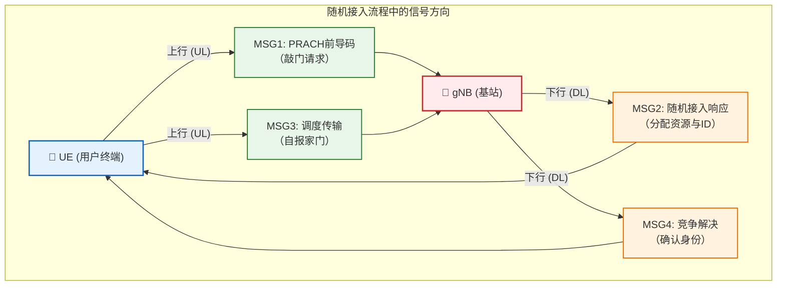

# 📡 5G NR随机接入过程 (RACH)

> [!abstract] 📌 核心导读
> **随机接入 (RACH)** 是UE（终端）与gNB（基站）建立通信连接的第一步，也是UE从空闲态进入连接态的必经过程。本文详细梳理了随机接入的触发场景、分类（CBRA/CFRA）、四步与两步流程，以及背后的关键技术点。

---

## ❓ 1. 什么是随机接入(Random Access)？

随机接入是UE在没有专用资源的情况下，向网络发起接入请求的机制。

> [!info] 💡 核心目的
> - ⏱️ **建立上行同步**：UE与gNB之间的时间同步是上行传输的基础。
> - 🏷️ **获取C-RNTI**：获得网络临时标识，用于后续通信。
> - 📦 **申请上行资源**：请求初始的上行传输资源。

### 🚨 2. 触发场景
随机接入不仅在开机时发生，以下情况都会触发：
- **初始接入**：UE从 `RRC_IDLE` 态进入 `RRC_CONNECTED` 态。
- **切换**：UE从一个小区切换到另一个小区。
- **上行失步**：UE有上行数据要发，但已经失步。
- **没有SR资源**：UE有数据要发，但没有配置 `PUCCH` 资源（或SR资源不够）。
- **RRC连接重建**：无线链路失败后重新建立连接。
- **请求SI**：UE主动请求系统信息（On-demand SI）。

---

## 🔄 3. 随机接入的两种类型

> [!tip] ⚖️ 竞争 vs 非竞争
> 区别主要在于 **前导码（Preamble）** 是UE自己选的，还是基站直接分配的。

| 对比项 | ⚔️ 基于竞争（CBRA） | 🛡️ 基于非竞争（CFRA） |
| :--- | :--- | :--- |
| **前导码来源** | UE随机选择 | gNB专用分配 |
| **冲突可能** | **==有==** | **==无==** |
| **应用场景** | 初始接入、请求系统信息(SI) | 切换、上行失步（有数据时） |

---

## 🏃 4. 四步随机接入流程详解 (Type-1 L1)

这是最经典的随机接入流程。过程简称为 `Msg1`➔`Msg2`➔`Msg3`➔`Msg4`。

### 🟢 步骤1：Msg1 - 随机接入前导码RA  Preamble
> UE ➔ gNB | 信道：**`PRACH`**
- **内容**：前导码（Preamble） + 循环前缀。
- **核心逻辑**：
  - UE根据 **SSB** 测量结果选择对应的 PRACH 资源。
  - gNB检测前导码，估算UE的传输时延（为下发时延作准备）。

### 🟡 步骤2：Msg2 - 随机接入响应（RAR） 
> gNB ➔ UE | 信道：**`PDSCH`** (由`PDCCH`调度, `RA-RNTI`加扰)
- **内容**：检测到的前导码ID + **==TA(定时提前)==** + **初始UL Grant** + **临时C-RNTI**。
- **核心逻辑**：
  - UE在RAR窗口期内监听，收到匹配的响应后进入下一步。
  - `RA-RNTI = 1 + s_id + 14×t_id + 14×80×f_id + 14×80×8×ul_carrier_id`

### 🔵 步骤3：Msg3 - 首次调度传输
> UE ➔ gNB | 信道：**`PUSCH`**
- **内容**：**RRC连接请求** (初始接入时) / **重建请求** / **BSR**。
- **核心逻辑**：
  - 携带UE真实标识，HARQ重传机制在此步开始生效。

### 🟣 步骤4：Msg4 - 竞争解决
> gNB ➔ UE | 信道：**`PDSCH`**
- **内容**：**竞争解决消息** + **RRC连接建立消息**。
- **核心逻辑**：
  - UE检查Msg4是否包含自己Msg3发的标识。如果匹配即**竞争解决成功**。
  - 临时C-RNTI转正为真正的 **==C-RNTI==**。如果不匹配，等待后重试。

---

## ⚡ 5. 两步随机接入 (2-Step RA)

> [!important] 🚀 R16 演进
> 5G R16版本引入了更快的两步随机接入（Type-2 L1 procedure），大大减少了信令交互开销与接入时延。适用 **小数据包传输** 和 **低时延要求业务**。

1. 🚀 **MsgA (= Msg1 + Msg3)**
   - **前导码** + **PUSCH负载** 一起发送。
   - 物理信道 : PRACH + PUSCH
   - 在配置的RO（RACH Occasion）和PO（PUSCH Occasion）上传输。
2. 🛬 **MsgB (= Msg2 + Msg4)**
   - gNB回复竞争解决信息 + TA + UL Grant。如果成功，一次完成接入！
   - 物理信道: PDSCH 

#### 如何选择两步接入和四步接入

**下行RSBP大于一定门限才可以选择两步随机接入**

---

## 🛠️ 6. 核心技术点解析

### 6.1 前导码与PRACH资源
- **前导码（Preamble）**：使用 **ZC序列**（Zadoff-Chu），具有极好的自相关特性。每个小区配置 64 个前导码（分为CFRA专用、CBRA组A、组B）。
- **PRACH Occasion (RO)**：时频资源的位置。每个 **SSB**（同步信号块）可以关联多个RO，UE通过测SSB来决定从哪个RO发请求。

### 6.2 功率攀升与定时提前
- 📈 **功率攀升 (Power Ramping)**：如果Msg1发出去没收到Msg2，UE会以固定步长**增加发送功率**再次发送，直到达到最大尝试次数。
- ⏱️ **定时提前 (TA)**：因为电磁波传播需要时间，gNB会计算并下发TA值，让远处的UE **==提前发送==**，从而保证近处和远处的UE信号到达基站时刚好对齐。

---

## ⚠️ 7. 失败处理与关联知识

### 7.1 异常情况处理
| 失败场景 | 处理动作 |
| :--- | :--- |
| ❌ **Msg1 无响应** | 继续功率攀升，达最大次数后上报上层。 |
| ❌ **Msg2 接收失败** | 立即重新发起随机接入。 |
| ❌ **Msg4 竞争失败** | 等待随机的回退时间 (Backoff) 后重试。 |
| 💥 **达最大尝试次数** | 宣告随机接入失败，触发RRC重建或返回空闲态。 |

### 7.2 RACH 与 SR 的协同互补关系

你可能疑惑：有了调度请求(SR)，为什么还需要RACH？

> [!note] 🤝 敲门砖 vs 直通车
> - **调度请求 (SR)**：前提是UE **已有PUCCH资源且保持同步**（就像有工牌的员工直接走VIP通道）。无冲突且专享。
> - **随机接入 (RACH)**：前提是UE **无专属资源或已经失步**（就像没工牌的新人需要敲大门登记）。资源共享且可能冲突。

---

## 8. 刷题补充

> [!info] 高频补充点
> 这里把摘要里最常考的 RACH 结论再压缩一遍，方便和 刷题知识点汇总 互相跳转。

- **RACH 周期** 常见记法是 **10 ms / 40 ms / 160 ms**，题目里把 **60 ms** 当成常见配置通常是错误项。
- **每个 RACH Occasion** 的前导码数量是 **64 个**。
- **UE 选择 PRACH 资源** 时，会结合 **SSB 测量结果** 和对应的 RO 资源来决定从哪里发起接入。
- **2-Step RA** 里，`MsgA` 对应前导码 + PUSCH 负载，`MsgB` 对应竞争解决信息 + TA + UL Grant。

---

**关联**：[[vault-notes/5g/00-guide]]｜[[vault-notes/5g/phy/01-cell-search]]｜[[vault-notes/5g/phy/04-physical-channels-signals]]｜[[vault-notes/5g/protocols/04-nr-standard-specifications]]
