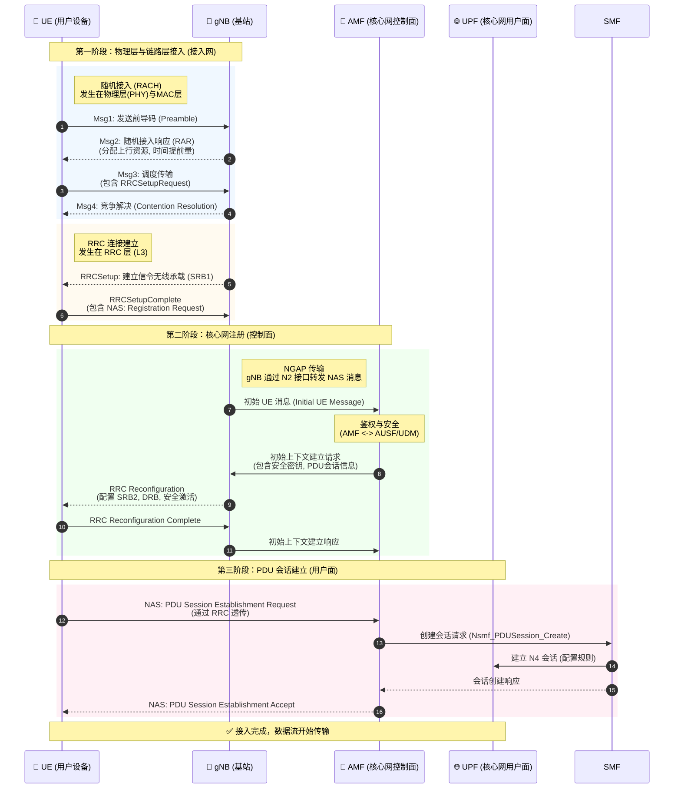

# 🔄 5G UE 接入核心网的全流程

> [!abstract] 本页在讲什么
> 这张时序图把「小区搜索 → RACH → RRC 建立 → 注册 → PDU 会话建立」串成一条端到端流程，适合和 [[vault-notes/5g/phy/03-random-access-rach]]、[[vault-notes/5g/phy/01-cell-search]] 对照阅读。

> [!tip] 关联
> [[vault-notes/5g/00-guide]]｜[[vault-notes/5g/phy/03-random-access-rach]]｜[[vault-notes/5g/phy/01-cell-search]]｜[[vault-notes/5g/architecture/02-5gc-architecture|5GC 架构]]

