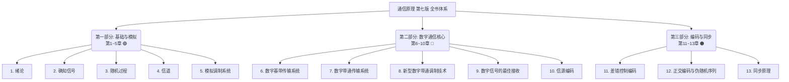

# 📡 通信原理（樊昌信·第七版）知识库总导读

> [!abstract] 📌 核心导读
> 本文件夹是按 **樊昌信《通信原理（第七版）》（国防工业出版社）** 全书 13 章逐章整理的考研复习级笔记。
> 全书分为三大部分：**第一部分（第 1~5 章）通信基础知识与模拟调制**；**第二部分（第 6~10 章）数字通信、最佳接收与模数转换**；**第三部分（第 11~13 章）编码与同步技术**。
> 本导读是知识地图（MOC），可从任意章节切入，顺着 wikilink 串起整个体系。

---

## 一、全书知识体系全景图

---

## 二、各章导航与核心考点

### 🟢 第一部分：基础与模拟调制（第 1~5 章）

| 章 | 笔记 | 核心考点（考研高频） |
| --- | --- | --- |
| 1 | [[vault-notes/communication/01-introduction]] | 信息量 $I=\log_2\frac{1}{P}$、熵、$R_b=R_B\log_2 M$、误码率/误信率 |
| 2 | [[vault-notes/communication/02-deterministic-signals]] | 能量/功率信号、能量谱/功率谱密度、自相关与维纳-辛钦关系 |
| 3 | [[vault-notes/communication/03-random-processes]] | 平稳/各态历经、窄带高斯过程（瑞利+均匀）、正弦+窄带噪声（莱斯）、白噪声 |
| 4 | [[vault-notes/communication/04-channel]] | 调制信道/编码信道模型、恒参/随参信道、**香农公式 $C=B\log_2(1+S/N)$** |
| 5 | [[vault-notes/communication/05-analog-modulation]] | AM/DSB/SSB/VSB 表达式与带宽、抗噪性能（解调增益）、FM 卡森公式、门限效应 |

### 🔵 第二部分：数字通信核心（第 6~10 章）

| 章 | 笔记 | 核心考点（考研高频） |
| --- | --- | --- |
| 6 | [[vault-notes/communication/06-digital-baseband]] | 常用码型（AMI/HDB₃）、**奈奎斯特第一准则**、升余弦滚降、眼图、部分响应、时域均衡 |
| 7 | [[vault-notes/communication/07-digital-bandpass]] | 2ASK/2FSK/2PSK/2DPSK 原理与**误码率公式表**、多进制调制 |
| 8 | [[vault-notes/communication/08-advanced-digital-modulation]] | QAM 星座与 16QAM vs 16PSK、MSK（h=0.5 连续相位）、OFDM 与循环前缀 |
| 9 | [[vault-notes/communication/09-optimal-reception]] | 最大似然准则、**匹配滤波器** $h(t)=ks(t_0-t)$、$r_{omax}=2E/n_0$、最佳接收机误码率 |
| 10 | [[vault-notes/communication/10-source-coding]] | 低通/带通抽样定理、**A 律 13 折线**、PCM 编码规则与带宽、ΔM 不过载条件、TDM(E1/T1)、霍夫曼编码 |

### 🟠 第三部分：编码与同步（第 11~13 章）

| 章 | 笔记 | 核心考点（考研高频） |
| --- | --- | --- |
| 11 | [[vault-notes/communication/11-error-control-coding]] | 码距与检纠错能力三公式、**线性分组码（G/H/伴随式）**、**循环码（生成多项式 g(x)）**、卷积码+维特比、Turbo/LDPC |
| 12 | [[vault-notes/communication/12-orthogonal-codes-pn-sequences]] | 哈达玛矩阵/沃尔什函数、**m 序列四大性质**、本原多项式、扩频通信 |
| 13 | [[vault-notes/communication/13-synchronization]] | 载波同步（平方环/科斯塔斯环）、码元同步、群同步（巴克码、漏/假同步概率）、网同步 |

---

## 三、全书主线逻辑（一句话串起 13 章）

> [!tip] 🧠 主线记忆
> **发端**：信源 →（第10章 信源编码去掉冗余）→（第11章 信道编码加**受控**冗余）→（第6/7/8章 基带/带通调制搬上信道）→ 信道（第4章，噪声用第3章的随机过程描述）→ **收端**：解调 →（第9章 最佳接收/匹配滤波）→ 译码 → 恢复信源。
> 第 1 章给出评价这一切的两把尺子：**有效性**（频带利用率）与**可靠性**（误码率/信噪比）；第 2 章是全书的数学语言；第 12/13 章是支撑数字通信实用化的两大配套技术（扩频序列与同步）。

---

## 四、与其他知识库的联系

- 数字调制硬件实现 → [[vault-notes/digital-modulation/01-digital-communication-system]]
- OFDM/信道编码在移动通信中的落地 → [[vault-notes/5g/00-guide|5G 知识库]]
- LDPC/Polar 等现代编码在 5G 中的应用 → [[vault-notes/5g/protocols/04-nr-standard-specifications]]

---

## 五、本书章节与笔记文件对照

| 原书章节 | 原书页码 | 笔记文件 |
| --- | --- | --- |
| 第 1 章 绪论 | 1~15 | [[vault-notes/communication/01-introduction]] |
| 第 2 章 确知信号 | 17~35 | [[vault-notes/communication/02-deterministic-signals]] |
| 第 3 章 随机过程 | 36~70 | [[vault-notes/communication/03-random-processes]] |
| 第 4 章 信道 | 71~85 | [[vault-notes/communication/04-channel]] |
| 第 5 章 模拟调制系统 | 86~129 | [[vault-notes/communication/05-analog-modulation]] |
| 第 6 章 数字基带传输系统 | 130~175 | [[vault-notes/communication/06-digital-baseband]] |
| 第 7 章 数字带通传输系统 | 176~228 | [[vault-notes/communication/07-digital-bandpass]] |
| 第 8 章 新型数字带通调制技术 | 229~250 | [[vault-notes/communication/08-advanced-digital-modulation]] |
| 第 9 章 数字信号的最佳接收 | 251~278 | [[vault-notes/communication/09-optimal-reception]] |
| 第 10 章 信源编码 | 279~330 | [[vault-notes/communication/10-source-coding]] |
| 第 11 章 差错控制编码 | 331~378 | [[vault-notes/communication/11-error-control-coding]] |
| 第 12 章 正交编码与伪随机序列 | 379~409 | [[vault-notes/communication/12-orthogonal-codes-pn-sequences]] |
| 第 13 章 同步原理 | 410~440 | [[vault-notes/communication/13-synchronization]] |

---

## 六、配套资源快捷入口

| 资源 | 用途 |
| --- | --- |
| 🧮 [[vault-notes/communication/a-formula-cheatsheet]] | 全书公式按章汇总 + **Top10 必背公式**，考前冲刺用 |
| 🗺️ 知识图谱 Canvas | 13 章可视化导图（含三大矛盾与跨库枢纽），Canvas 视图打开 |
| 🔗 [[vault-notes/communication/b-cross-library-links]] | 与**概率论 / 线性代数 / 5G / FPGA / Matlab** 文件夹的知识接口 + 三条跨库复习路线 |
| 🎲 [[vault-notes/random-signals/00-knowledge-map|随机信号处理子库]] | 概率 → 随机过程 → 时域/频域 → 估计/检测 → MATLAB 实验 |

> [!tip] 三种打开方式
> - 想**系统学**：从 [[vault-notes/communication/01-introduction]] 顺着每章末尾的"下一章"逐章推进
> - 想**查公式**：直接开 [[vault-notes/communication/a-formula-cheatsheet]]
> - 想**看全局**：打开 知识图谱 Canvas 或本页的 mermaid 图
