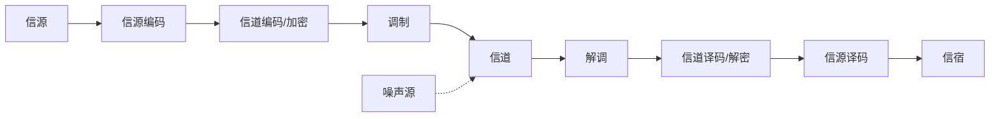

> [!abstract] 本章在讲什么
> 本章建立全书的概念框架，1.1–1.5 逐层回答五个问题：
> - **1.1 通信的基本概念**：消息、信息、信号是什么关系？模拟信号与数字信号怎么分？码元是什么？
> - **1.2 通信系统模型**：一般模型、模拟通信模型、数字通信模型各由哪些环节组成？信源编码与信道编码为什么方向相反？
> - **1.3 通信系统的分类及通信方式**：按什么维度分类？单工/半双工/全双工、并行/串行有什么区别？
> - **1.4 信息及其度量**：信息量 $I=\log_2(1/P)$ 怎么来？熵 $H$ 怎么算？等概时为什么最大？
> - **1.5 通信系统的主要性能指标**：有效性、可靠性分别用什么量衡量？$R_B$ 与 $R_b$ 怎么换算？
>
> 一句话主线：**通信系统就是"把信息装进信号、送过信道、再取出来"；本章给出这套流程的模型、术语和两把评价尺子——有效性（传得快）与可靠性（传得准）。**

> [!note] 记号约定
> - **消息**（message）、**信息**（information）、**信号**（signal）是三个不同层次的概念，后文不再混用
> - $M$：进制数，即一个码元可取的离散状态数；$P(x_i)$：第 $i$ 个符号出现的概率
> - $R_B$：码元速率（Baud）；$R_b$：信息速率（b/s）；二者关系 $R_b=R_B\log_2 M$
> - $B$：带宽（Hz）；$\eta=R_B/B$ 为频带利用率（Baud/Hz），$\eta_b=R_b/B$ 为比特频带利用率（b/(s·Hz)）
> - $P_e$：误码率（误符号率）；$P_b$：误信率（误比特率）
> - 本书的"比特"一律指以 2 为底的信息量单位

# 1.1 通信的基本概念

## 消息、信息与信号

> [!info] Def 1 消息、信息与信号
> - **消息**（message）：通信系统传输的**对象**，是信息的载体，表现为语音、文字、图像、数据等物理形式。
> - **信息**（information）：消息中包含的**有效内容**，即受信者预先不知而待知的内容。
> - **信号**（signal）：消息的**传输载体**；在电通信中表现为电压、电流或电磁波。

| 概念 | 定义 | 关键词 | 举例 |
| --- | --- | --- | --- |
| **消息** (message) | 通信系统传输的**对象**，信息的载体 | 物理表现形式 | 语音、文字、图像、数据 |
| **信息** (information) | 消息中包含的**有效内容**，受信者预先不知而待知的内容 | 内涵 | 天气预报中的"天气情况" |
| **信号** (signal) | 消息的**传输载体**（电信号） | 传输手段 | 电压/电流/电磁波 |

> [!tip] 一句话记忆
> **消息是"壳"，信息是"核"，信号是"车"。**

消息分两类：

- **连续消息**：状态连续变化或不可数（语音、温度）→ 对应**模拟信号**
- **离散消息**：可数的有限个状态（符号、文字、数据）→ 对应**数字信号**

## 模拟信号与数字信号

> [!info] Def 2 模拟信号与数字信号
> - **模拟信号**（analog signal）：载荷消息的信号参量取值**连续**（不可数、无穷多个）。
> - **数字信号**（digital signal）：载荷消息的信号参量只有**有限个取值**。

| 类型 | 定义 | 典型例子 |
| --- | --- | --- |
| **模拟信号** | 载荷消息的信号参量取值**连续**（不可数、无穷多） | 电话机送出的语音信号 |
| **数字信号** | 载荷消息的信号参量只有**有限个取值** | 电报/计算机输出信号 |

> [!warning] 易错点
> 模拟信号的"连续"指**参量取值连续**，不一定时间上也连续——抽样信号在时间上离散，但仍是模拟信号。

> [!info] Def 3 码元
> **码元**（code element）是承载一个离散符号（数字或字符等）的电波形，占用一定的时间和带宽。

# 1.2 通信系统模型

## 一般模型


- **信道**（channel）：信号传输的媒介（无线的电磁波传播 / 有线的电缆光纤）
- **噪声**：并非独立环节，但集中叠加在信道上处理

> [!info] Def 4 信源、信宿与信道
> - **信源**（source）：产生消息的源头。
> - **信宿**（sink）：接收消息的终点。
> - **信道**（channel）：连接发送设备与接收设备的传输媒介。

## 模拟通信系统模型


核心变换：**调制 → 信道 → 解调**（两种变换通过连续信号完成）。

> [!info] Def 5 调制与解调
> - **调制**（modulation）：把基带信号搬移到适合信道传输的高频载波上的过程。
> - **解调**（demodulation）：从已调信号中恢复基带信号的过程。

## 数字通信系统模型



三大编码环节的分工：

| 环节 | 任务 | 方向 |
| --- | --- | --- |
| **信源编码** | 去掉冗余、压缩（A/D 转换、压缩编码）；必要时加密 | 提**有效性** |
| **信道编码** | 增加**受控的冗余**（纠错码），克服噪声干扰 | 提**可靠性** |
| **调制** | 基带 → 频带，匹配信道特性、实现频分复用 | 搬运 + 有效性 |

> [!info] Def 6 信源编码与信道编码
> - **信源编码**（source coding）：把信源输出转换为数字序列并去除统计冗余，目的是提高**有效性**。
> - **信道编码**（channel coding）：按一定规则加入受控冗余，使接收端能够检错/纠错，目的是提高**可靠性**。

> [!tip] 深刻理解
> 信源编码**去冗余**，信道编码**加冗余**——两者方向相反但目的统一：前者去掉**无用的**统计冗余，后者加入**有规则的、可用于纠错的**冗余。

## 数字通信的优缺点

| ✅ 优点 | ❌ 缺点 |
| --- | --- |
| 抗干扰强，**可消除噪声积累** | 占用**频带宽** |
| 差错可控（可检可纠） | 需要严格的**同步**系统 |
| 灵活，可综合各种信源（多媒体） | — |
| 易集成（ASIC），成本低 | — |
| 保密性好（可加密） | — |

# 1.3 通信系统的分类及通信方式

## 常见分类

- 按**信道信号特征**：模拟 / 数字通信系统
- 按**传输方式**：基带 / 带通（频带）传输系统
- 按**信道媒介**：有线 / 无线
- 按**通信业务**：电话/数据/图像…

## 三种通信方式（按消息传递方向与时间）

> [!info] Def 7 单工、半双工与全双工
> - **单工**（simplex）：只能沿一个方向传输。
> - **半双工**（half-duplex）：双方都能收发，但**不能同时**。
> - **全双工**（duplex）：双方可以**同时**收发。

| 方式 | 特点 | 例子 |
| --- | --- | --- |
| **单工** (simplex) | 只能单方向传输 | 广播、遥控 |
| **半双工** (half-duplex) | 双方都能收发，**不能同时** | 对讲机 |
| **全双工** (duplex) | 双方可**同时**收发 | 电话 |

## 并行与串行传输

| 方式 | 特点 | 应用 |
| --- | --- | --- |
| **并行传输** | n 比特同时发，需 n 条线路，快、贵 | 设备近距离连接 |
| **串行传输** | 码元一个接一个发，一条信道，慢、省 | 远距离传输（需同步） |

# 1.4 信息及其度量

## 信息量的定义

信息量只与消息出现的**概率**有关——**概率越小，信息量越大**。

> [!info] Def 8 信息量
> 消息 $x$ 出现概率为 $P(x)$ 时，其**信息量**（amount of information）定义为
> $$I=\log_a\frac{1}{P(x)}=-\log_a P(x)$$
> 其中对数底 $a$ 决定信息量单位。

三条性质（定义的出发点）：

1. $I=I[P(x)]$，是概率的函数
2. $P(x)$ 越小，$I$ 越大；$P(x)=1$ 时 $I=0$（必然事件无信息）；$P(x)=0$ 时 $I=\infty$
3. **独立事件的信息具有可加性**

单位（取决于对数底数 $a$）：

| 底数 | 单位 |
| --- | --- |
| $a=2$ | **比特 (bit, b)** ← 最常用 |
| $a=e$ | 奈特 (nat) |
| $a=10$ | 哈特莱 (Hartley) |

## 等概率离散消息

$M$ 个波形等概率发送（$P=1/M$）、相互独立（无记忆），传送其中一个的信息量：

$$I=\log_2\frac{1}{P}=\log_2 M\quad(\text{b})$$

- 二进制（$M=2$）：$I=1$ b ——"1 个二进制码元含 1 比特信息"
- 四进制（$M=4$）：$I=2$ b
- 若 $M=2^k$，则 $I=k$ b（一个 $M$ 进制码元 = $k$ 个比特）

## 非等概率：平均信息量（熵）

设离散信源 $M$ 个符号独立出现，各符号概率 $P(x_i)$，$\sum P(x_i)=1$。

> [!info] Def 9 熵
> 离散信源的**平均信息量**称为**熵**（entropy）：
> $$H(x)=-\sum_{i=1}^{M}P(x_i)\log_2 P(x_i)\quad(\text{b/符号})$$

> [!tip] 熵的最大值
> 当且仅当**等概率**（$P(x_i)=1/M$）时，熵最大：$H_{\max}=\log_2 M$。
> 二进制信源：$H_{\max}=1$ b/符号（$P(0)=P(1)=1/2$ 时）。

> [!example] 计算示例
> 4 符号概率 $3/8,1/4,1/4,1/8$，则 $H=1.906$ b/符号；57 个符号的消息总信息量 $I\approx57\times1.906\approx108.6$ b。

> [!note] 计算技巧（考研题）
> - 长消息总信息量可用 $I_{\text{总}}\approx n\cdot H$（$n$ 为符号数）估算
> - 连续消息熵：$H(x)=-\int_{-\infty}^{\infty}f(x)\log_2 f(x)\,dx$（$f(x)$ 为概率密度）

# 1.5 通信系统的主要性能指标

> [!tip] 总纲
> **有效性**——传得快不快（频带利用率）；**可靠性**——传得准不准（信噪比/误码率）。两者**相互矛盾又可互换**（香农公式见 [[vault-notes/communication/04-channel]]）。

## 有效性

**模拟系统**：同样的信源信号，所需**带宽越小** → 有效性越好（SSB 语音 4 kHz < FM 语音 48 kHz，故 SSB 有效性更好）。

**数字系统**：**频带利用率**

$$\eta=\frac{R_B}{B}\quad(\text{Baud/Hz})\qquad \eta_b=\frac{R_b}{B}\quad(\text{b/(s·Hz)})$$

> [!info] Def 10 码元速率与信息速率
> - **码元速率**（symbol rate / baud rate）$R_B$：每秒传输的**码元**数目，单位 Baud。
> - **信息速率**（bit rate）$R_b$：每秒传输的**平均信息量**，单位 b/s。

| 速率 | 定义 | 单位 |
| --- | --- | --- |
| **码元速率 $R_B$**（传码率/波特率） | 每秒传输的**码元**数目 | 波特 (Baud) |
| **信息速率 $R_b$**（传信率/比特率） | 每秒传输的**平均信息量** | 比特/秒 (b/s) |

$$R_b=R_B\log_2 M\quad(\text{b/s})$$

> [!warning] 易错点
> 1. **Baud 与 b/s 不能直接画等号**，仅当 $M=2$（二进制）时 $R_b=R_B$ 数值相等。
> 2. 码元速率与进制数无关地受带宽限制（奈奎斯特），而信息速率可通过提高进制数增加——这正是多进制调制的意义（见 [[vault-notes/communication/07-digital-bandpass]]）。
> 3. $T_B$（码元宽度）与 $T_b$（比特宽度）关系：$T_b=T_B/\log_2 M$。

## 可靠性

**模拟系统**：输出**信噪比 $S/N$**（保真度、抗噪能力，FM 的 $S/N$ 高于 AM，但带宽更宽——有效性与可靠性矛盾）。

**数字系统**：**差错概率**

> [!info] Def 11 误码率与误信率
> - **误码率**（symbol error rate）$P_e$：错误接收的码元数占总码元数的比例。
> - **误信率**（bit error rate）$P_b$：错误接收的比特数占总比特数的比例。

$$P_e=\frac{\text{错误接收码元数}}{\text{传输总码元数}}\qquad P_b=\frac{\text{错误接收比特数}}{\text{传输总比特数}}$$

- 二进制中 $P_b=P_e$；多进制中一般 $P_b<P_e$

> [!tip] 本章收官
> 本章给出全书的三层地基：**术语层**（消息/信息/信号、码元、模拟/数字）、**模型层**（一般模型、模拟与数字通信模型、三大编码环节的分工）、**度量层**（信息量/熵、$R_B$/$R_b$、有效性/可靠性）。
> 后续 12 章都可以放回这条主线：第 2–3 章准备数学工具，第 4 章研究信道，第 5–8 章研究调制，第 9 章研究最佳接收，第 10–11 章研究编码，第 12–13 章研究扩频与同步。

## 本章知识地图

```
通信系统
├─ 三层概念（1.1）
│  ├─ 消息 message：信息的载体（壳）
│  ├─ 信息 information：有效内容（核）
│  ├─ 信号 signal：传输载体（车）
│  └─ 模拟信号 / 数字信号 → 码元 code element
├─ 系统模型（1.2）
│  ├─ 一般模型：信源 → 发送设备 → 信道(+噪声) → 接收设备 → 信宿
│  ├─ 模拟模型：调制 → 信道 → 解调
│  └─ 数字模型：信源编码 → 信道编码 → 调制 → 信道 → 解调 → 译码
│       └─ 信源编码去冗余（有效性）／信道编码加冗余（可靠性）
├─ 分类与方式（1.3）
│  ├─ 按信号特征 / 传输方式 / 媒介 / 业务
│  └─ 单工 / 半双工 / 全双工；并行 / 串行
├─ 信息度量（1.4）
│  ├─ 信息量 I = log₂(1/P)
│  ├─ 等概 M 进制：I = log₂M
│  ├─ 熵 H = −Σ Pᵢ log₂Pᵢ，等概时 H_max = log₂M
│  └─ 单位：bit / nat / Hartley
└─ 性能指标（1.5）
   ├─ 有效性：带宽↓、频带利用率 η = R_B/B、η_b = R_b/B
   ├─ 可靠性：S/N、误码率 P_e、误信率 P_b
   └─ R_b = R_B log₂M；二进制时 P_b = P_e
```

## 关联

- 上一章：（本章为全书开篇）
- 下一章：[[vault-notes/communication/02-deterministic-signals]]

**本章与后续章节的接口**

| 本章概念 | 后续落点 |
| --- | --- |
| 信息量 $I=\log_2(1/P)$、熵 $H$ | [[vault-notes/communication/10-source-coding]] 的压缩极限；[[vault-notes/communication/04-channel]] 的信道容量 |
| $R_b=R_B\log_2 M$ | [[vault-notes/communication/07-digital-bandpass]] 的多进制调制；[[vault-notes/communication/06-digital-baseband]] 的码元速率 |
| 有效性 ↔ 可靠性 | [[vault-notes/communication/04-channel]] 香农公式的带宽–信噪比互换；[[vault-notes/communication/05-analog-modulation]] FM 的带宽换信噪比 |
| 误码率/误信率 | [[vault-notes/communication/07-digital-bandpass]] 的误码率公式表；[[vault-notes/communication/09-optimal-reception]] 的最佳接收机 |

**通信方向应用**：

- [[vault-notes/5g/phy/04-physical-channels-signals]] —— 5G 的帧结构、资源粒子与调制编码方案（MCS）正是"码元速率/信息速率/频带利用率"的工程化版本。
- [[vault-notes/digital-modulation/01-digital-communication-system]] —— 与本章数字通信模型一一对应：信源、信道编码、调制、信道、解调、译码。
- [[vault-notes/matlab/matlab-notes]] —— 信息量、熵、$R_b$ 与 $R_B$ 的换算都可以直接用 MATLAB 数值验证。

**相关**：[[vault-notes/communication/02-deterministic-signals]]｜[[vault-notes/communication/04-channel]]｜[[vault-notes/communication/07-digital-bandpass]]
