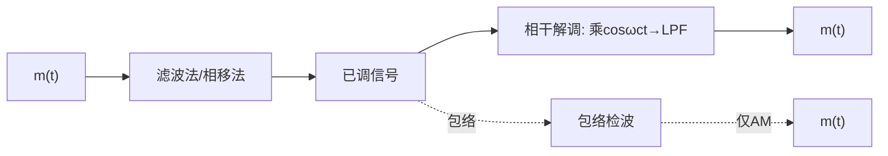

> [!abstract] 本章在讲什么
> 本章讲模拟调制的两条路线与它们的抗噪性能，5.1–5.6 依次展开：
> - **5.1 幅度调制（线性调制）原理**：AM/DSB/SSB/VSB 的时域表达式、带宽、调制效率与解调方式。
> - **5.2 线性调制系统的抗噪声性能**：解调增益 $G$ 怎么定义？DSB 与 SSB 谁更好？
> - **5.3 非线性调制（角度调制）原理**：PM/FM 的区别、调频指数、卡森公式、产生与解调。
> - **5.4 调频系统的抗噪声性能**：$G_{FM}\approx3m_f^3$、门限效应、预加重/去加重。
> - **5.5 各种模拟调制系统的比较**：有效性与可靠性的排序。
> - **5.6 频分复用 FDM**：多路信号如何搬移到不同副载频。
>
> 一句话主线：**调制的本质是频谱搬移（线性）或频谱扩展（非线性）；抗噪性能统一用"输入信噪比 → 解调增益 → 输出信噪比"分析，而带宽与信噪比的互换在这里第一次具体化。**

> [!note] 记号约定
> - $m(t)$：基带调制信号；$f_H$：$m(t)$ 的最高频率；$A_0$：AM 的直流偏置
> - $\omega_c$：载波角频率；$s(t)$：已调信号；$B$：已调信号带宽
> - $S_i/N_i$：解调器输入信噪比；$S_o/N_o$：输出信噪比；$G=\dfrac{S_o/N_o}{S_i/N_i}$：解调增益
> - $\Delta f$：最大频偏；$f_m$：调制信号最高频率；$m_f=\Delta f/f_m$：调频指数
> - $\hat{m}(t)$：$m(t)$ 的希尔伯特变换（Hilbert transform，相移 $-90^\circ$）

# 5.1 幅度调制（线性调制）原理

> [!info] Def 1 幅度调制
> **幅度调制**（amplitude modulation）是基带信号 $m(t)$ 与载波 $\cos\omega_c t$ 相乘，使已调信号的**幅度**随 $m(t)$ 变化。由于频谱结构只是被搬到 $\pm\omega_c$ 附近而不产生新的频率分量，故又称**线性调制**（linear modulation）。

## 标准调幅 AM

> [!info] Def 2 标准调幅
> **标准调幅**（amplitude modulation，简称 AM）：
> $$
> s_{AM}(t)=[A_0+m(t)]\cos\omega_c t
> $$
> 其中 $A_0$ 为直流偏置，必须满足 $A_0\ge|m(t)|_{\max}$。

- 频谱：载波 $\delta$ 函数（$\pm\omega_c$）+ 上下边带
- **带宽**：$B=2f_H$（$f_H$ 为 $m(t)$ 最高频率）
- **调制效率**：$\eta_{AM}=\dfrac{\text{边带功率}}{\text{总功率}}$；$|m(t)|_{\max}=A_0$（100% 调制）时 $\eta_{\max}=1/3$
- **解调**：包络检波（简单）或相干解调
- **条件**：$A_0\ge|m(t)|_{\max}$（否则过调制、包络失真）
- 优点：收机简单便宜 → 无线广播；缺点：载波不携信息、功率利用率低

## 抑制载波双边带 DSB-SC

> [!info] Def 3 双边带调制
> **抑制载波双边带调制**（double-sideband suppressed-carrier，简称 DSB-SC 或 DSB）：
> $$
> s_{DSB}(t)=m(t)\cos\omega_c t
> $$
> $$
> S_{DSB}(\omega)=\tfrac{1}{2}[M(\omega+\omega_c)+M(\omega-\omega_c)]
> $$

- 无载波分量 → **调制效率 100%**
- **带宽**仍 $2f_H$；包络与 $|m(t)|$ 成正比（有相位突变）→ **不能包络检波，必须相干解调**

## 单边带 SSB

> [!info] Def 4 单边带调制
> **单边带调制**（single-sideband modulation，简称 SSB）只传一个边带：$B=f_H$，**节省一半带宽和发送功率**——模拟话音通信首选。

两种产生方法：

1. **滤波法**：DSB → 边带滤波器（难点：低频含丰富频谱的信号要求极陡滤波器）
2. **相移法（希尔伯特变换法）**：

$$
s_{SSB}(t)=\tfrac{1}{2}m(t)\cos\omega_c t\mp\tfrac{1}{2}\hat{m}(t)\sin\omega_c t
$$

（$-$ 上边带 USB，$+$ 下边带 LSB；$\hat{m}(t)$ 为 $m(t)$ 的希尔伯特变换）

## 残留边带 VSB

> [!info] Def 5 残留边带调制
> **残留边带调制**（vestigial-sideband modulation，简称 VSB）介于 DSB 与 SSB 之间：传一个完整边带 + 另一边带的残留部分。
> 条件：残留边带滤波器 $H(\omega)$ 在载频处具有**互补对称（奇对称）**特性。

- 应用：模拟电视视频信号（含低频直流，SSB 难做、DSB 太宽）

## 线性调制的一般模型与解调



| 调制 | 带宽 | 效率 | 解调方式 |
| --- | --- | --- | --- |
| AM | $2f_H$ | ≤1/3 | 包络检波 ✅ / 相干 |
| DSB | $2f_H$ | 100% | 仅相干 |
| SSB | $f_H$ | 100% | 仅相干 |
| VSB | ≈$f_H$（略宽） | ≈100% | 相干（可插入强载波后包络检波） |

# 5.2 线性调制系统的抗噪声性能

**分析模型**：已调信号 + 窄带高斯噪声（双边谱密度 $\dfrac{n_0}{2}$）通过解调器。

$$
\frac{S_o}{N_o}=G\cdot\frac{S_i}{N_i}
$$

> [!info] Def 6 解调增益
> **解调增益**（demodulation gain，也称信噪比增益）定义为
> $$
> G=\frac{S_o/N_o}{S_i/N_i}
> $$
> 它是衡量解调器抗噪性能的核心指标。其中 $S_i/N_i$ 为解调器**输入**信噪比（$N_i=n_0B$，$B$ 为带通带宽）。

## 结论汇总

| 系统 | 解调 | 输入信噪比 $S_i/N_i$ | 解调增益 $G$ |
| --- | --- | --- | --- |
| DSB | 相干 | $\dfrac{\overline{m^2}}{n_0B_{DSB}}$ | **2** |
| SSB | 相干 | $\dfrac{\overline{m^2}}{n_0B_{SSB}}$ | **1** |
| AM（大信噪比） | 包络检波 | $\dfrac{A_0^2+\overline{m^2}}{n_0B}$ | $\dfrac{2\overline{m^2}}{A_0^2+\overline{m^2}}\le2/3$ |

> [!important] DSB 与 SSB 抗噪性能"谁更好"（经典简答题）
> 表面上 $G_{DSB}=2>G_{SSB}=1$，但 DSB 带宽是 SSB 两倍（$N_i$ 大一倍）：**同接收条件下两者输出信噪比相同**——SSB 用一半带宽达到同样质量，且省功率 → **SSB 综合最优**（模拟语音传输首选 SSB 的原因）。

**AM 包络检波的门限效应**：小信噪比时包络被噪声主导，输出信噪比急剧恶化——非相干解调特有（相干解调无门限效应）。FM 同样有（见 5.4 节）。

# 5.3 非线性调制（角度调制）原理

## 基本概念

> [!info] Def 7 角度调制
> **角度调制**（angle modulation）使载波的**频率或相位**随 $m(t)$ 变化，频谱不再是简单搬移而产生新的频率分量，故称**非线性调制**；其已调信号为**恒包络**。
> $$
> s(t)=A\cos[\omega_c t+\varphi(t)]
> $$

| 方式 | 相位偏移 | 瞬时频率偏移 |
| --- | --- | --- |
| **调相 PM** | $\varphi(t)=K_p m(t)$ | $\propto\dfrac{dm(t)}{dt}$ |
| **调频 FM** | $\varphi(t)=K_f\displaystyle\int_{-\infty}^{t}m(\tau)d\tau$ | $\propto m(t)$ |

（PM/FM 可互相转换：$m(t)$ 先积分再 FM = PM；先微分再 PM = FM。）

## 单音调频的核心参数

设 $m(t)=A_m\cos\omega_m t$：

$$
s_{FM}(t)=A\cos[\omega_c t+m_f\sin\omega_m t]
$$

> [!info] Def 8 调频指数与最大频偏
> **调频指数**（modulation index）$m_f=\dfrac{K_fA_m}{\omega_m}=\dfrac{\Delta f}{f_m}$；
> **最大频偏**（maximum frequency deviation）$\Delta f=\dfrac{K_fA_m}{2\pi}$。

**窄带调频 NBFM**（$m_f\ll1$）：带宽 $\approx2f_m$（与 AM 相近），主要项为载频 ± 边频。

**宽带调频 WBFM**（$m_f\gg1$）：有效边频数 $\approx m_f+1$（用贝塞尔函数 $J_v(m_f)$ 分析）。

## 卡森公式（FM 带宽）

$$
B_{FM}=2(m_f+1)f_m=2(\Delta f+f_m)
$$

- NBFM：$B\approx2f_m$；WBFM：$B\approx2\Delta f$
- 例：调频广播 $f_m=15$ kHz、$\Delta f=75$ kHz → $m_f=5$，$B=180$ kHz（**卡森带宽**）

## FM 的产生与解调

- **产生**：直接法（压控振荡器 VCO，频偏大但中心频不稳）/ 间接法（Armstrong：NBFM → 倍频到 WBFM）
- **解调**：非相干——**鉴频器**（限幅器 + 微分器 + 包络检波）；相干（仅 NBFM）
- 鉴频器输出正比于瞬时频偏 → 恢复 $m(t)$

# 5.4 调频系统的抗噪声性能

## 大信噪比时的解调增益

$$
G_{FM}=3m_f^2(m_f+1)\approx3m_f^3\quad(m_f\gg1)
$$

（单音调制、鉴频解调。）

> [!important] FM 换带宽买信噪比
> $G_{FM}\approx3m_f^3$ 随调频指数急剧增大——**FM 以成倍带宽换取输出信噪比**（与 DSB 的 $G=2$、AM 的 $G\le2/3$ 对比）。
> 这正是香农公式"**带宽与信噪比互换**"（[[vault-notes/communication/04-channel]]）的模拟体现。
> 代价：门限效应。

## 门限效应

$$
\left(\frac{S_i}{N_i}\right)_{th}\approx10\,\text{dB}\quad(\text{经验门限})
$$

- 输入信噪比低于门限 → 输出信噪比急剧恶化（脉冲噪声"咔嗒"声）
- $m_f$ 越大门限越高 → 宽带 FM 要在**足够大信噪比**下才有优势
- 改善：**预加重/去加重**（发端提升高频、收端衰减高频——FM 广播标准配置，可改善约 6 dB 以上）

# 5.5 各种模拟调制系统的比较

| 方式 | 带宽 | 解调增益 | 设备 | 主要应用 |
| --- | --- | --- | --- | --- |
| AM | $2f_H$ | ≤2/3 | 最简 | 中波广播 |
| DSB | $2f_H$ | 2 | 需相干载波 | 立体声副信道等 |
| SSB | $f_H$ | 1 | 需相干载波 | 短波通信、载波电话 |
| VSB | 略大于 $f_H$ | ≈SSB | 较复杂 | 模拟电视 |
| WBFM | $2(m_f+1)f_m$ | $\approx3m_f^3$ | 较简（鉴频） | 调频广播、卫星/微波中继 |

**三条结论**：

1. 有效性排序：**SSB > VSB > DSB/AM > FM**（占用带宽）
2. 抗噪性（大信噪比）排序：**WBFM > DSB ≈ SSB > AM**
3. 有效性与可靠性**矛盾互换**——FM 是"用带宽换信噪比"的典型

# 5.6 频分复用 FDM

> [!info] Def 9 频分复用
> **频分复用**（frequency-division multiplexing，简称 FDM）把不同话路搬移到**不同副载频**上（通常用 SSB 调制，间隔防护频带），使它们在同一个信道中同时传输。

- 与第 10 章 **TDM**（时分复用）对照记忆
- 应用于：载波电话（多路复用层级群）、模拟广播

> [!tip] 本章收官
> 本章把模拟调制整理成一张"带宽—功率—抗噪"的对照表：**线性调制**（AM/DSB/SSB/VSB）靠频谱搬移，**非线性调制**（FM/PM）靠带宽换信噪比。分析套路统一为"输入信噪比 → 解调增益 → 输出信噪比"，其中 $G_{DSB}=2$、$G_{SSB}=1$、$G_{FM}\approx3m_f^3$、AM 的 $G\le2/3$。这套套路在第 7 章数字调制中会原样复用。

## 本章知识地图

```
模拟调制
├─ 线性调制（5.1）
│  ├─ AM：s=[A₀+m(t)]cosω_c t，B=2f_H，η≤1/3，包络检波
│  ├─ DSB：s=m(t)cosω_c t，B=2f_H，η=100%，仅相干
│  ├─ SSB：B=f_H，η=100%，滤波法/相移法（希尔伯特变换）
│  └─ VSB：B≈f_H，互补对称，模拟电视
├─ 抗噪性能（5.2）
│  ├─ (S_o/N_o) = G·(S_i/N_i)
│  ├─ G_DSB=2，G_SSB=1 → 同条件下输出信噪比相同
│  └─ AM 包络检波：G≤2/3，有门限效应
├─ 角度调制（5.3）
│  ├─ PM：φ(t)=K_p m(t)；FM：φ(t)=K_f∫m dτ
│  ├─ m_f = Δf/f_m，Δf = K_f A_m/2π
│  ├─ 卡森公式 B_FM = 2(Δf + f_m)
│  └─ 产生：VCO/ Armstrong；解调：鉴频器
├─ FM 抗噪（5.4）
│  ├─ G_FM ≈ 3m_f³（带宽换信噪比）
│  ├─ 门限 ≈ 10 dB
│  └─ 预加重/去加重
├─ 系统比较（5.5）
│  ├─ 有效性：SSB > VSB > DSB/AM > FM
│  └─ 抗噪性：WBFM > DSB ≈ SSB > AM
└─ 频分复用（5.6）
   └─ 多路搬移到不同副载频；与第 10 章 TDM 对照
```

## 关联

- 上一章：[[vault-notes/communication/04-channel]]
- 下一章：[[vault-notes/communication/06-digital-baseband]]

**本章与前后章节的接口**

| 本章概念 | 后续落点 |
| --- | --- |
| 频谱搬移、相乘定理 | [[vault-notes/communication/02-deterministic-signals]] 的卷积/相乘定理；[[vault-notes/communication/07-digital-bandpass]] 的 ASK/PSK 调制 |
| 解调增益 $G$ | [[vault-notes/communication/07-digital-bandpass]] 的误码率与信噪比关系 |
| 带宽换信噪比、门限效应 | [[vault-notes/communication/04-channel]] 的香农公式；[[vault-notes/communication/07-digital-bandpass]] 的 2FSK/2PSK 比较 |
| FM、鉴频、预加重 | [[vault-notes/communication/13-synchronization]] 的载波同步；[[vault-notes/communication/01-introduction]] 的有效性/可靠性 |

**通信方向应用**：

- [[vault-notes/communication/07-digital-bandpass]] —— 模拟调制的"输入信噪比 → 解调增益 → 输出信噪比"套路，在数字调制中变成"$E_b/n_0$ → 误码率"的分析。
- [[vault-notes/digital-modulation/01-digital-communication-system]] —— 调制器/解调器的系统框图与本章的线性调制模型一一对应。
- [[vault-notes/matlab/matlab-notes]] —— 用 MATLAB 画 AM/DSB/SSB 的频谱与 FM 的瞬时频率，可直观看到"搬移"与"扩展"的差别。

**相关**：[[vault-notes/communication/04-channel]]｜[[vault-notes/communication/06-digital-baseband]]｜[[vault-notes/communication/07-digital-bandpass]]
