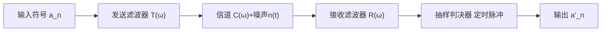

> [!abstract] 本章在讲什么
> 本章是数字通信的地基章，6.1–6.7 把一条基带链路从波形讲到均衡：
> - **6.1 数字基带信号及其频谱特性**：常用波形有哪几种？功率谱的连续谱与离散谱各决定什么？
> - **6.2 基带传输的常用码型**：传输码怎么选？AMI 与 HDB₃ 的编码规则是什么？
> - **6.3 数字基带传输与码间串扰**：ISI 从哪来？抽样值由哪三部分组成？
> - **6.4 无码间串扰的基带传输特性**：奈奎斯特第一准则的时域/频域表述；理想低通与升余弦滚降的带宽、频带利用率。
> - **6.5 基带系统的抗噪声性能**：双极性与单极性的误码率差多少？
> - **6.6 眼图**：眼图能读出哪些传输质量信息？
> - **6.7 部分响应与时域均衡**：如何"借"有规则的 ISI 换 2 Baud/Hz？如何用横向滤波器补偿信道？
>
> 一句话主线：**基带传输要同时对付"波形展宽造成的码间串扰"和"噪声"；奈奎斯特第一准则给出无 ISI 的频域条件，升余弦滚降把它变成可实现的工程方案，眼图则是检验这一切的"仪表盘"。**

> [!note] 记号约定
> - 码元周期 $T_B$，码元速率 $R_B=1/T_B$；$f_B=1/T_B$
> - $a_n$：第 $n$ 个发送符号；$g(t)$：码元波形；$h(t)$：系统总冲激响应
> - $H(\omega)=T(\omega)C(\omega)R(\omega)$：发送滤波器、信道、接收滤波器的总传输特性
> - $\alpha$：滚降系数（roll-off factor），$0\le\alpha\le1$
> - $\sigma_n^2=n_0B$：接收端噪声功率；$d$：判决门限到电平的距离
> - 部分响应中 $C_k$：相关编码后的抽样值；$b_k$：预编码输出

# 6.1 数字基带信号及其频谱特性

> [!info] Def 1 数字基带信号
> **数字基带信号**（digital baseband signal）是未经过载波调制的数字信号，由一串码元波形组成：
> $$s(t)=\sum_{n=-\infty}^{\infty}a_n g(t-nT_B)$$
> 其中 $a_n$ 为第 $n$ 个符号，$g(t)$ 为码元波形，$T_B$ 为码元周期。

## 基本波形与表示

数字基带信号 = 矩形脉冲序列（不同"形状"承载信息）：

| 波形 | 特点 |
| --- | --- |
| **单极性 NRZ** | 1=正电平，0=零电平；有直流、需线缆 |
| **双极性 NRZ** | 1=+E，0=−E；等概时**无直流**，抗噪好 |
| **单极性 RZ** | 归零（占空比<100%），含位定时时钟分量 |
| **双极性 RZ** | 直流小、含时钟、常用于波形容易提取同步 |
| **差分波形** | 相邻码元**电平跳变/不变**表示信息（解决相位模糊） |
| **多电平波形** | 一个码元多 bit（多进制） |

## 基带信号的功率谱密度（二进制）

$$P_s(f)=f_B\,p(1-p)\,|G_1(f)-G_2(f)|^2+f_B^2\sum_{m=-\infty}^{\infty}\left|p\,G_1(mf_B)+(1-p)\,G_2(mf_B)\right|^2\delta(f-mf_B)$$

（$f_B=1/T_B$；$G_1,G_2$：两种码元波形的频谱；$p$：出现 $g_1$ 的概率。）

**两个重要结论**：

- **连续谱**：$G_1(f)\ne G_2(f)$ 时必然存在（决定信号带宽）
- **离散谱（线谱）**：当 $pG_1(mf_B)+(1-p)G_2(mf_B)\ne0$ 时存在——**位定时（时钟）分量能否提取就看有没有 $f_B$ 离散线谱**（如双极性 NRZ 等概时无离散谱 → 不能直接提取时钟，RZ 有）
- 等概双极性信号（$G_2=-G_1$，$p=1/2$）：**无离散谱**；带宽由 $G(f)$ 主导，NRZ 矩形主瓣带宽 $B=f_B$（第一零点带宽）

# 6.2 基带传输的常用码型

> [!info] Def 2 传输码型
> **传输码型**（line code）是把数字符号映射为适合信道传输的电波形（码型）的规则。选择码型要兼顾直流分量、定时信息、透明性、效率、检错能力与实现复杂度。

## 传输码选择原则

1. 无（或极小）**直流**、低频分量少
2. 含足够的**定时信息**（时钟提取）
3. **透明性**（不受信源统计特性影响，如长 0/长 1 不丢失时钟）
4. **效率高**（编码冗余小）
5. 有**内在检错**能力
6. 编译码**简单**

## 常用码型对比

> [!info] Def 3 AMI 码
> **传号交替反转码**（alternate mark inversion，简称 AMI）：0 仍为 0；1 交替编码为 $+1$ 与 $-1$。它无直流、可检错、编译码简单，但**长 0 串会丢失时钟**。

> [!info] Def 4 HDB₃ 码
> **三阶高密度双极性码**（high-density bipolar 3，简称 HDB₃）：在 AMI 基础上，**每 4 个连 0 用取代节替换**（000V 或 B00V，V/B 遵循极性交替规律），从而保证最多 3 个连 0。

| 码型 | 规则 | 优点 | 缺点 |
| --- | --- | --- | --- |
| **AMI**（传号交替反转） | 0→0；1→交替 +1/−1 | 无直流、可检错、编译码简单 | **长 0 串失时钟** |
| **HDB₃**（3 阶高密度双极性） | AMI 基础上，**每 4 个连 0 用取代节替换**（000V 或 B00V，V/B 遵循极性交替规律） | 无直流、**最多 3 连 0**、时钟丰富、可检错 | 编译码较复杂 |

**HDB₃ 编码步骤（考研必会）**：

1. 连 0 个数 ≤ 3 → 按 AMI 编
2. 每 **4 个连 0** → 用 **B00V** 或 **000V** 取代：
   - **V（破坏脉冲）极性与前一非零脉冲极性相同**（破坏交替规则，便于识别）
   - **相邻两个 V 极性交替**
   - 若两个 V 之间非零脉冲（含 B）个数为**偶数** → 用 **B00V**（保证两 V 间脉冲数为奇数）
   - 为奇数 → 用 **000V**
3. 其余 1 码仍按 AMI 交替

> [!example] HDB₃ 编码示例
> 信息 $1\,0\,0\,0\,0\,1\,0\,0\,0\,0\,1$ →（设首个 V 为 $+V$）HDB₃ 码：$-1\,0\,0\,0\,-V\ /\ +B\,0\,0\,+V\ /\ -1$（V 破坏交替；相邻 V 极性交替）。

其他码型（了解）：双相码（曼彻斯特，自带时钟、以太网）、密勒码、CMI、块编码 4B/5B、4B/3T 等。

# 6.3 数字基带传输与码间串扰

## 系统模型



**总传输特性**：$H(\omega)=T(\omega)\cdot C(\omega)\cdot R(\omega)$

## 码间串扰的来源

> [!info] Def 5 码间串扰
> **码间串扰**（intersymbol interference，简称 ISI）是信道带限且特性不理想导致波形展宽/拖尾，使前后码元在本码元抽样时刻互相叠加的现象。它是**确定性的波形失真**，不是噪声。

抽样值：

$$r(kT_B)=a_k h(0)+\sum_{n\ne k}a_n h[(k-n)T_B]+n_R(kT_B)$$

（第二项即 ISI，第三项为噪声。）

# 6.4 无码间串扰的基带传输特性

## 时域条件

$$h(kT_B)=\begin{cases}1,&k=0\\0,&k\ne0\end{cases}$$

（本码元抽样时刻最大，其他码元抽样时刻全为 0。）

## 频域条件——奈奎斯特第一准则

> [!info] Def 6 奈奎斯特第一准则
> **奈奎斯特第一准则**（Nyquist first criterion）：若总传输特性满足
> $$\sum_i H\!\left(\omega+\frac{2\pi i}{T_B}\right)=T_B\quad(\text{或常数}),\qquad|\omega|\le\frac{\pi}{T_B}$$
> 则系统无码间串扰。

> [!tip] 物理意义（判断口诀）
> 把 $H(\omega)$ 沿频率轴**以 $2\pi/T_B$ 为间隔切段、平移、叠加**到 $\left(-\frac{\pi}{T_B},\frac{\pi}{T_B}\right)$ 区间内，若**叠加结果为常数**（等效理想低通），则无码间串扰。
> **等价判据**：$H(\omega)$ 关于 $\omega=\frac{\pi}{T_B}$（折叠频率/奈奎斯特频率）**呈奇对称（互补对称）滚降**即可。

## 理想低通（极限性能）

$$H(\omega)=\begin{cases}T_B\ (\text{常数}),&|\omega|\le\frac{\pi}{T_B}\\0,&\text{其他}\end{cases}$$

- **无 ISI 的最高码元速率**：$R_B=\frac{1}{T_B}=2B$（$B=\frac{1}{2T_B}$ 奈奎斯特带宽）
- **极限频带利用率**：

$$\eta_{\max}=\frac{R_B}{B}=2\ \text{Baud/Hz}$$

> [!warning] 必考结论
> **理想低通（矩形谱）时 $\eta=2$ Baud/Hz = 基带系统理论极限**；但理想低通不可物理实现且拖尾收敛慢（$\frac{1}{t}$ 速率、对定时抖动敏感）→ 实际用**升余弦滚降**。

## 升余弦滚降系统

> [!info] Def 7 滚降系数
> **滚降系数**（roll-off factor）$\alpha\in[0,1]$ 描述升余弦频谱在奈奎斯特频率处的滚降程度；$\alpha=0$ 为理想低通，$\alpha=1$ 为全升余弦。

$$B=(1+\alpha)\frac{1}{2T_B}=(1+\alpha)\frac{R_B}{2}$$

$$\boxed{\eta=\frac{R_B}{B}=\frac{2}{1+\alpha}\ \text{Baud/Hz}}$$

- $\alpha=0$：理想低通，$\eta=2$（极限）
- $\alpha=1$：全升余弦，$\eta=1$，$B=R_B$（拖尾按 $\frac{1}{t^3}$ 收敛，定时抖动不敏感）

> [!example] 典型计算
> $R_B=2048$ kBaud、$\alpha=0.5$ → $B=(1+0.5)\times1024\text{k}=1.536$ MHz；$\eta=2/1.5=1.33$ Baud/Hz。
> 反向：给定 $B$ 和 $\alpha$ 求最大无 ISI 码元速率 $R_B=\frac{2B}{1+\alpha}$。

**滚降的好处**：拖尾衰减快（$\frac{1}{t^3}$）、对定时误差不敏感、物理可实现；代价是带宽增大、$\eta$ 下降。

# 6.5 基带系统的抗噪声性能

二进制双极性基带（最佳判决门限 $V_d=0$，等概）：

$$P_e=\frac{1}{2}\mathrm{erfc}\!\left(\frac{d}{\sqrt{2}\sigma_n}\right)$$

（$d$：两电平差一半（双极性即 $\pm d$）；$\sigma_n^2=n_0B$。）

单极性（门限 $V_d=d/2$，等概）：

$$P_e=\frac{1}{2}\mathrm{erfc}\!\left(\frac{d}{2\sqrt{2}\sigma_n}\right)$$

> [!important] 结论
> 等功率条件下，**双极性比单极性抗噪性能好 6 dB**（同一 $P_e$ 所需信噪比低 6 dB）；且双极性无直流 → 首选双极性。

# 6.6 眼图

> [!info] Def 8 眼图
> **眼图**（eye diagram）是示波器以 $T_B$ 为周期重叠扫描接收基带波形所形成的图形；它把大量码元的波形叠加在一起，用于直观评估 ISI 与噪声容限。

**做法**：示波器上以 $T_B$ 为周期重叠扫描接收基带波形 → 形似"眼睛"的图形。

| 眼图特征 | 反映的传输质量 |
| --- | --- |
| 眼睛**张开度** | 噪声容限（判决门限上下裕量） |
| 最佳判决时刻 | 眼睛张开最大处 |
| **斜率**（眼睛边沿倾斜度） | 对**定时误差**的敏感度（越陡越敏感） |
| 上下两叉的**聚拢程度** | ISI 大小 |
| 中心横线位置 | 最佳判决门限 |

> 一句话：**眼睛张得越大（越清晰）→ 噪声容限大、ISI 小、质量好。**

# 6.7 部分响应与时域均衡

## 部分响应系统

> [!info] Def 9 部分响应
> **部分响应**（partial response）是**有控制地引入已知 ISI**（相邻码元固定串扰）的基带传输技术，用可控的码间串扰换取缓变的滚降特性与 2 Baud/Hz 的频带利用率。

**思想**：**有控制地引入已知 ISI**（相邻码元固定串扰），换取：

- 滚降特性缓变（$\alpha$ 等效为 1 的收敛速度）
- **频带利用率保持 2 Baud/Hz**（矩形带宽）

**第 I 类部分响应**（最常考）：两个相距 $T_B$ 的 $\frac{\sin x}{x}$ 波形相加：

$$g(t)=\frac{\sin\frac{\pi t}{T_B}}{\frac{\pi t}{T_B}}+\frac{\sin\frac{\pi(t-T_B)}{T_B}}{\frac{\pi(t-T_B)}{T_B}}$$

- 拖尾按 $\frac{1}{t^2}$ 衰减（比理想低通 $\frac{1}{t}$ 快）
- 带宽 $B=\frac{1}{2T_B}$，$\eta=2$ Baud/Hz
- 抽样值 $C_k=a_k+a_{k-1}$ → **三电平（伪三进制）**：$-2,0,+2$

**问题**：接收需 $a_k=C_k-a_{k-1}$（相关判决）→ **差错传播**（一个错全错）。

**解决**：发送端**预编码**（模 2 相关编码）：

$$b_k=a_k\oplus b_{k-1}\pmod2\quad(\text{预编码}),\qquad C_k=b_k+b_{k-1}\quad(\text{相关编码})$$

接收判决：$a_k=C_k\pmod2$（**本码元只看自身抽样值，无差错传播**）。

> [!tip] 一句话记忆
> **部分响应 = "借"有规则的 ISI，换 2 Baud/Hz 极限利用率 + 快收敛拖尾；预编码堵住差错传播。**

## 时域均衡

> [!info] Def 10 时域均衡
> **时域均衡**（time-domain equalization）是在判决前加横向滤波器（抽头延迟线），通过调整抽头系数强迫抽样时刻的 ISI 归零或最小化，以补偿信道失真。

**思想**：判决前加横向滤波器（抽头延迟线），强迫**抽样时刻的 ISI 归零**——时域"补"信道失真。

$$y(t)=\sum_{n=-N}^{N}C_n\,x(t-nT_B)$$

**峰值失真准则** → **迫零均衡器**：解方程组使 $y_0$ 之外抽样值为 0（有限抽头只能消除有限个 ISI 采样点）。

剩余 ISI 与最小化：**均方误差（MMSE）准则**更稳健（不强迫归零，总体误差最小）。

> 频域均衡 vs 时域均衡：频域（幅相校正，适合固定信道）；时域（抽头可自适应，适合随参/未知信道——现代主流）。

> [!tip] 本章收官
> 本章把基带传输的完整链条串起来：**码型**决定频谱与定时信息，**奈奎斯特第一准则**给出无 ISI 的频域条件，**升余弦滚降**把它变成可实现的方案（$B=(1+\alpha)R_B/2$、$\eta=2/(1+\alpha)$），**眼图**用于检验 ISI 与噪声容限，**部分响应**用可控 ISI 换极限利用率，**时域均衡**则补偿实际信道。第 7 章把这套基带链路"搬上载波"，第 9 章用匹配滤波重新审视最佳接收。

## 本章知识地图

```
数字基带传输
├─ 信号与频谱（6.1）
│  ├─ 波形：单/双极性 NRZ、RZ、差分、多电平
│  ├─ 功率谱 = 连续谱（定带宽）+ 离散谱（定能否提取时钟）
│  └─ 等概双极性 NRZ：无离散谱；矩形主瓣 B = f_B
├─ 常用码型（6.2）
│  ├─ 选择六原则：无直流、定时、透明、效率、检错、简单
│  ├─ AMI：1 交替 ±1；长 0 失时钟
│  └─ HDB₃：每 4 连 0 用 000V/B00V 取代；最多 3 连 0
├─ ISI（6.3）
│  ├─ 来源：信道带限 + 特性不理想 → 波形拖尾
│  └─ 抽样值 = 本码元 + ISI + 噪声
├─ 无 ISI 条件（6.4）
│  ├─ 时域：h(kT_B)=δ(k)
│  ├─ 频域：Σ H(ω+2πi/T_B) = 常数（奈奎斯特第一准则）
│  ├─ 理想低通：η_max = 2 Baud/Hz（不可实现）
│  └─ 升余弦：B=(1+α)R_B/2，η=2/(1+α)
├─ 抗噪声（6.5）
│  ├─ 双极性：P_e=½erfc(d/(√2σ_n))
│  └─ 单极性：差 6 dB
├─ 眼图（6.6）
│  └─ 张开度/斜率/聚拢 → 噪声容限、定时灵敏度、ISI
└─ 部分响应与均衡（6.7）
   ├─ 第 I 类：C_k=a_k+a_{k-1}，三电平；预编码防差错传播
   └─ 时域均衡：迫零 / MMSE
```

## 关联

- 上一章：[[vault-notes/communication/05-analog-modulation]]
- 下一章：[[vault-notes/communication/07-digital-bandpass]]

**本章与前后章节的接口**

| 本章概念 | 后续落点 |
| --- | --- |
| 基带波形、码型 | [[vault-notes/communication/07-digital-bandpass]] 的 2ASK/2PSK 基带 × 载波 |
| 功率谱、第一零点带宽 | [[vault-notes/communication/07-digital-bandpass]] 的 $B=2f_B$；[[vault-notes/communication/08-advanced-digital-modulation]] 的 OFDM 频谱 |
| 奈奎斯特第一准则 | [[vault-notes/communication/09-optimal-reception]] 的最佳基带系统；[[vault-notes/communication/10-source-coding]] 的抽样定理 |
| 升余弦滚降 | [[vault-notes/communication/09-optimal-reception]] 的平方根升余弦（SRRC） |
| 眼图、均衡 | [[vault-notes/communication/08-advanced-digital-modulation]] 的 OFDM 信道均衡；[[vault-notes/communication/13-synchronization]] 的定时同步 |

**通信方向应用**：

- [[vault-notes/communication/07-digital-bandpass]] —— 2ASK/2PSK 就是把本章的基带波形乘上载波，带宽关系 $B=2f_B$ 直接由基带主瓣推出。
- [[vault-notes/communication/09-optimal-reception]] —— 最佳基带系统的收发滤波器 $|T|=|R|=|H|^{1/2}$ 以本章的升余弦总特性为基础。
- [[vault-notes/matlab/matlab-notes]] —— 用 `comm.RaisedCosineTransmitFilter` 观察滚降、用眼图函数验证 ISI，是最直接的实验。

**相关**：[[vault-notes/communication/07-digital-bandpass]]｜[[vault-notes/communication/09-optimal-reception]]｜[[vault-notes/communication/13-synchronization]]
