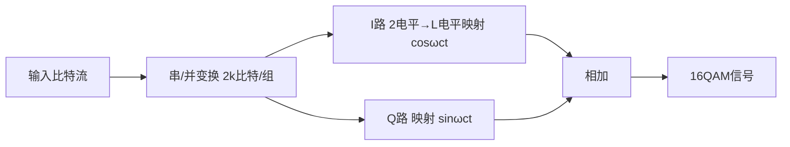

> [!abstract] 本章在讲什么
> 本章讲三大现代主力调制，8.1–8.4 依次展开：
> - **8.1 正交振幅调制 QAM**：振幅与相位如何联合？16QAM 为什么比 16PSK 好 4.12 dB？
> - **8.2 最小频移键控 MSK 与 GMSK**：MSK 的"四个最"是什么？GMSK 为什么适合 GSM？
> - **8.3 正交频分复用 OFDM**：子载波正交条件、IFFT/FFT 实现、循环前缀如何抗多径？
> - **8.4 知识对比总表**：QAM / MSK/GMSK / OFDM 的包络、相位、频带利用率与适用场景。
>
> 一句话主线：**QAM 用"振幅+相位"把星座点排得更密，MSK/GMSK 用"恒包络+连续相位"适配非线性功放，OFDM 用"多载波正交"把频率选择性衰落切成平坦衰落——三者分别代表"高效、鲁棒、抗多径"三条工程路线。**

> [!note] 记号约定
> - $M$：星座点数；每码元 $\log_2M$ bit；$A_m,B_m$：QAM 两路振幅
> - $A_M$：最大振幅；$d$：相邻星座点最小欧氏距离
> - MSK 调制指数 $h=0.5$；频率间隔 $\Delta f=1/(2T_B)$
> - $B_bT_B$：GMSK 高斯滤波器归一化带宽
> - OFDM：$N$ 个子载波，子载波间隔 $\Delta f=1/T_s$，符号长度 $T_s$；CP 长度 $T_{CP}$
> - PAPR：峰均功率比（peak-to-average power ratio）

# 8.1 正交振幅调制 QAM

## 基本原理

> [!info] Def 1 正交振幅调制
> **正交振幅调制**（quadrature amplitude modulation，简称 QAM）是振幅与相位**联合**调制：用两个**正交**载波 $\cos\omega_c t$ 与 $\sin\omega_c t$ 分别做 ASK，每码元取一对振幅 $(A_m,B_m)$。

$$s_{QAM}(t)=A_m\cos\omega_c t+B_m\sin\omega_c t\quad\text{（每码元取一对 }(A_m,B_m)\text{）}$$

- 星座图：$(A_m,B_m)$ 平面上的点阵（同相 I + 正交 Q）
- **每码元 $\log_2M$ bit**（$M$ = 星座点数）
- 带宽与 MASK/PSK 相同 → **频带利用率 = $\log_2M$ b/(s·Hz)（矩形谱基带）**，高阶优势巨大



## 16QAM vs 16PSK（经典考点）

设**最大振幅相等**为 $A_M$：

- 16QAM 相邻点最小欧氏距离：$d_1=\dfrac{\sqrt{2}A_M}{3}\approx0.471A_M$
- 16PSK 相邻点距离：$d_2\approx A_M\cdot\dfrac{\pi}{8}\approx0.393A_M$

再考虑 16QAM 峰均功率比 1.8 倍（2.55 dB）：

> [!important] 必背结论
> **平均功率相等条件下，16QAM 的噪声容限比 16PSK 大约 4.12 dB**（$0.471/0.393\approx1.57$ dB + 峰均比换算 2.55 dB）。
> → **高阶调制（$M\ge16$）一律 QAM 优于 MPSK**；这也是 5G 采用 16/64/256-QAM 的原因（对照 [[vault-notes/5g/phy/04-physical-channels-signals]] 中 PDSCH 调制）。

## QAM 解调

相干解调：两路正交相干载波分别相乘 → LPF → 判决（需载波同步 + 定时同步）。星形星座（如 8QAM 星形）比方形更抗相位抖动。

# 8.2 最小频移键控 MSK 与 GMSK

## MSK 的动机

2FSK 三大缺陷 → MSK 针对性改进：

| 2FSK 缺陷 | MSK 改进 |
| --- | --- |
| 带宽大（频带利用率低） | **带宽最小**（最小频率间隔） |
| 开关法产生相位不连续 → 包络起伏 | **相位连续** |
| 两种码元波形不一定正交 | **严格正交** |

## 正交 2FSK 的最小频率间隔

两个正弦码元在 $T_B$ 内正交要求 $\int_0^{T_B}\cos\omega_1t\cos\omega_2t\,dt=0$：

- 相干检测（相位连续）：最小间隔 $\Delta f=\dfrac{1}{2T_B}$（**MSK 采用**）
- 非相干（包络检波）：最小间隔 $\Delta f=\dfrac{1}{T_B}$（正交 2FSK 实际采用）

## MSK 信号（"四个最"）

> [!info] Def 2 最小频移键控
> **最小频移键控**（minimum-shift keying，简称 MSK）是调制指数 $h=0.5$、频率间隔 $\Delta f=1/(2T_B)$ 的**恒包络、相位连续、严格正交**的 2FSK。

$$s_{MSK}(t)=\cos\!\left(\omega_c t+\frac{a_n\pi t}{T_B}+\varphi_n\right)$$

（$a_n=\pm1$；频率间隔 $\Delta f=\frac{1}{2T_B}$，即 $f_1=f_c-\frac{1}{4T_B}$，$f_2=f_c+\frac{1}{4T_B}$，调制指数 **$h=0.5$**。）

| 性质 | 说明 |
| --- | --- |
| **包络恒定** | 对功放非线性友好 |
| **相位连续** | 相位路径折线，每个码元内线性增/减 $\pi/2$；无相位跳变 |
| **带宽最小**（严格正交前提下） | 主瓣 $1.5f_B$，带外衰减快 |
| **严格正交** | 误码性能与 2PSK 相当（相干） |

> [!note] 相位约束（考点）
> MSK 在码元交界处相位必须连续：$\varphi_n$ 的选择保证 $t=nT_B$ 处相位为 $\frac{n\pi}{2}$ 的整数倍——"相位路径是斜率 $\pm\pi/(2T_B)$ 的折线"。

## GMSK（高斯 MSK）

> [!info] Def 3 高斯最小频移键控
> **高斯最小频移键控**（Gaussian minimum-shift keying，简称 GMSK）是在 MSK 之前加一个**高斯低通滤波器**（归一化带宽 $B_bT_B$）对基带矩形脉冲成形，以进一步压缩带外辐射。

MSK 相位路径虽连续但**转折仍陡** → 频谱旁瓣仍不够低。GMSK 的基带矩形脉冲先经**高斯低通滤波器**（带宽 $B_b$，$B_bT_B$ 为参数）成形，再 MSK 调制。

- $B_bT_B$ 越小 → 频谱越紧凑（带外辐射小），但 ISI 越大
- **GSM 空口即采用 GMSK（$B_bT_B=0.3$）**——恒包络 + 高频谱效率，适配非线性功放的手机终端

# 8.3 正交频分复用 OFDM

## 概述（为什么需要 OFDM）

- 随参/宽带信道存在**频率选择性衰落**（[[vault-notes/communication/04-channel]]：相关带宽 $1/\tau_m$）——单载波高速信号易被深衰落打击整段频谱
- **思想：把高速串行数据流拆成 $N$ 路低速并行数据，调制到相互正交的子载波上同时传输**：
  - 每路子载波带宽变窄（< 相关带宽）→ 平坦衰落，均衡简单
  - 码元时长延长 $N$ 倍 → 抗多径/脉冲噪声

## 正交条件

> [!info] Def 4 正交频分复用
> **正交频分复用**（orthogonal frequency-division multiplexing，简称 OFDM）是用一组**相互正交**的子载波并行传输低速数据流的多载波调制技术；子载波间隔 $\Delta f=1/T_s$（$T_s$ 为 OFDM 符号长度）。

$$\int_0^{T_s}e^{j2\pi f_i t}e^{-j2\pi f_k t}\,dt=0\quad(f_i\ne f_k,\ f_i-f_k=m/T_s)$$

- 子载波频谱相互重叠但在抽样时刻**严格正交** → 频带利用率极高（对比传统 FDM 需保护带）
- 频谱交叠"火车厢"状，是**最佳频谱效率**的多载波方案

## OFDM 的实现（IFFT/FFT）

> [!important] 核心工程实现
> - **调制：IFFT**（离散反傅里叶变换把 $N$ 个子载波上的 QAM 符号一步变成时域波形）
> - **解调：FFT**
> - **串/并 + IFFT + 加循环前缀 CP + D/A → 射频**；接收相反
>
> 没有 FFT 之前 OFDM 只是理论；FFT 使其复杂度降为 $O(N\log N)$ → 4G/5G/WiFi 全面落地。

> [!info] Def 5 循环前缀
> **循环前缀**（cyclic prefix，简称 CP）是把 OFDM 符号**尾部**一段复制到**头部**的保护间隔：
> - 将线性卷积（多径信道）变成**循环卷积** → 保留子载波正交性
> - 只要 CP 长度 ≥ 最大多径时延扩展 $\tau_{\max}$，**ISI 和 ICI（载波间干扰）同时消除**
> - 代价：功率/带宽效率下降 $\frac{T_{CP}}{T_s+T_{CP}}$

**其他特点**：

- 各子载波可用不同调制阶数（自适应：好子信道 64QAM、差子信道 QPSK）
- 峰均比 PAPR 高（多载波叠加，对功放线性要求高）→ 上行改用 SC-FDMA（DFT-s-OFDM，LTE 上行）
- 对频偏/相位噪声敏感（正交性依赖严格频率同步）

> [!tip] 一句话记忆
> **OFDM = IFFT 实现的正交多载波 + 循环前缀抗多径**：把"频率选择性衰落的宽带信道"切成"一片平坦衰落的窄带信道"。

# 8.4 知识对比总表

| 体制 | 包络 | 相位 | 频带利用率 | 抗衰落/非线性 | 典型应用 |
| --- | --- | --- | --- | --- | --- |
| QAM | 不恒定 | — | **最高**（$\log_2M$） | 对非线性/衰落敏感 | ADSL/5G 下行/有线 |
| MSK/GMSK | **恒定** | 连续 | 中 | **最好**（功放友好） | GSM/蓝牙(DECT) |
| OFDM | 不恒定(PAPR 高) | 各子载波独立 | **极高**（子载波正交交叠） | **抗频率选择性衰落**（CP 抗多径） | 4G/5G/WiFi/DVB |

> [!tip] 本章收官
> 本章三条路线各有取舍：**QAM** 用密集星座换频带利用率，代价是抗噪/抗非线性差；**MSK/GMSK** 用恒包络与连续相位换功放友好与抗衰落，代价是频带利用率中等；**OFDM** 用多载波正交与循环前缀换抗多径能力，代价是 PAPR 高、对频偏敏感。现代系统往往是它们的组合：OFDM 的每个子载波上再放 QAM 星座。

## 本章知识地图

```
新型数字带通调制
├─ QAM（8.1）
│  ├─ s = A_m cosω_c t + B_m sinω_c t（I/Q 两路 ASK）
│  ├─ M 点星座，每码元 log₂M bit
│  ├─ 16QAM vs 16PSK：平均功率相等时噪声容限大 4.12 dB
│  └─ 相干解调：两路正交载波 → LPF → 判决
├─ MSK / GMSK（8.2）
│  ├─ MSK：h=0.5、Δf=1/(2T_B)、恒包络、相位连续、严格正交
│  ├─ 相位路径：每码元 ±π/2 折线
│  ├─ GMSK：高斯低通预滤波 + MSK，B_bT_B 越小频谱越紧
│  └─ GSM 采用 GMSK（B_bT_B=0.3）
└─ OFDM（8.3）
   ├─ 动机：把频率选择性衰落切成平坦衰落
   ├─ 正交条件：Δf = 1/T_s
   ├─ 实现：IFFT 调制 / FFT 解调，O(N log N)
   ├─ CP：≥ 最大多径时延 → 消 ISI + ICI
   └─ 弱点：PAPR 高、对频偏敏感
```

## 关联

- 上一章：[[vault-notes/communication/07-digital-bandpass]]
- 下一章：[[vault-notes/communication/09-optimal-reception]]

**本章与前后章节的接口**

| 本章概念 | 后续落点 |
| --- | --- |
| QAM 星座与最小距离 | [[vault-notes/communication/09-optimal-reception]] 的最小欧氏距离判决 |
| MSK 正交、$h=0.5$ | [[vault-notes/communication/07-digital-bandpass]] 的 2FSK；[[vault-notes/communication/12-orthogonal-codes-pn-sequences]] 的正交性 |
| OFDM 正交子载波 | [[vault-notes/communication/02-deterministic-signals]] 的傅里叶变换；[[vault-notes/communication/09-optimal-reception]] 的相关接收 |
| 循环前缀抗多径 | [[vault-notes/communication/04-channel]] 的频率选择性衰落与相关带宽 |
| PAPR、SC-FDMA | [[vault-notes/5g/phy/05-air-interface-illustrated]] 的上行波形 |

**通信方向应用**：

- [[vault-notes/5g/phy/04-physical-channels-signals]] —— 5G NR 的下行就是 CP-OFDM + 自适应 QAM；本章的 $M$ 阶 QAM、CP 长度、PAPR 都是 5G 参数设计的直接依据。
- [[vault-notes/5g/phy/05-air-interface-illustrated]] —— OFDM 的 IFFT/FFT 链路、CP、SC-FDMA 在 5G 空口笔记中有工程版展开。
- [[vault-notes/matlab/matlab-notes]] —— 用 `qammod`/`qamdemod`、`ofdmmod`/`ofdmdemod` 可以复现本章的星座与 OFDM 链路。

**相关**：[[vault-notes/communication/07-digital-bandpass]]｜[[vault-notes/communication/09-optimal-reception]]｜[[vault-notes/5g/phy/04-physical-channels-signals]]
