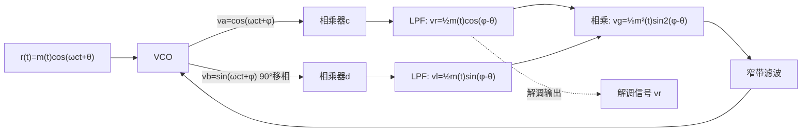

> [!abstract] 本章在讲什么
> 本章讲数字通信系统"咬合运转"的前提——同步，13.1–13.5 依次展开：
> - **13.1 概述**：载波同步、码元同步、群同步、网同步各管什么？出错后果是什么？
> - **13.2 载波同步**：插入导频法与直接法；平方环、科斯塔斯环的原理与相位模糊。
> - **13.3 码元同步（位同步）**：外同步与自同步；定时误差如何折损 $E_b/n_0$？
> - **13.4 群同步（帧同步）**：集中插入与分散插入；巴克码识别器；漏同步/假同步概率。
> - **13.5 网同步**：主从、互同步、准同步三种方案。
>
> 一句话主线：**同步是"在接收端凭空造出与发送端一致的时钟与相位"；载波同步供相干解调，位同步供抽样判决，群同步供分帧，网同步供全网时钟一致——四者逐级依赖，任何一级失锁都会让整条链路崩溃。**

> [!note] 记号约定
> - $\omega_c$：载波角频率；$\theta$：发送载波初相；$\varphi$：本地 VCO 相位
> - $T_B$：码元周期；$f_B=1/T_B$
> - $n$：同步码长（巴克码长度）；$m$：识别器允许的错误位数
> - $p$：码元误码率；$P_1$：漏同步概率；$P_2$：假同步概率
> - $t_s$：同步建立时间；$t_c$：同步保持时间
> - VCO：压控振荡器（voltage-controlled oscillator）；PLL：锁相环（phase-locked loop）

# 13.1 概述

| 同步类型 | 作用 | 出错后果 |
| --- | --- | --- |
| **载波同步** | 产生同频同相相干载波 | 相干解调失败（2PSK 倒 π） |
| **码元同步（位同步）** | 确定每个码元的抽样判决时刻 | 误码率大增 |
| **群同步（帧同步）** | 找到帧/群的开头（字头） | 分路/分帧错位、信息混乱 |
| **网同步** | 全网统一时钟（通信网） | 滑码、数据丢失 |

> 载波/码元/群同步按"点对点系统内"划分；网同步面向"多节点组网"。**群同步以码元同步为前提**，逐级依赖。

# 13.2 载波同步

> [!info] Def 1 载波同步
> **载波同步**（carrier synchronization）是在接收端提取与发送载波**同频同相**（或已知相差）的本地载波，为相干解调提供参考。

**任务**：在接收端提取与发送载波**同频同相**（或已知相差）的本地载波。

## 直接法与插入导频法

| 途径 | 方法 | 典型 |
| --- | --- | --- |
| **插入导频法（外同步）** | 在频谱适当位置插小功率导频，收端窄带滤波取出 | SSB/VSB、模拟电视 |
| **直接法（自同步）** | 从信号自身非线性变换提取 | DSB/2PSK：平方/科斯塔斯环 |

## 平方法（平方变换/平方环）

> [!info] Def 2 平方环
> **平方环**（squaring loop）先把接收信号平方，产生 $2f_c$ 分量，再用锁相环提取并二分频得到载波。

2PSK/DSB 信号无载波离散谱 → **平方后出现 2 倍频分量**：

$$[m(t)\cos\omega_c t]^2=\frac{m^2(t)}{2}[1+\cos2\omega_c t]\ \to\ \text{窄带取 }2f_c\ \to\ \text{二分频得 }f_c$$

> [!warning] 相位模糊的根源
> 平方 + 二分频 → 输出相位有 **$0/\pi$ 二义**（这就是第 7 章 2PSK"倒 π"的出处）→ 工程用**差分编码（2DPSK）**规避。

## 科斯塔斯环（同相正交环）

> [!info] Def 3 科斯塔斯环
> **科斯塔斯环**（Costas loop，也称同相正交环）是**无需平方运算**、直接在 $f_c$ 上工作的锁相环：用同相/正交两路相乘滤波得到误差电压驱动 VCO，同时输出解调信号。

**无需平方运算**、直接在 $f_c$ 上工作的锁相环：



**工作原理（关键方程）**：

$$v_r=\tfrac{1}{2}m(t)\cos(\varphi-\theta),\qquad v_l=\tfrac{1}{2}m(t)\sin(\varphi-\theta)$$

$$v_g=v_rv_l=\tfrac{1}{8}m^2(t)\sin2(\varphi-\theta)\approx\tfrac{1}{4}m^2(t)(\varphi-\theta)\quad(\text{小相差时})$$

- $m(t)=\pm1$（数字）时 $v_g\propto(\varphi-\theta)$：**误差电压驱动 VCO 锁定相位**
- **同时输出解调信号 $v_r$**（锁定后 $v_r\to\frac{1}{2}m(t)$）——载波提取与解调一步完成

> [!important] 对比记忆
> 平方环 vs 科斯塔斯环：**性能理论相同**；科斯塔斯环省去平方器（避免高频）、但电路复杂（多支路）。**同样存在相位模糊**（$0/\pi$ 平衡点），2PSK 仍需差分编码。

## 载波同步的性能指标

1. **效率**：插入导频占功率 → 直接法效率高
2. **精度**：稳态相差 $\Delta\varphi$（锁相环剩余相差，应尽量小）
3. **同步建立时间 $t_s$**：开机到锁定（快捕带宽内）
4. **同步保持时间 $t_c$**：信号中断后本地载波仍可用的时长（VCO 相位漂移在允许范围内）

（后三者互相制约：带宽大 → 快但精度差。）

# 13.3 码元同步（位同步）

> [!info] Def 4 码元同步
> **码元同步**（symbol synchronization，也称位同步）是在接收端产生与接收码元**同步的定时脉冲序列**，以确定抽样判决时刻。

**任务**：产生与接收码元**同步的定时脉冲序列**，确定抽样判决时刻。

## 外同步法（插入定时信息）

- 发端在码元中**插入位定时导频**（频域零点处插小载波/时域穿插同步码）；
- 收端窄带滤波提取 → 相位调整（移相 $1/4$ 周期使判决在码元中心）→ 脉冲形成。
- 优点：收端简单可靠；缺点：占用功率/带宽、连续波串扰。

## 自同步法（从信号自身提取）

**前提**：基带信号含定时分量（或经非线性变换产生）。

**滤波法**：矩形 RZ 有位定时离散谱（[[vault-notes/communication/06-digital-baseband]] 功率谱）→ 窄带滤波/锁相环提取。
若 NRZ 无离散谱（等概双极性）→ **先非线性变换**（微分整流/平方）再生 $f_B$ 分量。

**锁相法（数字锁相环位同步）**：本地晶振分频出的定时脉冲与接收码元前沿比较 → 超前扣除/滞后附加脉冲（调整精度 1 个分频周期 $T_B/m$）→ 相位逐步对齐。

## 同步误差对误码率的影响

定时误差 $\Delta t$ 使抽样偏离最佳时刻：

- 信号样值按 $\left(1-\frac{2\Delta t}{T_B}\right)$ 减小（近似）
- 误码率恶化：$P_e(\Delta t)\approx\frac{1}{2}\mathrm{erfc}\left(\sqrt{\frac{E}{n_0}\left(1-\frac{2\Delta t}{T_B}\right)}\right)$

> 结论：**定时抖动直接吃掉有效 $E_b/n_0$**——接收机里"定时与 AGC 一样重要"。

# 13.4 群同步（帧同步）

> [!info] Def 5 群同步
> **群同步**（frame synchronization，也称帧同步）是在码元流中识别**帧（群）的起始位置**，以便正确分组（区分话路、字节、分组头等）。

**任务**：在码元流中识别"**帧（群）的起始位置**"，以便正确分组。

## 两类方法

| 方法 | 机制 | 应用 |
| --- | --- | --- |
| **集中插入法** | 帧头集中插入特殊**同步码组**（如巴克码）——识别器逐位比对 | PCM 30/32 路帧同步码 **0011011**（TS0） |
| **分散插入法** | 同步码**分散**到每帧固定位置（如每帧 1 位，1/0 交替） | PCM 24 路（T1，每 193 bit 插 1 位帧码） |

## 巴克码 (Barker)

> [!info] Def 6 巴克码
> **巴克码**（Barker code）是具有尖锐双值局部自相关的同步码：
> $$R(j)=\begin{cases}n,&j=0\\0\text{ 或 }\pm1,&j\ne0\end{cases}$$
> 已知长度 $n=2,3,4,5,7,11,13$（已证明 $n>13$ 不存在，奇长）。

**特殊性质**：局部自相关函数双值尖锐：

$$R(j)=\begin{cases}n,&j=0\\0\text{ 或 }\pm1,&j\ne0\end{cases}$$

已知巴克码：$n=2,3,4,5,7,11,13$（已证明 $n>13$ 不存在，奇长）。典型 **7 位巴克码：1110010**（$-+-+++-$，注意约定）。

**识别器**：移存器 + 相加器 + 判决器：收到全部对齐时相加输出**峰值 7**，判决"帧头找到"。

## 漏同步与假同步（性能指标）

> [!info] Def 7 漏同步与假同步
> - **漏同步概率** $P_1$：真正的同步码因误码而未被识别的概率。
> - **假同步概率** $P_2$：随机数据中碰巧出现同步码样而被误判为帧头的概率。

设同步码长 $n$，识别器允许错误 $m$ 位（判决门限降低）：

$$\boxed{\text{漏同步概率 }P_1=1-\sum_{i=0}^{m}C_n^i\,p^i(1-p)^{n-i}}\quad(p\text{: 码元误码率})$$

$$\boxed{\text{假同步概率 }P_2=\frac{\sum_{i=0}^{m}C_n^i}{2^n}}\quad(\text{随机数据中碰巧出现同步码样的概率})$$

- **矛盾**：$m$↑ → $P_1$↓ 但 $P_2$↑（容错与误判的折中）
- **平均建立时间**：集中插入 $t_s\approx N_T(1+P_1+P_2)$ 帧（误码小时约一两帧）

> [!example] 例：$n=7$ 巴克码、$p=10^{-3}$、$m=0$：$P_1=1-(1-p)^7\approx7\times10^{-3}$；$P_2=1/2^7\approx7.8\times10^{-3}$。

## 起止式同步与自群同步（了解）

- **起止同步**：每字符加"起/止"位（异步串口 UART 的原理，效率低）
- **自群同步**：码组本身结构自识别（如用**自同步的纠错码**——卷积码某些具有）
- **扩频系统同步**：PN 码捕获/跟踪（滑动相关/匹配滤波捕获、延迟锁相环跟踪）——[[vault-notes/communication/12-orthogonal-codes-pn-sequences]] 的应用延伸

# 13.5 网同步

> [!info] Def 8 网同步
> **网同步**（network synchronization）是使数字通信网中各节点时钟保持一致，避免因时钟偏差导致缓冲器滑码（重读或漏读）。

**问题**：数字网中各站时钟不完全一致 → 中继/交换节点缓冲器**滑码**（重读或漏读）。

| 方法 | 思路 | 应用 |
| --- | --- | --- |
| **开环法（主从同步）** | 全网锁定一个**主时钟**（等级主从） | PDH/SDH 传输网（主从 + 区域基准） |
| **闭环法（互同步）** | 各站时钟**互相比较调节**到平均值（无主站） | 特殊网状网 |
| **准同步（异步）** | 各站用高稳钟（铯原子钟），靠缓冲吸收慢漂移 | 国际互连、跨网 |

> SDH 全网同步（主从）；以太网/分组网异步 + 缓冲；5G 网同步还需要 GPS/北斗授时辅助（eCPRI 前传对时钟的严格要求即源于此）。

> [!tip] 本章收官
> 本章把同步拆成四级并逐级打通：**载波同步**（平方环/科斯塔斯环，代价是相位模糊，用 DPSK 规避）→ **码元同步**（外同步插导频 / 自同步非线性 + 锁相，定时误差直接折损 $E_b/n_0$）→ **群同步**（集中/分散插入，巴克码识别器，漏同步与假同步的 $m$ 权衡）→ **网同步**（主从/互同步/准同步）。这四级同步是数字通信"最后一公里"的保障，也是第 7、9 章解调与最佳接收能够落地的前提。

## 本章知识地图

```
同步原理
├─ 概述（13.1）
│  └─ 载波 → 码元 → 群 → 网（逐级依赖）
├─ 载波同步（13.2）
│  ├─ 插入导频（外同步）/ 直接法（自同步）
│  ├─ 平方环：×2 频 → PLL → ÷2；相位 0/π 模糊
│  ├─ 科斯塔斯环：同相/正交两路，误差 v_g∝(φ−θ)
│  └─ 指标：效率/精度/建立时间/保持时间
├─ 码元同步（13.3）
│  ├─ 外同步：插入位定时导频
│  ├─ 自同步：非线性变换 + 滤波/PLL
│  └─ 定时误差 Δt → 有效 E_b/n₀ 折损
├─ 群同步（13.4）
│  ├─ 集中插入（PCM 30/32：0011011）/ 分散插入（T1）
│  ├─ 巴克码 1110010，R(j) 双值
│  ├─ 漏同步 P₁=1−ΣC_n^i p^i(1−p)^(n−i)
│  └─ 假同步 P₂=ΣC_n^i/2ⁿ；m 的两难
└─ 网同步（13.5）
   ├─ 主从（开环）
   ├─ 互同步（闭环）
   └─ 准同步（高稳钟 + 缓冲）
```

## 关联

- 上一章：[[vault-notes/communication/12-orthogonal-codes-pn-sequences]]
- 下一章：（全书结束，返回 [[vault-notes/communication/00-guide]]）

**本章与前后章节的接口**

| 本章概念 | 后续落点 |
| --- | --- |
| 载波同步、相位模糊 | [[vault-notes/communication/07-digital-bandpass]] 的 2PSK 倒 π；[[vault-notes/communication/09-optimal-reception]] 的相干接收 |
| 位同步、定时误差 | [[vault-notes/communication/06-digital-baseband]] 的眼图与定时灵敏度 |
| 群同步、巴克码 | [[vault-notes/communication/10-source-coding]] 的 E1 帧同步码 0011011 |
| 漏同步/假同步 | [[vault-notes/math/probability/01-basic-concepts\|1. 概率论的基本概念]] 的二项分布 |
| 网同步 | [[vault-notes/5g/phy/04-physical-channels-signals]] 的授时与同步信号 |

**通信方向应用**：

- [[vault-notes/5g/phy/04-physical-channels-signals]] —— 5G 的小区搜索（PSS/SSS）、时频同步、定时提前（TA）是本章四类同步的工程实现。
- [[vault-notes/5g/phy/01-cell-search]] —— 主同步信号/辅同步信号的检测就是载波与帧同步的现代版本。
- [[vault-notes/matlab/matlab-notes]] —— 用锁相环（PLL）系统对象、相关器实现巴克码识别，可以复现本章的同步环路。

**相关**：[[vault-notes/communication/12-orthogonal-codes-pn-sequences]]｜[[vault-notes/communication/07-digital-bandpass]]｜[[vault-notes/communication/10-source-coding]]
