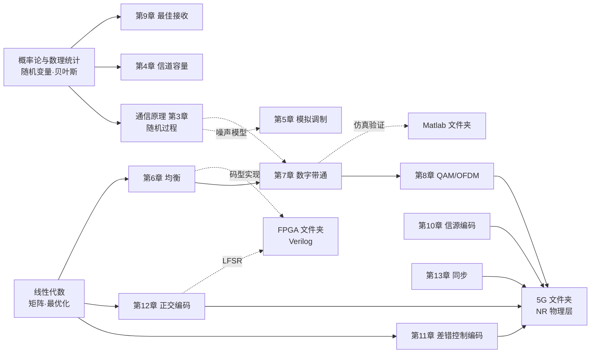

# 🔗 跨库知识关联：通信原理 ↔ 其他文件夹

> [!abstract] 📌 为什么需要这一页
> 《通信原理》不是孤岛：它的**概率语言**来自概率论、**代数工具**来自线性代数、**工程落地**写在 5G 文件夹里、**硬件实现**落在 FPGA 文件夹。
> 本笔记把这些"接口"逐条列出——**在哪一章用到哪个库的哪个知识点**，方便你顺着一条链子把整个 vault 串起来复习。

---

## 一、与「概率论与数理统计」文件夹的关联 ⭐⭐⭐（关联最紧密）

| 通信原理 | 用到的概率论知识 | 具体接口 |
| --- | --- | --- |
| [[vault-notes/communication/01-introduction]] 信息量与熵 | [[vault-notes/math/probability/01-basic-concepts|1.基本概念]]——概率的定义与性质 | 信息量 $I=\log_2\frac1P$ 是**概率的函数**；熵是概率的加权平均 |
| [[vault-notes/communication/03-random-processes]] 全章 | [[vault-notes/math/probability/03-random-variables-distributions|3.随机变量及其分布]] | **高斯/瑞利/莱斯/对数正态四大分布原样复用**；"两个独立高斯变量的模服从瑞利"就是该笔记里那句"瑞利 = 两个独立同方差高斯变量的模" |
| [[vault-notes/communication/03-random-processes]] 窄带过程 | [[vault-notes/math/probability/03-random-variables-distributions|3.随机变量及其分布]] 的"两级衰落"图 | 笔记中快衰落（瑞利/莱斯）↔ 通信原理里"窄带噪声包络"；**同一数学、两种语境** |
| [[vault-notes/communication/04-channel]] 离散信道容量 | [[vault-notes/math/probability/02-conditional-probability-independence|条件概率及事件的独立性]] | 信道容量 $C=\max[H(x)-H(x/y)]$ 中的条件熵 $H(x/y)$ 由**贝叶斯公式**算出（原书 4.6.1 例即用贝叶斯） |
| [[vault-notes/communication/04-channel]] 随参信道衰落 | [[vault-notes/math/probability/03-random-variables-distributions|3.随机变量及其分布]] 的瑞利分布 | 多径衰落包络服从瑞利分布——**通信原理讲物理成因，概率论讲数学形式** |
| [[vault-notes/communication/09-optimal-reception]] | [[vault-notes/math/probability/02-conditional-probability-independence|条件概率及事件的独立性]] 的贝叶斯公式 | **最大后验准则 MAP 就是贝叶斯公式的直接应用**：$P(s_i/r)\propto P(r/s_i)P(s_i)$ |

> [!tip] 联动复习法
> 先读 [[vault-notes/math/probability/03-random-variables-distributions|3.随机变量及其分布]] 的第五节「常见分布」，再读 [[vault-notes/communication/03-random-processes]] 第五、六节——你会发现**同一组公式出现在两个文件夹，但一个问"分布长什么样"、一个问"接收机怎么设计"**。这正是"数学 → 工程"的完整链条。

---

## 二、与「线性代数」文件夹的关联 ⭐⭐

| 通信原理 | 用到的线代知识 | 具体接口 |
| --- | --- | --- |
| [[vault-notes/communication/11-error-control-coding]] 线性分组码 | [[vault-notes/math/linear-algebra/02-solving-linear-systems|线性方程组求解]] | **监督矩阵 $H$、生成矩阵 $G$、伴随式 $S=RH^T$**——整章就是模 2 域上的矩阵运算；$G=[I_k\vert Q]$、$H=[P\vert I_r]$ 是分块矩阵 |
| [[vault-notes/communication/11-error-control-coding]] 码距 | [[vault-notes/math/linear-algebra/10-applications|线性代数的应用]] | 最小码距 = 码字集合中"最稀疏"的两点距离 → **最小距离问题**；纠错译码 = 找最近码字（最优化） |
| [[vault-notes/communication/09-optimal-reception]] | [[vault-notes/math/linear-algebra/10-applications|线性代数的应用]] | **最小欧氏距离判决**即最小二乘拟合；匹配滤波器是施瓦茨不等式取等条件 |
| [[vault-notes/communication/11-error-control-coding]] 卷积码 | [[vault-notes/math/linear-algebra/06-eigenvalues-eigenvectors|特征值与特征向量]] | 状态图/网格图就是**状态转移矩阵**的图形化；状态数 $2^{N-1}$ 与矩阵维数对应 |
| [[vault-notes/communication/12-orthogonal-codes-pn-sequences]] | [[vault-notes/math/linear-algebra/02-solving-linear-systems|线性方程组求解]] | **哈达玛矩阵** $H_nH_n^T=nI$ 是正交矩阵；沃尔什函数系 = 正交基 |
| [[vault-notes/communication/06-digital-baseband]] 时域均衡 | [[vault-notes/math/linear-algebra/11-numerical-linear-algebra|数值线性代数]] | 迫零均衡**解线性方程组**求抽头系数；系数矩阵病态→需正则化（MMSE 的代数解释） |
| [[vault-notes/communication/11-error-control-coding]] 维特比译码 | [[vault-notes/math/linear-algebra/11-numerical-linear-algebra|数值线性代数]] | 网格图上的**动态规划**（加-比-选），与最短路径算法同源 |

> [!note] 一句话对应
> **线性分组码 = 模 2 线性代数**：$H$ 定义"合法码字的子空间"，伴随式 $S$ 是"投影到校验空间的残差"。

---

## 三、与「数字调制」文件夹的关联 ⭐⭐

| 通信原理 | 数字调制笔记 | 具体接口 |
| --- | --- | --- |
| [[vault-notes/communication/01-introduction]] 数字通信系统模型 | [[vault-notes/digital-modulation/01-digital-communication-system|数字通信系统的基本组成部分]] | 该笔记的 mermaid 流程图与绪论 §2.3 数字通信系统模型**同一张图**；它把"信源编码/信道编码"分工讲得更工程化 |
| [[vault-notes/communication/10-source-coding]] | 同上 | 笔记中"信源编码 = 压缩/去冗余"→ 对应抽样/量化/PCM/霍夫曼的完整实现 |
| [[vault-notes/communication/11-error-control-coding]] | 同上 | 笔记中"信道编码 = 加受控冗余"→ 对应汉明码/循环码/卷积码/Turbo/LDPC |

---

## 四、与 [[vault-notes/5g/00-guide|5G 文件夹]] 的关联 ⭐⭐⭐

> 5G 是通信原理"最直接的工程落地现场"——**每一条 NR 规范背后都能翻到本书的某一章**。

| 通信原理 | 5G 笔记 | 接口说明 |
| --- | --- | --- |
| [[vault-notes/communication/08-advanced-digital-modulation]] OFDM | [[vault-notes/5g/phy/04-physical-channels-signals]]、[[vault-notes/5g/phy/05-air-interface-illustrated]] | NR 的 **SCS 15/30/60/120 kHz 就是 $\Delta f=1/T_s$** 的具体取值；循环前缀 CP 对应"CP ≥ 最大多径时延" |
| [[vault-notes/communication/08-advanced-digital-modulation]] QAM | [[vault-notes/5g/phy/04-physical-channels-signals]] | PDSCH 的 **256-QAM/1024-QAM** 就是 QAM 高阶化；控制信道用 QPSK 是"可靠性换效率"（呼应 [[vault-notes/communication/01-introduction]] 有效性/可靠性矛盾） |
| [[vault-notes/communication/07-digital-bandpass]] 多进制调制 | [[vault-notes/5g/protocols/04-nr-standard-specifications]] | 调制阶数与 RB/BWP 的频谱效率关系 $\eta_b=\log_2M$ Brad/(s·Hz) |
| [[vault-notes/communication/11-error-control-coding]] LDPC | [[vault-notes/5g/phy/04-physical-channels-signals]]、[[vault-notes/5g/protocols/04-nr-standard-specifications]] | 5G 数据信道 **LDPC 编码**、控制信道 Polar 码——正是本章"现代编码双雄"的产业选择 |
| [[vault-notes/communication/11-error-control-coding]] Turbo/LDPC | [[vault-notes/5g/phy/04-physical-channels-signals]] 的 CRC-添加→LDPC编码→速率匹配链 | 物理层处理链的每一环都能在本书找到根 |
| [[vault-notes/communication/12-orthogonal-codes-pn-sequences]] | [[vault-notes/5g/phy/01-cell-search]]、[[vault-notes/5g/phy/03-random-access-rach]] | **PN 序列/扰码**、PRACH 的 Zadoff-Chu 前导码 = 伪随机序列的正交性应用 |
| [[vault-notes/communication/13-synchronization]] | [[vault-notes/5g/phy/01-cell-search]] | 小区搜索 = **载波同步 + 群同步**的工程版：PSS/SSS 完成时频同步与 PCI 识别（等价于巴克码/群同步的作用） |
| [[vault-notes/communication/13-synchronization]] 载波同步 | [[vault-notes/5g/phy/02-measurements-mobility]] | 频偏估计与补偿 = 载波同步的精度问题 |
| [[vault-notes/communication/04-channel]] 随参信道 | [[vault-notes/5g/phy/05-air-interface-illustrated]] | 多径/衰落是 NR 要对抗的第一号敌人 → 引出 OFDM + CP + 均衡 |

---

## 五、与「FPGA」文件夹的关联 ⭐

| 通信原理 | FPGA 笔记 | 接口说明 |
| --- | --- | --- |
| [[vault-notes/communication/06-digital-baseband]] 码型编码 | 向量（及后续） | AMI/HDB₃ 编码器 = **移位寄存器 + 模 2 加法**，Verilog 里就是 `shift register + XOR`（对应"向量"接线思维） |
| [[vault-notes/communication/12-orthogonal-codes-pn-sequences]] m 序列 | 同上 | **LFSR 是 m 序列发生器的硬件本体**；递推方程 $a_k=\sum c_ia_{k-i}$ 直接翻译成 Verilog 的反馈抽头 |
| [[vault-notes/communication/07-digital-bandpass]] / [[vault-notes/communication/08-advanced-digital-modulation]] | 同上 | 调制器 = 查找表（星座映射）+ 乘法器 + 累加器（相位积分，MSK 尤其典型） |
| [[vault-notes/communication/13-synchronization]] | 同上 | 数字锁相环/科斯塔斯环的 FPGA 实现 = 相位累加器 + 环路滤波器 |

---

## 六、与 [[vault-notes/matlab/matlab-notes]] 的关联 ⭐

> Matlab 是**验证本书结论**的实验室：误码率曲线、星座图、眼图、滤波器冲激响应都可以直接仿真出来。

| 通信原理 | 建议的仿真验证 |
| --- | --- |
| [[vault-notes/communication/07-digital-bandpass]] | 仿真 2ASK/2FSK/2PSK/2DPSK 的 $P_e$–$r$ 曲线，与原书图 7-29 对比 |
| [[vault-notes/communication/06-digital-baseband]] | 画升余弦滚降波形与眼图（`rcosdesign` + `eyediagram`）；仿真 HDB₃ 编码序列 |
| [[vault-notes/communication/08-advanced-digital-modulation]] | QAM 星座图、OFDM 的 IFFT/FFT 收发链与 CP 效果 |
| [[vault-notes/communication/09-optimal-reception]] | 匹配滤波器输出波形与最大信噪比验证 |
| [[vault-notes/communication/10-source-coding]] | A 律 13 折线压缩特性曲线、PCM 量化信噪比 vs 位数 $n$ 的 6 dB/位关系 |

---

## 七、一张总图：知识如何流动

---

## 八、建议的复习路线（跨库串联）

> [!tip] 三条串法
> 1. **概率线**：[[vault-notes/math/probability/01-basic-concepts|1.基本概念]] → [[vault-notes/math/probability/03-random-variables-distributions|3.随机变量及其分布]] → [[vault-notes/communication/03-random-processes]] → [[vault-notes/communication/09-optimal-reception]]（从概率公理一路走到接收机设计）
> 2. **代数线**：[[vault-notes/math/linear-algebra/02-solving-linear-systems|线性方程组求解]] → [[vault-notes/communication/11-error-control-coding]] → [[vault-notes/communication/12-orthogonal-codes-pn-sequences]]（模 2 线性代数 → 纠错码 → 正交码/扩频码）
> 3. **工程线**：[[vault-notes/communication/08-advanced-digital-modulation]] → [[vault-notes/5g/phy/05-air-interface-illustrated]] → [[vault-notes/5g/phy/04-physical-channels-signals]] → [[vault-notes/5g/protocols/04-nr-standard-specifications]]（OFDM/QAM → 空口实现 → 信道设计 → 规范参数）

**随机信号处理子库**：[[vault-notes/random-signals/00-knowledge-map]] —— 概率基础、随机过程、相关函数与 PSD、估计/检测、MATLAB 实验。

**相关**：[[vault-notes/communication/00-guide]]｜[[vault-notes/communication/a-formula-cheatsheet]]｜知识图谱 Canvas
