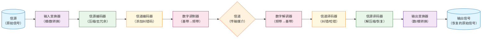

# 🎛️ 数字通信系统的基本组成部分

> [!abstract] 本页在讲什么
> 用一张流程图把「信源 → 信源编码 → 信道编码 → 调制 → 信道 → 解调 → 译码」串起来，并标出每一环在《通信原理》中的对应章节。

\#概念解析
**信源编码**（数据压缩）：将模拟或数字信源的输出有效的变换成二进制数字序列的处理过程

*由信源编码器输出的二进制序列被称为信息序列，它将被传送到信道编码器*

**信道编码**：在二进制信息序列中，受控的增加一些冗余，以便在接收机中克服信号在信道中传输时受到的噪声和干扰的影响

## 关联

这张图就是《通信原理（第七版）》绪论中的**数字通信系统模型**，各环节的详细展开见对应章节：

- [[vault-notes/communication/01-introduction]] —— 系统模型、信息量与熵的度量、有效性/可靠性指标
- [[vault-notes/communication/10-source-coding]] —— 信源编码的完整实现：抽样定理 / 量化 / A 律 13 折线 / PCM / ΔM / 霍夫曼编码
- [[vault-notes/communication/11-error-control-coding]] —— 信道编码的完整实现：码距判据 / 汉明码 / 循环码 / 卷积码 / Turbo / LDPC
- [[vault-notes/communication/07-digital-bandpass]] —— 图中"数字调制器"的具体调制方式与误码率
- [[vault-notes/communication/06-digital-baseband]] —— 未搬上载波时的基带传输：码型 / 码间串扰 / 眼图
- 全景入口：[[vault-notes/communication/00-guide]]｜跨库索引：[[vault-notes/communication/b-cross-library-links]]
- 实现落点：[[vault-notes/fpga/00-guide|FPGA 知识库导读]]｜[[vault-notes/fpga/ad9361/iq-signals-lab-matlab-rtl]]
