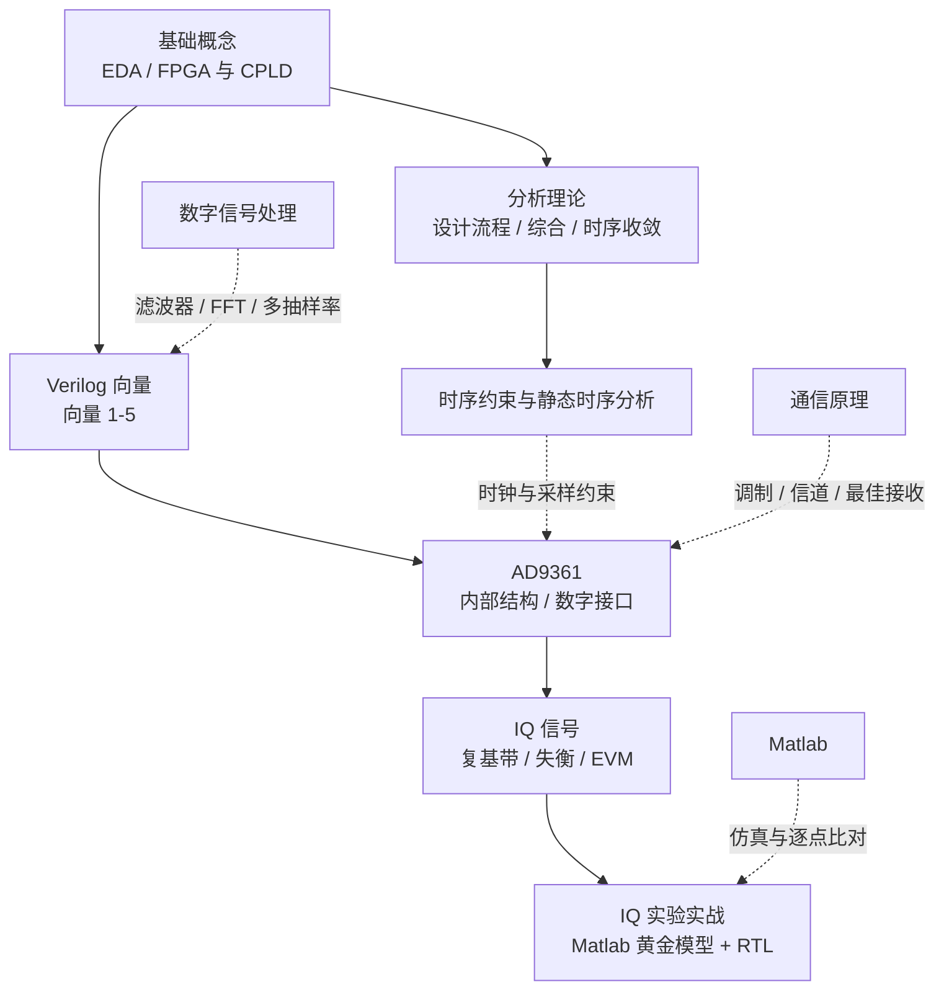

# 🔧 FPGA 知识库导读

> [!abstract] 这个子库在讲什么
> FPGA 子库分成两条主线：**数字设计基础**（EDA、FPGA/CPLD、Verilog 向量）和 **射频收发链路**（AD9361、IQ 信号、Matlab + RTL 实验）。
> 前者回答“怎么把逻辑写成可综合的 RTL”，后者回答“RTL 怎么和真实射频前端对接”。

## 一、知识地图

## 二、推荐学习顺序

1. **数字设计地基**：[[vault-notes/fpga/basics/01-eda-technology-overview]] → [[vault-notes/fpga/basics/02-fpga-cpld-overview]]
2. **Verilog 向量五连**：向量 → 向量（2） → 向量（3） → 向量（4） → 向量（5）
3. **时序与约束（数字系统设计）**：[[vault-notes/fpga/sta/00-guide]] → [[vault-notes/fpga/sta/01-design-implementation-flow]] → [[vault-notes/fpga/sta/04-timing-analysis-setup-hold]] → [[vault-notes/fpga/sta/05-timing-constraints-period-offset]] → [[vault-notes/fpga/sta/07-timing-analysis-cheatsheet]]
4. **射频前端**：[[vault-notes/fpga/ad9361/ad9361-architecture]] → [[vault-notes/fpga/ad9361/ad9361-digital-interface]]
5. **IQ 与实验**：[[vault-notes/fpga/ad9361/iq-signals]] → [[vault-notes/fpga/ad9361/iq-signals-lab-matlab-rtl]]

## 三、笔记索引

| 笔记 | 主题 | 关键落点 |
| --- | --- | --- |
| [[vault-notes/fpga/sta/00-guide]] | 数字系统设计：流程 / 综合 / 时序收敛 | 时序路径、建立保持、约束与优先级 |
| [[vault-notes/fpga/basics/01-eda-technology-overview]] | EDA 流程、综合/仿真/时序分析 | 设计流程与工具链 |
| [[vault-notes/fpga/basics/02-fpga-cpld-overview]] | PLD 分类、乘积项 vs 查找表 | CPLD/FPGA 选型 |
| 向量 | Verilog 向量声明与位选 | `[7:0]`、bit select |
| 向量（2） | Part-select 部分选择 | `[upper:lower]` |
| 向量（3） | 位运算与逻辑运算 | `&` / `\|` / `^` / `&&` / `\|\|` |
| 向量（4） | 向量反转 | 切片 + 拼接 |
| 向量（5） | 拼接与复制运算 | `{ }`、`{{N{...}}}`、符号扩展 |
| [[vault-notes/fpga/ad9361/ad9361-architecture]] | 零中频收发链、抽取/插值 | 采样率、FIR、PLL |
| [[vault-notes/fpga/ad9361/ad9361-digital-interface]] | CMOS/LVDS、时序、帧格式 | DATA_CLK、RX/TX_FRAME |
| [[vault-notes/fpga/ad9361/iq-signals]] | 复基带、欧拉公式、IQ 失衡 | 星座图、EVM、IRR |
| [[vault-notes/fpga/ad9361/iq-signals-lab-matlab-rtl]] | 黄金模型与 RTL 逐点比对 | PRBS7、定点补码、xsim |

## 四、和理论课的接口

| FPGA 概念 | 理论出处 | 接口说明 |
| --- | --- | --- |
| 卷积 / FIR 滤波器 | [[vault-notes/dsp/05-filter-structures]]、[[vault-notes/dsp/07-fir-filter-design]] | 抽头、乘累加、DSP48 |
| DFT / FFT | [[vault-notes/dsp/03-discrete-fourier-transform]]、[[vault-notes/dsp/04-fast-fourier-transform]] | FFT 核、OFDM 基带 |
| 多抽样率 | [[vault-notes/dsp/08-multirate-sampling]] | DDC/DUC、CIC、多相 FIR |
| 复数与 IQ | [[vault-notes/math/complex-analysis/01-complex-numbers-functions]]、[[vault-notes/fpga/ad9361/iq-signals]] | 复指数、正交混频 |
| 调制与星座 | [[vault-notes/communication/07-digital-bandpass]]、[[vault-notes/communication/08-advanced-digital-modulation]] | 星座映射、QAM/OFDM |
| 同步与载波恢复 | [[vault-notes/communication/13-synchronization]] | 数字锁相环、科斯塔斯环 |
| 编码与序列 | [[vault-notes/communication/11-error-control-coding]]、[[vault-notes/communication/12-orthogonal-codes-pn-sequences]] | LFSR、m 序列、LDPC |

## 五、关联

- 全库总纲：00_全库理论知识点综合与联系
- 时序分析子库：[[vault-notes/fpga/sta/00-guide]]｜[[vault-notes/fpga/sta/07-timing-analysis-cheatsheet]]
- 跨库索引：[[vault-notes/communication/b-cross-library-links]]
- 仿真验证：[[vault-notes/matlab/matlab-notes]]｜[[vault-notes/5g/phy/04-physical-channels-signals]]
- 上层系统：[[vault-notes/5g/00-guide]]
