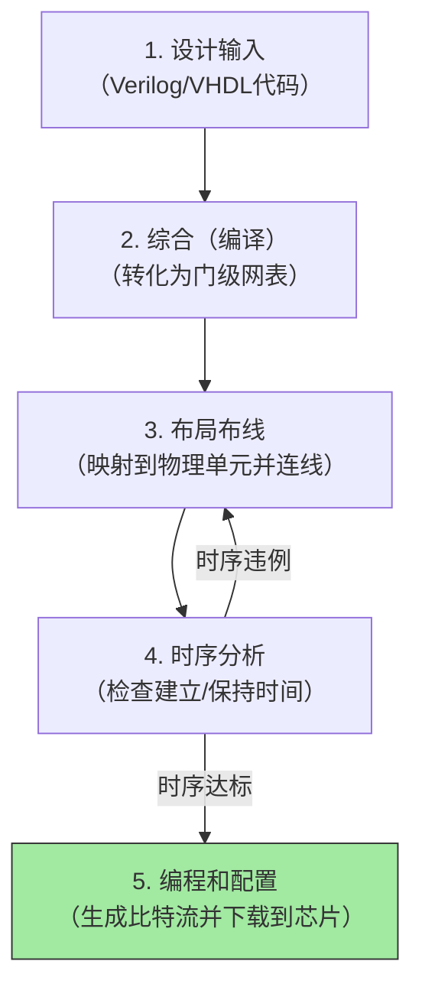

# 🛠️ EDA 技术概述

> [!abstract] 本页在讲什么
> EDA 是把「设计输入 → 逻辑综合 → 布局布线 → 下载验证」串起来的一整套工具链。本页同时区分功能仿真、时序分析与后仿真。

**定义** ： 所谓EDA技术，就是设计者以计算机为工具，基于EDA软件平台，采用原理图或者硬件描述语言（HDL）完成设计输入，然后由计算机自动完成逻辑综合，优化，布局布线，直至对目标芯片（FPGA/CPLD）的适配和编程下载工作，实现既定的电路功能

### EDA技术的三个阶段

- **CAD阶段（20世纪60-70年代）—— “替代手工绘图”**
	
    - **核心任务**：解决物理实现问题，用计算机替代人工画图。
    - **主要工具**：版图编辑、基本布局布线、设计规则检查（DRC）。
    - **特点**：侧重于**“几何图形处理”**，仅提供辅助绘图手段，设计思路仍完全依赖人工。
        
- **CAE阶段（20世纪70-80年代）—— “引入仿真验证”**
    
    - **核心任务**：在制造前验证功能是否正确，解决“设计对不对”的问题。    
    - **主要工具**：电路仿真（SPICE）、逻辑仿真、时序分析、自动测试生成（ATPG）。
    - **特点**：侧重于**“功能与性能分析”**，引入仿真技术，使工程师能在计算机上预判电路行为。
        
- **EDA阶段（20世纪80年代末至今）—— “实现自动综合”**
    
    - **核心任务**：从高层抽象自动转换出底层电路，解决“怎么自动设计”的问题。
    - **主要工具**：硬件描述语言（VHDL/Verilog）、逻辑综合、高层次综合（HLS）、IP核复用。
    - **特点**：侧重于**“系统级设计与自动优化”**，设计重心从底层晶体管转向行为级描述，标志着现代电子设计方法的真正形成。

### 设计思路

- **Top-down（自顶向下）：从“抽象”到“具体”**
    
    - **思路**：从**系统功能需求**出发，先定义顶层架构和行为，再逐层分解为子模块、逻辑门，直至最后的物理版图。
        
    - **流程**：
	    - **需求分析 → 行为级描述（HDL） → 逻辑综合 → 布局布线**。
        - **行为级与RTL级仿真 -> 功能仿真 -> 综合 -> 门级网表 -> 时序仿真**
    - **优点**：**宏观把控强**，前期重视架构设计，便于早期进行系统仿真验证，缩短整体开发周期。
        
    - **缺点**：容易**忽视底层物理效应**（如线延迟、串扰），可能导致后期物理实现时因时序不收敛而返工。
        
    - **典型场景**：现代**大规模数字芯片**（如CPU、GPU）的主流设计方法。

*（图片未随站点发布：9a0a5d39014047db856b2596dad79554.png）*

- **Bottom-up（自底向上）：从“基础”到“系统”**
    
    - **思路**：先从最底层的**基础器件或标准单元**（如晶体管、基本逻辑门）入手，优化好底层模块后，再逐层向上组装成更大的功能模块，最终拼合成完整系统。
        
    - **流程**：**器件建模 → 单元库设计 → 模块拼接 → 系统集成**。
        
    - **优点**：**底层优化极致**，能精确把控关键模块的性能、功耗和面积（PPA），物理实现时风险较小。
        
    - **缺点**：**视野局限**，顶层架构调整困难，早期难以验证整体功能，设计周期较长且容易局部优化损害整体效益。
        
    - **典型场景**：**模拟/混合信号电路**设计，或对性能极其苛刻的关键IP核（如SRAM、PLL）开发。

在设计思路上，我们通常是==**以top-down思路为主，bottom-up思路为辅**==

### IP核复用

**定义**：在EDA和芯片设计领域，**IP核复用**（Intellectual Property Core Reuse）是指将已经设计好、经过验证的、可重复使用的电路功能模块，直接集成到新的芯片系统中去的做法。

**==IP核的分类==**
根据交付形式和灵活性，IP核主要分为以下三类，它们代表了灵活性与性能之间不同的权衡：

|特性维度|**软核（Soft）**|**固核（Firm）**|**硬核（Hard）**|
|---|---|---|---|
|**交付形态**|HDL代码（文本）|门级网表|物理版图（GDSII）|
|**灵活性**|⭐⭐⭐⭐⭐（最高）|⭐⭐⭐（中等）|⭐（最低）|
|**工艺绑定**|不绑定|可移植性较好|严格绑定（不可移植）|
|**性能/功耗**|取决于后端实现|可预测|最优（固定）|
|**设计风险**|最高（需后端全流程）|中等|最低（即插即用）|
|**授权费用**|相对便宜|中等|非常昂贵|

**==片上系统（SoC）==**
**定义**： 片上系统（system of chip），又称芯片系统，系统芯片，是指把系统集成在一个芯片上，这在便捷设备中使用的较多，手机芯片就是典型的SoC
**设计方法的演变**：SoC的设计方法，从基于晶体管的设计TBD->基于门级模块的设计GBD ->基于模块的设计BBD -> 基于平台的设计 PBD

### EDA设计流程

各流程简述：

1. **设计输入**：用硬件描述语言（Verilog/VHDL）或原理图，把芯片“要做什么”写成代码。
    
2. **综合（编译）**：将高层代码转化为较低层级描述的过程，并针对目标器件进行逻辑优化。
	包括下面三种：
	- 将算法表示，行为描述转换到寄存器传输级（RTL），称为**RTL综合**
	- 将RTL级综合转换到逻辑门级（包括触发器），成为**门级综合**或者工艺级综合
    - 将逻辑门级综合转换为版图级，一般需要流片产商的支持
    
3. **布局布线（place & route）**：将综合出来的逻辑电路，**映射到FPGA芯片内部真实的物理单元（LUT/触发器）** 上，并用金属线把它们连接起来。
	- **布局**是将已分割的逻辑小块放到器件内部逻辑资源的具体位置，并使他们易于连线
	- **布线**则是利用器件的布线资源完成各功能块之间和反馈信号之间的连接
    
4. **时序分析**：又称为静态时序分析（STA），或者时序检查（timing check）；检查布线后的物理路径延迟是否满足时钟频率要求（检查建立/保持时间），确保芯片能稳定跑起来。
    
5. **编程和配置**：生成比特流文件（.bit），**烧录/下载**到FPGA芯片中，让硬件“活”起来执行任务。

### 时序仿真与功能仿真

 **==功能仿真（前仿真 / RTL仿真）==**
_（通常位于“设计输入”之后，“综合”之前）_

- **核心目的**：验证**逻辑功能是否正确**（即“你做对了吗？”）。
    
- **输入数据**：直接使用你写的 **RTL代码**（Verilog/VHDL），不含任何物理延迟信息。
    
- **特点**：
    
    - **理想化**：假设所有信号传输都是零延迟（或单位延迟），不考虑门延迟和线延迟。
        
    - **速度快**：因为没有复杂的物理计算，仿真运行极快，便于快速迭代调试算法。
        
    - **调试友好**：你能清晰地追踪每个时钟周期的逻辑变化，发现设计架构上的Bug。
        
- **通俗比喻**：就像写作文时**只检查错别字和语法**（逻辑通顺），不管字写得快慢。
    
**==时序仿真（后仿真 / 门级仿真）==**

_（通常位于“布局布线”之后，“时序分析”期间或之后）_

- **核心目的**：验证**物理实现后能否稳定工作**（即“跑得起来且不犯错吗？”）。
    
- **输入数据**：布局布线后提取的**网表 + SDF标准延迟格式文件**（包含了真实的门延迟、金属线延迟）。
    
- **特点**：
    
    - **真实物理特性**：仿真的波形会带有毛刺（Glitch）和传输延迟，最接近芯片上电后的真实情况。
        
    - **速度极慢**：需要反标成千上万的延迟参数，运行速度比功能仿真慢几个数量级。
        
    - **针对性**：主要用于检查**建立/保持时间违例**是否导致数据采样错误，以及异步接口的稳定性。
        
- **通俗比喻**：就像**实际印刷或邮寄作文时**，检查纸张在运输中会不会卡住、墨水会不会干（物理延迟），确保最终成品能正常阅读。

> [!note] 时序分析与时序仿真的区别
> - **时序分析**：指**静态时序分析（STA，Static Timing Analysis）**。它是一种**穷举数学计算**，不需要输入任何测试向量，通过查表计算路径上所有单元的延迟，自动找出最坏情况。
> - **时序仿真**：指**后仿真（带SDF反标）**。它是一种**动态事件驱动**，必须编写Testbench输入特定数据，模拟芯片在真实延迟下的波形变化。

---

**关联**：[[vault-notes/fpga/00-guide]]｜[[vault-notes/fpga/basics/02-fpga-cpld-overview]]｜向量｜00_全库理论知识点综合与联系

