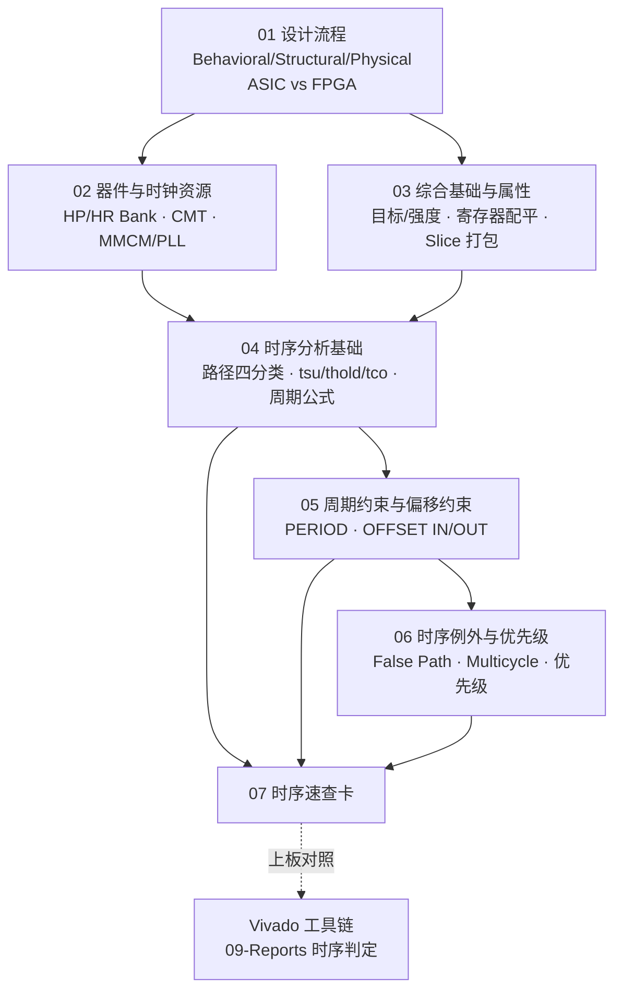

# 📐 分析理论 · 数字系统设计与时序收敛导读

> [!abstract] 这个子库在讲什么
> 本子库来自 2026–2027 秋季《数字系统设计》课程的**课件截图整理 + 理论补全**，主线是：
> **设计流程（ASIC/FPGA）→ 器件与时钟资源 → 综合 → 静态时序分析 → 时序约束 → 时序收敛**。
> 与 [[vault-notes/fpga/00-guide]] 中的"Verilog 基础语法"互补：那边回答"怎么写 RTL"，这里回答"写出来的 RTL 能不能跑在指定频率上"。

## 一、材料来源

| 源课件 | 页数 | 截取页 | 对应笔记 |
| --- | --- | --- | --- |
| `0_0课程简介(1).ppt` | 21 页 | 第 11–13、16–20 页（8 张） | [[vault-notes/fpga/sta/01-design-implementation-flow]]、[[vault-notes/fpga/sta/02-device-structure-clock-resources]] |
| `4 FPGA综合与时序收敛.ppt` | 110 页 | 第 4–14、16–20、22–26、27–48 页（44 张，其中第 22 页有 1 张重复截图） | [[vault-notes/fpga/sta/03-synthesis-basics-attributes]]～[[vault-notes/fpga/sta/06-timing-exceptions-priority]] |

> [!note] 整理原则
> 1. 截图里的**原文**逐条提取（含错别字原样保留并标注），不臆造页面没有的内容；
> 2. 时序相关的页面，**重绘 WaveDrom 时序图**并补"关键时间节点 / 信号变化 / 公式 / 易错点与假设"；
> 3. 课件的**术语年代**（ISE/XST/UCF、Design Compiler、Spartan-3）在笔记中保留，同时给出 Vivado 对照；
> 4. 课件自身的印刷错误集中在 [[#七、原课件勘误与存疑汇总|第七节]]。
> 原始截图保存在课程资料目录，本库不重复存放图片，只保留重绘的 SVG 时序图。

## 二、知识地图



## 三、笔记索引

| 笔记 | 核心问题 | 关键落点 | 源课件页 |
| --- | --- | --- | --- |
| [[vault-notes/fpga/sta/01-design-implementation-flow]] | 一个反相器如何从 Verilog 变成硅片？ | 三层抽象、两个仿真检查点、SPICE 参数与时序 | 课程简介 11–13 |
| [[vault-notes/fpga/sta/02-device-structure-clock-resources]] | 7 系列 FPGA 的时钟从哪来？ | HP/HR/HD Bank、FGG484、CMT=MMCM+PLL、$f_{VCO}$ 与相位 | 课程简介 16–20 |
| [[vault-notes/fpga/sta/03-synthesis-basics-attributes]] | 综合器有哪些旋钮影响时序？ | 优化目标/强度、5 个综合端时序属性、四类路径、7 个 Xilinx 参数 | 4–14 |
| [[vault-notes/fpga/sta/04-timing-analysis-setup-hold]] | 建立/保持时间到底怎么检查？ | 时序路径、$t_{su}/t_{hold}/t_{c\text{-}q}$、周期公式、$f_{max}$ 例题、slack | 16–27 |
| [[vault-notes/fpga/sta/05-timing-constraints-period-offset]] | PERIOD 和 OFFSET 该怎么写？ | 周期约束命令、反相时钟半周期、OFFSET IN/OUT 公式与例题 | 28–39 |
| [[vault-notes/fpga/sta/06-timing-exceptions-priority]] | 哪些路径不该按全局约束检查？ | False Path 不可敏化、多周期路径、逐引脚偏移、6 级优先级 | 40–48 |
| [[vault-notes/fpga/sta/07-timing-analysis-cheatsheet]] | 考前/上板前快速回忆 | 公式表、命令对照、报告清单、自检十问 | 汇总 |

## 四、推荐学习路径

**路线 A · 系统学（跟课程）**

1. [[vault-notes/fpga/sta/01-design-implementation-flow]] → 建立"设计是分层的"直觉
2. [[vault-notes/fpga/sta/02-device-structure-clock-resources]] → 知道时钟是怎么进芯片、怎么分频
3. [[vault-notes/fpga/sta/03-synthesis-basics-attributes]] → 理解综合在做什么、能改什么
4. [[vault-notes/fpga/sta/04-timing-analysis-setup-hold]] → **主线核心**，公式推导必自己推一遍
5. [[vault-notes/fpga/sta/05-timing-constraints-period-offset]] → 把公式变成约束语句
6. [[vault-notes/fpga/sta/06-timing-exceptions-priority]] → 处理真实设计的例外
7. [[vault-notes/fpga/sta/07-timing-analysis-cheatsheet]] → 压缩记忆

**路线 B · 应急查（做实验/调工程时）**

[[vault-notes/fpga/sta/07-timing-analysis-cheatsheet]] → 找到对应公式/命令 → 回到 04/05/06 看推导与例题。

## 五、时序图清单（重绘 SVG）

| 图 | 主题 | 笔记 |
| --- | --- | --- |
| `Assets/TimingDiagrams/Combinational/inverter-propagation-delay.svg` | CMOS 反相器 $t_{pHL}$/$t_{pLH}$ | 01 |
| `Assets/TimingDiagrams/Clock/mmcm-output-phase.svg` | MMCM 输出频率与相位抽头 | 02 |
| `Assets/TimingDiagrams/STA/setup-hold-window.svg` | 建立/保持时间窗口 | 04 |
| `Assets/TimingDiagrams/STA/setup-hold-check.svg` | 发起沿/捕获沿与时钟偏斜 | 04 |
| `Assets/TimingDiagrams/STA/reg-to-reg-period.svg` | 周期约束的路径分解 | 04 |
| `Assets/TimingDiagrams/STA/inverted-clock-half-period.svg` | 反相时钟 → 半周期 | 05 |
| `Assets/TimingDiagrams/STA/input-offset.svg` | 输入偏移约束 | 05 |
| `Assets/TimingDiagrams/STA/output-offset.svg` | 输出偏移约束 | 05 |
| `Assets/TimingDiagrams/STA/multicycle-path.svg` | 预定标计数器多周期路径 | 06 |

> 所有图均由 `.agent-tools/render-wavedrom.mjs` 从同名 `.json5` 渲染，**是理论示意图，不是 RTL 仿真波形**。真实时序必须用 Vivado 综合/实现后的时序报告或仿真波形核对。

## 六、与 FPGA 子库其它部分的关系

| 本子库概念 | 已有笔记 | 关系 |
| --- | --- | --- |
| 设计流程、综合/仿真/时序分析 | [[vault-notes/fpga/basics/01-eda-technology-overview]] | 概念级总览 → 本篇给出细节 |
| LUT vs 乘积项、器件选型 | [[vault-notes/fpga/basics/02-fpga-cpld-overview]] | 器件结构基础 |
| 寄存器、复位、非阻塞赋值 | [[vault-notes/fpga/verilog/sequential/01-registers]]｜[[vault-notes/fpga/verilog/sequential/02-blocking-vs-nonblocking-assignment]] | RTL 层如何保证时序行为 |
| 状态机 | [[vault-notes/fpga/verilog/sequential/10-finite-state-machines]] | 时序电路的典型载体 |
| 分频器 | [[vault-notes/fpga/verilog/sequential/04-clock-divider-even]]｜[[vault-notes/fpga/verilog/sequential/05-clock-divider-odd]] | 时钟生成；本篇解释 PMCM/PLL 与门控时钟的风险 |
| XDC 引脚与时钟 | [[vault-notes/fpga/vivado/base/06-xdc-pins-clocks]] | 工具层约束写法 |
| 综合/实现/报告 | [[vault-notes/fpga/vivado/base/07-synthesis-netlist]]｜[[vault-notes/fpga/vivado/base/08-implementation-place-route]]｜[[vault-notes/fpga/vivado/base/09-reports-timing-verdict]] | Vivado 实操流程 |
| 异步 FIFO / CDC | [[vault-notes/fpga/architecture/fifo-ip-core]] | 跨时钟域处理 |
| 亚稳态与建立保持 | [[vault-notes/fpga/architecture/uart-rs232]] | 亚稳态定义与串口采样 |

## 七、原课件勘误与存疑汇总

整理过程中发现课件自身的若干问题，笔记中已逐条标注，汇总如下（**原文照录，不改写课件**）：

| # | 位置 | 问题 | 处理方式 |
| --- | --- | --- | --- |
| 1 | 课程简介 P12 | Verilog 写作 `A=~B;`，`A` 是 input 不能赋值，且缺 `assign` | 笔记中给出正确写法 `assign B = ~A;` 并说明原因 |
| 2 | 课程简介 P19–20 | MMCM 的 8 相位抽头/可变相位抽头，未给 VCO 频率范围 | 笔记补充典型范围并注明以 UG472 为准 |
| 3 | 时序收敛 P9 | `Write Timing Constrains` 拼写（应为 Constraints） | 原样保留 + 标注 |
| 4 | 时序收敛 P22 | `oprating`（应为 operating）；该页无标题 | 原样保留 + 标注 |
| 5 | 时序收敛 P23 | `data arrived time -19.80`：若为负数则 slack 应为 51.54，与 11.94 矛盾 | 判定为负号笔误，笔记中说明 |
| 6 | 时序收敛 P30 | $T_{period}=\cdots-T_{clk\_skew}$ 与 $T_{clk\_skew}=T_{cd1}-T_{cd2}$ 的符号约定易混 | 笔记给出自洽推导与记忆法 |
| 7 | 时序收敛 P31 | `HIGH 4ns`（40%）与同页"占空比 50%"矛盾 | 按 50% 推导半周期 5 ns，并标注矛盾 |
| 8 | 时序收敛 P32 | 同页混用"偏置输入/输出"与"偏移约束" | 原样保留，笔记统一用"偏移约束"并注明 |
| 9 | 时序收敛 P33 | "偏移约束的内容的时刻"一句疑漏字 | 原样保留 + 标注 |
| 10 | 时序收敛 P35–36、P44–46 | 页面无标题（或被装饰遮挡） | 按正文首行归纳标题并注明 |
| 11 | 全课件 | 混用 Synopsys（Design Compiler）、ISE/XST（NGC、OFFSET_*）、Quartus（Post-Map）术语 | 保留原术语，笔记给 Vivado 对照 |
| 12 | 时序收敛 P21 | 参考截图中缺失该页 | 笔记未覆盖，来源表注明 |

## 八、维护说明

- 时序图源文件：`Assets/TimingDiagrams/{Combinational,Clock,STA}/*.json5`，修改后重新渲染：
  ```bash
  node .agent-tools/render-wavedrom.mjs "Assets/TimingDiagrams/STA/setup-hold-window.json5" \
       "Assets/TimingDiagrams/STA/setup-hold-window.svg"
  ```
- 笔记中的 SVG 嵌入路径与 JSON5 同目录、同基本名；**改 JSON5 后必须重新渲染 SVG**，不要只手改 SVG。
- 本子库只放"整理后的知识"，原始课件截图与提取中间产物保存在 `.ai-workspace/`（已 gitignore），不进入知识库。

## 关联

- 上级：[[vault-notes/fpga/00-guide]]
- 理论课接口：[[vault-notes/fpga/basics/01-eda-technology-overview]]｜[[vault-notes/dsp/05-filter-structures]]
- 工具链：[[vault-notes/fpga/vivado/base/06-xdc-pins-clocks]]｜[[vault-notes/fpga/vivado/base/09-reports-timing-verdict]]
- 全库总纲：00_全库理论知识点综合与联系
