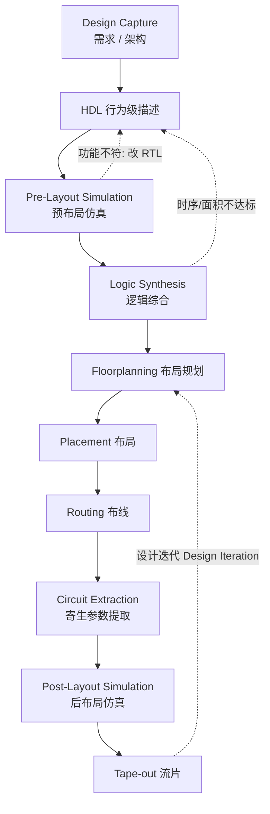

# 01 · 数字系统设计与 ASIC/FPGA 实现流程

> [!abstract] 这一篇在讲什么
> 对应课程导入《0_0课程简介》第 11–13 页。核心是回答"同一个反相器，从 Verilog 代码到能跑在硅片上的电路，中间经历了什么"，以及为什么设计流程被切成 **Behavioral → Structural → Physical** 三层。
> 学完应能：说出三个抽象层次各自的描述对象与产物、指出两个仿真检查点各自能发现什么问题、解释组合逻辑延迟（$t_{pHL}$、$t_{pLH}$）从哪些物理量来。

## 一、三个抽象层次

课件把设计流程画成"设计捕获（Design Capture）→ 三个层次 → 流片（Tape-out）"的纵向流水线：

| 层次 | 描述对象 | 典型表示 | 关键工具 | 仿真精度 |
| --- | --- | --- | --- | --- |
| Behavioral 行为级 | 功能与算法 | Verilog / VHDL 语句 | 行为仿真器 | 无延迟、最快，只验证逻辑 |
| Structural 结构级 | 门与连线 | 门级网表（SPICE / EDIF） | DesignCompiler 等综合工具 | 含单元延迟，可查毛刺 |
| Physical 物理级 | 晶体管、版图几何 | 版图（GDSII） | IC Compiler、PrimeTime | 含寄生参数，最慢最真 |

对应关系要点：

- **HDL 只在行为级出现**，综合器把它翻译成结构级的门级网表；版图由物理设计工具生成。
- 层次越往下，时序信息越真实、仿真越慢；RTL 仿真通过 ≠ 门级仿真通过 ≠ 后布局仿真通过。
- 这也解释了为什么"综合成功"不能当作时序合格的证据——综合只做到结构级。

## 二、设计流程与两个仿真检查点



| 检查点 | 输入 | 能发现 | 发现不了 |
| --- | --- | --- | --- |
| Pre-Layout Simulation | HDL / 综合后网表 | 功能错误、状态机死锁、时序逻辑建模错误 | 布线延迟、时钟偏斜导致的真实违例 |
| Post-Layout Simulation | 提取寄生参数后的网表 | 真实延迟、毛刺、建立/保持违例 | 流片后的工艺偏差、长时间老化 |

> [!note] 补充（课件外）
> 现代工程里 Post-Layout 门级仿真通常被 **静态时序分析（STA）+ 少量关键路径仿真** 替代：STA 覆盖全部路径且更快，门级仿真则用于异步/复位等 STA 不易覆盖的场合。课件保留完整流程是为了说明"延迟信息是逐步变精确的"。

## 三、一个反相器的三种"落地形态"

### 3.1 behavioral：Verilog RTL

```verilog
module INV (A, B);   // A: 输入, B: 输出
  input  A;
  output B;
  assign B = ~A;     // 课件原文写作 A=~B;，见下方勘误
endmodule
```

### 3.2 structural：门级网表（用 SPICE 语法描述的 CMOS 反相器）

```spice
.SUBCKT INV A Z
m1 Z A gnd gnd nfet l=0.06 w=0.2      * 下拉 NMOS
m2 Z A vdd vdd pfet l=0.06 w=0.28     * 上拉 PMOS
.ENDS HS65_LH_IVX2
```

- `m1/m2` 描述的是**晶体管**而不是逻辑门，说明结构级并不等于"与非门/或非门"这一层，取决于工艺库提供的单元。
- `l`（沟道长度）取工艺最小尺寸 0.06 µm；`w`（沟道宽度）PMOS 0.28 > NMOS 0.2，正是为了补偿空穴迁移率低。

### 3.3 physical：版图

课件给出的是版图截图：多晶硅栅、扩散区、金属连线、电源环按设计规则叠放，最终转成掩膜。**版图决定寄生电容/电阻，也就决定了上面那个反相器真实的 $t_{pHL}$、$t_{pLH}$。**

> [!warning] 课件勘误：`A=~B;` 不是合法的 Verilog
> 第 12 页幻灯片把反相器写成 `A = ~B;`，存在两处问题：
> 1. `A` 在模块里是 `input`，在 Verilog 中不允许对输入端口赋值；
> 2. 连续赋值应写 `assign`，否则该语句位于模块体但不是任何过程块内的赋值语句，属于语法错误。
>
> 正确写法：`assign B = ~A;`（B 是输出，A 是输入，取反后驱动 B）。
> 这类"教学示意代码"与实际可综合代码的差距，要以 **工具能吃进去并综合出电路** 为准。

### 3.4 工具链对照

| 步骤 | 课件标注工具 | 产物 |
| --- | --- | --- |
| Logic Synthesis | Synopsys DesignCompiler | 门级网表 |
| Physical Design | Synopsys IC Compiler | 版图 / GDSII |
| 时序签核 | Synopsys PrimeTime | 建立/保持时间报告 |

## 四、SPICE 反相器：网表参数怎么变成时序

课件第 13 页给出一份完整的 SPICE 反相器仿真网表：

```spice
M1 OUT IN VDD VDD CMOSP L=0.24u W=1.8u
M2 OUT IN 0   0   CMOSN L=0.24u W=0.9u
VDD VDD 0 2.5
VIN IN 0 0 PULSE 0 2.5 2n .5n .5n 7n 20n
CLOAD OUT 0 20fF
.OPTIONS LIST NODE POST
.TRAN 200p 20n
.PRINT TRAN V(IN) V(OUT)
.LIB "tsmc_025um_model" CMOS_MODELS
.END
```

### 4.1 参数逐个读

| 参数 | 值 | 含义 | 对时序的影响 |
| --- | --- | --- | --- |
| M1 | PMOS，L=0.24 µm，W=1.8 µm | 上拉管 | 决定 $t_{pLH}$（输出 0→1） |
| M2 | NMOS，L=0.24 µm，W=0.9 µm | 下拉管 | 决定 $t_{pHL}$（输出 1→0） |
| VDD | 2.5 V | 电源电压 | 50% 判决电平 = 1.25 V；电压越高延迟越小 |
| CLOAD | 20 fF | 负载电容 | 电容越大，充放电越慢，延迟越大 |
| `.TRAN 200p 20n` | 步长 200 ps，仿真 20 ns | 瞬态分析设置 | 决定波形分辨率，步长应远小于最小延迟 |
| `.LIB` | tsmc 0.25 µm 模型 | 工艺模型 | 延迟的真实来源 |

### 4.2 激励 `PULSE` 的七个参数

`PULSE(V1 V2 TD TR TF PW PER)`：

| 字段 | 值 | 含义 |
| --- | --- | --- |
| V1 | 0 V | 初始电平 |
| V2 | 2.5 V | 高电平 |
| TD | 2 ns | 延迟时间（波形从什么时候开始） |
| TR | 0.5 ns | 上升时间 |
| TF | 0.5 ns | 下降时间 |
| PW | 7 ns | 高电平脉宽 |
| PER | 20 ns | 周期 → $f = 1/20\,\text{ns} = 50$ MHz |

> [!important] 时序结论 1
> 输入是 50 MHz、占空比约 35%（7 ns / 20 ns）的方波，边沿 0.5 ns。**边沿不是 0，所以"输入在某个时刻跳变"这句话必须补上判决电平**：工程上取 50% VDD 作为跳变时刻，即上升沿在 $TD + TR/2 = 2.25$ ns 才算"越过阈值"。

## 五、时序分析：传输延迟的定义

### 5.1 时序图


### 5.2 关键时间节点

| 时刻 | 事件 | 说明 |
| --- | --- | --- |
| 0 ns | VIN = 0，VOUT = VDD | 输入低，输出被上拉为高 |
| 2 ns 起 | VIN 开始上升（0.5 ns 边沿） | $t = TD$ |
| ≈ 2.25 ns | VIN 越过 50% VDD | 记为输入跳变时刻 |
| ≈ 2.25 ns + $t_{pHL}$ | VOUT 下降到 50% VDD | 定义 $t_{pHL}$ |
| 9 ns 起 | VIN 开始下降 | 高电平持续 7 ns |
| ≈ 9.25 ns + $t_{pLH}$ | VOUT 上升到 50% VDD | 定义 $t_{pLH}$ |

### 5.3 信号变化说明

- VOUT 与 VIN 反相：输入为高时 PMOS 关断、NMOS 导通，输出被下拉到 0。
- 输出边沿比输入边沿"缓"：输入边沿 0.5 ns 是激励强加的，输出边沿由器件电流给 20 fF 充放电决定，通常更慢。
- 传播延迟定义在两个 50% 点之间：$t_{pHL}$ 是输出由高到低，$t_{pLH}$ 是输出由低到高，两者一般不相等。

### 5.4 相关公式

$$
t_{pHL}=\frac{t_{PHL1}+t_{PHL2}}{2}\ \text{（按边沿的 50% 点到 50% 点）},\qquad t_p=\frac{t_{pHL}+t_{pLH}}{2}
$$

一阶估算（把 MOS 看成恒流源给 $C_L$ 充放电）：

$$
t_{pHL}\approx \frac{C_L V_{DD}}{2 I_{DSN}},\qquad t_{pLH}\approx \frac{C_L V_{DD}}{2 I_{DSP}}
$$

因此要让两者接近，需要 $I_{DSP}\approx I_{DSN}$，这正是课件取 $W_p/W_n = 1.8/0.9 = 2:1$ 的原因（空穴迁移率约为电子的 $1/2$）。

### 5.5 易错点与假设

- **假设**：图中把边沿画成 1 格阶跃，真实边沿 0.5 ns；输出延迟被放大为 1 格只为看清定义，**数值不代表本次 SPICE 仿真结果**。
- 常见错误：把 $t_p$ 理解成"输入到输出端口的全部延迟"。$t_p$ 只是门本身的延迟，路径上还有连线延迟。
- 常见错误：忽略负载电容。同一个反相器驱动 20 fF 与驱动 200 fF，延迟差一个数量级——这就是扇出（fanout）与时序的关系。
- 组合逻辑延迟是后续静态时序分析里 $T_{logic}$ 的来源，见 [[vault-notes/fpga/sta/04-timing-analysis-setup-hold]]。

## 六、ASIC 流程 ↔ FPGA 流程

| 阶段 | ASIC | FPGA |
| --- | --- | --- |
| 电路"落地"方式 | 生成掩膜版图，定制晶体管 | 生成 bitstream，配置 LUT / FF / 布线开关 |
| 综合 | DesignCompiler → 门级网表 | Vivado Synthesis / XST → LUT/FF 网表 |
| 布局布线 | Floorplan → Placement → Routing | Implementation（Place & Route） |
| 时序检查 | PrimeTime（STA） | Vivado Timing Report（STA） |
| 单次迭代 | 数周~数月、费用高 | 数分钟~数小时、费用低 |
| "流片"等价物 | Tape-out 交掩膜厂 | 下载 bitstream 到板卡 |

> [!important] 时序结论 2
> ASIC 的时序由**物理版图和寄生参数**决定，流片后不可更改；FPGA 的时序由 **LUT 级数 + 布线延迟 + 时钟树偏斜** 决定，可以靠重新布局布线、流水线切分、寄存器配平来优化。因此两门课关注点不同：ASIC 更强调单元尺寸/负载/版图，FPGA 更强调 RTL 结构与约束。

## 七、源课件对照

| 课件页 | 主题 | 本笔记位置 |
| --- | --- | --- |
| 11 | Design Flow（三层抽象 + 迭代） | 一、二 |
| 12 | ASIC 实现：Verilog → 网表 → 版图 | 三 |
| 13 | ASIC 实现：SPICE 反相器仿真与版图 | 四、五 |

> 源文件：深大《数字系统设计》课程简介 `0_0课程简介(1).ppt` 第 11–13 页（截图另存于课程实验报告参考资料，不在本库内重复存放）。

## 关联

- 前置：[[vault-notes/fpga/basics/01-eda-technology-overview]]（EDA 六步流程、综合/仿真/时序分析的定义）
- 下一篇：[[vault-notes/fpga/sta/02-device-structure-clock-resources|02 · FPGA 器件结构与时钟资源]]
- 后续时序主线：[[vault-notes/fpga/sta/04-timing-analysis-setup-hold]]
- 工具流程：[[vault-notes/fpga/vivado/base/07-synthesis-netlist]]｜[[vault-notes/fpga/vivado/base/08-implementation-place-route]]｜[[vault-notes/fpga/vivado/base/09-reports-timing-verdict]]
- 器件与单元：[[vault-notes/fpga/basics/02-fpga-cpld-overview]]（乘积项 vs 查找表）
