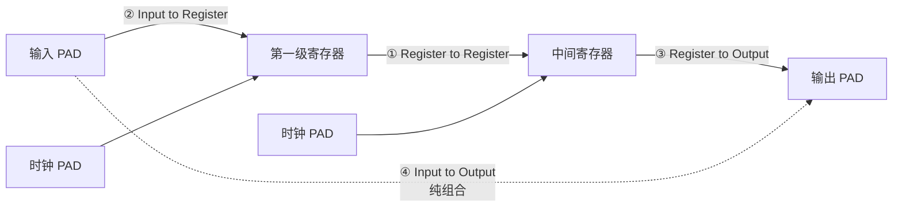

# 04 · 时序分析基础：路径模型、建立保持时间与时序方程

> [!abstract] 这一篇在讲什么
> 对应课件《4 FPGA综合与时序收敛》第 16–27 页，是整个时序主线的"地基"：先把**时序路径**定义清楚，再用波形定义**建立时间 / 保持时间 / 时钟到输出**，最后推出**周期约束方程**并用一道分频器例题算通。
> 学完应能：画出建立/保持检查的发起沿与捕获沿；写出 $T_{period}=T_{cko}+T_{logic}+T_{net}+T_{setup}-T_{clk\_skew}$ 并说清每项含义；算出一道"给定门延迟求 $f_{max}$"的题；读懂时序报告里的 setup/hold、max/min、worst/best 与 slack。

## 一、为什么要附加约束

课件第 17 页给出三条理由：

| 目的 | 原文要点 | 本质 |
| --- | --- | --- |
| 提高工作频率 | 约束可以控制逻辑的综合、映射、布局和布线，以减小逻辑和布线延时 | 给工具优化目标 |
| 获得正确的时序分析报告 | 静态时序分析工具以**约束**作为判断时序是否满足要求的标准 | 没有约束＝没有判断基准 |
| 指定引脚位置与电气标准 | 可指定 I/O 引脚位置、接口标准与电气特性 | 引脚/电平约束 |

> [!important] 一句话
> **约束不是"检查清单"，而是工具优化与判定的输入。** 没写约束的路径，工具既不会优化它，也不会在报告里警告它——这是"时序报告全绿但板子跑飞"的最常见原因。

### 1.1 时序收敛的路线图（课件目录）

课件第 16 页把"时序收敛"拆成 8 个环节，正好是这门课的骨架：

```
时序约束的概念 → 时序收敛流程 → 代码风格 → 综合技术 → 管脚约束
                → 时序约束 → 静态时序分析 → 实现技术 → FloorPlanner/PACE
```

本子库的对应关系：代码风格见 [[vault-notes/fpga/verilog/sequential/02-blocking-vs-nonblocking-assignment]]、[[vault-notes/fpga/verilog/sequential/10-finite-state-machines]]；综合技术见 [[vault-notes/fpga/sta/03-synthesis-basics-attributes]]；约束见 [[vault-notes/fpga/sta/05-timing-constraints-period-offset]] 与 [[vault-notes/fpga/sta/06-timing-exceptions-priority]]；静态时序分析见本篇与 [[vault-notes/fpga/vivado/base/09-reports-timing-verdict]]。

## 二、时序路径（timing path）

### 2.1 起点与终点

课件第 19 页给出定义：

| 项 | 定义 |
| --- | --- |
| 起点（startpoint） | ① 所有基本输入端（Primary Input）；② 寄存器（DFF）的**时钟输入端** |
| 终点（endpoint） | ① 所有基本输出端（Primary Output）；② 寄存器（DFF）的**数据输入端 D** |

### 2.2 四类路径

课件第 20 页用一张图标出 STA（静态时序分析）要计算的四类路径：



| 路径 | 起点 | 终点 | 由谁约束 |
| --- | --- | --- | --- |
| ① 寄存器 → 寄存器 | 触发器时钟端 | 触发器 D 端 | **周期约束（PERIOD）** |
| ② 输入 → 寄存器 | 输入 PAD | 第一级寄存器 D 端 | **偏移约束（OFFSET IN）** |
| ③ 寄存器 → 输出 | 末级寄存器时钟端 | 输出 PAD | **偏移约束（OFFSET OUT）** |
| ④ 输入 → 输出 | 输入 PAD | 输出 PAD | **PAD-TO-PAD** |

> [!tip] 记忆
> 只有 ① 是"芯片内部自己跟自己比"，所以用周期约束；②③ 跨过了 PAD 边界，必须靠外部给的偏移量；④ 根本没有寄存器参与，只能单独约束。
> 课件第 20 页横幅原文："Design Compiler uses Static Timing Analysis (STA) to calculate the timing of the paths in the design."——STA 不需要激励向量，它把**所有路径**都算一遍，这正是它比仿真强的地方。

## 三、建立时间、保持时间、时钟到输出

### 3.1 三个参数的定义

| 参数 | 符号 | 定义 | 对设计者的含义 |
| --- | --- | --- | --- |
| 建立时间 | $t_{su}$（setup） | 时钟有效沿到来**之前**，数据必须保持稳定的最短时间 | 数据不能来太晚 |
| 保持时间 | $t_{hold}$（hold，课件译"维持时间"） | 时钟有效沿到来**之后**，数据必须继续保持稳定的最短时间 | 数据不能走太快 |
| 时钟到输出 | $t_{c\text{-}q}$（clock-to-Q） | 时钟有效沿到 Q 端数据变化之间的延迟 | 决定了数据"出发"的时刻 |

### 3.2 时序图

![[vault-notes/assets/04-timing-analysis-setup-hold/fig-01.svg|1100]]

### 3.3 关键时间节点

| 时刻 | 事件 | 说明 |
| --- | --- | --- |
| 2 ns | D 端数据变稳 | 开始满足建立时间要求的起点 |
| 5 ns | 时钟上升沿（捕获沿） | 触发器采样时刻 |
| 5 ns − 2 ns = 3 ns | $t_{su}$ | 沿前必须稳定的时间 |
| 6 ns | D 端数据允许变化 | 沿后必须保持的时间 = 6 − 5 = 1 ns = $t_{hold}$ |
| 沿后约 $t_{c\text{-}q}$ | Q 端数据更新 | 输出滞后于时钟（图中约 0.5～1 ns） |

### 3.4 信号变化说明

- **D 端必须"包住"时钟沿**：沿前 $t_{su}$ 到沿后 $t_{hold}$ 这一段是"禁止变化区"，数据必须在区外变化。
- **Q 端不会立刻跟随 D**：时钟沿后要经过 $t_{c\text{-}q}$ 才更新，所以一条路径的延迟从"时钟沿"而不是"数据变化"开始算。
- 图中 D 恰好在 $t_{hold}$ 结束时刻变化，属于**临界合法**；实际设计要留裕量，否则工艺/温度漂移就会违例。

### 3.5 易错点与假设

- 数值 $t_{su}=3$ ns、$t_{hold}=1$ ns 为示意值；真实值由器件库（`.lib`/时序模型）给出，FPGA 中查 Datasheet 的 "Setup/Hold" 表。
- 常见错误：把 $t_{c\text{-}q}$ 当成"组合逻辑延迟"。$t_{c\text{-}q}$ 是触发器内部延迟，与组合逻辑无关。
- 常见错误：以为"时钟频率降低，保持时间就一定满足"。保持时间与周期**无关**，频率再低也可能 hold 违例（见 3.7）。

## 四、发起沿与捕获沿（Setup check / Hold check）

课件第 18 页的图（FF1 → 组合逻辑 → FF2）给出了 STA 的两个基本检查：

| 检查 | 用哪两个沿 | 物理含义 |
| --- | --- | --- |
| **Setup check** | 发起沿 → **下一周期**的捕获沿 | 数据在一个周期内必须传到并稳定 |
| **Hold check** | 同周期的发起沿 → 捕获沿 | 数据不能在新数据到来前"冲掉"旧数据 |

![[vault-notes/assets/04-timing-analysis-setup-hold/fig-02.svg|1100]]

### 4.1 时钟偏斜（skew）如何进入

设：

- $T_{cd1}$：时钟到**发起**触发器时钟端的延迟
- $T_{cd2}$：时钟到**捕获**触发器时钟端的延迟
- $T_{clk\_skew}=T_{cd2}-T_{cd1}$（捕获时钟比发起时钟晚多少）

则两条检查分别变成：

$$\text{Setup: } T + T_{clk\_skew} \ge T_{cko} + T_{logic} + T_{net} + T_{setup}$$

$$\text{Hold: } T_{cd1} + T_{cko}^{min} + T_{logic}^{min} \ge T_{cd2} + T_{hold}$$

> [!important] 两个方向相反
> **捕获时钟更晚（skew 为正）→ setup 更宽裕，hold 更危险。**
> 这就是为什么"降频"能修 setup 违例，却完全修不了 hold 违例——hold 不等式里没有 $T$。
> 图：`skew = 1 ns` 时 setup 可用时间是 $10+1=11$ ns，而 hold 只剩 1 ns 的余量。

## 五、时序方程（时序电路的两个条件）

课件第 25、26 页用不同符号给出了同一组结论：

| 课件页 | 建立条件 | 保持条件 |
| --- | --- | --- |
| 第 25 页 | $T \ge t_{c\text{-}q} + t_{plogic} + t_{su}$ | $t_{cdreg} + t_{cdlogic} \ge t_{hold}$ |
| 第 26 页 | $t_{ck} \ge t_{pmax} + t_{cmax} + t_{su}$ | $t_{pmin} + t_{cmin} \ge t_h$ |

符号对照：

| 符号 | 含义 | 等价写法 |
| --- | --- | --- |
| $t_{c\text{-}q}$ / $t_p$ | 触发器 clk→Q 延迟 | $t_{co}$、$T_{cko}$ |
| $t_{plogic}$ / $t_{cmax}$ | 组合逻辑**最大**延迟 | $T_{logic}$ |
| $t_{cdreg}$ / $t_{pmin}$ | 触发器**最小**（污染）延迟 | $t_{co}^{min}$ |
| $t_{cdlogic}$ / $t_{cmin}$ | 组合逻辑**最小**延迟 | $t_{logic}^{min}$ |
| $t_{su}$ / $t_h$ | 建立 / 保持时间 | $T_{setup}$ / $T_{hold}$ |

> [!warning] 为什么建立用 max、保持用 min？
> - **建立**关心"数据最晚什么时候到"→ 走**最慢**的路径（max 延迟，worst-case）。
> - **保持**关心"数据最早什么时候到"→ 走**最快**的路径（min 延迟，best-case）。
> 这也是时序报告要分 max/min 两种 path type 的原因（见第七节）。

## 六、周期约束的计算（核心公式）

### 6.1 课件公式

课件第 30 页原文：

$$T_{period}=T_{cko}+T_{logic}+T_{net}+T_{setup}-T_{clk\_skew},\qquad T_{clk\_skew}=T_{cd1}-T_{cd2}$$

其中 $T_{cko}$ = 时钟输出时间，$T_{logic}$ = 同步元件之间的组合逻辑延迟，$T_{net}$ = 网线延迟，$T_{setup}$ = 同步元件的建立时间，$T_{clk\_skew}$ = 时钟信号偏斜。

### 6.2 时序图：一条 reg-to-reg 路径的分解

![[vault-notes/assets/04-timing-analysis-setup-hold/fig-03.svg|1000]]

| 时间点 | 事件 | 数值（示意） |
| --- | --- | --- |
| 2 ns | FF1 时钟沿（发起沿） | — |
| 3 ns | FF1.Q 更新 | $T_{cko}=1$ ns |
| 8 ns | 数据到达 FF2.D | $T_{logic}+T_{net}=5$ ns |
| 12 ns | 要求数据稳定的最晚时刻 | $T_{period}+skew-T_{setup}=13-1=12$ ns |
| 13 ns | FF2 时钟沿（捕获沿） | $T + skew$ |
| — | 建立余量 slack | $12-8=4$ ns |

### 6.3 从不等式到公式（自己推一遍才记得住）

设时钟源在 $t=0$ 发出边沿：

1. 发起触发器时钟沿到：$T_{cd1}$
2. Q 端数据有效：$T_{cd1}+T_{cko}$
3. 到达捕获触发器 D 端：$T_{cd1}+T_{cko}+T_{logic}+T_{net}$
4. 捕获时钟沿到：$T_{period}+T_{cd2}$，要求数据提前 $T_{setup}$ 稳定

$$\Rightarrow T_{period}\ge T_{cko}+T_{logic}+T_{net}+T_{setup}+(T_{cd1}-T_{cd2})$$

即工程上更好记的形式：

$$\boxed{T_{period}\ge T_{cko}+T_{logic}+T_{net}+T_{setup}-(T_{cd2}-T_{cd1})}$$

> [!warning] 符号约定陷阱（本课件的易错点）
> 课件把 $T_{clk\_skew}$ 定义为 $T_{cd1}-T_{cd2}$，却写成 $T_{period}=\cdots-T_{clk\_skew}$。若按"$T_{cd1}$ 是发起时钟、$T_{cd2}$ 是捕获时钟"直接代入，会得出"捕获时钟越晚、周期要求越短"的反直觉结论。
> **正确记忆**：把 skew 理解成"捕获时钟比发起时钟晚多少"（$T_{cd2}-T_{cd1}$），则 $T_{period}\ge \text{各项之和}-\text{skew}$。
> 遇到不同教材时，先看它把 skew 定义成"谁减谁"，再代公式——这是最常见的一处符号混乱。

### 6.4 例题：自反馈分频器能跑多快（课件第 27 页）

电路：一个 D 触发器，$\bar{Q}$ 经**非门**反馈回 D 端（T 触发器接法，实现二分频）。

已知：非门延迟 $t_c=1\sim3$ ns，触发器延迟 $t_p=5\sim8$ ns，$t_{su}=4$ ns，$t_h=2$ ns。

**建立准则（准则 1）：**

$$t_{ck}\ge t_{c}^{max}+t_{p}^{max}+t_{su}=3+8+4=15\ \text{ns}$$

$$f_{max}=\frac{1}{t_{ck}}=\frac{1}{15\ \text{ns}}\approx 66.67\ \text{MHz}$$

**保持准则（准则 2）：**

$$t_p^{min}+t_c^{min}=5+1=6\ \text{ns}>t_h=2\ \text{ns}\quad\checkmark$$

结论：时钟周期至少要 15 ns（即频率不高于 66.67 MHz）；保持时间有 4 ns 余量，不是瓶颈。

> [!tip] 这道题的三个考点
> 1. **反馈路径也是一条时序路径**：$\bar{Q}\to$ 非门 $\to D$ 必须按"寄存器→寄存器"处理，不能因为"只是个分频器"就忽略。
> 2. **max/min 分开算**：建立用 $t^{max}$，保持用 $t^{min}$，两组数据不能混用。
> 3. **$f_{max}$ 与周期互为倒数**：$1/15\,\text{ns}=1/(15\times10^{-9})\approx66.67\times10^{6}$ Hz。

## 七、读时序报告：先分清是哪种报告

课件第 22 页列出读报告前的确认清单（原文有拼写 `oprating`，应为 operating）：

| 问题 | 答案 | 为什么 |
| --- | --- | --- |
| 是 setup 报告还是 hold 报告？ | 先看标题/路径类型 | 两种检查的判据完全不同 |
| operating conditions 看哪个？ | **worst**（建立）/ **best**（保持） | 慢工艺+低压+高温使延迟最大→最不利 setup；快工艺+高压+低温使延迟最小→最不利 hold |
| path type 看哪个？ | **max**（建立）/ **min**（保持） | 与上一行同一逻辑：建立看最慢路径，保持看最快路径 |
| 时钟频率多少？ | 由上升沿与下降沿的时间确定 | 约束是否与实际时钟一致，决定报告是否有意义 |

### 7.1 slack 的计算

课件第 23 页的示例：

```
data required time      31.74
data arrived time      -19.80      ← 疑为课件笔误，负号应去掉
------------------------------
slack                   11.94
```

$$\text{slack}=\text{required time}-\text{arrival time}$$

- 数值自洽检查：$31.74-19.80=11.94$ ✓，而 $31.74-(-19.80)=51.54$ ✗ → **`-19.80` 的负号是课件笔误**。
- 判据：**slack ≥ 0 才算满足**。arrival time 必须**早于** required time（原文："arrived time 应比 required time 提前，这样才能保证建立时间不违例"）。

> [!note] slack 的工程含义
> slack 不是"延迟"，而是**余量**：slack = 要求到达时间 − 实际到达时间。
> - slack > 0：还有多少时间富余；
> - slack = 0：临界；
> - slack < 0：违例（WNS 就是最差的那条负 slack），见 [[vault-notes/fpga/vivado/base/09-reports-timing-verdict]]。

## 八、本篇公式速查

| 公式 | 含义 | 使用场景 |
| --- | --- | --- |
| $T\ge t_{c\text{-}q}+t_{plogic}+t_{su}$ | 建立条件（无 skew） | 粗算最高频率 |
| $T_{period}\ge T_{cko}+T_{logic}+T_{net}+T_{setup}-(T_{cd2}-T_{cd1})$ | 周期约束（含 skew） | 写 `create_clock` / PERIOD |
| $t_{cdreg}+t_{cdlogic}\ge t_{hold}$ | 保持条件 | 检查 hold 违例 |
| $\text{slack}=T_{required}-T_{arrival}$ | 时序裕量 | 读报告 |
| $f_{max}=1/T_{min}$ | 最高频率 | 估算性能上限 |

## 九、源课件对照

| 课件页 | 主题 | 本笔记位置 |
| --- | --- | --- |
| 16 | 时序收敛主要内容（目录） | 1.1 |
| 17 | 附加约束的基本作用 | 一 |
| 18 | 建立时间、维持时间（发起沿/捕获沿、setup/hold check） | 四 |
| 19 | 时序通路（起点/终点/四类路径） | 二 |
| 20 | Timing-Path（STA 与四类路径框图） | 2.2 |
| 22 | 读时序报告的确认清单（worst/best、max/min） | 七 |
| 23 | slack 计算示例 | 7.1 |
| 24 | Timing Metrics（$t_{su}$/$t_{hold}$/$t_{c\text{-}q}$ 波形） | 三 |
| 25 | System Timing Constraints（$T\ge t_{c\text{-}q}+t_{plogic}+t_{su}$） | 五 |
| 26 | 时序电路的时序条件（$t_{ck}\ge t_{pmax}+t_{cmax}+t_{su}$） | 五 |
| 27 | EXAMPLE（分频器 $f_{max}=66.67$ MHz） | 6.4 |

> 源文件：深大《数字系统设计》课件《4 FPGA综合与时序收敛.ppt》第 16–27 页（第 21 页未包含在参考截图中）。

## 关联

- 前置：[[vault-notes/fpga/sta/03-synthesis-basics-attributes]]｜[[vault-notes/fpga/sta/01-design-implementation-flow]]
- 下一站：[[vault-notes/fpga/sta/05-timing-constraints-period-offset]]（周期/偏移约束的写法）
- 例外与优先级：[[vault-notes/fpga/sta/06-timing-exceptions-priority]]
- 报告解读：[[vault-notes/fpga/vivado/base/09-reports-timing-verdict]]（WNS/TNS/WHS）
- 时钟资源：[[vault-notes/fpga/sta/02-device-structure-clock-resources]]
- 复位与亚稳态：[[vault-notes/fpga/verilog/sequential/01-registers]]｜[[vault-notes/fpga/architecture/uart-rs232]]
