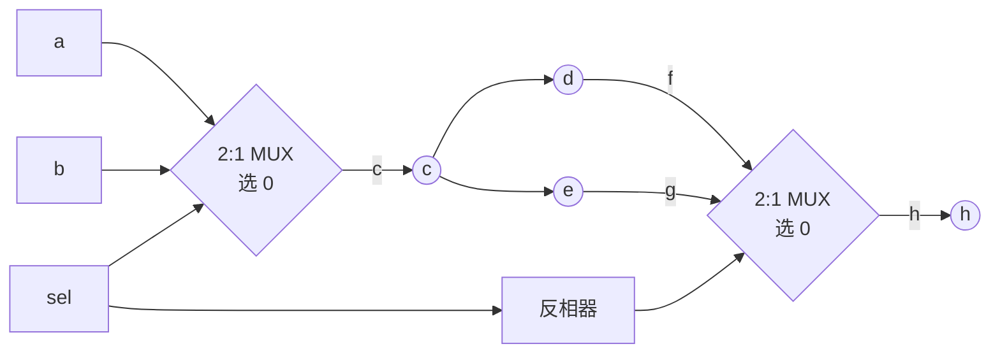

# 06 · 时序例外与约束优先级

> [!abstract] 这一篇在讲什么
> 对应课件《4 FPGA综合与时序收敛》第 40–48 页。前面两类约束（周期、偏移）都是**全局**的：一旦写下，作用于整个时钟域/所有 I/O。真实设计里总有一些路径"不该按全局要求检查"，于是需要**路径专有约束（path-specific constraints）**：伪路径、多周期路径、逐引脚偏移。
> 学完应能：判断一条路径是不是伪路径、解释多周期路径为什么能放宽、说出 6 级约束优先级、知道什么时候**不该**用例外约束。

## 一、全局约束的局限：过约束（over-constrained）

课件第 42 页要点：

- 全局约束（PERIOD、OFFSET、PAD-TO-PAD）会约束**整个设计**；
- 只用全局约束，常常导致**过约束**：
  - constraints are too tight（约束过紧）
  - 增加编译时间，甚至使时序目标无法达成
- 应当查看综合工具给出的性能估计或 **Post-Map Static Timing Report**；
- 路径专有约束可以**覆盖（override）**指定路径上的全局约束，从而放宽特定路径的要求。

> [!important] 一句话
> 过约束不是"更安全"，而是"更慢 + 更难收敛"。**约束要真实**，例外约束就是把"不该赶的路径"从全局要求里摘出来。

## 二、什么时候该用路径专有约束

课件第 43 页列出四类受益场景，并提醒"应服务于明确的性能目标，不可随意（indiscriminately）添加"：

| 场景 | 说明 | 典型约束 |
| --- | --- | --- |
| 多周期路径（multi-cycle paths） | 数据不需要每个周期都更新 | `set_multicycle_path` |
| 跨时钟域路径（cross clock domains） | 两个时钟无固定相位关系，不能用同一周期比较 | `set_clock_groups -asynchronous` / `set_false_path` |
| 双向总线（bidirectional buses） | 同一组引脚分时收发 | 逐引脚 OFFSET / 伪路径 |
| I/O 时序（I/O timing） | 少数引脚的时序要求与其他引脚不同 | 逐引脚 OFFSET（Path-pin offset） |

## 三、伪路径（False Paths）

### 3.1 定义

> **Paths that cannot be sensitized** —— 无法被"敏化"（无法真正把数据从起点传到终点）的路径。

课件第 40 页的例子：两个 2:1 MUX 级联，**两个 MUX 的选择端由同一根控制线驱动，但右边那个经过了一个反相器**。



### 3.2 为什么这两条路径不可敏化

| 路径 | 需要的条件 | 矛盾 |
| --- | --- | --- |
| `a → c → d → f → h` | 左 MUX 选 0（$c=a$）**且** 右 MUX 选 0（$h=f$） | 右 MUX 的选择端 = `sel` 取反，两者不可能同时为 0 |
| `b → c → e → g → h` | 左 MUX 选 1（$c=b$）**且** 右 MUX 选 1 | 同理，两个 MUX 选择极性相反，不可能同时为 1 |

因此这两条路径永远不会真正传输数据，**可以在时序分析中排除**：写伪路径后，工具不再为它们优化，也不会报它们的违例。

> [!warning] 伪路径是"证据"，不是"愿望"
> 写 `set_false_path` 的前提是**你能证明这条路径物理上不可能被敏化**（如上面的 MUX 互锁、静态配置寄存器、复位/测试逻辑）。
> 如果只是"这条路径跑不到"，那是**功能/架构问题**，应该改 RTL 或加流水线，而不是加伪路径——伪路径会把真实的时序风险藏起来。

### 3.3 Constraints Editor 中的位置

课件第 45 页的 ISE 界面对应两项：

- `False Paths (FROM TO TIG)` —— 按起点/终点声明伪路径
- `False Paths by Net (NET TIG)` —— 按网线声明

Vivado 等价：

```tcl
set_false_path -from [get_clocks clkA] -to [get_clocks clkB]
set_false_path -through [get_pins u_mux/S]
set_clock_groups -asynchronous -group {clkA} -group {clkB}
```

## 四、多周期路径（Multicycle Path）

### 4.1 课件实例：预定标计数器（prescaler counter）

课件第 46 页的原文要点：

> 32 位高速计数器，速度取决于**最低位到最高位的进位延迟**。为提高速度采用预定标计数器结构：拆成 2 位小计数器 + 30 位大计数器，同一时钟驱动；大计数器使能端 EN 受小计数器进位驱动；小计数器每 **4 个 CLK** 进位一次，使 EN 持续有效 **1 个 CLK**，此时有效时钟沿到来大计数器加 1。
>
> 可见：小计数器寄存器可能每个 CLK 翻转 1 次 → 寄存器之间最大延时 **1 个 CLK**；而大计数器寄存器每 4 个 CLK 才可能翻转一次 → 低位到高位的路径最大延时可放宽到 **4 个 CLK**。

![[vault-notes/assets/06-timing-exceptions-priority/fig-01.svg|1000]]

### 4.2 关键时间节点

| 时间 | 事件 | 说明 |
| --- | --- | --- |
| 每 4 ns | CLK 上升沿 | 小计数器每拍工作 |
| 14–17 ns | EN 有效（1 个 CLK） | 小计数器进位 |
| 14 ns 之后 | 大计数器值 +1 | 每 4 个 CLK 才更新一次 |
| 2 → 18 ns | 16 ns = 4 个 CLK | 大计数器内部路径可用的时间 |

### 4.3 为什么能放宽

- **多周期路径的本质**：数据从发起到被捕获，中间允许经过 $N$ 个时钟周期。
- 组合逻辑只需在 $N$ 个周期内算完，工具就可以用**更慢但更省资源**的实现（例如把大位宽的进位链摊开），从而既省面积又容易收敛。
- 典型例子：计数器/累加器的进位链、慢速控制寄存器、每 N 拍更新一次的配置字。

### 4.4 约束写法

UCF（课件第 45 页界面项 `Multicycle Paths (FROM TO)`）：

```tcl
NET "slow_reg*" TNM = "slow_group";
TIMESPEC "TS_slow" = FROM "FFS" TO "slow_group" 4;
```

Vivado：

```tcl
set_multicycle_path 4 -setup -from [get_cells small_cnt_reg*] -to [get_cells big_cnt_reg*]
set_multicycle_path 3 -hold  -from [get_cells small_cnt_reg*] -to [get_cells big_cnt_reg*]
```

> [!warning] setup 与 hold 必须成对设置
> Vivado 中 `set_multicycle_path -setup N` 只改建立检查，**保持检查默认仍按 1 个周期**，会人为制造 hold 违例。正确做法是同时写 `-hold N-1`（上例 N=4 → hold 3）。
> 这是多周期路径最常见的一处坑：**只写 setup 不写 hold**。

### 4.5 与周期公式的关系

把 [[vault-notes/fpga/sta/04-timing-analysis-setup-hold]] 的周期公式右边整体放宽 $N$ 倍：

$$N\cdot T_{period}\ge T_{cko}+T_{logic}+T_{net}+T_{setup}-(T_{cd2}-T_{cd1})$$

## 五、逐引脚偏移约束（Path-pin offset）

课件第 47 页（Constraints Editor 的 Ports 视图）：

| 方法 | 说明 | 评价 |
| --- | --- | --- |
| 按列（Pad to Setup / Clock to Pad）对该时钟域**所有** I/O 路径统一设 OFFSET | 最简便 | 但容易**过约束** |
| 对**每个 I/O 引脚**单独设 OFFSET | 只用于少数引脚需要不同时序时 | 更精确，但工作量大、易漏 |

界面中的列含义：

- `Pad to Setup`：输入方向，对应 `OFFSET IN BEFORE`（数据到 PAD 相对时钟的建立偏移）
- `Clock to Pad`：输出方向，对应 `OFFSET OUT`（时钟到 PAD 的输出偏移）

## 六、约束优先级（Timing Constraint Priority）

课件第 48 页：优先级由高到低（右侧绿色向上箭头标注 Highest → Lowest）：

| 优先级 | 约束 | 说明 |
| --- | --- | --- |
| 1（最高） | **False paths** | Must be allowed to override any timing constraint（必须能覆盖任何约束） |
| 2 | FROM THRU TO | 带中间点的路径约束 |
| 3 | FROM TO | 起点→终点路径约束 |
| 4 | Pin-specific OFFSETs | 逐引脚偏移 |
| 5 | Group OFFSETs | 按 pads / registers 分组的偏移 |
| 6（最低） | **Global PERIOD and OFFSETs** | 全局周期与偏移，优先级最低 |

> [!important] 怎么用这张表
> 1. **越具体的约束优先级越高**：全局 < 分组 < 逐引脚 < 路径 < 伪路径。
> 2. 所以"我写了全局周期约束，但某条路径要放宽"是可行的：用 FROM TO 覆盖它。
> 3. 反过来，**伪路径会盖掉一切**——写错一个 `set_false_path`，那条路径的时序检查就彻底消失了，而且报告不会告诉你。这是最危险的约束。

## 七、现代 Vivado 对照表

| 用途 | ISE/UCF 概念 | Vivado 命令 |
| --- | --- | --- |
| 伪路径 | `False Paths (FROM TO TIG)` / `NET TIG` | `set_false_path -from ... -to ...` |
| 多周期 | `Multicycle Paths (FROM TO)` | `set_multicycle_path N -setup/-hold -from ... -to ...` |
| 最大延迟 | `MAXIMUM_DELAY` / `FROM TO` | `set_max_delay` / `set_min_delay` |
| 异步时钟域 | — | `set_clock_groups -asynchronous -group {...} -group {...}` |
| 逐引脚偏移 | `Pad to Setup` / `Clock to Pad` | `set_input_delay` / `set_output_delay`（可带 `-clock`） |
| 路径分组 | `TIMEGRP` / `TNM` | `-from/-to` 支持 `get_cells` / `get_clocks` / `get_pins` |

## 八、易错点汇总

| 错误 | 后果 | 正确做法 |
| --- | --- | --- |
| 伪路径滥用（跑不到就写 false path） | 真实违例被隐藏，板子偶发错误 | 只有能证明不可敏化才写 |
| 多周期只写 setup 不写 hold | 人为制造 hold 违例 | setup N、hold N−1 成对写 |
| 全局约束过紧 | 编译时间大增、反而难收敛 | 按真实频率约束，局部放宽用例外 |
| 例外约束不加注释 | 半年后没人知道为什么写 | 每条例外写清"为什么这条路径不需要按周期检查" |
| 跨时钟域直接用周期约束 | 两个时钟无固定相位，检查无意义 | 用 `set_clock_groups -asynchronous` 或握手/异步 FIFO |

## 九、源课件对照

| 课件页 | 主题 | 本笔记位置 |
| --- | --- | --- |
| 40 | False Paths（不可敏化路径） | 三 |
| 41 | 偏移约束 100 MHz 提问 | [[vault-notes/fpga/sta/05-timing-constraints-period-offset#2.8 例题推演：100 MHz 系统怎么填约束（课件第 41 页）|05 第 2.8 节]] |
| 42 | Path-Specific Timing Constraints（全局约束的局限） | 一 |
| 43 | Path-Specific Timing Constraints（适用场景） | 二 |
| 44 | 一条路径也可单独优化 | 一、二 |
| 45 | 两步法 + Constraints Editor 界面 | 三、四、五 |
| 46 | 预定标计数器（多周期路径实例） | 四 |
| 47 | Path-pin offset Timing Constraints | 五 |
| 48 | Timing Constraint Priority | 六 |

> 源文件：深大《数字系统设计》课件《4 FPGA综合与时序收敛.ppt》第 40–48 页。

## 关联

- 前置：[[vault-notes/fpga/sta/05-timing-constraints-period-offset]]
- 基础：[[vault-notes/fpga/sta/04-timing-analysis-setup-hold]]
- 报告判读：[[vault-notes/fpga/vivado/base/09-reports-timing-verdict]]
- 状态机与代码风格：[[vault-notes/fpga/verilog/sequential/10-finite-state-machines]]｜[[vault-notes/fpga/verilog/sequential/02-blocking-vs-nonblocking-assignment]]
- 跨时钟域：[[vault-notes/fpga/architecture/fifo-ip-core]]（异步 FIFO / 握手思路）
