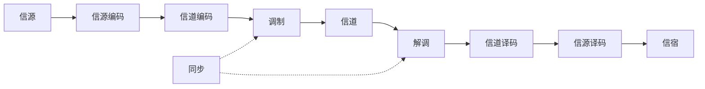

# 📡 数字通信系统知识地图

> [!abstract] 核心问题
> 信息如何从信源可靠、有效地送到信宿？发送端要做哪几层变换，接收端如何从噪声中恢复？5G 把这些模块标准化后变成了什么？
> 一句话主线：**信源编码去冗余，信道编码加冗余，调制把比特搬到载波，信道引入噪声与失真，接收机做同步、均衡与判决。**

## 一、前置知识

| 前置 | 为什么需要 | 入口 |
| --- | --- | --- |
| 信号与系统 | 卷积、频响、滤波器 | [[vault-notes/dsp/01-discrete-time-systems]] |
| 傅里叶/频谱 | 带宽、调制、OFDM | [[vault-notes/maps/fourier-analysis-map]] |
| 随机过程/噪声 | 误码率、最佳接收 | [[vault-notes/communication/03-random-processes]]、[[vault-notes/random-signals/10-awgn-channel]] |
| 概率与判决 | 假设检验、MAP/ML | [[vault-notes/random-signals/08-hypothesis-testing]]、[[vault-notes/communication/09-optimal-reception]] |

## 二、系统链

## 三、模块地图

| 模块 | 核心问题 | 关键笔记 |
| --- | --- | --- |
| 系统组成 | 各模块如何分工？ | [[vault-notes/communication/01-introduction]]、[[vault-notes/digital-modulation/01-digital-communication-system\|数字通信系统组成]] |
| 信源编码 | 如何压缩、去冗余？ | [[vault-notes/communication/10-source-coding]]、[[vault-notes/random-signals/10-adc-sampling-quantization-noise]] |
| 信道编码 | 如何加受控冗余、纠错？ | [[vault-notes/communication/11-error-control-coding]] |
| 数字基带 | 码型、ISI、眼图、均衡 | [[vault-notes/communication/06-digital-baseband]] |
| 数字带通 | 2ASK/2FSK/2PSK/2DPSK、QAM | [[vault-notes/communication/07-digital-bandpass]]、[[vault-notes/communication/08-advanced-digital-modulation]] |
| 信道 | 恒参/随参、衰落、香农公式 | [[vault-notes/communication/04-channel]]、[[vault-notes/random-signals/10-awgn-channel]] |
| 最佳接收 | 匹配滤波、最大似然、$E_b/N_0$ | [[vault-notes/communication/09-optimal-reception]]、[[vault-notes/random-signals/08-matched-filter-detection]]、[[vault-notes/random-signals/10-receiver-detection]] |
| 同步 | 载波/位/帧/网同步 | [[vault-notes/communication/13-synchronization]] |
| 性能 | BER、SNR、噪声带宽 | [[vault-notes/random-signals/10-bpsk-qam-ber]]、[[vault-notes/random-signals/10-snr-noise-bandwidth]] |
| 5G 落地 | NR 帧结构、物理信道、HARQ | [[vault-notes/5g/protocols/04-nr-standard-specifications]]、[[vault-notes/5g/phy/04-physical-channels-signals]]、[[vault-notes/5g/harq]] |

## 四、三对矛盾

| 矛盾 | 表现 | 解决思路 |
| --- | --- | --- |
| 有效性 ↔ 可靠性 | 带宽/速率 vs 误码率 | 编码增益、高阶调制、自适应 MCS |
| 带宽 ↔ SNR | 带宽换功率、功率换带宽 | 香农公式、扩频、OFDM |
| 复杂度 ↔ 性能 | 最优接收 vs 实时实现 | 次优检测、迭代译码、定点化 |

## 五、关键公式链

| 环节 | 公式 | 入口 |
| --- | --- | --- |
| 信道容量 | $C=B\log_2(1+S/N)$ | [[vault-notes/communication/04-channel]] |
| 奈奎斯特第一准则 | 无 ISI 条件 | [[vault-notes/communication/06-digital-baseband]] |
| 匹配滤波 | $h(t)=s(t_0-t)$，输出 SNR $=2E/N_0$ | [[vault-notes/communication/09-optimal-reception]] |
| BPSK BER | $P_b=Q(\sqrt{2E_b/N_0})$ | [[vault-notes/random-signals/10-bpsk-qam-ber]] |
| 信噪比换算 | $\mathrm{SNR}=(E_b/N_0)(R_b/B)$ | [[vault-notes/random-signals/10-snr-noise-bandwidth]] |
| OFDM 正交 | $\Delta f=1/T_s$ | [[vault-notes/communication/08-advanced-digital-modulation]] |

## 六、工程应用

- **5G NR**：帧结构、BWP、SSB、PRACH、PDSCH/PDCCH，见 [[vault-notes/5g/protocols/04-nr-standard-specifications]]、[[vault-notes/5g/phy/04-physical-channels-signals]]。
- **小区搜索/随机接入**：PSS/SSS、PRACH、Msg1–Msg4，见 [[vault-notes/5g/phy/01-cell-search]]、[[vault-notes/5g/phy/03-random-access-rach]]。
- **HARQ**：ACK/NACK、增量冗余、CBG，见 [[vault-notes/5g/harq]]。
- **硬件**：IQ 调制/解调、DDC/DUC，见 [[vault-notes/fpga/ad9361/iq-signals]]、[[vault-notes/fpga/ad9361/ad9361-digital-interface]]。

## 七、实验与项目

- [[vault-notes/random-signals/11-awgn-ber-experiment]]：BPSK/QPSK 理论 vs 仿真。
- [[vault-notes/fpga/ad9361/iq-signals-lab-matlab-rtl]]：星座映射与定点化。
- [[vault-notes/5g/engineering-simulation/02-signal-tower-practice]]：工程参数与设备配置。
- [[vault-notes/5g/phy/05-air-interface-illustrated]]：空口流程与波束。

## 八、学习顺序

1. [[vault-notes/communication/01-introduction]] → [[vault-notes/communication/06-digital-baseband]]：先建立系统模型与基带传输。
2. [[vault-notes/communication/07-digital-bandpass]] → [[vault-notes/communication/08-advanced-digital-modulation]]：再搬上载波。
3. [[vault-notes/communication/03-random-processes]] → [[vault-notes/communication/09-optimal-reception]]：理解噪声与最佳判决。
4. [[vault-notes/communication/10-source-coding]] → [[vault-notes/communication/11-error-control-coding]] → [[vault-notes/communication/13-synchronization]]：补全编码与同步。
5. [[vault-notes/5g/protocols/04-nr-standard-specifications]] → [[vault-notes/5g/phy/04-physical-channels-signals]]：落地到 5G。

## 九、尚未学习/待补

- MIMO/大规模天线、波束赋形与空间复用。
- 信道估计（LS/MMSE）、均衡与干扰消除。
- LDPC/Polar 的构造、速率匹配与译码细节。
- 毫米波、NTN、URLLC 的专门链路设计。

## 关联
- 首页：首页｜总图：电子信息工程知识总图
- 相关 MOC：[[vault-notes/maps/random-signal-processing-map]]｜[[vault-notes/maps/linear-systems-filtering-map]]｜[[vault-notes/maps/sampling-quantization-map]]
- 5G：[[vault-notes/5g/00-guide]]｜通信原理：[[vault-notes/communication/00-guide]]
- 全库总纲：00_全库理论知识点综合与联系
