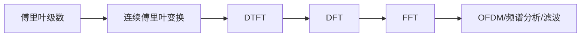

# 🌊 傅里叶分析知识地图

> [!abstract] 核心问题
> 同一个信号，为什么可以同时用“时间波形”和“频率成分”描述？这两种描述之间如何无损转换？离散化以后又发生了什么？
> 一句话主线：**傅里叶级数处理周期信号，傅里叶变换处理非周期信号，DTFT 处理离散时间，DFT 把频率也离散化，FFT 只是 DFT 的快速算法。**

## 一、前置知识

| 前置 | 为什么需要 | 入口 |
| --- | --- | --- |
| 复数与欧拉公式 | 复指数是傅里叶基 | [[vault-notes/math/complex-analysis/01-complex-numbers-functions]] |
| 内积与正交 | “频率成分”就是信号在正交基上的投影 | [[vault-notes/math/linear-algebra/04-orthogonality]] |
| 级数与积分 | 傅里叶级数/变换的收敛与存在条件 | [[vault-notes/math/complex-analysis/07-fourier-transform]] |
| 卷积 | 时域卷积 ↔ 频域乘积 | [[vault-notes/dsp/01-discrete-time-systems]] |
| 采样 | 连续频谱如何变成离散频谱 | [[vault-notes/dsp/01-discrete-time-systems]] |

## 二、概念链

| 节点 | 适用对象 | 时域 | 频域 | 入口 |
| --- | --- | --- | --- | --- |
| 傅里叶级数 | 周期连续信号 | 连续、周期 | 离散谱 | [[vault-notes/math/complex-analysis/07-fourier-transform]] |
| 连续傅里叶变换 | 非周期连续信号 | 连续、非周期 | 连续谱 | [[vault-notes/math/complex-analysis/07-fourier-transform]] |
| DTFT | 离散时间序列 | 离散、非周期 | 连续、周期 | [[vault-notes/dsp/02-z-transform-and-dtft]] |
| DFT | 有限长离散序列 | 离散、有限长 | 离散、有限长 | [[vault-notes/dsp/03-discrete-fourier-transform]] |
| FFT | DFT 的快速实现 | 离散、有限长 | 离散、有限长 | [[vault-notes/dsp/04-fast-fourier-transform]] |

> [!tip] 记忆抓手
> **“周期 ↔ 离散”是一对**：时域周期 ⇒ 频域离散；时域离散 ⇒ 频域周期。DFT 同时把两边都变成离散且有限，所以才能在计算机里算。

## 三、核心结论

| 结论 | 表达式 | 用途 |
| --- | --- | --- |
| 线性 | $\mathcal{F}\{ax+by\}=aX+bY$ | 叠加分析 |
| 时移 | $x(t-t_0)\leftrightarrow X(\omega)e^{-j\omega t_0}$ | 时延/相位 |
| 频移 | $x(t)e^{j\omega_0t}\leftrightarrow X(\omega-\omega_0)$ | 调制/混频 |
| 卷积定理 | $x(t)*h(t)\leftrightarrow X(\omega)H(\omega)$ | LTI 系统 |
| 乘积定理 | $x(t)h(t)\leftrightarrow \frac{1}{2\pi}X(\omega)*H(\omega)$ | 加窗/截断 |
| Parseval | $\int\lvert x(t)\rvert^2dt=\frac{1}{2\pi}\int\lvert X(\omega)\rvert^2d\omega$ | 能量守恒 |
| 抽样 | 抽样后频谱周期延拓 | 采样定理/混叠 |

## 四、同一个概念在不同课里的名字

| 概念 | 数学/复变 | DSP | 通信原理 | 随机信号 |
| --- | --- | --- | --- | --- |
| 傅里叶变换 | [[vault-notes/math/complex-analysis/07-fourier-transform]] | [[vault-notes/dsp/02-z-transform-and-dtft]] | [[vault-notes/communication/02-deterministic-signals]] | [[vault-notes/random-signals/05-wiener-khinchin]] |
| 频谱 | 复变频域 | DTFT/DFT | 调制/带宽 | [[vault-notes/random-signals/05-power-spectral-density]] |
| 卷积 | 卷积定理 | 卷积和 | 信道/滤波 | [[vault-notes/random-signals/06-random-process-lti-systems]] |
| 正交基 | 复指数基 | DFT 基 | OFDM 子载波 | 随机过程正交展开 |

## 五、工程应用

- **OFDM**：IFFT 把频域符号变成时域波形，FFT 在接收端拆回子载波，见 [[vault-notes/communication/08-advanced-digital-modulation]]、[[vault-notes/5g/phy/04-physical-channels-signals]]。
- **频谱分析**：周期图/Welch 估计 PSD，见 [[vault-notes/random-signals/11-psd-estimation-experiment]]、[[vault-notes/random-signals/05-psd-numerical-estimation]]。
- **滤波器设计**：频响 $H(\omega)$ 决定通带/阻带，见 [[vault-notes/dsp/07-fir-filter-design]]。
- **调制/解调**：频移与卷积定理是混频、相干解调的基础，见 [[vault-notes/communication/07-digital-bandpass]]。
- **采样/重建**：频谱周期延拓与抗混叠，见 [[vault-notes/maps/sampling-quantization-map]]。

## 六、实验与项目

- [[vault-notes/dsp/04-fast-fourier-transform]] 的蝶形/位倒序练习。
- [[vault-notes/random-signals/11-psd-estimation-experiment]]：周期图 vs Welch。
- [[vault-notes/random-signals/11-awgn-ber-experiment]]：OFDM/BPSK 的频域处理。
- [[vault-notes/5g/phy/05-air-interface-illustrated]]：OFDM/SCS/CP 的工程参数。

## 七、学习顺序

1. 复数/欧拉 → 正交/内积（[[vault-notes/math/complex-analysis/01-complex-numbers-functions]]、[[vault-notes/math/linear-algebra/04-orthogonality]]）。
2. 傅里叶级数 → 连续傅里叶变换（[[vault-notes/math/complex-analysis/07-fourier-transform]]）。
3. 采样 → DTFT（[[vault-notes/dsp/01-discrete-time-systems]]、[[vault-notes/dsp/02-z-transform-and-dtft]]）。
4. DFT → FFT（[[vault-notes/dsp/03-discrete-fourier-transform]]、[[vault-notes/dsp/04-fast-fourier-transform]]）。
5. OFDM/频谱估计（[[vault-notes/communication/08-advanced-digital-modulation]]、[[vault-notes/random-signals/11-psd-estimation-experiment]]）。

## 八、尚未学习/待补

- 二维傅里叶变换与图像处理。
- 小波变换、短时傅里叶变换与分数阶傅里叶。
- 非均匀采样、压缩感知。
- OFDM 的 PAPR、信道估计与均衡细节。

## 关联
- 首页：首页｜总图：电子信息工程知识总图
- 相关 MOC：[[vault-notes/maps/linear-systems-filtering-map]]｜[[vault-notes/maps/sampling-quantization-map]]｜[[vault-notes/maps/digital-communication-map]]
- 随机信号：[[vault-notes/random-signals/05-power-spectral-density]]｜[[vault-notes/random-signals/05-wiener-khinchin]]
- 全库总纲：00_全库理论知识点综合与联系
