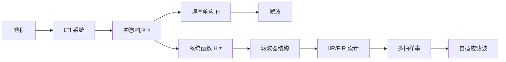

# 🔗 线性系统与滤波知识地图

> [!abstract] 核心问题
> 一个系统对输入做了什么？为什么“卷积”能描述一切 LTI 系统？滤波器如何在时域、频域、z 域三种语言之间切换？随机信号通过系统后，功率谱怎么变？
> 一句话主线：**LTI 系统由冲激响应完全描述；时域是卷积，频域是相乘，z 域是系统函数；滤波就是把不需要的频率成分压低。**

## 一、前置知识

| 前置 | 为什么需要 | 入口 |
| --- | --- | --- |
| 卷积 | LTI 的时域运算 | [[vault-notes/dsp/01-discrete-time-systems]] |
| 复指数/傅里叶 | 特征函数与频响 | [[vault-notes/math/complex-analysis/01-complex-numbers-functions]]、[[vault-notes/math/complex-analysis/07-fourier-transform]] |
| z 变换 | 系统函数、极点/零点 | [[vault-notes/dsp/02-z-transform-and-dtft]] |
| 差分方程 | 系统的递推描述 | [[vault-notes/dsp/01-discrete-time-systems]] |

## 二、概念链

## 三、三种描述

| 语言 | 描述 | 适合做什么 | 入口 |
| --- | --- | --- | --- |
| 时域 | $y(n)=x(n)*h(n)$ | 看波形、卷积、滑动平均 | [[vault-notes/dsp/01-discrete-time-systems]] |
| 频域 | $Y(\omega)=X(\omega)H(\omega)$ | 看通带/阻带、滤波 | [[vault-notes/math/complex-analysis/07-fourier-transform]] |
| z 域 | $H(z)=Y(z)/X(z)$ | 看极点/零点、稳定性、结构 | [[vault-notes/dsp/05-filter-structures]] |

> [!tip] 稳定性一句话
> 连续系统看极点是否在左半平面；离散系统看极点是否在单位圆内。因果 + 绝对可和是 BIBO 稳定的常用判据。

## 四、滤波器家族

| 类型 | 特点 | 设计方法 | 入口 |
| --- | --- | --- | --- |
| FIR | 无反馈、可线性相位、永远稳定 | 窗函数/频率采样 | [[vault-notes/dsp/07-fir-filter-design]] |
| IIR | 有反馈、阶数低、相位非线性 | 模拟原型 + 双线性变换 | [[vault-notes/dsp/06-iir-filter-design]] |
| 直接型 | 结构直观、系数敏感 | 直接 I/II | [[vault-notes/dsp/05-filter-structures]] |
| 级联/并联 | 数值稳健、易调 | 二阶节 | [[vault-notes/dsp/05-filter-structures]] |
| 多相 | 高效重采样 | 多抽样率 | [[vault-notes/dsp/08-multirate-sampling]] |

## 五、随机信号通过系统

| 结论 | 公式 | 入口 |
| --- | --- | --- |
| 输出均值 | $\mu_Y=\mu_X H(0)$ | [[vault-notes/random-signals/06-output-mean-autocorrelation]] |
| 输出自相关 | $R_Y=R_X*h*h(-)$ | [[vault-notes/random-signals/06-output-mean-autocorrelation]] |
| 输出功率谱 | $S_Y(\omega)=\lvert H(\omega)\rvert^2S_X(\omega)$ | [[vault-notes/random-signals/06-input-output-psd-relation]] |
| 输出功率 | $P_Y=\frac{1}{2\pi}\int\lvert H\rvert^2S_Xd\omega$ | [[vault-notes/random-signals/06-filtering-noise-power]] |
| 噪声带宽 | $B_n=\frac{1}{\lvert H(0)\rvert^2}\int_0^\infty\lvert H(f)\rvert^2df$ | [[vault-notes/random-signals/06-filtering-noise-power]] |

## 六、工程应用

- **通信接收机**：匹配滤波、成形滤波、均衡，见 [[vault-notes/communication/09-optimal-reception]]、[[vault-notes/random-signals/08-matched-filter-detection]]。
- **软件无线电**：DDC/DUC、CIC/多相 FIR，见 [[vault-notes/dsp/08-multirate-sampling]]、[[vault-notes/fpga/ad9361/ad9361-architecture]]。
- **FPGA 实现**：FIR 的乘累加、DSP48、定点化，见 [[vault-notes/fpga/00-guide]]、向量。
- **自适应**：LMS/RLS 用于回声消除、信道均衡，见 [[vault-notes/random-signals/09-adaptive-filter-lms]]、[[vault-notes/random-signals/09-adaptive-filter-rls]]。

## 七、实验与项目

- [[vault-notes/random-signals/11-white-noise-through-filter]]：验证 $S_Y=\lvert H\rvert^2S_X$。
- [[vault-notes/random-signals/11-wiener-filtering-experiment]]：Wiener 滤波的 SNR 改善。
- [[vault-notes/fpga/ad9361/iq-signals-lab-matlab-rtl]]：RTL 与黄金模型比对。
- [[vault-notes/5g/engineering-simulation/02-signal-tower-practice]]：工程滤波器/线缆配置。

## 八、学习顺序

1. 卷积 → LTI → 冲激响应（[[vault-notes/dsp/01-discrete-time-systems]]）。
2. z 变换 → 系统函数 → 极点/零点（[[vault-notes/dsp/02-z-transform-and-dtft]]）。
3. 滤波器结构 → FIR/IIR 设计（[[vault-notes/dsp/05-filter-structures]]、[[vault-notes/dsp/07-fir-filter-design]]）。
4. 多抽样率 → DDC/DUC（[[vault-notes/dsp/08-multirate-sampling]]）。
5. 随机信号通过系统 → 自适应（[[vault-notes/random-signals/06-random-process-lti-systems]]、[[vault-notes/random-signals/09-adaptive-filter-lms]]）。

## 九、尚未学习/待补

- 非线性系统、时变系统、状态空间控制。
- 多速率滤波器组、小波滤波器。
- 定点化/有限字长对滤波器稳定性的影响。
- 自适应滤波的跟踪性能与鲁棒性。

## 关联
- 首页：首页｜总图：电子信息工程知识总图
- 相关 MOC：[[vault-notes/maps/fourier-analysis-map]]｜[[vault-notes/maps/digital-communication-map]]｜[[vault-notes/maps/random-signal-processing-map]]
- 全库总纲：00_全库理论知识点综合与联系
