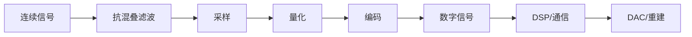

# 📏 采样、量化与数字化知识地图

> [!abstract] 核心问题
> 连续信号如何变成计算机能处理的数字序列？采样会丢失什么，量化会引入什么，过采样为什么能换精度？
> 一句话主线：**采样把时间离散化（频谱周期延拓），量化把幅度离散化（引入量化噪声），编码把符号变成比特；抗混叠、量化噪声和时钟抖动是三个主要误差源。**

## 一、前置知识

| 前置 | 为什么需要 | 入口 |
| --- | --- | --- |
| 傅里叶/频谱 | 采样后的频谱周期延拓、混叠 | [[vault-notes/maps/fourier-analysis-map]] |
| 信号与系统 | 理想采样、重建滤波器 | [[vault-notes/dsp/01-discrete-time-systems]] |
| 概率与噪声 | 量化误差建模、SQNR | [[vault-notes/random-signals/01-random-variables-distributions]]、[[vault-notes/random-signals/10-adc-sampling-quantization-noise]] |
| 滤波器 | 抗混叠/抗镜像 | [[vault-notes/dsp/07-fir-filter-design]] |

## 二、数字化链

## 三、核心概念

| 概念 | 一句话解释 | 入口 |
| --- | --- | --- |
| 采样定理 | 带限信号 $f_s\ge2f_H$ 时可无失真重建 | [[vault-notes/dsp/01-discrete-time-systems]] |
| 奈奎斯特率 | 最低无混叠采样率 $2f_H$ | [[vault-notes/dsp/01-discrete-time-systems]] |
| 混叠 | 高于 $f_s/2$ 的成分折回低频 | [[vault-notes/dsp/01-discrete-time-systems]] |
| 抗混叠滤波 | 采样前压低 $f_s/2$ 以上成分 | [[vault-notes/dsp/07-fir-filter-design]] |
| 量化 | 把连续幅度映射到有限电平 | [[vault-notes/random-signals/10-adc-sampling-quantization-noise]] |
| 量化噪声 | 量化误差的统计模型，近似均匀分布 | [[vault-notes/random-signals/10-adc-sampling-quantization-noise]] |
| SQNR | 信号功率与量化噪声功率之比 | [[vault-notes/random-signals/10-adc-sampling-quantization-noise]] |
| 过采样 | $f_s\gg2f_H$，用带宽换 SQNR | [[vault-notes/random-signals/10-adc-sampling-quantization-noise]] |
| 抖动/dither | 用随机化改善量化误差相关性 | [[vault-notes/random-signals/10-adc-sampling-quantization-noise]] |
| 抽取/插值 | 数字域降/升采样率 | [[vault-notes/dsp/08-multirate-sampling]] |

## 四、三个误差源

| 误差源 | 产生原因 | 典型对策 |
| --- | --- | --- |
| 混叠 | 采样率不足或抗混叠滤波器不理想 | 提高 $f_s$、加抗混叠滤波 |
| 量化噪声 | 幅度离散化 | 增加位数、过采样、dither |
| 时钟抖动 | 采样时刻不确定 | 低抖动时钟、差分时钟、合理布线 |

> [!warning] 采样定理的“带限”前提
> 采样定理要求信号严格带限。实际信号总有带外噪声，所以**采样前必须抗混叠**；否则带外噪声会折回带内，后续数字滤波无法去除。

## 五、关键公式

| 公式 | 说明 | 入口 |
| --- | --- | --- |
| $f_s\ge2f_H$ | 奈奎斯特采样条件 | [[vault-notes/dsp/01-discrete-time-systems]] |
| $\mathrm{SQNR}\approx6.02n+1.76\ \mathrm{dB}$ | $n$ 位均匀量化、满幅正弦 | [[vault-notes/random-signals/10-adc-sampling-quantization-noise]] |
| $\mathrm{SQNR}_{os}\approx6.02n+1.76+10\log_{10}(f_s/(2f_H))$ | 过采样增益 | [[vault-notes/random-signals/10-adc-sampling-quantization-noise]] |
| $P_q=\Delta^2/12$ | 均匀量化噪声功率（$\Delta$ 为量化步长） | [[vault-notes/random-signals/10-adc-sampling-quantization-noise]] |
| $S_Y=\lvert H\rvert^2S_X$ | 抗混叠/重建滤波后的谱 | [[vault-notes/random-signals/06-input-output-psd-relation]] |

## 六、工程应用

- **ADC/DAC**：采样率、位数、SNR、ENOB，见 [[vault-notes/random-signals/10-adc-sampling-quantization-noise]]。
- **软件无线电**：中频采样 → 数字混频 → 抽取 → 基带，见 [[vault-notes/fpga/ad9361/iq-signals]]、[[vault-notes/fpga/ad9361/ad9361-architecture]]。
- **5G**：宽带信号、BWP、采样率与 FFT 尺寸，见 [[vault-notes/5g/protocols/04-nr-standard-specifications]]、[[vault-notes/5g/phy/04-physical-channels-signals]]。
- **数字通信**：PCM、量化信噪比、BER，见 [[vault-notes/communication/10-source-coding]]、[[vault-notes/random-signals/10-bpsk-qam-ber]]。

## 七、实验与项目

- [[vault-notes/random-signals/10-adc-sampling-quantization-noise]]：SQNR、位数、过采样。
- [[vault-notes/random-signals/11-white-noise-through-filter]]：抗混叠/重建滤波。
- [[vault-notes/fpga/ad9361/iq-signals-lab-matlab-rtl]]：数字中频/基带与定点化。
- [[vault-notes/5g/engineering-simulation/02-signal-tower-practice]]：工程采样/传输参数。

## 八、学习顺序

1. 傅里叶/频谱 → 采样定理与混叠（[[vault-notes/maps/fourier-analysis-map]]、[[vault-notes/dsp/01-discrete-time-systems]]）。
2. 量化与 SQNR → 过采样/dither（[[vault-notes/random-signals/10-adc-sampling-quantization-noise]]）。
3. 抗混叠/重建滤波（[[vault-notes/dsp/07-fir-filter-design]]）。
4. 多抽样率 → DDC/DUC（[[vault-notes/dsp/08-multirate-sampling]]）。
5. IQ/AD9361 与 5G 空口（[[vault-notes/fpga/ad9361/iq-signals]]、[[vault-notes/5g/phy/04-physical-channels-signals]]）。

## 九、尚未学习/待补

- Sigma-Delta ADC 的噪声整形。
- 时间交织 ADC 的失配与校准。
- 采样时钟抖动对 SNR/EVM 的定量影响。
- 压缩感知/非均匀采样。

## 关联
- 首页：首页｜总图：电子信息工程知识总图
- 相关 MOC：[[vault-notes/maps/fourier-analysis-map]]｜[[vault-notes/maps/linear-systems-filtering-map]]｜[[vault-notes/maps/digital-communication-map]]
- 硬件：[[vault-notes/fpga/00-guide]]｜[[vault-notes/fpga/ad9361/ad9361-digital-interface]]
- 全库总纲：00_全库理论知识点综合与联系
