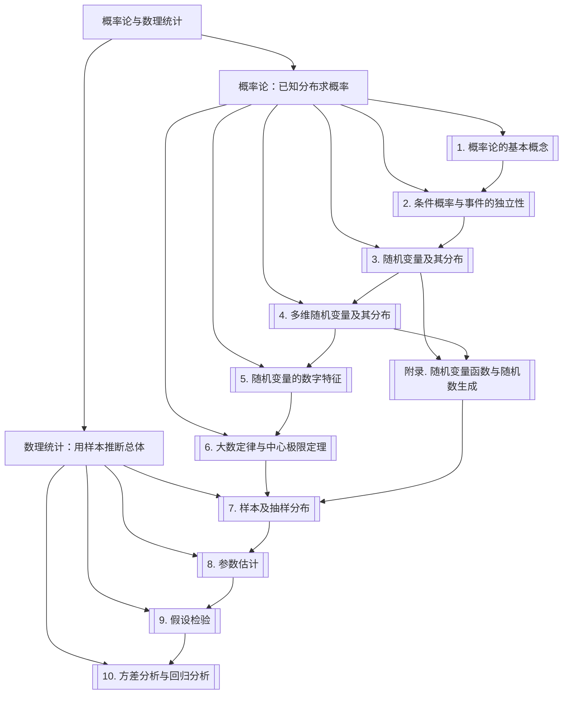

# 📊 概率论与数理统计知识库总导读

> [!abstract] 📌 核心导读
> 本文件夹按《概率论与数理统计》的课程体系整理 **10 章 + 1 个附录**。
> 全书分两条主线：
> - **概率论（第 1–6 章）**：已知分布，求概率。从事件与公理出发，经过随机变量、多维随机变量、数字特征，最后用大数定律与中心极限定理回答"大量重复会怎样"。
> - **数理统计（第 7–10 章）**：只看到样本，反推总体。从抽样分布出发，做参数估计、假设检验、方差分析与回归分析。
>
> 一句话主线：**概率论是"由因到果"——已知分布算概率；数理统计是"由果溯因"——用样本推断分布。两者在"抽样分布"处接上。**

---

## 一、全书知识体系全景图

---

## 二、各章导航与核心考点

### 🟢 概率论：已知分布求概率（第 1–6 章）

| 章 | 笔记 | 核心考点 |
| --- | --- | --- |
| 1 | [[vault-notes/math/probability/01-basic-concepts]] | 随机试验、样本空间、事件运算、概率公理、古典/几何概型 |
| 2 | [[vault-notes/math/probability/02-conditional-probability-independence]] | 条件概率、乘法公式、全概率公式、贝叶斯公式、独立性、伯努利概型 |
| 3 | [[vault-notes/math/probability/03-random-variables-distributions]] | 分布律、分布函数、概率密度、常见分布、随机变量函数的分布 |
| 4 | [[vault-notes/math/probability/04-multivariate-random-variables]] | 联合/边缘/条件分布、独立性、二维正态、卷积、雅可比 |
| 5 | [[vault-notes/math/probability/05-numerical-characteristics]] | 期望、方差、协方差、相关系数、矩、协方差矩阵 |
| 6 | [[vault-notes/math/probability/06-law-of-large-numbers-clt]] | 切比雪夫不等式、伯努利/辛钦大数定律、Lindeberg–Levy CLT |

### 🔵 数理统计：用样本推断总体（第 7–10 章）

| 章 | 笔记 | 核心考点 |
| --- | --- | --- |
| 7 | [[vault-notes/math/probability/07-samples-sampling-distributions]] | 总体/样本/统计量、$\bar X$ 与 $S^2$、$\chi^2$/$t$/$F$ 分布、分位数 |
| 8 | [[vault-notes/math/probability/08-parameter-estimation]] | 矩估计、极大似然、无偏/有效/相合、置信区间、样本量 |
| 9 | [[vault-notes/math/probability/09-hypothesis-testing]] | 两类错误、$z$/$t$/$\chi^2$/$F$ 检验、$p$ 值、拟合优度 |
| 10 | [[vault-notes/math/probability/10-anova-regression]] | 单因素 ANOVA、平方和分解、一元线性回归、$R^2$、预测区间 |

### 🟠 附录

| 附录 | 内容 |
| --- | --- |
| [[vault-notes/math/probability/appendix-random-variable-functions]] | 卷积/雅可比/顺序统计量；逆变换/舍选/Box–Muller/Cholesky；通信仿真与蒙特卡洛 |

---

## 三、全书主线逻辑（一句话串起 10 章）

> [!tip] 🧠 主线记忆
> **概率论**：事件（第 1 章）→ 条件与独立（第 2 章）→ 随机变量（第 3 章）→ 多维随机变量（第 4 章）→ 数字特征（第 5 章）→ 极限定理（第 6 章）。
> **数理统计**：样本与抽样分布（第 7 章）→ 参数估计（第 8 章）→ 假设检验（第 9 章）→ 方差分析与回归（第 10 章）。
> **连接点**：第 6 章的中心极限定理解释"为什么样本均值近似正态"，第 7 章的抽样分布则给出 $\bar X$、$S^2$ 的精确分布——统计推断的全部公式都从这里长出来。

---

## 四、与其他知识库的联系

- **通信原理**：[[vault-notes/communication/03-random-processes]]（噪声的随机过程模型）、[[vault-notes/communication/04-channel]]（瑞利/莱斯/对数正态衰落）、[[vault-notes/communication/07-digital-bandpass]]（误码率与 $Q$ 函数）、[[vault-notes/communication/09-optimal-reception]]（最大似然与判决）。
- **线性代数**：[[vault-notes/math/linear-algebra/06-eigenvalues-eigenvectors]]（协方差矩阵的特征分解）、[[vault-notes/math/linear-algebra/11-numerical-linear-algebra]]（Cholesky 分解）、[[vault-notes/math/linear-algebra/04-orthogonality]]（最小二乘的投影解释）。
- **数字信号处理**：[[vault-notes/dsp/02-z-transform-and-dtft]]（随机信号的频谱）、[[vault-notes/dsp/04-fast-fourier-transform]]（蒙特卡洛与频谱估计）。
- **5G**：[[vault-notes/5g/phy/04-physical-channels-signals]]（MIMO 信道协方差、信道估计、SNR 估计）。
- **Matlab**：[[vault-notes/matlab/matlab-notes]]（`normrnd`/`mvnrnd`/`mean`/`var`/`cov`/`ttest`/`anova1`/`fitlm` 等）。

---

## 五、建议的三种打开方式

| 目标 | 路线 |
| --- | --- |
| **系统学概率论** | 第 1 章 → 第 2 章 → 第 3 章 → 第 4 章 → 第 5 章 → 第 6 章 |
| **系统学数理统计** | 第 7 章 → 第 8 章 → 第 9 章 → 第 10 章 |
| **考前冲刺** | 每章末尾的「本章知识地图」+ 例题；重点看第 3、5、7、8、9 章的分布与检验表 |
| **做通信仿真** | [[vault-notes/math/probability/appendix-random-variable-functions]] → 第 6 章（CLT）→ 第 7 章（抽样分布）→ 第 8 章（参数估计） |

> [!tip] 三种打开方式（快捷入口）
> - 想**系统学**：从 [[vault-notes/math/probability/01-basic-concepts]] 顺着每章末尾的"下一章"逐章推进。
> - 想**查分布**：直接看 [[vault-notes/math/probability/03-random-variables-distributions]] 的「常见分布」与「分布一览」。
> - 想**做统计推断**：直接看 [[vault-notes/math/probability/07-samples-sampling-distributions]] 的抽样分布总表，再进入 [[vault-notes/math/probability/08-parameter-estimation]] / [[vault-notes/math/probability/09-hypothesis-testing]]。

> [!tip] 继续深入：随机信号处理
> 概率论学完后，进入 [[vault-notes/random-signals/00-knowledge-map|随机信号处理]]：随机过程、相关函数、功率谱、估计与检测，以及 MATLAB 实验。

---

## 六、学习顺序与前置关系

| 章节 | 前置 |
| --- | --- |
| 1–2 | 无（集合论基础即可） |
| 3 | 第 1–2 章 |
| 4 | 第 3 章 |
| 5 | 第 3–4 章 |
| 6 | 第 5 章（期望、方差） |
| 7 | 第 3–6 章（分布、数字特征、CLT） |
| 8 | 第 7 章（抽样分布） |
| 9 | 第 7–8 章（抽样分布、区间估计） |
| 10 | 第 7–9 章（抽样分布、F 检验） |
| 附录 | 第 3–4 章（可独立阅读） |
