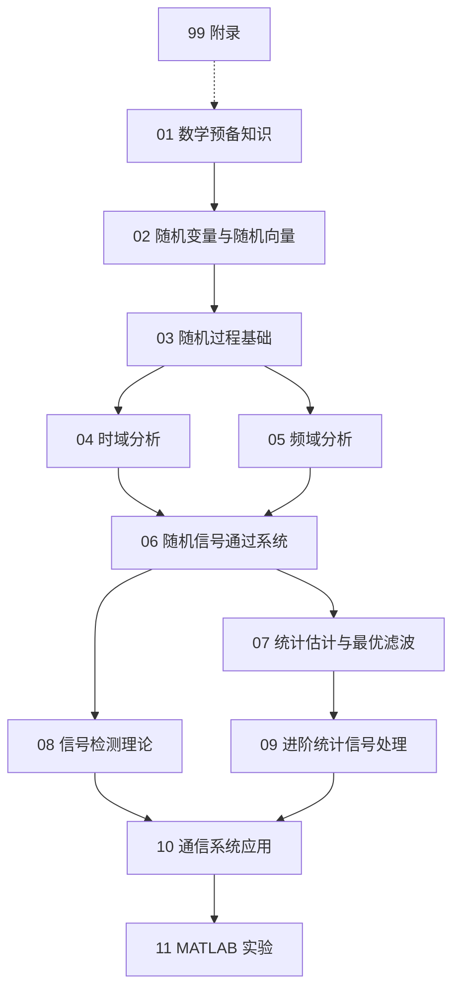

# 🧭 随机信号处理知识地图

> [!abstract] 这个子库在讲什么
> 随机信号处理研究的是：**当信号和噪声都只能用概率分布描述时，如何提取信息、设计系统、做估计与判决。**
> 全库分两条主线：
> - **理论线**：概率基础 → 随机变量/向量 → 随机过程 → 时域/频域分析 → 通过系统 → 估计与检测。
> - **落地线**：通信系统应用（AWGN、ADC、误码率、接收机）→ MATLAB 实验 → 公式/易错点/错题附录。
> 一句话主线：**先学会描述随机性，再学会在随机性里做最优决策。**

## 一、模块地图



## 二、模块索引

| 模块 | 核心问题 | 关键工具 | 入口 |
| --- | --- | --- | --- |
| 01 数学预备知识 | 概率、矩阵、傅里叶与线性系统够不够用？ | 概率公理、贝叶斯、矩阵、CTFT/DTFT | [[vault-notes/random-signals/01-probability-basics]] |
| 02 随机变量与随机向量 | 如何用均值、方差、协方差描述随机性？ | 期望、协方差矩阵、高斯向量、复随机变量 | [[vault-notes/random-signals/02-expectation-variance]] |
| 03 随机过程基础 | 随机信号随时间是怎样的过程？ | 均值/相关函数、平稳性、各态历经、白噪声 | [[vault-notes/random-signals/03-definition-and-sample-functions]] |
| 04 时域分析 | 如何从相关函数看信号结构？ | 自相关、互相关、相关函数性质、样本估计 | [[vault-notes/random-signals/04-autocorrelation-autocovariance]] |
| 05 频域分析 | 随机信号的功率如何分布？ | PSD、维纳-辛钦、互谱、周期图/Welch | [[vault-notes/random-signals/05-power-spectral-density]] |
| 06 通过系统 | 随机信号经过 LTI 系统后怎么变？ | 卷积、$S_Y=\lvert H\rvert^2S_X$、噪声带宽 | [[vault-notes/random-signals/06-random-process-lti-systems]] |
| 07 估计与最优滤波 | 怎样从含噪观测中估计参数/信号？ | MLE、LS、MMSE/LMMSE、Wiener、Kalman | [[vault-notes/random-signals/07-estimator-bias-variance]] |
| 08 信号检测理论 | 怎样在假设之间做最优判决？ | 似然比、Neyman-Pearson、ROC、匹配滤波 | [[vault-notes/random-signals/08-hypothesis-testing]] |
| 09 进阶统计信号处理 | 如何建模和自适应处理非白信号？ | ARMA、参数化谱估计、LMS、RLS | [[vault-notes/random-signals/09-ar-ma-arma-modeling]] |
| 10 通信系统应用 | 这些理论在通信里怎么落地？ | AWGN、ADC 量化、BER、SNR、接收机 | [[vault-notes/random-signals/10-awgn-channel]] |
| 11 MATLAB 实验 | 如何用仿真验证公式？ | `randn`、`xcorr`、`pwelch`、`filter`、BER 仿真 | [[vault-notes/random-signals/11-gaussian-noise-distribution]] |
| 99 附录 | 考前/工程速查用什么？ | 公式表、易混概念、错题记录 | [[vault-notes/random-signals/99-formula-cheatsheet]] |

## 三、四条学习路线

### 路线 1：通信/信号处理方向（推荐）

```
01 概率与矩阵 → 02 随机变量/向量 → 03 随机过程
→ 04/05 时域与频域 → 06 通过系统
→ 07 估计与滤波 → 08 检测 → 10 通信应用 → 11 MATLAB
```

重点：把 [[vault-notes/random-signals/10-awgn-channel]]、[[vault-notes/random-signals/10-bpsk-qam-ber]]、[[vault-notes/random-signals/08-matched-filter-detection]] 与 [[vault-notes/communication/09-optimal-reception]]、[[vault-notes/communication/07-digital-bandpass]] 对照。

### 路线 2：考研/理论

```
01 → 02 → 03 → 04 → 05 → 06
（07/08 选读，09 作为扩展）
```

重点：定义、性质、推导与反例；每章先背定义，再做“判断 + 计算 + 证明”三类题。

### 路线 3：工程/算法

```
02 高斯向量 → 05 PSD → 06 系统 → 07 Wiener/Kalman
→ 09 ARMA/LMS/RLS → 11 MATLAB
```

重点：[[vault-notes/random-signals/07-wiener-filter]]、[[vault-notes/random-signals/07-kalman-filter]]、[[vault-notes/random-signals/09-adaptive-filter-lms]]、[[vault-notes/random-signals/05-psd-numerical-estimation]]。

### 路线 4：实验/验证

```
11 MATLAB 六个实验 → 05/07/10 对应理论
```

重点：每个实验都要做“理论曲线 + 仿真曲线”的对比，而不是只跑通代码。

## 四、和本库其他文件夹的接口

| 本库模块 | 已有笔记 | 接口 |
| --- | --- | --- |
| 概率基础 | [[vault-notes/math/probability/03-random-variables-distributions]]、[[vault-notes/math/probability/04-multivariate-random-variables]]、[[vault-notes/math/probability/05-numerical-characteristics]] | 分布、期望、方差、协方差 |
| 随机过程 | [[vault-notes/communication/03-random-processes]] | 平稳性、各态历经、窄带高斯 |
| 信号与系统 | [[vault-notes/dsp/01-discrete-time-systems]]、[[vault-notes/dsp/02-z-transform-and-dtft]] | 卷积、LTI、频响 |
| 频域分析 | [[vault-notes/dsp/03-discrete-fourier-transform]]、[[vault-notes/dsp/04-fast-fourier-transform]] | DFT/FFT、谱估计 |
| 滤波器 | [[vault-notes/dsp/05-filter-structures]]、[[vault-notes/dsp/07-fir-filter-design]] | FIR/IIR、匹配滤波 |
| 通信原理 | [[vault-notes/communication/04-channel]]、[[vault-notes/communication/09-optimal-reception]]、[[vault-notes/communication/07-digital-bandpass]] | 噪声、最佳接收、误码率 |
| 线性代数 | [[vault-notes/math/linear-algebra/06-eigenvalues-eigenvectors]]、[[vault-notes/math/linear-algebra/07-singular-value-decomposition]]、[[vault-notes/math/linear-algebra/10-applications]] | 协方差矩阵、投影、最小二乘 |
| 复变/变换 | [[vault-notes/math/complex-analysis/07-fourier-transform]]、[[vault-notes/math/complex-analysis/08-laplace-transform]] | 傅里叶/拉氏变换 |
| 工程实现 | [[vault-notes/fpga/ad9361/iq-signals]]、[[vault-notes/matlab/matlab-notes]]、[[vault-notes/fpga/00-guide]] | IQ、仿真、定点实现 |
| 全库总纲 | 00_全库理论知识点综合与联系 | 七条横向连接与六条主线 |

## 五、使用约定

1. 先读 [[vault-notes/random-signals/00-math-symbols]]，全库的 $X(t)$、$R_X(\tau)$、$S_X(\omega)$ 都按那一页的约定。
2. 每篇笔记末尾都有“关联”，至少给出上一节/下一节和 2 条跨库链接。
3. 公式优先用 `$$...$$`；表格里的 wikilink 别名用 `\|` 转义。
4. 实验笔记以 MATLAB 代码 + 理论曲线对照为主，不堆命令。
5. 课程作业的解析并入各篇主笔记的「六、作业题解析」小节，先自己做再对照；原始截图与题号索引见 作业截图。

## 关联

- 课程与教材：[[vault-notes/random-signals/00-course-index]]
- 公式速查：[[vault-notes/random-signals/99-formula-cheatsheet]]
- 易混概念：[[vault-notes/random-signals/99-easily-confused-concepts]]
- 错题记录：[[vault-notes/random-signals/99-mistakes-and-questions]]
- 作业题索引：作业截图
- 全库总纲：00_全库理论知识点综合与联系
