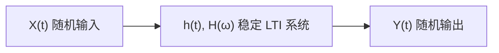

# 随机过程与LTI系统

> [!abstract] 这一节在讲什么
> 随机信号经过线性时不变系统后，输出仍然是随机的；我们关心它的均值、相关函数和功率谱如何由输入与系统决定。
> 本节建立输入输出卷积模型，说明输出为宽平稳所需的条件（系统稳定、输入宽平稳、零初始状态），并给出频率响应的存在性。
> 这些假设是后续 [[vault-notes/random-signals/06-output-mean-autocorrelation]] 与 [[vault-notes/random-signals/06-input-output-psd-relation]] 的前提。

## 一、输入输出卷积

> [!info] 定义 1 随机过程通过 LTI 系统
> 设系统冲激响应为 $h(t)$（离散为 $h[n]$），输入 $X(t)$ 是随机过程，输出定义为
> $$Y(t)=\int_{-\infty}^{\infty}h(\tau)X(t-\tau)\,\mathrm{d}\tau=(h*X)(t)$$
> 离散形式为
> $$Y[n]=\sum_{k=-\infty}^{\infty}h[k]X[n-k]=(h*X)[n]$$

对每个固定的 $t$，$Y(t)$ 是输入样本函数的线性泛函，因此仍是随机变量。积分（或求和）要按**均方意义**理解：先用有限支撑近似，再取均方极限。

> [!tip] 与确定性卷积的区别
> 确定性卷积算的是一条波形；随机卷积算的是"所有样本函数一起做同一个线性变换"。因为变换是线性的，期望可以穿过卷积，这是后面所有公式的根源。

## 二、输出为宽平稳的条件

> [!info] 定义 2 输出 WSS 的条件
> 若满足以下四条，则输出 $Y(t)$ 是宽平稳的，且与 $X(t)$ 联合宽平稳：
> 1. $h(t)$ 是确定的、线性时不变的；
> 2. 系统 BIBO 稳定：$\int_{-\infty}^{\infty}\lvert h(t)\rvert\,\mathrm{d}t<\infty$（离散为 $\sum\lvert h[n]\rvert<\infty$）；
> 3. 输入 $X(t)$ 宽平稳，且 $E[\lvert X(t)\rvert^2]<\infty$；
> 4. 系统零初始状态，输入从 $t=-\infty$ 起作用。

为什么需要稳定性？卷积是无穷多个输入值的加权和，只有权重绝对可和，输出的二阶矩才不会被放大到无穷。若 $h$ 不稳定，即使输入有界，输出也可能发散。

| 条件 | 作用 | 不满足时的后果 |
| --- | --- | --- |
| $h$ 确定且 LTI | 可用卷积与频响 | 时变系统需 $h(t,\tau)$，不能只用 $H(\omega)$ |
| $h$ 绝对可积 | 输出二阶矩有限 | 积分器、不稳定系统输出可能非平稳 |
| $X$ 宽平稳 | 均值、相关不随 $t$ 变 | 非平稳输入使输出非平稳 |
| 零初始状态 | 输出只由输入决定 | 暂态使输出在开始阶段非平稳 |
| 均方收敛 | 期望与积分可交换 | 奇异输入需广义过程 |

> [!warning] 稳定与"物理可实现"不是一回事
> 因果性（$h(t)=0,t<0$）只影响能否实时实现；稳定性（绝对可积）才决定输出是否宽平稳。一个因果但不稳定的系统（如 $h(t)=e^{t}u(t)$）仍然会让输出发散。

## 三、频率响应与系统函数

> [!info] 定义 3 频率响应
> 对稳定系统，频率响应为
> $$H(\omega)=\int_{-\infty}^{\infty}h(t)e^{-j\omega t}\,\mathrm{d}t,\qquad H(e^{j\omega})=\sum_{n=-\infty}^{\infty}h[n]e^{-j\omega n}$$
> 它存在、连续、有界，且 $\lvert H(\omega)\rvert\le\int\lvert h(t)\rvert\,\mathrm{d}t$。离散系统的 $H(e^{j\omega})$ 以 $2\pi$ 为周期。

频率响应描述"系统对各频率复指数的增益与相移"。对随机信号，单个频率的相位没有意义，但 $\lvert H(\omega)\rvert^2$ 会直接乘到功率谱上，相位则影响互谱与波形。

| 系统 | $h(t)$ | $H(\omega)$ | 稳定性 |
| --- | --- | --- | --- |
| 纯时延 | $\delta(t-D)$ | $e^{-j\omega D}$ | 稳定，$\lvert H\rvert=1$ |
| RC 低通 | $\frac{1}{RC}e^{-t/(RC)}u(t)$ | $\frac{1}{1+j\omega RC}$ | 稳定 |
| 双边指数 | $\frac{1}{2T}e^{-\lvert t\rvert/T}$ | $\frac{1}{1+(\omega T)^2}$ | 稳定但非因果 |
| 积分器 | $u(t)$ | $\frac{1}{j\omega}+\pi\delta(\omega)$ | 不绝对可积 |
| 微分器 | $\delta'(t)$ | $j\omega$ | 不稳定（对白噪声） |

> [!example] 例 1 积分器把白噪声变成随机游走
> 设 $X(t)$ 为零均值白噪声（双边谱 $N_0/2$），$h(t)=u(t)$，从 $t=0$ 起接入，则 $Y(t)=\int_0^tX(s)\,\mathrm{d}s$。虽然每个 $Y(t)$ 的均值仍为 0，但
> $$\mathrm{Var}[Y(t)]=\frac{N_0}{2}t$$
> 随 $t$ 增长，$Y(t)$ 不是宽平稳的。原因就是 $h$ 不绝对可积，不满足定理条件。

## 四、基本假设与两个例子

> [!example] 例 2 白噪声通过 RC 低通
> $H(\omega)=1/(1+j\omega RC)$，输入双边谱 $N_0/2$。输出均值 $\mu_Y=0$，自相关
> $$R_Y(\tau)=\frac{N_0}{4RC}e^{-\lvert\tau\rvert/(RC)}$$
> 输出是宽平稳的，且样本路径均方连续。这是"稳定系统 + 白噪声"的标准结果。

> [!example] 例 3 滑动平均
> $h[n]=\frac{1}{M}\sum_{k=0}^{M-1}\delta[n-k]$，输入为方差 $\sigma^2$ 的离散白噪声。输出
> $$R_Y[m]=\begin{cases}\frac{\sigma^2(M-\lvert m\rvert)}{M^2}, & \lvert m\rvert<M\\ 0, & \lvert m\rvert\ge M\end{cases}$$
> 输出功率为 $\sigma^2/M$。平均把噪声功率压小了 $M$ 倍，但样本之间出现了相关性，输出不再是白噪声。

> [!warning] 随机过程通过 LTI 的四个默认假设
> - 系统参数不随机：$h$ 是确定函数，不是随机过程；
> - 系统工作在零状态：不把初始储能当成额外随机源；
> - 输入从无穷远开始：忽略开机暂态；
> - 积分按均方收敛：不处理白噪声求导这类广义过程。

## 关联

- 上一节：[[vault-notes/random-signals/05-psd-numerical-estimation]]
- 下一节：[[vault-notes/random-signals/06-output-mean-autocorrelation]]
- 导航：[[vault-notes/random-signals/00-knowledge-map]]、[[vault-notes/random-signals/00-math-symbols]]
- 跨库：[[vault-notes/dsp/01-discrete-time-systems]]、[[vault-notes/dsp/05-filter-structures]]、[[vault-notes/math/complex-analysis/08-laplace-transform]]、[[vault-notes/communication/03-random-processes]]
