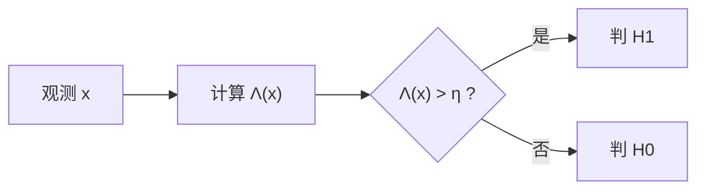

# 假设检验

> [!abstract] 这一节在讲什么
> 估计回答“参数是多少”，检测回答“信号在不在、属于哪一种”。本节把检测写成二元假设检验：观测服从 $H_0$ 或 $H_1$ 两个条件分布之一，判决规则把观测空间分成两块。核心工具是两类错误、Bayes 风险与似然比判决，最终把“最小平均错误概率”化成对 $\Lambda(x)$ 的门限比较。

## 一、从估计到判决

检测问题由三部分组成：可能的假设、观测的统计模型、判决规则。二元情形记为

$$H_0:\ \mathbf{x}\sim f(\mathbf{x}\mid H_0),\qquad H_1:\ \mathbf{x}\sim f(\mathbf{x}\mid H_1)$$

$H_0$ 称为原假设，通常表示“只有噪声”；$H_1$ 称为备择假设，通常表示“信号加噪声”。判决规则是一个映射 $\delta(\mathbf{x})\in\{H_0,H_1\}$，等价于把观测空间分成判决区域 $\mathcal{R}_0$ 与 $\mathcal{R}_1$。

> [!info] 定义 判决区域
> 使判决为 $H_1$ 的观测集合 $\mathcal{R}_1=\{\mathbf{x}:\delta(\mathbf{x})=H_1\}$ 称为**判决区域**，其补集 $\mathcal{R}_0$ 为判 $H_0$ 的区域。检测器的设计就是选择 $\mathcal{R}_1$。

## 二、两类错误

| 真实情况 \ 判决 | 判 $H_0$ | 判 $H_1$ |
| --- | --- | --- |
| $H_0$ 为真 | $1-P_{fa}$ | $P_{fa}$（虚警） |
| $H_1$ 为真 | $P_m$（漏检） | $P_d$（检测） |

> [!info] 定义 虚警概率与检测概率
> 虚警概率 $P_{fa}=P(\text{判 }H_1\mid H_0)=\int_{\mathcal{R}_1}f(\mathbf{x}\mid H_0)\,d\mathbf{x}$，检测概率 $P_d=P(\text{判 }H_1\mid H_1)=\int_{\mathcal{R}_1}f(\mathbf{x}\mid H_1)\,d\mathbf{x}$，漏检概率 $P_m=1-P_d$。

两类错误不可能同时任意小：把 $\mathcal{R}_1$ 扩大，$P_d$ 上升，$P_{fa}$ 也上升；缩小则相反。样本量固定时，二者存在此消彼长的关系，这正是 [[vault-notes/random-signals/08-roc-curve]] 要画出的权衡。工程上常把 $P_{fa}$ 控制在系统可接受的水平，再尽量提高 $P_d$。

> [!warning] “判 $H_1$”不是“证明 $H_1$”
> 判决只是基于有限观测做出的选择，总有犯错概率。报告结果时必须同时给出 $P_{fa}$ 与 $P_d$（或等价的门限与样本量），只说“检测到了”没有意义。

## 三、Bayes 风险与最小错误概率

给两类错误分配代价，得到 Bayes 风险：

$$R=\sum_{i=0}^{1}\sum_{j=0}^{1}C_{ij}P(H_j)P(\text{判 }H_i\mid H_j)$$

其中 $C_{ij}$ 是真实为 $H_j$ 却判 $H_i$ 的代价。若取均匀代价 $C_{01}=C_{10}=1$、$C_{00}=C_{11}=0$，风险退化为平均错误概率

$$P_e=\pi_0P_{fa}+\pi_1P_m,\qquad \pi_j=P(H_j)$$

> [!info] 定义 Bayes 判决
> 使 Bayes 风险最小的判决规则为
>
> $$\Lambda(\mathbf{x})=\frac{f(\mathbf{x}\mid H_1)}{f(\mathbf{x}\mid H_0)}\underset{H_0}{\overset{H_1}{\gtrless}}\eta,\qquad \eta=\frac{\pi_0(C_{10}-C_{00})}{\pi_1(C_{01}-C_{11})}$$

门限 $\eta$ 把先验与代价都吸收进来。等先验、均匀代价时 $\eta=1$，判决简化为“比较两个条件密度谁大”，即最大似然判决。

> [!tip] 门限的读法
> $\eta$ 大，意味着判 $H_1$ 的门槛高，只有似然比非常强才判有信号，虚警少但漏检多；$\eta$ 小则相反。改变 $\eta$ 就在 [[vault-notes/random-signals/08-roc-curve]] 上滑动工作点。

## 四、似然比判决规则

似然比 $\Lambda(\mathbf{x})$ 有两个重要性质：非负；在 $H_1$ 下通常取较大值。因此“似然比超过门限”是一个自然的判决形式，并且可以取对数把乘积变求和。对独立样本，

$$\ln\Lambda(\mathbf{x})=\sum_{n=1}^N\ln\frac{f(x_n\mid H_1)}{f(x_n\mid H_0)}$$

若 $\ln\Lambda$ 是某个统计量 $T(\mathbf{x})$ 的单调增函数，判决就等价于 $T(\mathbf{x})>\gamma$。这把高维观测压缩成一维统计量，是 [[vault-notes/random-signals/08-likelihood-ratio-test]] 与 [[vault-notes/random-signals/08-matched-filter-detection]] 的共同起点。

## 五、例子：高斯均值检测

设 $H_0$ 下 $x\sim\mathcal{N}(0,\sigma^2)$，$H_1$ 下 $x\sim\mathcal{N}(\mu,\sigma^2)$，$\mu>0$。似然比为

$$\Lambda(x)=\frac{\exp\left[-(x-\mu)^2/(2\sigma^2)\right]}{\exp\left[-x^2/(2\sigma^2)\right]}=\exp\left(\frac{\mu x}{\sigma^2}-\frac{\mu^2}{2\sigma^2}\right)$$

它随 $x$ 单调递增，所以判决规则等价于

$$x\underset{H_0}{\overset{H_1}{\gtrless}}\gamma,\qquad \gamma=\frac{\sigma^2}{\mu}\ln\eta+\frac{\mu}{2}$$

两类错误用 $Q(\cdot)$ 表示：

$$P_{fa}=Q\left(\frac{\gamma}{\sigma}\right),\qquad P_d=Q\left(\frac{\gamma-\mu}{\sigma}\right)$$

> [!example] 等先验、均匀代价
> 取 $\eta=1$，门限 $\gamma=\mu/2$，则 $P_{fa}=Q(\mu/(2\sigma))$，$P_d=Q(-\mu/(2\sigma))=1-Q(\mu/(2\sigma))$，平均错误概率
>
> $$P_e=\frac{1}{2}P_{fa}+\frac{1}{2}(1-P_d)=Q\left(\frac{\mu}{2\sigma}\right)$$
>
> 信噪比 $\mu/\sigma$ 越大，$P_e$ 越小。若 $\mu/\sigma=4$，则 $P_e=Q(2)\approx0.023$；要降到 $10^{-6}$ 量级，需要 $\mu/\sigma\approx9.5$。

## 关联

- 上一节：[[vault-notes/random-signals/07-kalman-filter]]（07 模块末篇）
- 下一节：[[vault-notes/random-signals/08-likelihood-ratio-test]]
- 导航：[[vault-notes/random-signals/00-knowledge-map]]、[[vault-notes/random-signals/00-math-symbols]]
- 跨库：[[vault-notes/math/probability/09-hypothesis-testing]]、[[vault-notes/math/probability/05-numerical-characteristics]]、[[vault-notes/5g/harq]]
