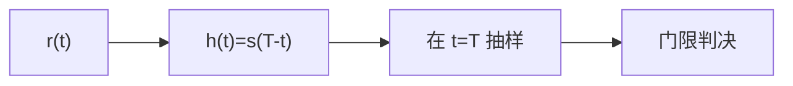

# 匹配滤波检测

> [!abstract] 这一节在讲什么
> 在加性白高斯噪声中检测一个已知波形，最优线性处理器是匹配滤波器：它的冲激响应是信号的时间反转，抽样时刻的输出信噪比达到 $2E/N_0$。本节从匹配滤波器定义与 SNR 推导出发，说明它与相关接收的等价性，并把它落到 BPSK 检测与 [[vault-notes/communication/09-optimal-reception]] 的对照上。

## 一、匹配滤波器的定义

> [!info] 定义 匹配滤波器
> 对已知信号 $s(t)$、$0\le t\le T$，匹配滤波器的冲激响应与频率响应为
>
> $$h(t)=s(T-t),\qquad H(\omega)=S^*(\omega)e^{-j\omega T}$$

$h(t)$ 是 $s(t)$ 的时间反转并平移 $T$，因此只有在 $T$ 大于信号持续时间时才是因果的。$H(\omega)$ 的相位与信号谱共轭抵消，使信号各频率分量在 $t=T$ 时刻同相叠加。

> [!tip] 名字的由来
> “匹配”指滤波器与信号波形匹配：信号频谱的每个分量都被乘以它的共轭，相位对齐、幅度按噪声分布加权。白噪声下权重相同，于是 $H$ 正比于 $S^*$；有色噪声下要先白化，再做匹配。

## 二、输出信噪比 $2E/N_0$

设输入为 $r(t)=s(t)+n(t)$，$n(t)$ 是双边功率谱为 $N_0/2$ 的白噪声。抽样时刻的信号输出为

$$y_s(T)=\int_{-\infty}^{\infty}s(t)h(T-t)\,dt=\int_0^T s^2(t)\,dt=E$$

噪声输出功率为

$$\sigma_n^2=\frac{N_0}{2}\int_{-\infty}^{\infty}h^2(t)\,dt=\frac{N_0}{2}E$$

因此输出信噪比为

$$\mathrm{SNR}_{out}=\frac{y_s^2(T)}{\sigma_n^2}=\frac{E^2}{N_0E/2}=\frac{2E}{N_0}$$

> [!info] 定理 匹配滤波的最优性
> 在所有线性时不变滤波器中，匹配滤波器使 $t=T$ 时刻的输出信噪比最大，最大值为 $2E/N_0$。由柯西-施瓦茨不等式，信号输出满足 $y_s(T)\le\sqrt{E\int\lvert h\rvert^2dt}$，等号在 $h(t)\propto s(T-t)$ 时成立，此时信噪比达到上界。

注意 $2E/N_0$ 与信号形状无关，只取决于能量与噪声谱密度。把能量做大、把噪声压低，是提高检测性能的两条根本途径；改变波形形状只能改善时延分辨、抗干扰等次要指标。

> [!warning] 最大 SNR 不等于最小 MSE
> 匹配滤波器在抽样时刻最大化 SNR，但它的输出波形相对原信号有失真，均方误差未必小。若目标是波形恢复，应使用 [[vault-notes/random-signals/07-wiener-filter]]；若目标是判决，匹配滤波才是对的工具。

## 三、相关接收的等价形式

匹配滤波的输出在 $t=T$ 时刻可以写成内积：

$$y(T)=\int_0^T r(t)s(t)\,dt$$

这正是“把接收信号与本地模板相乘再积分”的相关接收机。两者数学上完全等价：匹配滤波是卷积实现，相关接收是内积实现；前者适合模拟前端流式处理，后者适合数字信号处理。

| 实现方式 | 运算 | 优点 | 缺点 |
| --- | --- | --- | --- |
| 匹配滤波 | 卷积 $r*h$，在 $T$ 抽样 | 可流式、连续输出 | 需要知道信号结束时刻 |
| 相关接收 | 乘加积分 $\int r s$ | 结构直观、易数字化 | 需要严格同步的本地模板 |

对离散时间信号，相关接收退化为 $z=\sum_{n=0}^{N-1}r_ns_n$，匹配滤波器系数为 $h_n=s_{N-1-n}$，两者只差一个索引反转。

## 四、AWGN 下的 BPSK 检测

BPSK 的两个波形为 $s_1(t)=+s(t)$、$s_0(t)=-s(t)$，每比特能量 $E_b=E$。接收信号为 $r(t)=s_i(t)+n(t)$，用匹配滤波器得到判决量 $z$。

在 $H_1$ 下 $z\sim\mathcal{N}(E,N_0E/2)$，在 $H_0$ 下 $z\sim\mathcal{N}(-E,N_0E/2)$。门限取 0 时，

$$P_e=Q\left(\frac{E}{\sqrt{N_0E/2}}\right)=Q\left(\sqrt{\frac{2E_b}{N_0}}\right)$$

> [!example] 与通信原理的记号换算
> 通信原理用单边谱密度 $n_0$ 表示，误码率写作 $P_e=\frac{1}{2}\mathrm{erfc}\sqrt{E_b/n_0}$。利用 $Q(x)=\frac{1}{2}\mathrm{erfc}(x/\sqrt{2})$，两种写法完全一致。若 $E_b/N_0=9.6$ dB（约 9.12），则 $\sqrt{2E_b/N_0}\approx4.27$，$P_e\approx10^{-5}$。

| 项目 | 本库（统计检测） | [[vault-notes/communication/09-optimal-reception|最佳接收]] |
| --- | --- | --- |
| 噪声记号 | $N_0$ 为单边谱密度 | $n_0$ 为单边谱密度 |
| 判决准则 | NP / Bayes / 最大似然 | 最小差错概率 / MAP / ML |
| 核心运算 | 相关或匹配滤波 | 相关接收或匹配滤波 |
| BPSK 误码 | $Q(\sqrt{2E_b/N_0})$ | $\frac{1}{2}\mathrm{erfc}\sqrt{E_b/n_0}$ |
| 适用条件 | 已知波形、白高斯噪声 | 确知信号、AWGN |

## 五、从“已知波形”到实际系统

匹配滤波的 $2E/N_0$ 是理论天花板，实际系统会在几处损失：定时误差使抽样点偏离 $T$，输出 SNR 按自相关旁瓣下降；载波频偏与多普勒使模板失配；多径造成符号间干扰；噪声有色时匹配滤波不再最优，需要先白化。

> [!warning] 三个常见误用
> 一是把匹配滤波器直接用于未知到达时刻的信号，正确做法是滤波器组或滑动相关搜索；二是在色噪声下仍用 $h=s(T-t)$，正确做法是“白化 + 匹配”；三是把匹配滤波输出当作波形估计，实际上它只保证抽样时刻的 SNR 最大。

> [!example] 与最佳接收的分工
> [[vault-notes/communication/09-optimal-reception]] 从最小差错概率推出相关接收机，给出 2PSK、2FSK、2ASK 的误码率；本节从 SNR 最大化推出匹配滤波器，再证明它与相关接收等价。两条路径起点不同，终点相同：**AWGN 下已知信号的最佳检测 = 相关/匹配 + 门限判决**。

## 关联

- 上一节：[[vault-notes/random-signals/08-roc-curve]]
- 下一节：[[vault-notes/random-signals/09-ar-ma-arma-modeling]]（09 模块首篇）
- 导航：[[vault-notes/random-signals/00-knowledge-map]]、[[vault-notes/random-signals/00-math-symbols]]
- 跨库：[[vault-notes/communication/09-optimal-reception]]、[[vault-notes/communication/07-digital-bandpass]]、[[vault-notes/communication/04-channel]]、[[vault-notes/matlab/matlab-notes]]
