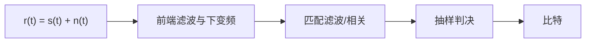

# 接收机检测

> [!abstract] 这一节在讲什么
> 接收机要在噪声里判断"刚才发的是哪一个波形"。最佳准则由似然比给出，工程实现则落在相关器或匹配滤波器加一个门限上。
> 核心结论：BPSK 的判决变量是 $z=\pm E_b+n$，等概时门限取 0，误码率 $P_b=Q(\sqrt{2E_b/N_0})$。
> 用途：解释接收机框图、灵敏度、同步误差的代价，并把检测理论与通信原理的"最佳接收"接起来。

## 一、接收机链路

前端滤波限制进入后级的噪声带宽，下变频把射频搬到基带，匹配滤波或相关器在符号末端给出信噪比最大的判决统计量，抽样后与门限比较。在给定信噪比的前提下，抽样时刻与门限是最直接决定误码率的两个参数。

> [!tip] 相关器与匹配滤波器是一回事
> 在抽样时刻 $T$，用 $s(t)$ 做相关与用 $h(t)=s(T-t)$ 做卷积的输出完全相同。相关器适合已知的有限长波形，匹配滤波器更适合连续流水的实现；两者都要求本地波形与发送波形对齐。

## 二、相关接收与匹配滤波

> [!info] 定义
> **相关接收**把接收信号与本地参考波形相乘后再积分：

$$
z=\int_0^T r(t)s(t)\,\mathrm dt
$$

若 $r(t)=s(t)+n(t)$，则信号分量为能量 $E$，噪声分量为零均值高斯，方差为

$$
\sigma_n^2=\frac{N_0}{2}\int_0^T s^2(t)\,\mathrm dt=\frac{N_0E}{2}
$$

于是输出信噪比为 $2E/N_0$。匹配滤波器 $h(t)=s(T-t)$ 给出同样的结果，而且可以证明它在所有线性滤波器中使抽样时刻的 SNR 最大：

$$
\mathrm{SNR_{out,max}}=\frac{2E}{N_0}
$$

> [!warning] 那个 2 从哪来
> 它来自双边谱 $N_0/2$。若把 $N_0$ 当成双边谱密度，输出噪声功率会写成 $N_0E$，最大 SNR 就变成 $E/N_0$，整体差 3 dB。套公式前先确认 $N_0$ 的定义。

## 三、BPSK 接收机与判决门限

BPSK 的两个波形是 $s_1(t)=+s(t)$ 与 $s_0(t)=-s(t)$，相关器输出只有两种可能：

$$
z=+E_b+n\quad\text{或}\quad z=-E_b+n,\qquad n\sim N\left(0,\frac{N_0E_b}{2}\right)
$$

等概、等能量时，似然比门限正好在 0：$z>0$ 判 1，$z<0$ 判 0。错误概率就是"发 $+E_b$ 却落到 0 以下"：

$$
P_b=Q\left(\frac{E_b}{\sqrt{N_0E_b/2}}\right)=Q\left(\sqrt{\frac{2E_b}{N_0}}\right)
$$

若门限偏移到 $b$，两侧错误概率不再相等：

$$
P_b=\frac12\left[Q\left(\frac{E_b-b}{\sigma_n}\right)+Q\left(\frac{E_b+b}{\sigma_n}\right)\right],\qquad
\sigma_n=\sqrt{\frac{N_0E_b}{2}}
$$

> [!tip] 门限什么时候不是 0
> 只在"等概、等能量、载波相位正确"时才是 0。先验不等时门限向大概率的假设偏移；有 AGC 误差或直流偏置时，门限也会被推歪，这时误码率对偏置非常敏感。

## 四、同步误差与对照

相干检测的前提是本地载波与发送载波同频同相。载波相位误差 $\varphi$ 会让信号分量乘 $\cos\varphi$，于是

$$
P_b(\varphi)=Q\left(\sqrt{\frac{2E_b}{N_0}}\cos\varphi\right)
$$

定时误差则让相关器只覆盖部分符号能量。矩形 NRZ 下若偏移 $\varepsilon T$，有效能量约乘 $(1-\varepsilon)^2$。

| 误差来源 | 一阶影响 | 工程对策 |
| --- | --- | --- |
| 载波相位 $\varphi$ | 有效 $E_b/N_0$ 乘 $\cos^2\varphi$ | PLL、导频、判决反馈 |
| 定时误差 $\varepsilon$ | 有效能量乘 $(1-\varepsilon)^2$ | 早迟门、Gardner 算法 |
| 载波频偏 $\Delta f$ | 符号内相位旋转，相关输出下降 | AFC、频偏估计 |

> [!example] 相位误差 20° 的代价
> $\cos20^\circ=0.940$，平方后为 0.883，折合 0.54 dB 损失。BPSK 在 $10^{-5}$ 处约需 9.6 dB，20° 相位误差会把它推到约 10.1 dB。相位误差到 30° 时损失约 1.25 dB，这就是载波恢复必须做好的原因。

与 [[vault-notes/communication/09-optimal-reception]] 对照，本笔记只是把它的结论落到 BPSK 的一条具体链路上；[[vault-notes/random-signals/08-matched-filter-detection]] 则从波形检测的角度给出了同一套相关/匹配滤波结构。

| 主题 | [[vault-notes/communication/09-optimal-reception|数字信号的最佳接收]] | 本笔记 |
| --- | --- | --- |
| 准则 | 最大似然、最小错误概率 | 同一准则，落到 BPSK |
| 结构 | 相关器或匹配滤波器 | 给出完整链路与抽样时刻 |
| 门限 | 似然比门限 | 等概时取 0，给出门限偏移的影响 |
| 误码率 | 2PSK 的相干误码率公式 | $Q(\sqrt{2E_b/N_0})$ 与数值 |
| 同步 | 通常假设理想同步 | 相位、定时、频偏的定量损失 |

## 关联

- 上一节：[[vault-notes/random-signals/10-snr-noise-bandwidth]]
- 下一节：[[vault-notes/random-signals/11-gaussian-noise-distribution]]（11 首篇）
- 导航：[[vault-notes/random-signals/00-knowledge-map]]、[[vault-notes/random-signals/00-math-symbols]]
- 跨库：[[vault-notes/communication/09-optimal-reception]]、[[vault-notes/random-signals/08-matched-filter-detection]]、[[vault-notes/communication/13-synchronization]]、[[vault-notes/communication/07-digital-bandpass]]
